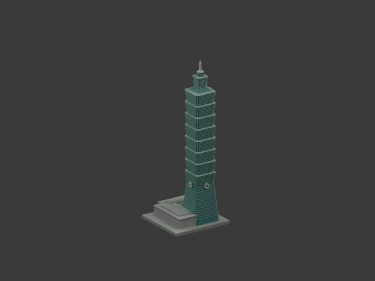

# 臺灣建築物 3D 模型

依地點整理的臺灣建築外觀模型集，收錄 **704 組模型／列印包**：國立聯合大學 42 組、國家衛生研究院竹南院區 9 組、臺灣各地地標 61 組，另收錄大專校院圖鑑的 592 組模型。模型套件數不等於獨立建築棟數，也不表示全校或全國完成。

全庫有 **114 所大專校院至少一套模型**，合計 **635 套校園相關模型**；另有 **69 套非高教模型**。大專校院圖鑑的新增目錄為113校／592套，另計國立聯合大學42套及東海大學路思義教堂1套；東海已在新增目錄中，校數不重複。國衛院9套與其餘地標60套不列入高教校數。

每個地點資料夾保留模型、可編輯原始檔、Blender 場景、實際模型預覽、來源說明與既有驗證資料。點選下方圖片，進入該地點的三欄建築圖鑑；個別模型的詳細資訊可展開查看。

## 依地點瀏覽

| 國立聯合大學 | 國家衛生研究院竹南院區 | 臺灣各地地標 |
| :---: | :---: | :---: |
|  **[國立聯合大學｜42 組](大專校院/國立聯合大學/README.md)** |  **[國衛院竹南院區｜9 組](國家衛生研究院竹南院區/README.md)** |  **[臺灣地標｜61 組](臺灣地標/README.md)** |

## 新增大專校院圖鑑

[瀏覽大專校院圖鑑與全國清冊](大專校院/README.md)

## 資料夾與使用方式

- [國立聯合大學/](大專校院/國立聯合大學/)：42 組校園模型位於 buildings/；研究目錄位於 docs/。
- [國家衛生研究院竹南院區/](國家衛生研究院竹南院區/)：9 組列印包位於 buildings/；範圍與證據限制位於 docs/。
- [臺灣地標/](臺灣地標/)：目錄收錄 61 組模型，含歸東海大學高教統計的路思義教堂 1 組；其餘 60 組不列入高教。各組保留原模型名稱與資料夾。
- 先進入地點資料夾，再依該資料夾 README 與個別模型說明操作。原說明中的相對路徑以其所在的地點／模型資料夾為準。
- 下載 STL 後，請自行使用切片軟體檢查；需要修改幾何或重新渲染時，使用各模型附帶的原始檔與 scene.blend。

### 龍虎塔模型下載

[最新彩色模型及預覽](臺灣地標/dragon-tiger-pagodas/README.md) · [二進位 STL（6.69 MB）](臺灣地標/dragon-tiger-pagodas/compact/model-binary.stl)。如需比對原 ASCII 檔，可從[固定版本附件](https://github.com/hplin50643/taiwan-buildings-3d/releases/download/v1.0.0/dragon_tiger_pagodas_150mm.stl)下載（36,412,062 bytes，SHA-256：6e1c338abc56367db05ceb285e223071e96eb950f847d7895347387233de68b7）。
