# 臺灣建築物 3D 模型

依地點整理的臺灣建築外觀模型集，收錄 **728 組模型／列印包**：國立聯合大學 42 組、國家衛生研究院竹南院區 9 組、臺灣各地地標 61 組，另新增下列大專校院 592 組及高中職模型 22 組及私立國際K12學校模型 1 組，另有國小附幼研究模型 1 組。模型套件數不等於獨立建築棟數，也不表示全校或全國完成。

全庫有 **114 所大專校院至少一套模型**，合計 **635 套校園相關模型**；另有 **93 套非大專校園模型**。大專校院圖鑑的新增目錄為113校／592套，另計國立聯合大學42套及東海大學路思義教堂1套；東海已在新增目錄中，校數不重複。國衛院9套與其餘地標60套不列入高教校數。

每個地點資料夾保留模型、可編輯原始檔、Blender 場景、實際模型預覽、來源說明與既有驗證資料。點選下方圖片，進入該地點的三欄建築圖鑑；個別模型的詳細資訊可展開查看。

## 依地點瀏覽

| 國立聯合大學 | 國家衛生研究院竹南院區 | 臺灣各地地標 |
| :---: | :---: | :---: |
| [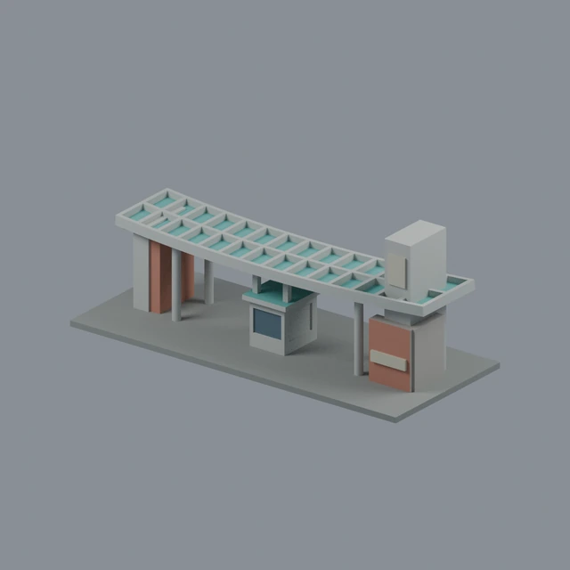](大專校院/國立聯合大學/README.md) **[國立聯合大學｜42 組](大專校院/國立聯合大學/README.md)** | [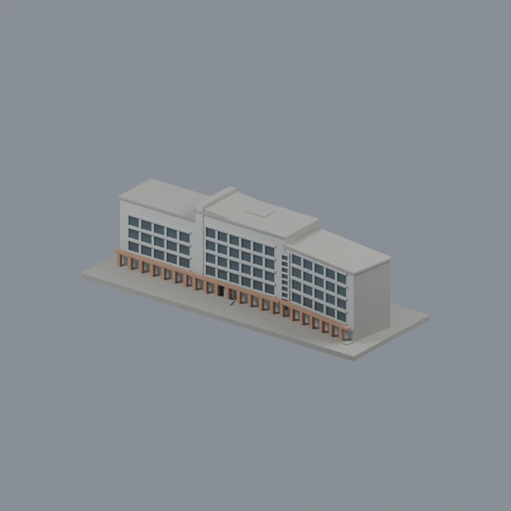](國家衛生研究院竹南院區/README.md) **[國衛院竹南院區｜9 組](國家衛生研究院竹南院區/README.md)** |  **[臺灣地標｜61 組](臺灣地標/README.md)** |

## 新增大專校院圖鑑

[瀏覽大專校院圖鑑與全國清冊](大專校院/README.md)

## 資料夾與使用方式

- [國立聯合大學/](大專校院/國立聯合大學/)：42 組校園模型位於 buildings/；研究目錄位於 docs/。
- [國家衛生研究院竹南院區/](國家衛生研究院竹南院區/)：9 組列印包位於 buildings/；範圍與證據限制位於 docs/。
- [臺灣地標/](臺灣地標/)：目錄收錄 61 組模型，含歸東海大學高教統計的路思義教堂 1 組；其餘 60 組不列入高教。各組保留原模型名稱與資料夾。
- 先進入地點資料夾，再依該資料夾 README 與個別模型說明操作。原說明中的相對路徑以其所在的地點／模型資料夾為準。
- 下載 STL 後，請自行使用切片軟體檢查；需要修改幾何或重新渲染時，使用各模型附帶的原始檔與 scene.blend。

### 龍虎塔模型下載

[最新彩色模型及預覽](臺灣地標/dragon-tiger-pagodas/README.md) · [二進位 STL（6.69 MB）](臺灣地標/dragon-tiger-pagodas/compact/model-binary.stl)。如需比對原 ASCII 檔，可從[固定版本附件](https://github.com/hplin50643/taiwan-buildings-3d/releases/download/v1.0.0/dragon_tiger_pagodas_150mm.stl)下載（36,412,062 bytes，SHA-256：6e1c338abc56367db05ceb285e223071e96eb950f847d7895347387233de68b7）。

## 高中職建築研究模型

高中套件不列入高教機構或高教模型統計；學校入口內有各件實際模型預覽。

| 學校 | 學校 | 學校 |
| :---: | :---: | :---: |
| [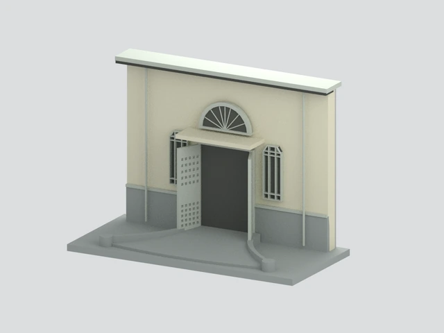](國立新竹高級中學/README.md) **[國立新竹高級中學｜2 套](國立新竹高級中學/README.md)** | [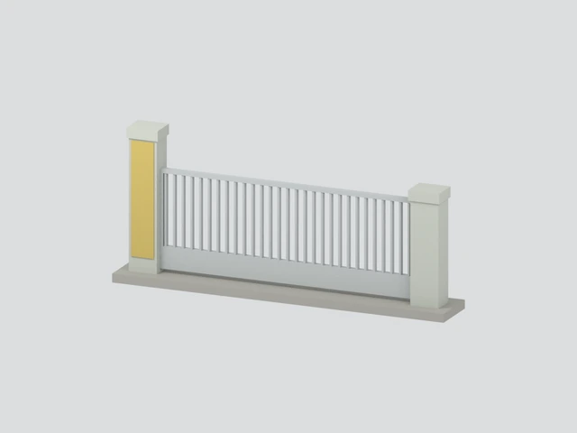](國立斗六高級中學/README.md) **[國立斗六高級中學｜1 套](國立斗六高級中學/README.md)** | [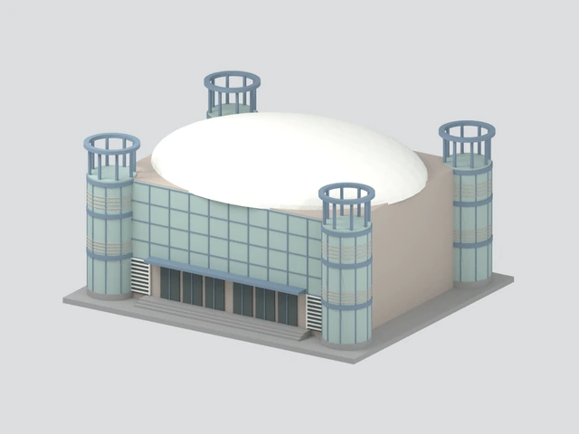](新竹市私立光復高級中學/README.md) **[新竹市私立光復高級中學｜1 套](新竹市私立光復高級中學/README.md)** |
| [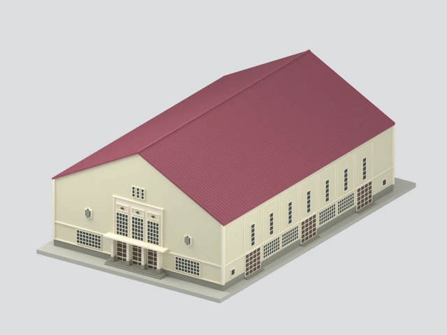](臺中市立臺中第一高級中等學校/README.md) **[臺中市立臺中第一高級中等學校｜1 套](臺中市立臺中第一高級中等學校/README.md)** 2012 調查外觀。 | [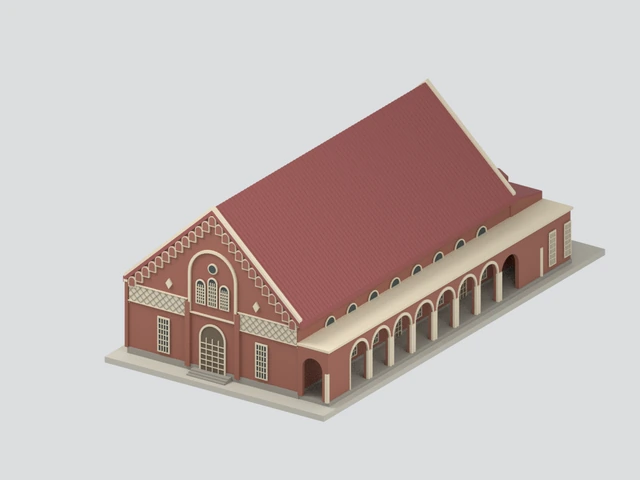](國立臺南第一高級中學/README.md) **[國立臺南第一高級中學｜2 套](國立臺南第一高級中學/README.md)** 含2003小禮堂調查外觀與2012體育館完工外觀。 | [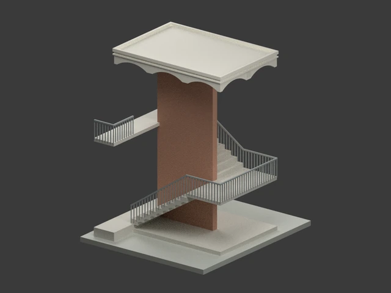](國立屏東高級工業職業學校/README.md) **[國立屏東高級工業職業學校｜1 套](國立屏東高級工業職業學校/README.md)** 1971年8月外梯增建單元原設計，不含既有教室樓。 |
| [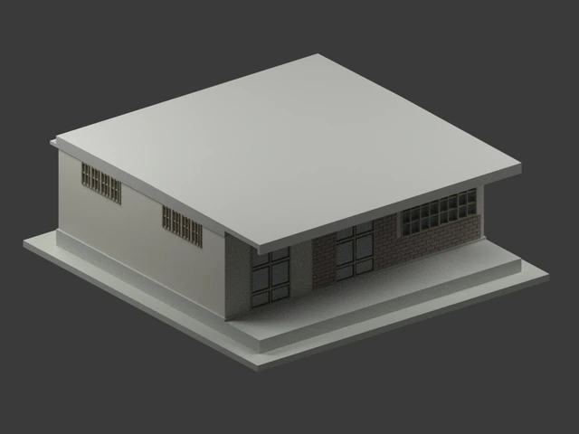](高雄市立高雄高級商業職業學校/README.md) **[高雄市立高雄高級商業職業學校｜4 套](高雄市立高雄高級商業職業學校/README.md)** 含未定年宿舍、1957竣工圖示局部單元、1963原四層方案（相關圖面有劃除記號、未確認實建）及未定年倉庫增建變更外殼；模型包不等於已證實實建整棟。 | [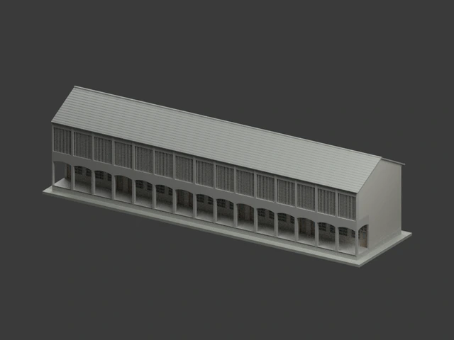](國立彰化女子高級中學/README.md) **[國立彰化女子高級中學｜2 套](國立彰化女子高級中學/README.md)** 未載年六戶眷屬宿舍與圖書館教室附接翼；後者非獨棟，均非現況。 | [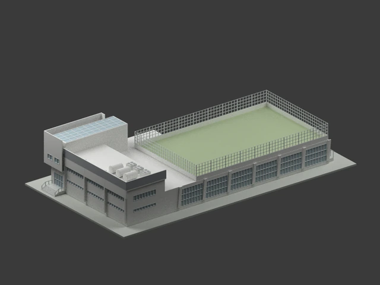](國立臺灣師範大學附屬高級中學/README.md) **[國立臺灣師範大學附屬高級中學｜1 套](國立臺灣師範大學附屬高級中學/README.md)** 體育教學館暨室內溫水泳池2019設計，非師大本部泳館或現況。 |
| [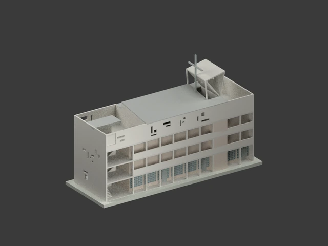](臺東縣私立公東高級工業職業學校/README.md) **[臺東縣私立公東高級工業職業學校｜2 套](臺東縣私立公東高級工業職業學校/README.md)** 晚1958原校舍暨聖堂、1960南側餐廚教師服務棟兩套歷史設計，均非現況。 | [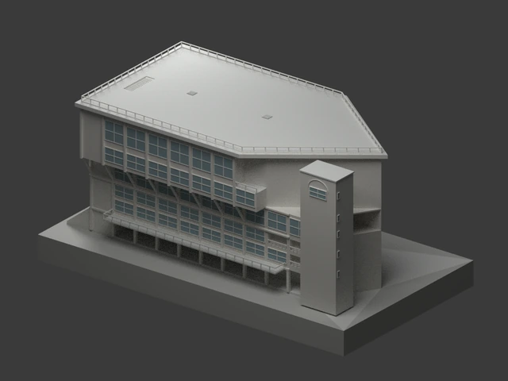](臺北市私立泰北高級中學/README.md) **[臺北市私立泰北高級中學｜1 套](臺北市私立泰北高級中學/README.md)** 依圖框標示竣工圖的工號7307重建；校史1988年改建記載不是圖框日期，不從工號推算年分；地下層局部與示意地坪範圍以模型README為準，不是2026現況。 | [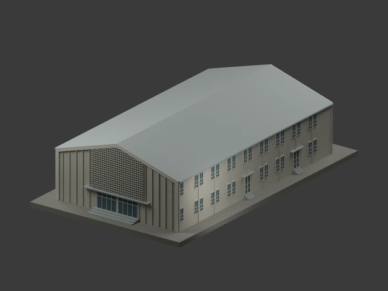](國立南投高級中學/README.md) **[國立南投高級中學｜1 套](國立南投高級中學/README.md)** 陳其寛／中國建築師事務所工號5218、1964年4月原設計圖；尚未證實同形實際建成，不直接稱中正堂，不混1989中正大樓或1990活動中心，非現況測繪。 |
| [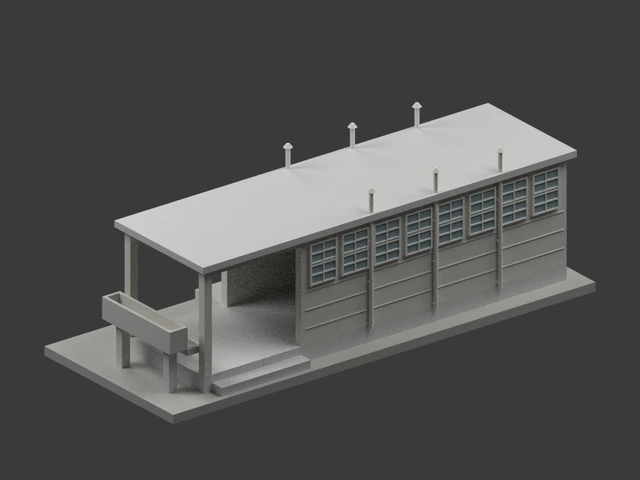](國立鳳山高級商工職業學校/README.md) **[國立鳳山高級商工職業學校｜3 套](國立鳳山高級商工職業學校/README.md)** 陳仁和建築師事務所《省立高雄商業職業學校鳳山分校廁所新建工程設計圖》CCRH12624009；原圖未讀得設計日期，不以學校改制年推定。只是歷史原設計圖外觀，不是竣工復原、現況測繪或實施證明；不聲稱此小棟仍存，未試印。 |  |  |

## 私立國際K12學校建築研究模型

與前述13所高中職22套分開分類，亦不計入高教機構或高教模型統計。

- [高雄美國學校｜1 套](高雄美國學校/README.md)：Thomas Farrell運動中心2016竣工供圖外觀，代表圖待指定。

本件僅含自行重建幾何與模型渲染，不附來源原圖／原照片；公開可讀不等於任意再散布或商用授權。建築設計與攝影權利仍歸原權利人，不由同庫其他素材或通用授權推定本案建築設計／照片的使用權。 [本件來源與使用說明](高雄美國學校/校本部/buildings/kas-farrell-athletic-complex-2016/SOURCE-RIGHTS.md)。

## 國小附幼建築研究模型

獨立於大專校院、高中職、私立國際K12與地標分類；目前1校1研究包，並非全校完成。49分件合計一包，不增加49棟建築。

| 國小附幼研究 |  |  |
| :---: | :---: | :---: |
| [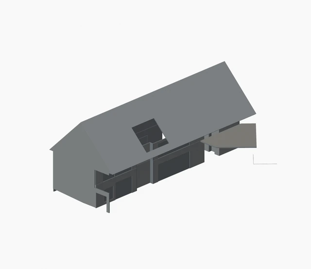](臺中市烏日區東園國民小學/README.md) **[臺中市烏日區東園國民小學｜1 套](臺中市烏日區東園國民小學/README.md)** 2018–2020作者設計期／部分完成照支持；人工接合與中性代理、未建屋窗域均明示。 |  |  |
