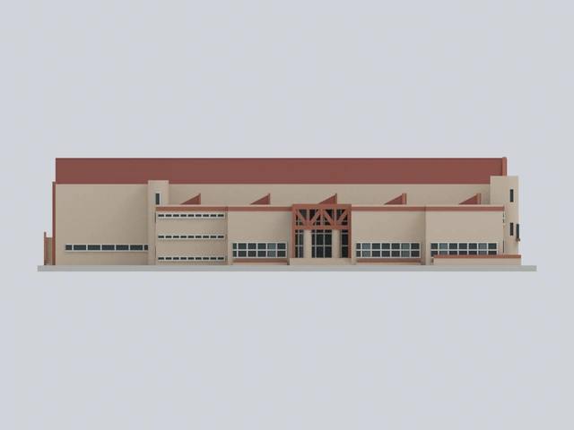
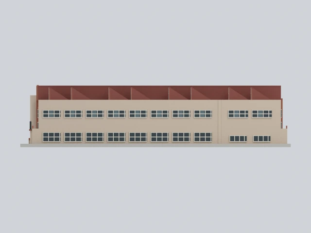
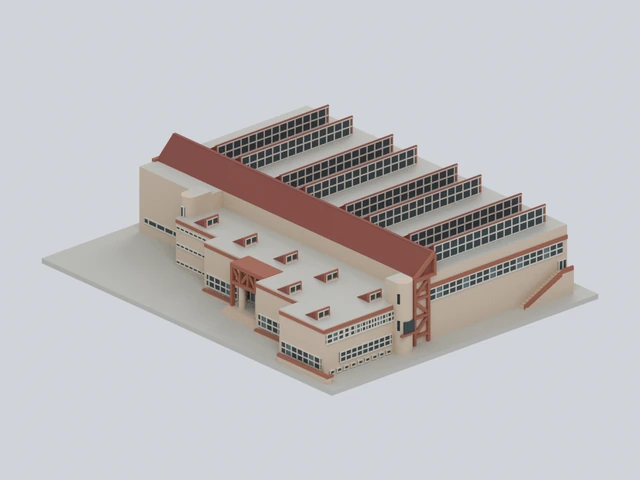
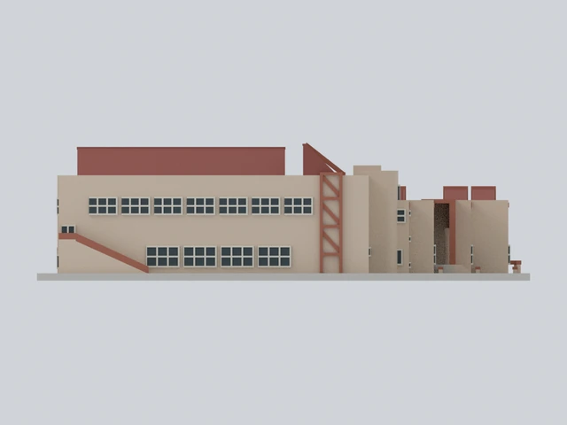
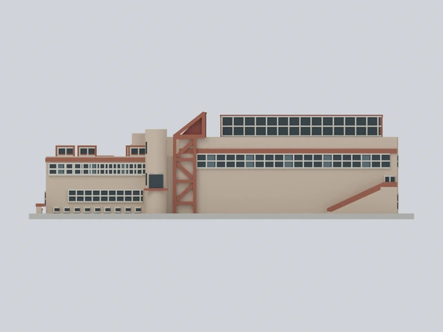
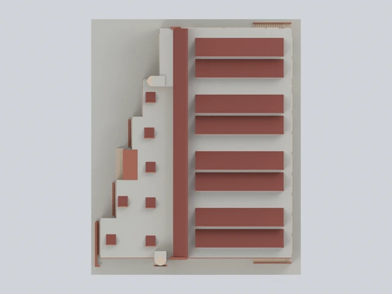
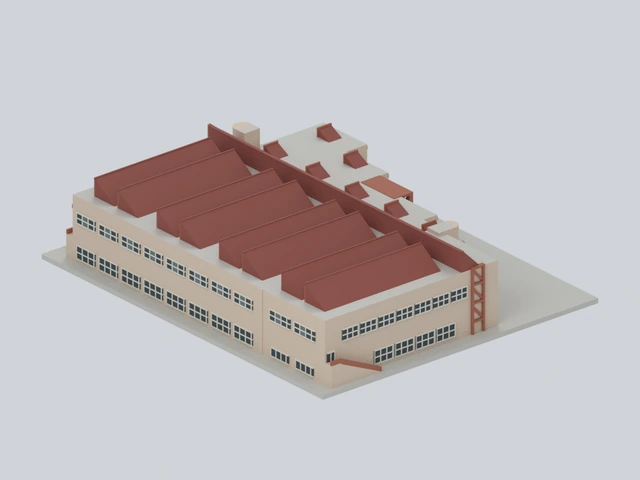
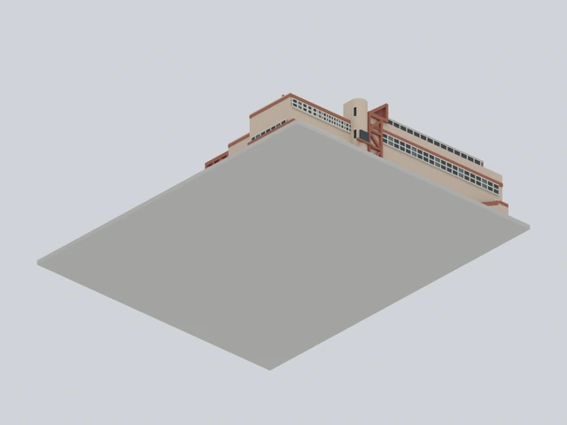
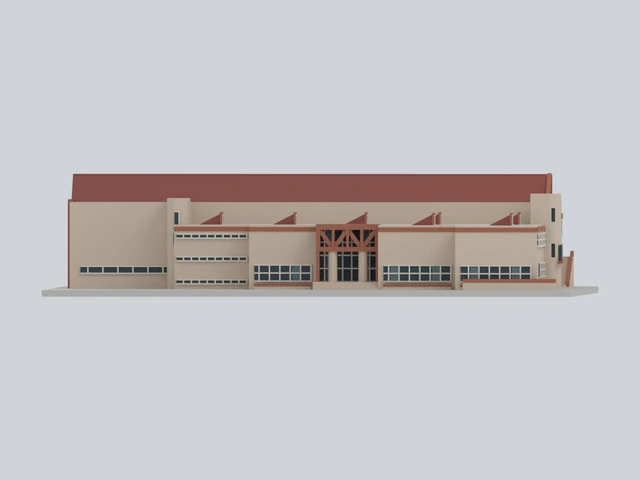

# 中原大學體育館｜現行模型九視角

約 1989–1991 年歷史外觀近似，不是測繪、現況或精確竣工復原。九張圖均由現行 Blender 場景依原鏡頭重繪，點擊縮圖可看逐像素無損 WebP 大圖。

|  |  |  |
| :---: | :---: | :---: |
| 西立面入口 | 東立面（圖面支持） | 西南斜視 |
|  |  |  |
| 北立面（圖面支持） | 南立面 | 屋頂俯視 |
|  |  |  |
| 東北斜視 | 底面與展示底座 | 低角度西入口 |

北、東立面按歷史圖面有界簡化；泳池與跨棟連橋不包含在此模型。保留原工程檢查使用的 PNG 與技術說明；未改幾何或配色，未實體試印。

[工程原件、來源與限制](../../../../大專校院/中原大學/中壢校區/buildings/cycu-gymnasium/README.md) · [STL](../../../../大專校院/中原大學/中壢校區/buildings/cycu-gymnasium/model.stl) · [現行彩色 3MF](../../../../大專校院/中原大學/中壢校區/buildings/cycu-gymnasium/cycu-gymnasium.3mf) · [現行 Blender](../../../../大專校院/中原大學/中壢校區/buildings/cycu-gymnasium/cycu-gymnasium.blend) · [原交付校驗](../../../../大專校院/中原大學/中壢校區/buildings/cycu-gymnasium/SHA256SUMS)

[影像驗證](RENDER-PROOF.json) · [圖庫校驗](SHA256SUMS)
