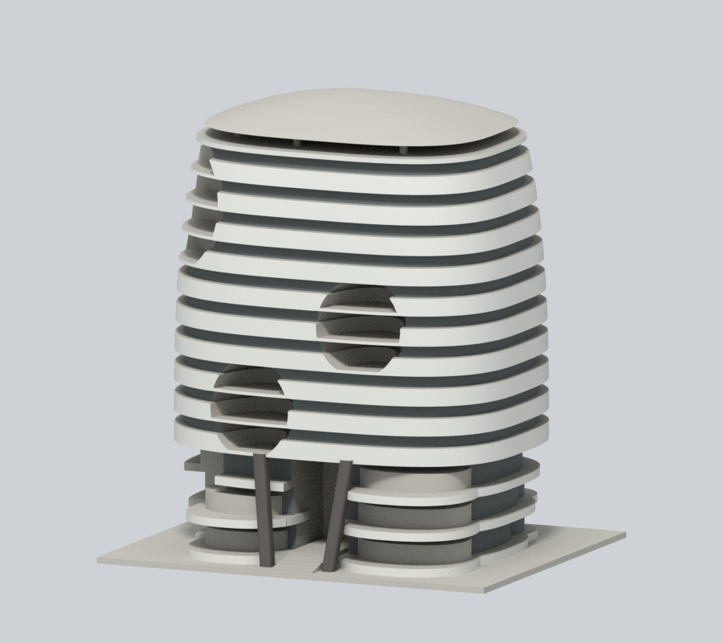
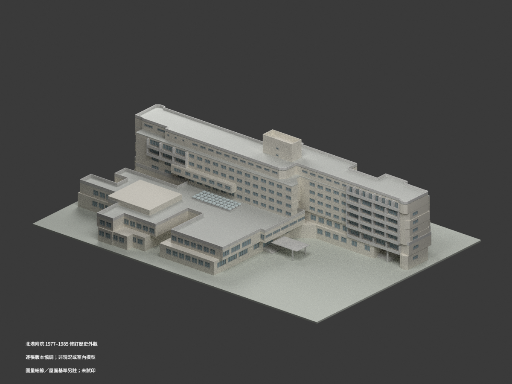

# 中國醫藥大學

## 模型圖鑑

| 建築模型 | 建築模型 | 建築模型 |
| :---: | :---: | :---: |
|  **[中國醫藥大學水湳校區 關懷大樓](水湳校區/buildings/cmu-guanhuai/README.md)** 西側正面 |  **[水湳創研大樓 A2｜整棟地上外觀有限細節近似版](水湳校區/buildings/cmu-chuangyan-a2/README.md)** |  **[北港附院主館｜1977–1985歷史設計](北港附設醫院/buildings/cmu-beigang-hospital-1977-1985-historical-design/README.md)** [STL](北港附設醫院/buildings/cmu-beigang-hospital-1977-1985-historical-design/model.stl) · [彩色3MF](北港附設醫院/buildings/cmu-beigang-hospital-1977-1985-historical-design/model.3mf) · [Blender](北港附設醫院/buildings/cmu-beigang-hospital-1977-1985-historical-design/scene.blend) |

現收錄3套：北港附院1977–1985歷史主館，以及關懷大樓A3既有有界外觀模型，以及創研大樓A2整棟地上外觀有限細節近似；不代表全校全部建物已完成。關懷大樓原有範圍與限制維持不變。

[關懷大樓：模型、範圍及限制](水湳校區/buildings/cmu-guanhuai/README.md)

[水湳創研大樓 A2｜整棟地上外觀有限細節近似版](水湳校區/buildings/cmu-chuangyan-a2/README.md)：創研大樓A2：2020完工後公開資料結合2022屋頂狀態的整棟地上外觀有限細節近似；十二個編號樓層不等於全部已使用，非2026現況/測繪/精密竣工或工程模型。南街側偏西眼部為有封閉背壁的凹腔與反射展示面，不是藍圓貼片或穿棟孔；成對波浪遮陽帶、北院側垂直屏條/弧帶、不同短端、不同地層/上層/屋面及連續雙葉高罩體、2022光電區均保留。未知北側高層細格與遮擋部位有界簡化，不鏡射南眼；排除A1/A3/完整庭院/室內地下層。254×85×194.1mm為展示尺寸、無實測比例尺；STL、8材質3MF、可編輯Blend、Python重建與9圖。0.2mm數值切層在11個取樣高度共偵測80個未承接截面起始成分，需支撐評估；細帶/眼部/低拱/高罩體與縮放風險保留，未實體試印。

## 北港附院歷史設計研究

1977–1985逐張續建修訂圖協調之北港附院歷史外觀，一個連通主館含裙房、講堂、錯位住院翼與屋塔；北港朝天宮綜合醫院／媽祖醫院／中正紀念醫院／第二附院為本案歷史稱謂，不拆成多棟，不是水湳既有模型。非現況測繪或完整竣工認證；局部窗框、階帶與轉角圖量約±0.20–0.30m，西入口地坪無獨立標高，A15晚版一樓東穿堂開放，較早立面差異與化糞池排除保留。屋塔5.275±0.10m字形解讀、40採光罩採1978晚版，未完整重建排水坡角。只做外觀，不呈現病人、醫療設備、內部配置或安全設施，1:400細框約0.40mm，未試印。

[北港附設醫院圖鑑](北港附設醫院/README.md)；[校方北港附院校史](https://history.cmu.edu.tw/history_beikang_hospital.html)及[院方說明](https://www2.bh.cmu.edu.tw/Department/AboutUs?depid=212)供名稱沿革核對，不據此把歷史模型當成今日外觀。
