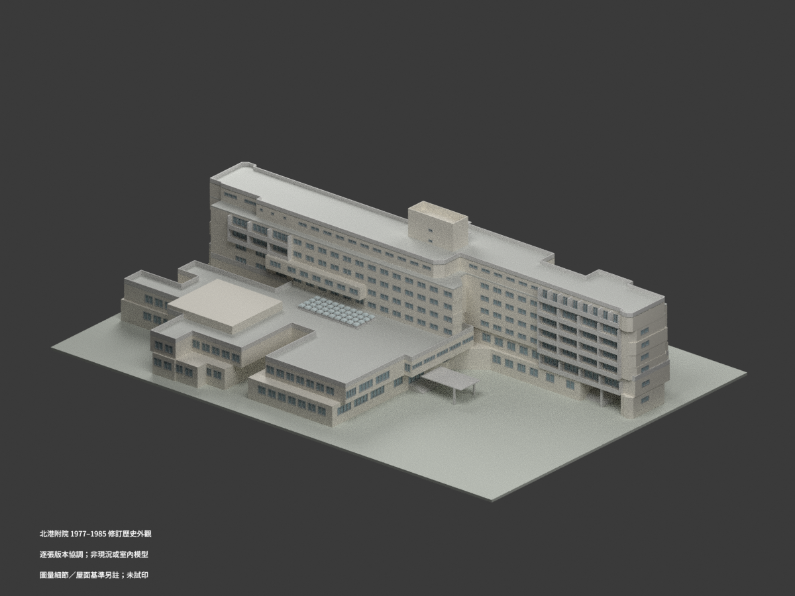

# 中國醫藥大學北港附設醫院｜歷史設計研究

## 模型圖鑑

| 建築模型 | 建築模型 | 建築模型 |
| :---: | :---: | :---: |
|  **[北港附院主館｜1977–1985歷史設計](buildings/cmu-beigang-hospital-1977-1985-historical-design/README.md)** [STL](buildings/cmu-beigang-hospital-1977-1985-historical-design/model.stl) · [彩色3MF](buildings/cmu-beigang-hospital-1977-1985-historical-design/model.3mf) · [Blender](buildings/cmu-beigang-hospital-1977-1985-historical-design/scene.blend) |  |  |

現行收錄 **1 套模型包**；非全院或現況完成。

## 收錄範圍

1977–1985逐張續建修訂圖協調之北港附院歷史外觀，一個連通主館含裙房、講堂、錯位住院翼與屋塔；北港朝天宮綜合醫院／媽祖醫院／中正紀念醫院／第二附院為本案歷史稱謂，不拆成多棟，不是水湳既有模型。非現況測繪或完整竣工認證；局部窗框、階帶與轉角圖量約±0.20–0.30m，西入口地坪無獨立標高，A15晚版一樓東穿堂開放，較早立面差異與化糞池排除保留。屋塔5.275±0.10m字形解讀、40採光罩採1978晚版，未完整重建排水坡角。只做外觀，不呈現病人、醫療設備、內部配置或安全設施，1:400細框約0.40mm，未試印。

保留設計者及來源權利；原圖與私人參考檔不公開，不作商用保證。

[回學校圖鑑](../README.md)
