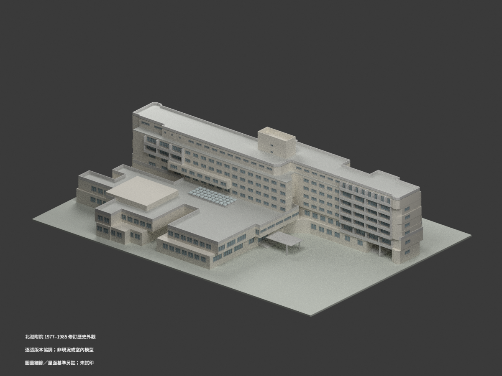
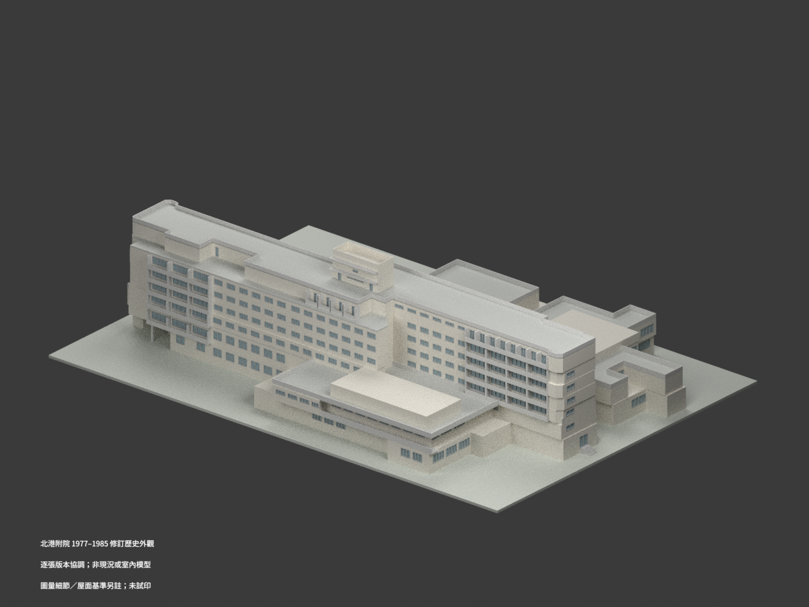
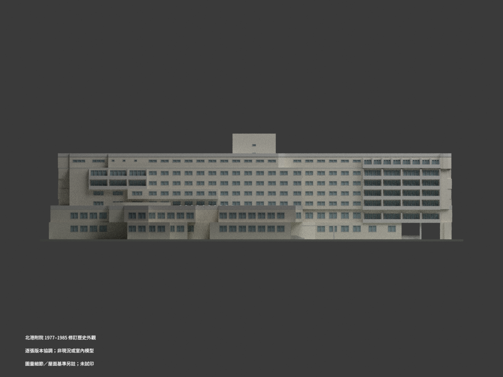
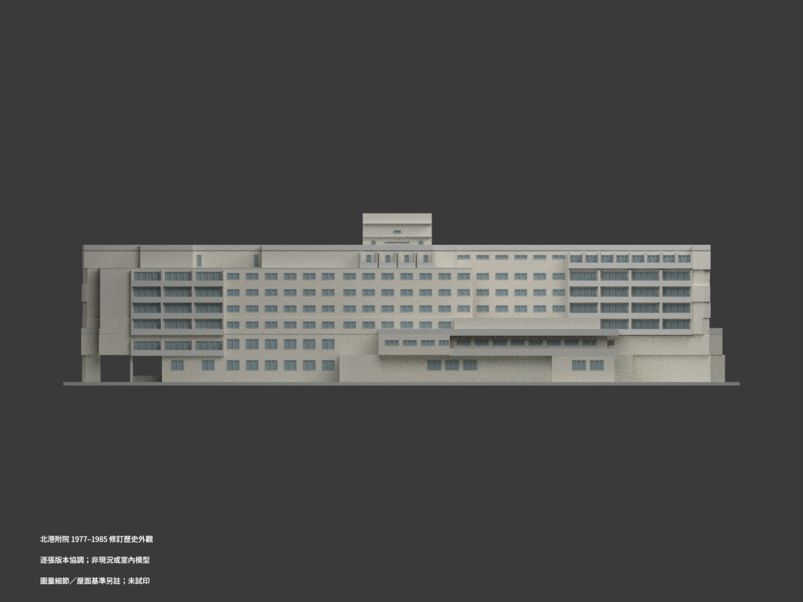
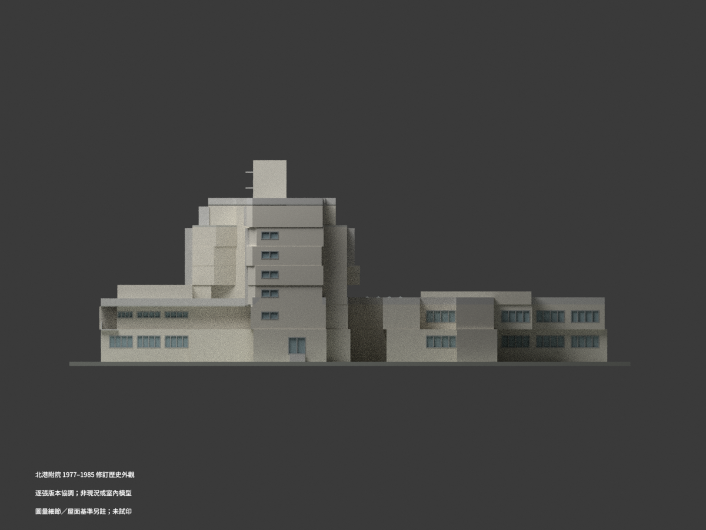
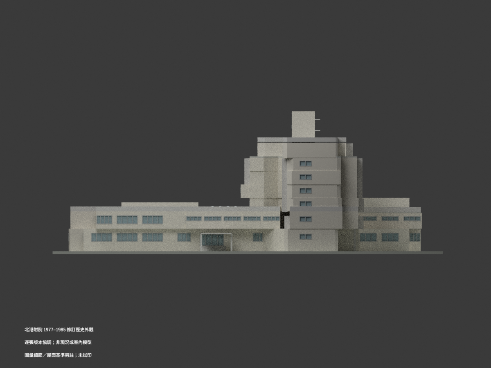
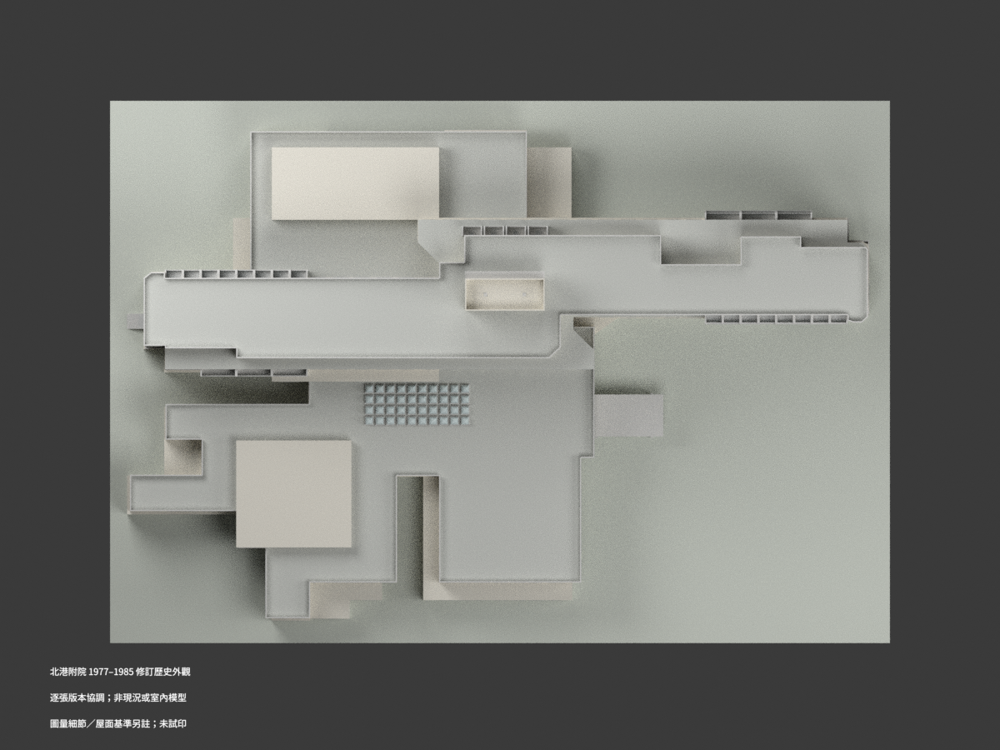
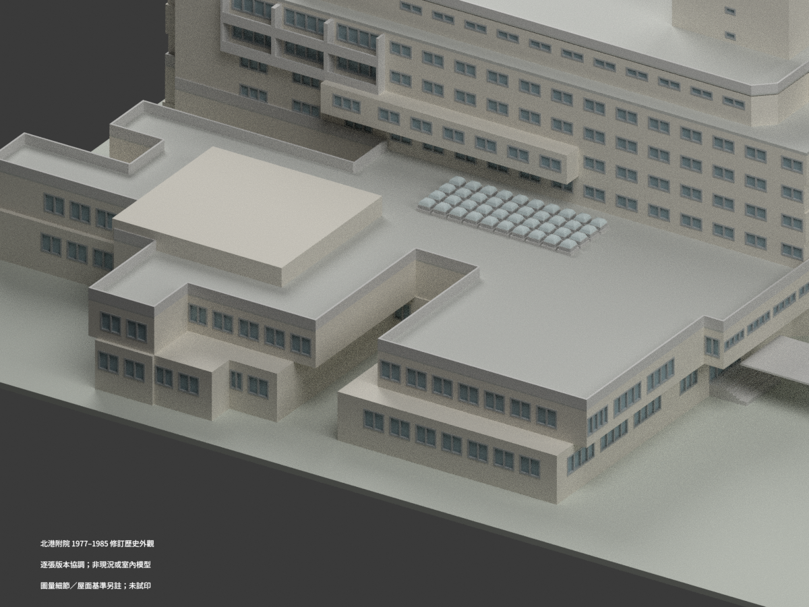
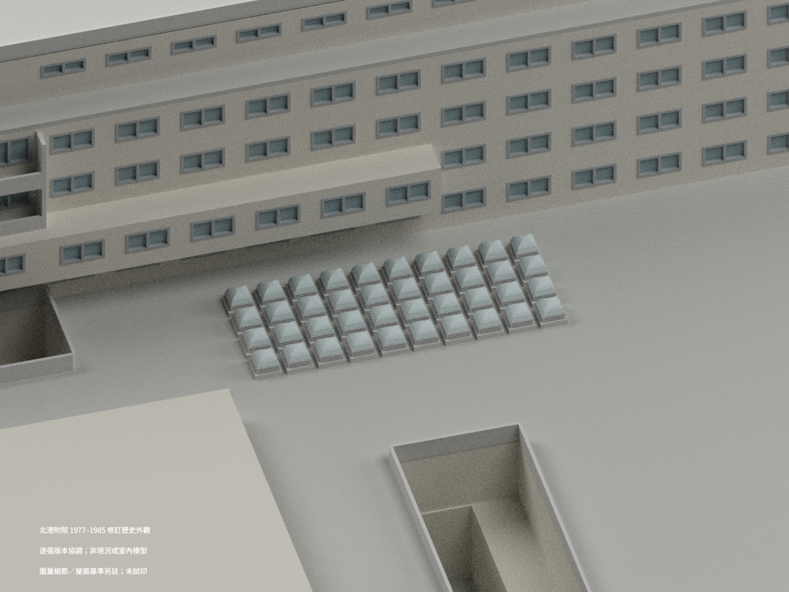
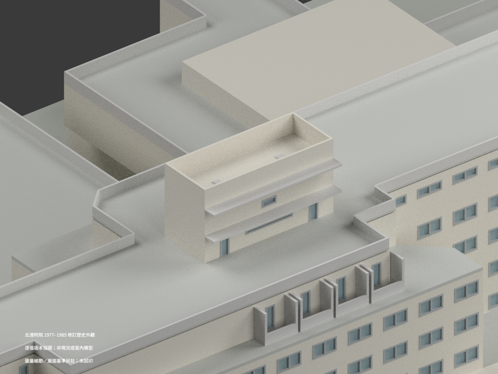

# 中國醫藥學院北港附院｜1977–1985 續建修訂歷史外觀

## 1. 模型實際渲染

**依逐張修訂圖協調的歷史設計重建，非現況測繪、非完整竣工實錄；未實際列印。** 一個連通主館含裙房、講堂、錯位住院翼與屋塔，不將不同院名拆成多棟。僅外觀，不呈現病人、醫療設備、內部配置或安全設施。

| 視圖 | 視圖 | 視圖 |
| --- | --- | --- |
|  |  |  |
|  |  |  |
|  |  |  |
|  |  |  |

## 2. 檔案與重建

- [STL](model.stl)／[含材質 3MF](model.3mf)／[Blender 場景](scene.blend)。單位 mm、比例 **1:400**。
- `build_model.py`、`geometry_helpers.py`、`geometry_controls.json` 是可重現數值幾何；`opening-controls.json` 與 `opening-revisions.json` 記錄圖量開口及轉角裁切，不附原圖。
- 安裝 `requirements.txt` 後依序執行 `python build_model.py`、`python export_3mf.py`、`python validate_model.py`；渲染用 `blender -b --python render_model.py`（Blender 4.3.2、Cycles 64 samples）。
- `SOURCE-VISUAL-QA.json`、格式／重建／場景檢查及 `SHA256SUMS` 提供交付證據；有來源依據不等於已試印。

## 3. 尺寸與分層控制

| 項目 | 採用值與性質 |
| --- | --- |
| 長向尺寸鏈 | 119.05 m＝3.50＋8×5.85＋9×7.20＋0.45＋3.50；不是整棟矩形外框 |
| 橫向 A–O 軸域 | 77.375 m；各層有不同轉折、露台、斜角與外廊 |
| GL 與樓面 | 1F 1.20、2F 5.16、3F 9.12、4F 12.18、5F 15.24、6F 18.30、7F 21.72 m |
| 主 RF | 控制線 24.78；18＋12 cm 層次得名義屋皮 25.08；女兒牆由 RF 加1.20至25.98，不從屋皮再加 |
| 低露台 | 結構21.36＋0.18＋0.12＝21.66，不能當成7FL 21.72 |
| 裙房分段 | 南屋面9.12、北露台8.97、北機房屋面12.18、講堂11.16、東雨庇4.18 m；不擠成一塊相同高度盒子 |
| 低裙房欄頂 | A30南西有110 cm直標，該段頂10.22；其他相同輪廓段為圖量延續，北8.97屋面之10.07欄頂是協調推定，非全周直標 |
| 屋塔 | 最高31.94；名義13.05×5.275 m，短邊字形估讀±0.10；舊5.375讀法撤回。30.14以上1.80以空框女兒牆表達，不填成實心樓層；北1.20雨庇另計 |
| 40座採光罩 | 1978 A52b：屋面9.12、頂10.32，0.30座＋0.40百葉＋0.50弧升；方基座拱帽，不是圓筒半球 |
| 採光罩排位 | 10×4、1.75 m格距；由12×6天花格排除外圈對位，首中心(33.525,32.475)為尺寸鏈推導，不是原圖點位直註 |

原圖1/100屋面找坡是局部排水控制；本比例以名義屋面及分段高差呈現，**未重建每一排水坡角的厘米標高**。未把材料引線三角形做成鋸齒屋頂。

## 4. 版本、圖量與省略

- 採各圖最後清楚修訂：A15 1985-08-30；A18/A19 1985-09-03；A20 1985-01-16；A30 1984-12-17。不是宣稱20張同日竣工圖。A19中間修訂月份字跡不清不影響最後日期採用。
- A15/A17/A18 平面 spot 有＋0.60基準差，僅對這類平面換算；A68結構／面層鏈另處理，**不是全圖一律減60 cm**。
- 早1977 A52b的6.20屋面已被1978版取代；VOID二樓、較早一樓／四樓／屋頂、配置圖虛線 FUTURE WARDS 都不拼進主體。
- 原像素逐層追外牆。一般圖量允差約±0.30 m；僅有共同柱軸／同段主牆證據的點在此範圍內正規化，原點、位移都保留。東南49.50是共同面圖量，不是印刷柱軸。
- 4F南側約軸4–8的1.8–2.0 m封閉凸出保留，沒有當成5/6F陽台；7F另依8間、5間、6間與局部辦公／浴廁／曬衣段重建，不照抄樓下窗列。局部窗寬、門高、框格及開口外觀依平立圖估讀，**不是完整門窗表復刻**；未唯一的小型設備／排水與隱蔽開口不造細節。
- 七樓 I/J/K/L實柱線校準；H由跨圖外推，不把南牆或露台外線當H。K–I局部812.5／830 cm引線差保留為牆面／柱心基準疑義，不藉此改整棟軸網。
- 地下蓄水池地表、草坪、車道、1130平台、1082平台和西花臺不填成室內量體；北外廊是板＋低欄，只有確有實牆的小房延伸。地下坡道／設備與非建築場地細節不做實測重建。
- 晚版 A15 一樓東翼室內牆止於約16軸；其東兩跨是開放穿堂、局部平台與分離端梯，不以玻璃或整層實心填滿。A30/A31較早立面開放跨數不同，採日期清楚的1985平面界定晚版一樓範圍。化糞池圖示不作地上樓層。
- 東主入口以 A15 局部點位換算：門內GL1.20、近階腳0.44、車道0.35，北側車道另為0。可見階線作圖量階帶，不宣稱精確階數／踏階施工尺寸；未把全場地套成同一地坪。西入口依A31立面基線圖量協調名義階腳GL0、上1FL1.20，約±0.20 m；沒有A15獨立階腳spot，不挪用東側階腳值。東5／西8個模型階帶為圖量表達，非原圖直註施工級數。
- 端梯外觀為約2.8 m寬分節短窗與實心窗間牆，不是0.85 m細縫，也不是連續全高玻璃。局部寬高允差約±0.20–0.30 m；1F西門與東端窗分開落位。
- 開口只在實際連續直牆內裁切；轉角、斜面或窄碎段未能唯一辨識的圖量候選不外伸造假窗。完整裁切／省略記錄見opening-revisions.json。
- 窗框採0.16 m（模型0.40 mm）等明示比例化處理；罩百葉小浮雕、薄雨庇、懸挑及細框可能超出特定列印機能力。底座為展示支座，非測量地形；顏色／材料呈現近似。

## 5. 來源與權利

設計圖：**吳明修建築師事務所**；典藏：**國立臺灣博物館**，CWMH157 北港朝天宮綜合醫院新建工程。來源影像標示 **CC BY-NC**，原圖與放大裁圖僅私人研究備份；館藏詮釋資料 **CC BY** 與影像授權分開。

本包只有新建數值幾何、程式、模型渲染及文字審核，不公開掃描影像。沒有把來源影像的NC自動宣告成所有新幾何的同一限制，也不作一概商用／建築設計權利保證。逐項連結及版本用途見 [SOURCE_REGISTER.md](SOURCE_REGISTER.md)。

歷史別名（北港朝天宮綜合醫院、媽祖醫院、北港中正紀念醫院、第二附設醫院、北港附設醫院）屬同一連通主館識別，不重複計數；不混水湳校區、別案殯儀館或警衛室。
