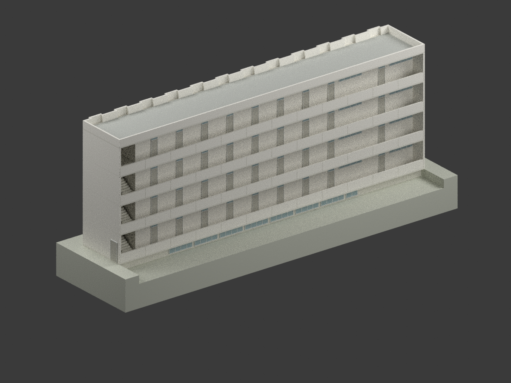

# 中央警察大學建築研究模型

## 模型圖鑑

| 建築模型 | 建築模型 | 建築模型 |
| :---: | :---: | :---: |
|  **[女生宿舍｜1976年7月原設計](校本部/buildings/cpu-female-dorm-1976-design/README.md)** [STL](校本部/buildings/cpu-female-dorm-1976-design/model.stl) · [彩色3MF](校本部/buildings/cpu-female-dorm-1976-design/model.3mf) · [Blender](校本部/buildings/cpu-female-dorm-1976-design/scene.blend) |  |  |

現行收錄 **1 套模型包**，不等於全校完成或完整建築棟數。

## 收錄範圍

中央警官學校1976年7月女生宿舍原設計之外觀研究，陳其寛／陳其寬建築師事務所CCCK253；不是竣工或2026現況，不混入1981後續增建。保留42.30m外長與4207／4210衛浴標註之區別、地下北側退縮及來源尺寸差異。比例1:200，中性配色、局部估讀與製造簡化，未實體試印。

歷史中央警官學校與現中央警察大學合併計為同一所高教機構，不另增加歷史學校。校本部僅為本目錄分組，不推定原案精確基地或宿舍現存身分。[校方沿革](https://www.cpu.edu.tw/p/412-1000-119.php?Lang=zh-tw)記載1995年更名；不據此推定本建築完工年代。

保留設計者與國立臺灣博物館典藏來源；原圖權利與自行編寫程式／重建模型分開，不概括模型為非商業，也不宣稱原圖或建築設計可無限制商用。未附來源原圖或私人參考資料。

[校本部圖鑑](校本部/README.md) · [回總目錄](../README.md)
