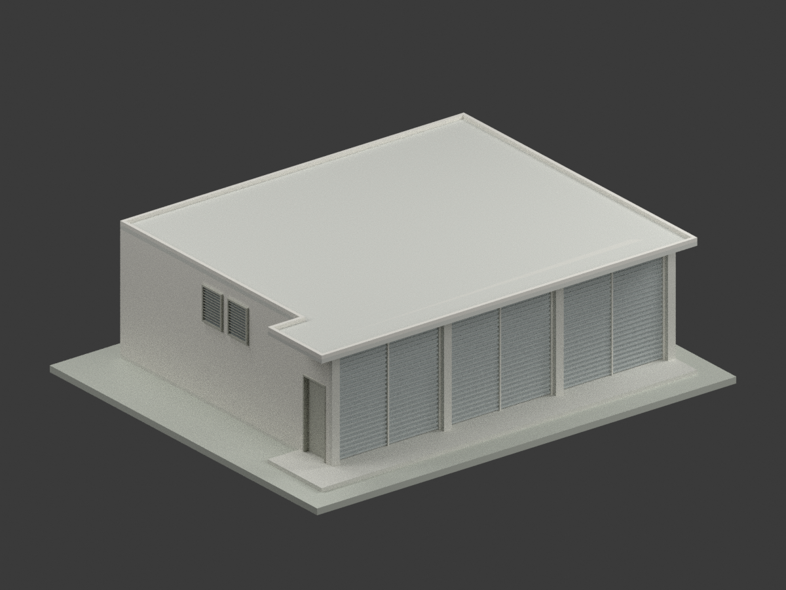
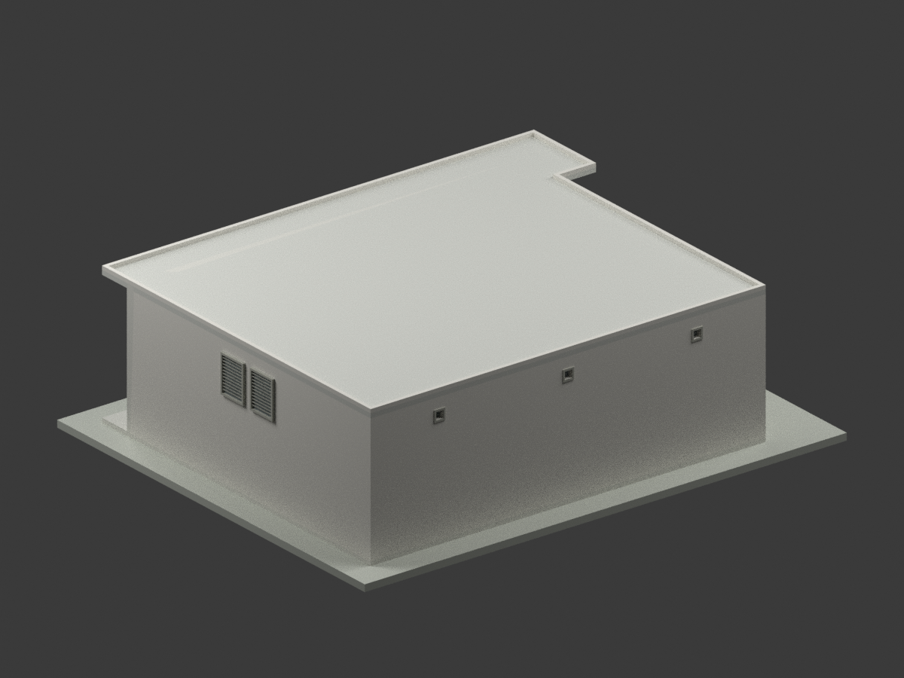
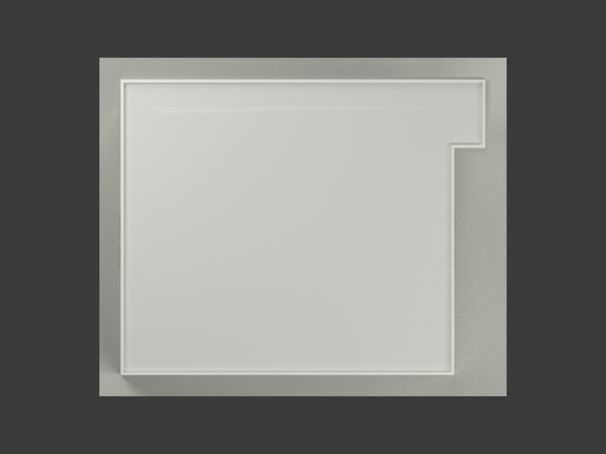
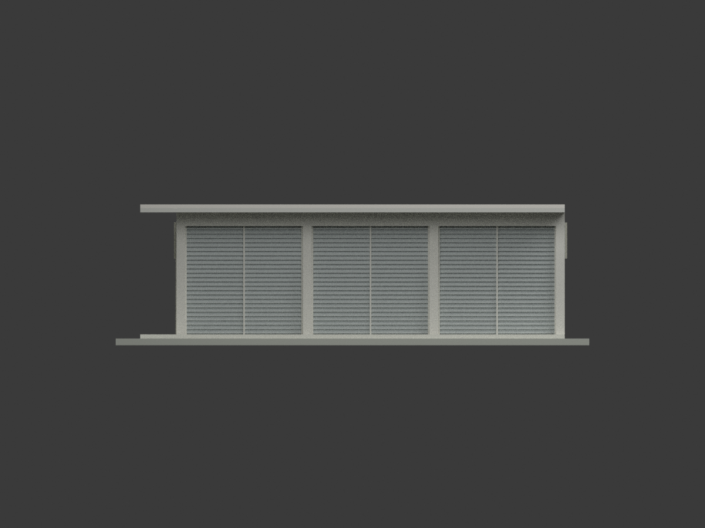
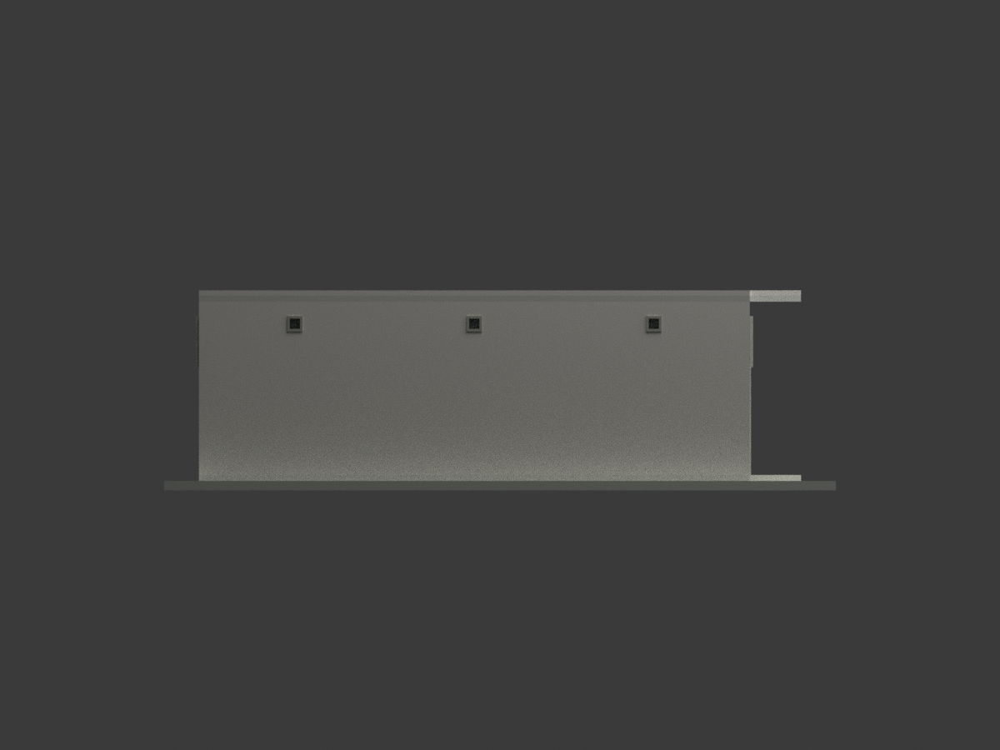
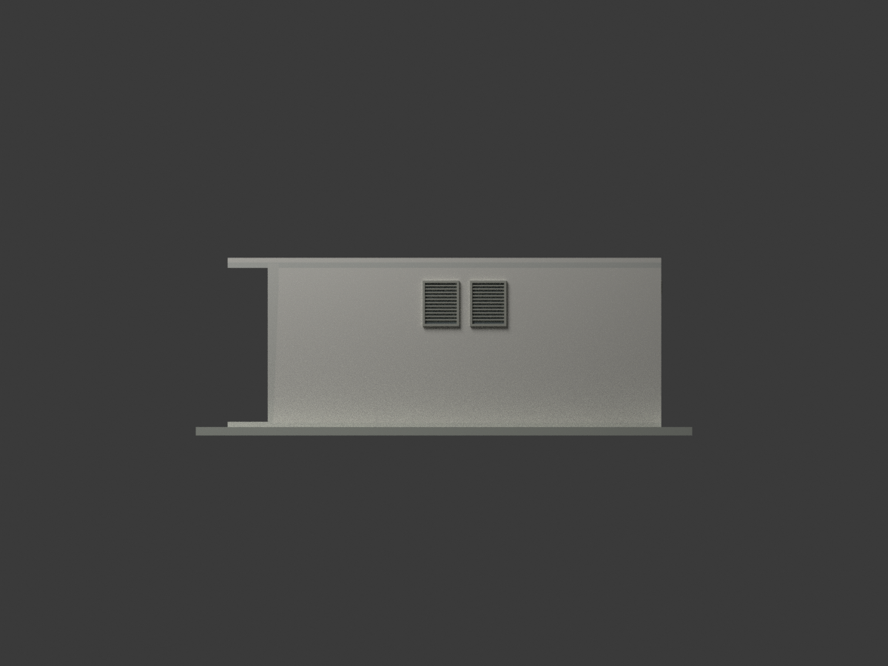
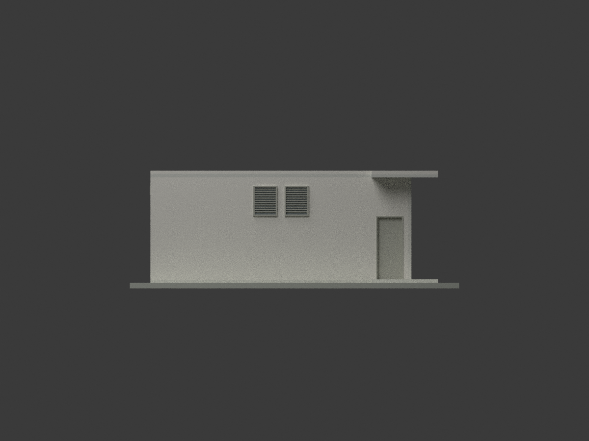
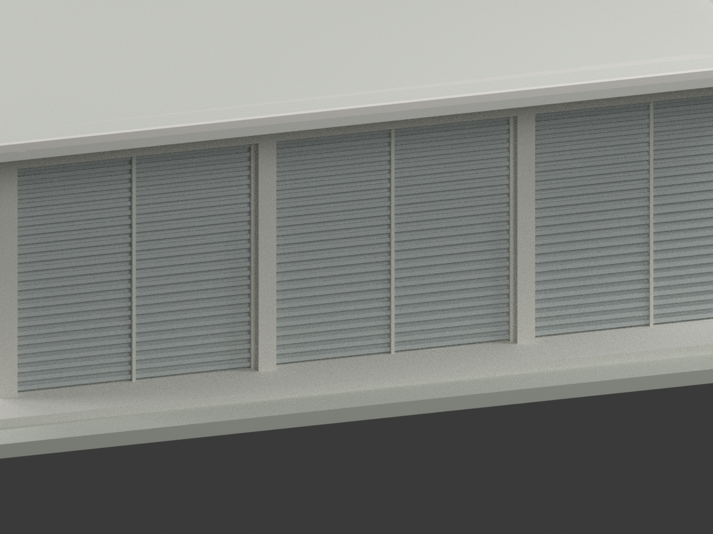
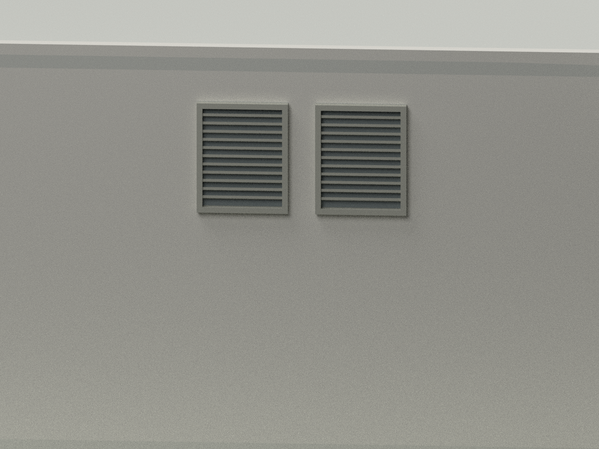
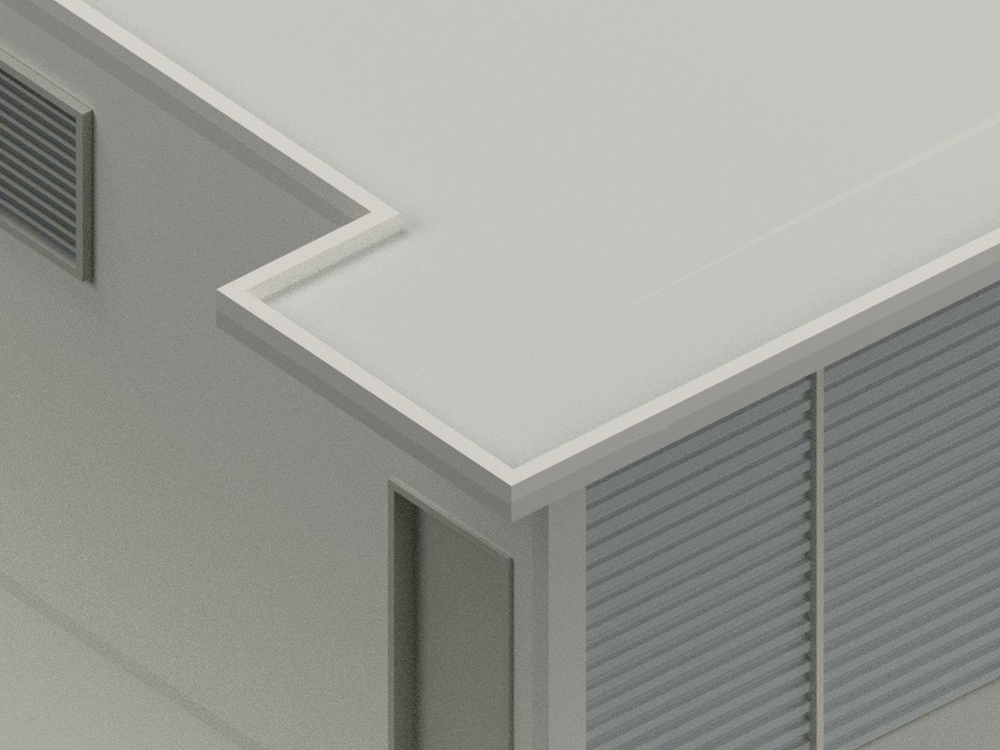

# 中央警官學校鍋爐房｜1976 年設計外殼模型

## 模型圖覽

| 全貌／立面 | 全貌／立面 | 全貌／細部 |
|---|---|---|
|  |  |  |
|  |  |  |
|  |  |  |
|  | 細部圖刻意局部取景 | 檔名方向依模型座標；方位以本表標題為準 |

## 身分與限定範圍

本件依陳其寛／C. K. Chen & Associates「中央警官學校鍋爐房新建工程」**1976 年 11 月（民國 65.11）**的 A1、A2 兩張圖，製作單棟歷史設計外殼。中央警官學校為現今中央警察大學的前身；本件不是先前的女生宿舍模型。

**不是現況測繪，也未確認實際興建、仍存或今日名稱／外觀。**不添加未見於這兩張圖的鍋爐設備、煙囪、管線或基地。未標年的相似 CCCK30023019 版本被排除，不拿來補齊本版細節。

## 基準、尺寸與不確定性

- **建築基準為 1FL＝0，而非 GL。**RFL＝＋3.50 m，屋緣頂＝＋3.60 m。A1 牆剖顯示 GL 比 1FL 低約 10 cm，A2 北立面標示低 5 cm；兩者未解決，既不平均也不臆造地面坡度。底座是展示支座，不宣稱實際地形或地坪標高。
- 柱軸 10.50×8.40 m，x＝3.50＋3.50＋3.50 m，y＝4.20＋4.20 m；RC 柱截面與名義磚牆厚度均 24 cm。軸線不是外框。
- 屋頂主矩形 **10.74×9.52 m**，側凸寬 **1.00 m**。側凸回折長採約 **2.20 m**，由門區 1.20 m 與前簷 1.00 m、同列圖形對齊推導，**不是原圖直接標註的 220 cm**。
- 屋頂座標以後→前為 y：主框 x＝−0.12～10.62、y＝−0.12～9.40 m；側凸 x＝10.62～11.62、y≈7.20～9.40 m。A1 原像素以主深 9.52 m 校準，凹角邊線取點圖量支持約 2.16～2.18 m；選用 2.20 m 的差值小於保留的 **±12 cm 軸／牆面基準不確定性**。只對凹角採此限定，不擅改已標主框尺寸。校準記錄見 `ROOF-NOTCH-CALIBRATION.json`。
- 屋板 12 cm、屋緣突出 10 cm。圖註 1% 排水與薄找坡／防水層在展示模型中以平屋面簡化；保留 L 形輪廓及前、側雨庇。小排水孔、PVC 落水管路未完整重建，不作排水性能模型。

## 開口與外觀

- 正面保留 **三個 3.50 m 柱間開間、各雙分格中線**及水平捲片。原圖中間線與捲紋不足以確認全部獨立操作機構數，因此不武斷宣稱只有三片或六片獨立捲門；斜向操作示意線不做成斜桿。門頭高度採 **3.00 m**：牆剖 RFL−50 cm 與立面 3.60−22−38 cm 相互支持。
- 兩側各兩個 W1 木百葉；**80 cm 寬、100 cm 高**，窗底／頂為 1FL＋2.10／3.10 m。A1 尺寸曾被誤讀成 120，放大原圖確認為 **100**，與 A2 詳圖一致。窗中心依中柱兩側圖量配置 y≈3.68／4.72 m，不當作另有精確座標標註。
- 北側另有 D1 木門 90×210 cm，靠前端位置 y≈7.8 m 為圖量；南側不鏡抄此門。
- 後牆三個通氣口由 A1 平面與牆剖支持；20×20 cm 淨口，5 cm 木框解讀為外框約 30×30 cm。後梁下掛讀數為 **28 cm**，加 12 cm 屋板使梁底為 3.10 m，不是 3.18 m。模型外框高程 2.80～3.10 m、淨口 2.85～3.05 m；x≈1.75／5.25／8.75 m 為三開間中央圖量位置。
- 百葉採有背板的斜葉浮雕，12 排葉片與框線為有限細節解讀；沒有通透到室內。捲片間距、窗框突出、葉厚、門框接縫均有展示／網格製作簡化。原指定粉刷、木材及鋼捲門只用中性近似色，不聲稱原始選樣或今日實色。

## 檔案與製作限制

- `model.stl`：毫米、單一連通水密網格；`model.3mf`：相同幾何與逐面材料。
- `scene.blend`：實際渲染場景；`mesh.npz`、`palette.json`、`components.json` 保留幾何、材料與構件記錄。
- 比例 **1:75**；含作者支座外框約 **174.67×145.33×52.00 mm**。模型檔 z＝0 在支座底，建築 1FL 位於其上 4 mm，並非 GL。
- 室內封實，門、百葉、通氣口有背板；不提供室內設備或施工詳圖。底座及支承厚度為展示附加，不代表實際基礎。
- 尚未實體列印。葉片約 2.5 cm 展示厚度在此比例約 0.33 mm，細紋、雨庇懸挑及小通氣口須依切片、材料、方向與機器再驗證；水密不代表必定能印，也不是結構安全或法規認證。

## 重建與檢查

Python 套件版本見 `requirements.txt`；Blender 4.3.2 實測。

```bash
python build_model.py
python export_3mf.py
python validate_model.py
blender -b -t 4 -P render_model.py
blender -b scene.blend -P verify_scene.py
```

`*-QA.json` 分別記錄水密、單一連通、有限頂點、非零面積、面向、STL 重讀、3MF 頂點／面／材料／單位比對、獨立目錄重建、場景重開及圖框。七張全貌與三張細部由獨立審核綁定 `SOURCE-VISUAL-QA.json`；公開檔案雜湊見 `SHA256SUMS`。

## 來源與權利

原圖：國立臺灣博物館／臺灣現代建築圖說資料庫，陳其寛建築師事務所；CCCK37523006（A1）、CCCK37523007（A2）。逐張連結見 [SOURCES.md](SOURCES.md)；原檔雜湊見 `SOURCE-REGISTER.json`。

原圖頁標示 **CC BY-NC**，所檢頁面未註明版本。原圖、裁圖只存私人參考備份，**未包含於公開模型包**。本次模型、程式與渲染為新製作的解讀成果，這不消除原圖或建築設計的權利；不由此推論可任意採寬鬆授權或不受限制商用。來源權利與本次成果分開說明，再利用須確認適用條件、署名及必要許可。
