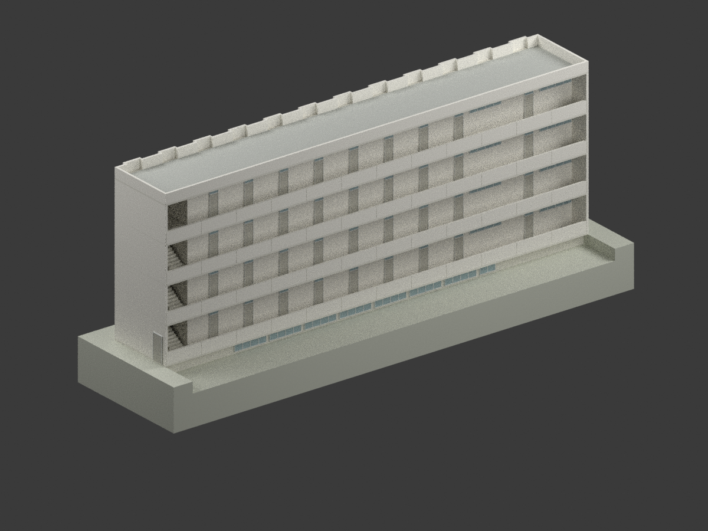
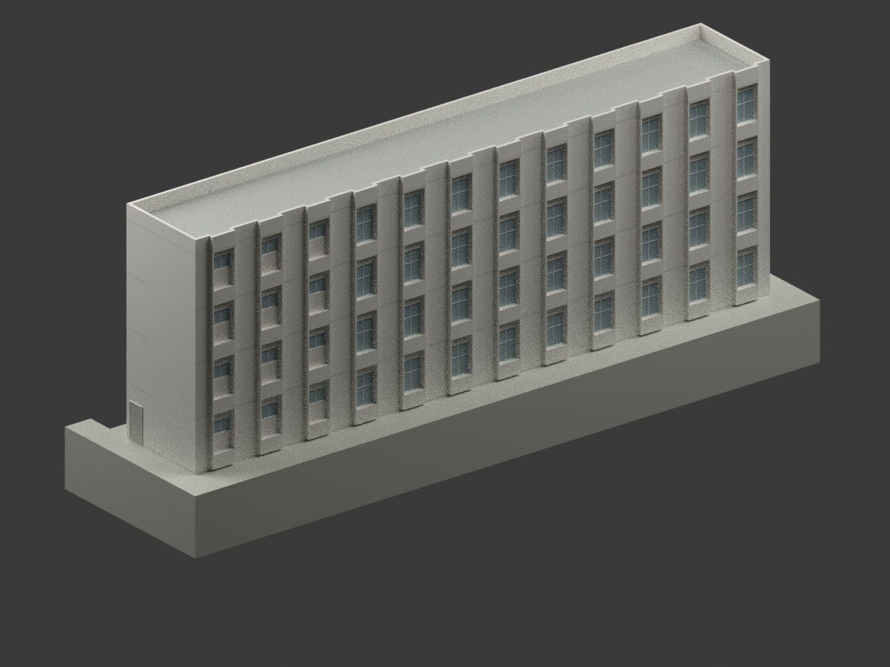
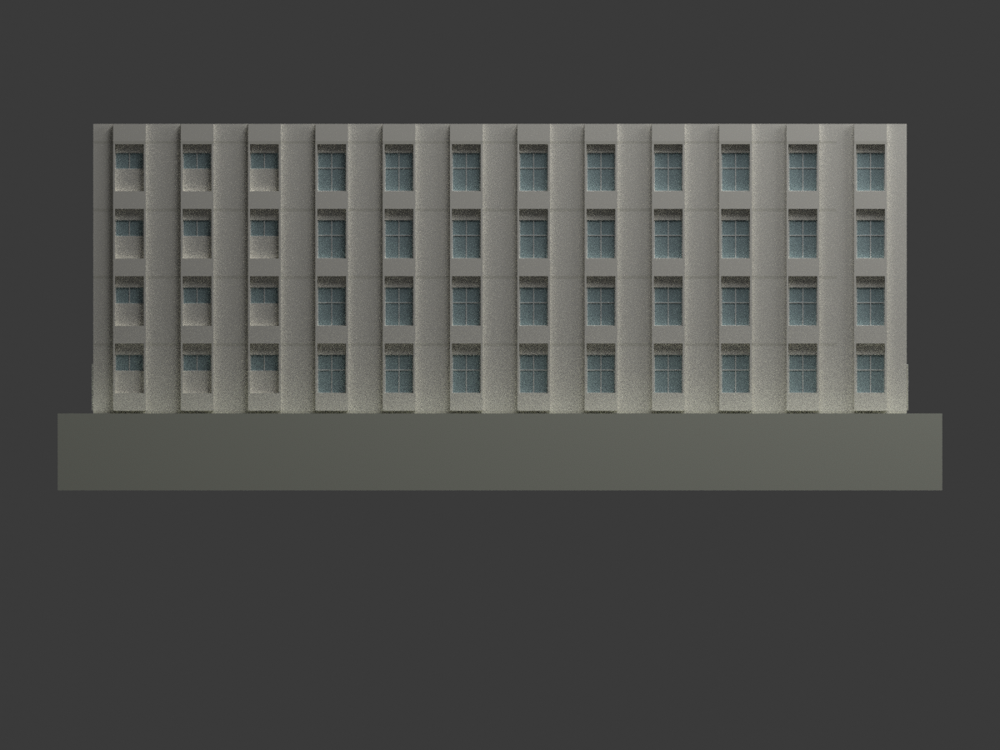
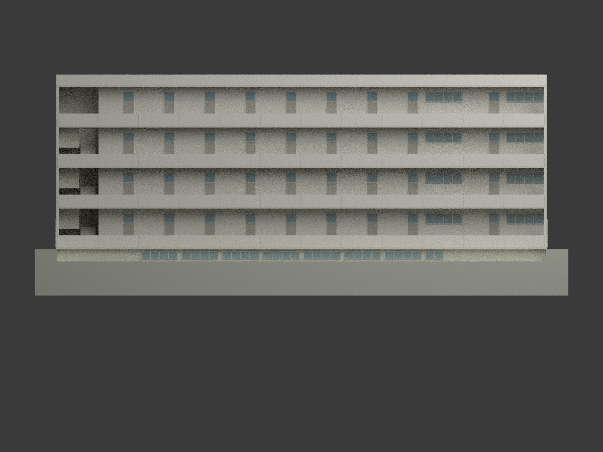
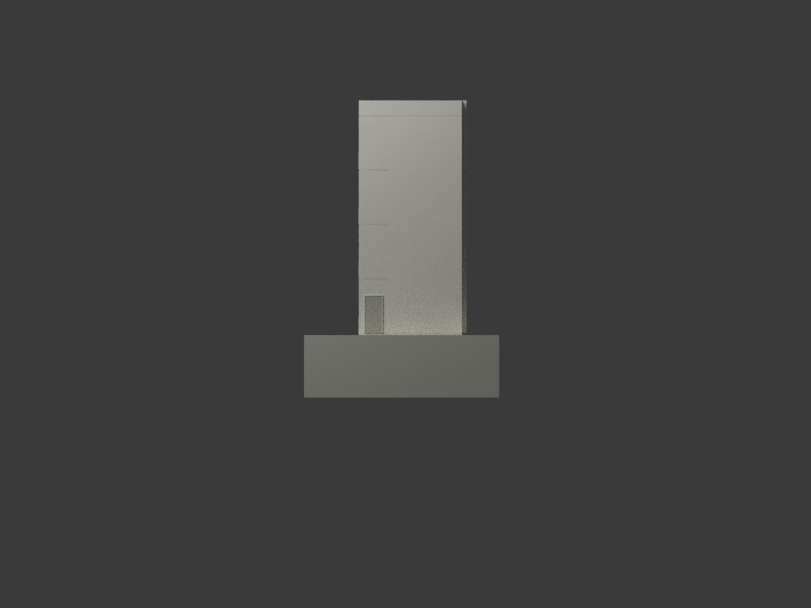
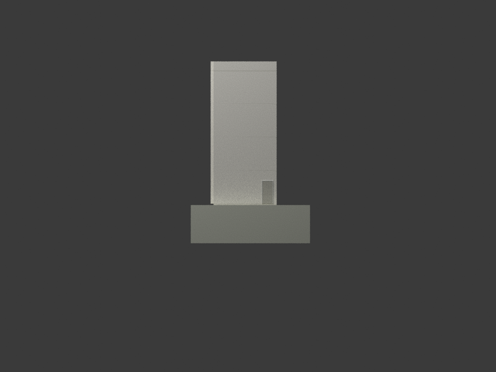
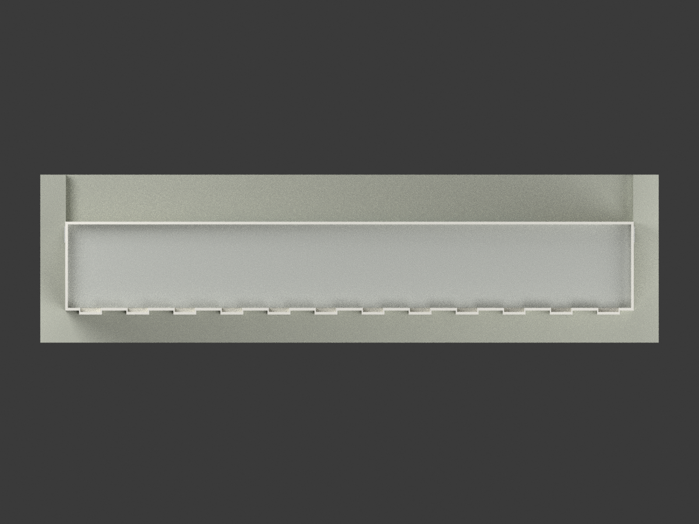
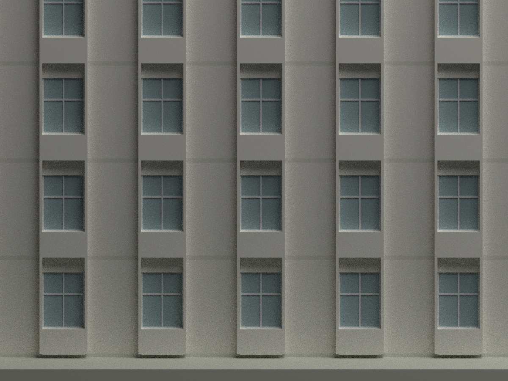
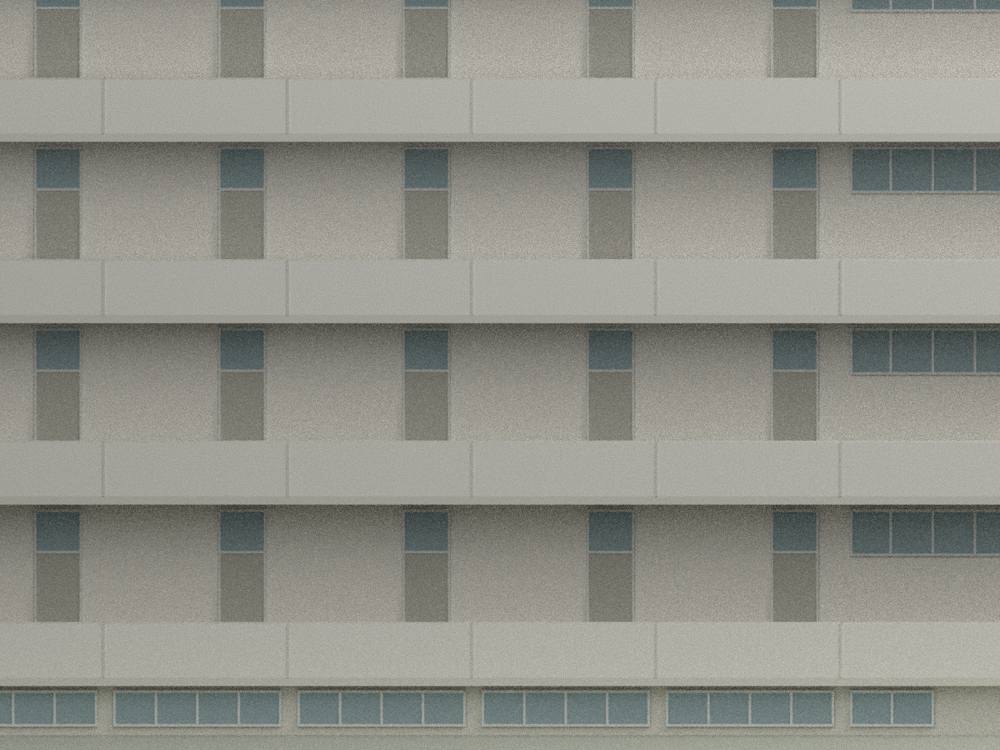
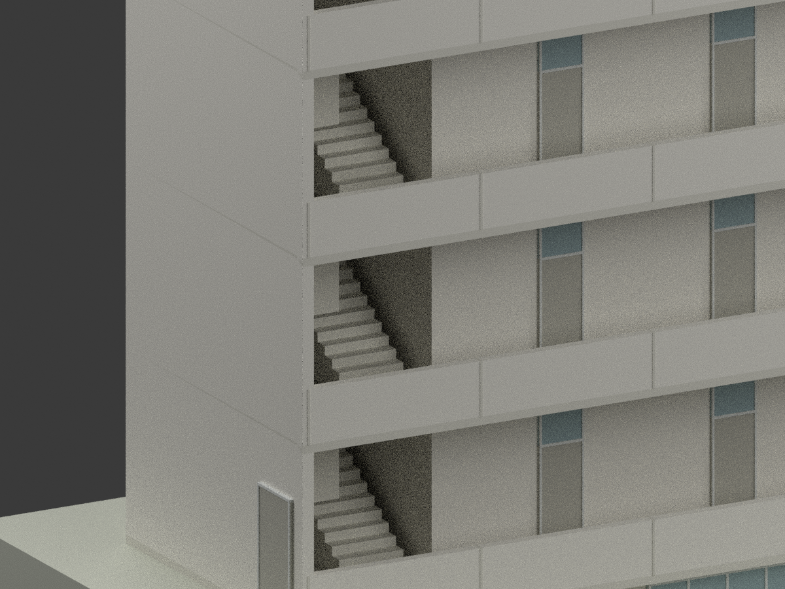

# 中央警官學校女生宿舍｜1976年7月原設計

## 模型圖集

| 北側透視 | 南側透視 | 南立面 |
|---|---|---|
|  |  |  |
| 北立面 | 西立面 | 東立面 |
|  |  |  |
| 屋頂俯視 | 南側凸窗／窗台 | 北外廊 |
|  |  |  |
| 端部樓梯 | | |
|  | | |

## 範圍與檔案

依陳其寛／陳其寬建築師事務所（C. K. CHEN & ASSOCIATES）CCCK253圖組重建。題欄核對日期「65.7」支持**1976年7月設計**，不是以工程號6504猜年，也不代表竣工日期。學校現名為中央警察大學；**不宣稱此原設計等同現存宿舍、不混入1981年後續增建圖**。

地上四層與地下室的外觀解讀模型，附 STL、含基本材質3MF、Blender場景、10張實際模型渲染、程式與QA。比例1:200，輸出mm。展示底座約230×62.5mm，含地下／底座總高95.3mm。封閉房間內部，保留北外廊空間及簡化端部樓梯；地下室內梯段未顯示，不重建衛浴、內部家具、鋼筋、管線或施工微層。

## 控制尺寸與來源差異

- 建築端牆中心距42.07m（353.5＋10×350＋353.5cm）、地下室端牆中心距42.10m；加上各自23cm／20cm牆厚後，兩者外輪廓皆42.30m。結構S2長42.00m另保留為結構參考，不平均或把中心距誤稱外長。地下室A2南／北牆中心深579.5cm＝460＋119.5，北牆24cm；依A4地下北牆中心至外廊外緣72cm，採上下南外牆面連續的尺寸協調解讀：主南牆中心0，地下南牆中心−0.015m，地下北牆中心5.780m、北外面5.900m、上外廊外緣6.500m。南牆中心差1.5cm是依牆厚及外面連續推得，非圖上另有明示標註，也不是實測到毫米。A1的450／200與S2的450／210＝660cm仍為不同圖面／參考基準，未強行平均、未稱200cm已證實為淨寬。
- GL=EL255.00；1F完成面255.16，各層間3.50m；RF=269.16，女兒牆270.06。地下室完成面251.86。A5的327／330cm及頂層353cm反映3cm結構／完成面偏移，**不是額外加樓高**。
- W1為150×200cm（上80＋下120），窗台高90cm；浴室前三bay的南窗依A1平面與A2窗表用W2=150×85cm，與A3畫成高窗的立面有差異，模型明確採平面／窗表優先。浴室北窗W3=320×85；地下室W4=320×65，集中在中央8個bay；首組因原檢修槽截短，以圖量簡化寬1.60m表現，檢修槽本體省略。W2窗台2.05m是使上緣對齊W1的圖量推定，非窗表明示窗台高度。
- 南窗台櫃由23cm主牆外緣再凸30cm；「40＋30」包含不同內側參考，不能當整段外凸70cm。玻璃約在主牆中心是圖量估計。全高10cm薄側片與凹凸屋頂邊依A2／A3／A4綜合解讀；只有窗下90cm作凸出櫃體，不作全高不透明盒。
- 北側是懸挑開放走廊、104cm欄牆；外緣**沒有任意新增全高柱列**。門牆柱屬內側。兩端大面實牆與底層小門依A3，沒有鏡像複製南窗。
- 屋頂以原圖平屋頂與凹凸女兒牆外形表現；排水坡度、孔洞和防水微層簡化，無無據水塔或屋頂梯間。端部小門尺寸與位置為A3圖量近似，非門窗表逐項明示；端部樓梯為可見外觀的簡化雙跑示意，不作完整梯段／扶手施工圖。

## 地形、材質與列印限制

北立面露出的地下室窗帶以**作者添加的簡化凹地／展示底座**呈現；沒有完整地形測量，不能把此展示地形當原校園高程模型。地下窗−0.85至−0.20m及凹地深度亦屬圖量／展示配置，不是已知實測控制。地下室下方為列印實心連接，不代表基礎結構。

洗石子、馬賽克、鋁窗有原圖名稱依據；中性色僅材質近似，非校準歷史或現況顏色。窗戶採不透明背板；紗網、門扇百葉／五金及部分細框簡化。欄牆／女兒牆部分加厚至20cm原型等效（模型1mm）；10cm薄側片在1:200僅0.5mm，細窗框約0.2–0.3mm，可能不適合一般FDM。需自行切片、支撐、放大及試印。**未實際列印、未經結構工程驗證**；閉合單連通不等於保證所有機器可印。

## 來源與權利分離

設計者：陳其寛；圖面題欄陳其寬建築師事務所。典藏：國立臺灣博物館。

- [A1：各層平面，CCCK25323001](https://collections.culture.tw/docomomo_collectionsweb/Collection?GID=MKMRMAMLMD)
- [A2：屋頂、地下室與門窗表，CCCK25323002](https://collections.culture.tw/docomomo_collectionsweb/Collection?GID=M8MSMAMLMD)
- [A3：四向立面，CCCK25323003](https://collections.culture.tw/docomomo_collectionsweb/Collection?GID=MLMSMAMLMD)
- [A4：房間／外廊剖面，CCCK25323004](https://collections.culture.tw/docomomo_collectionsweb/Collection?GID=MXMSMAMLMD)
- [A5：樓梯剖面，CCCK25323005](https://collections.culture.tw/docomomo_collectionsweb/Collection?GID=MNMSMAMLMD)
- [S2：屋頂結構，CCCK25324010](https://collections.culture.tw/docomomo_collectionsweb/Collection?GID=MPMSMAMLMD)
- [中央警察大學校史／名稱沿革](https://www.cpu.edu.tw/p/412-1000-119.php?Lang=zh-tw)

原圖標示CC BY-NC，原圖、裁圖及來源影像包只作私人參考，**未包含於公開交付包**。來源影像、建築設計、模型、程式及新渲染應分別辨識權利；此說明不將來源NC條款一概套到所有新檔，也不保證建築及其他第三方權利可無限制商用。後續使用或散布須依用途確認適用權利與署名。

## 重建與檢查

Python依賴見 `requirements.txt`；使用Blender4.3.2：

```sh
python build_model.py
python export_3mf.py
python validate_model.py
blender -b --python render_model.py
blender -b --python verify_scene.py
```

無需原始私人圖面即可重建本版模型。QA分別記錄幾何、STL／3MF讀回、fresh-directory重建、場景重開、框架及獨立來源／視覺檢查；不把來源矛盾隱藏成無條件精確性保證。
