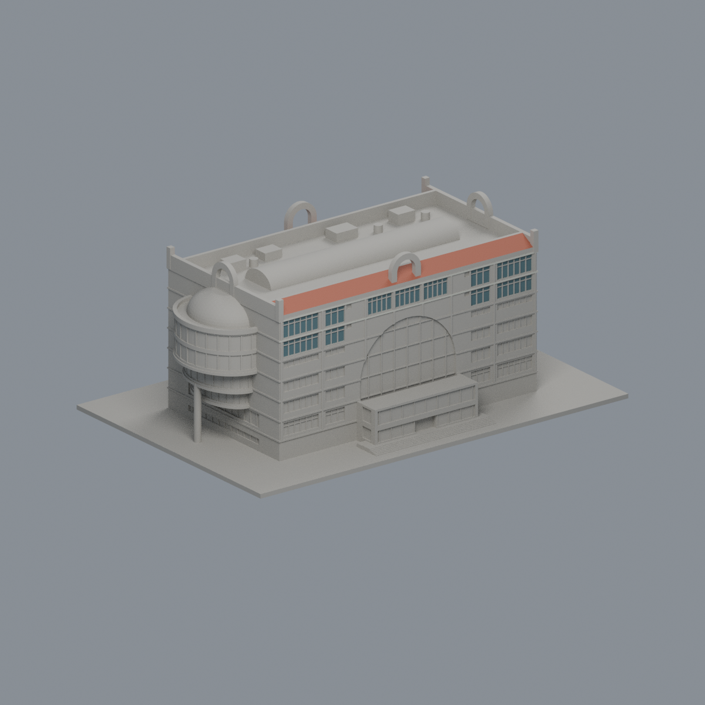
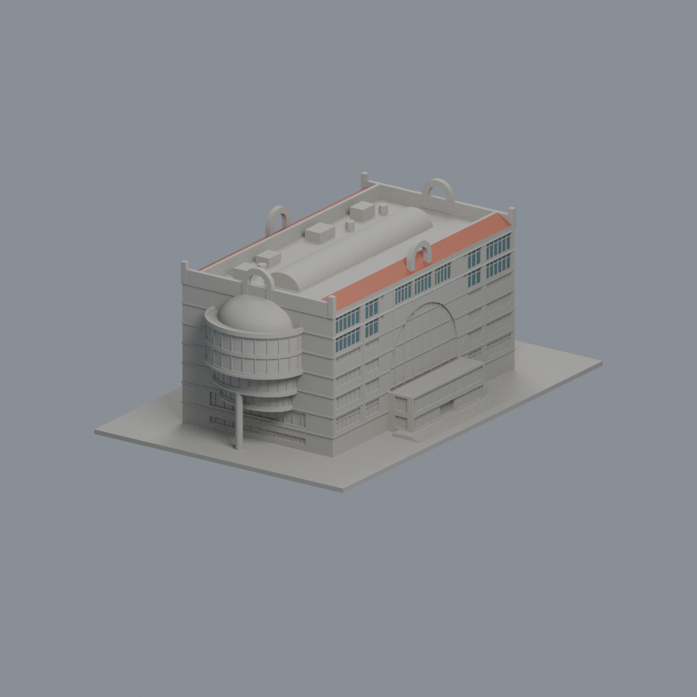
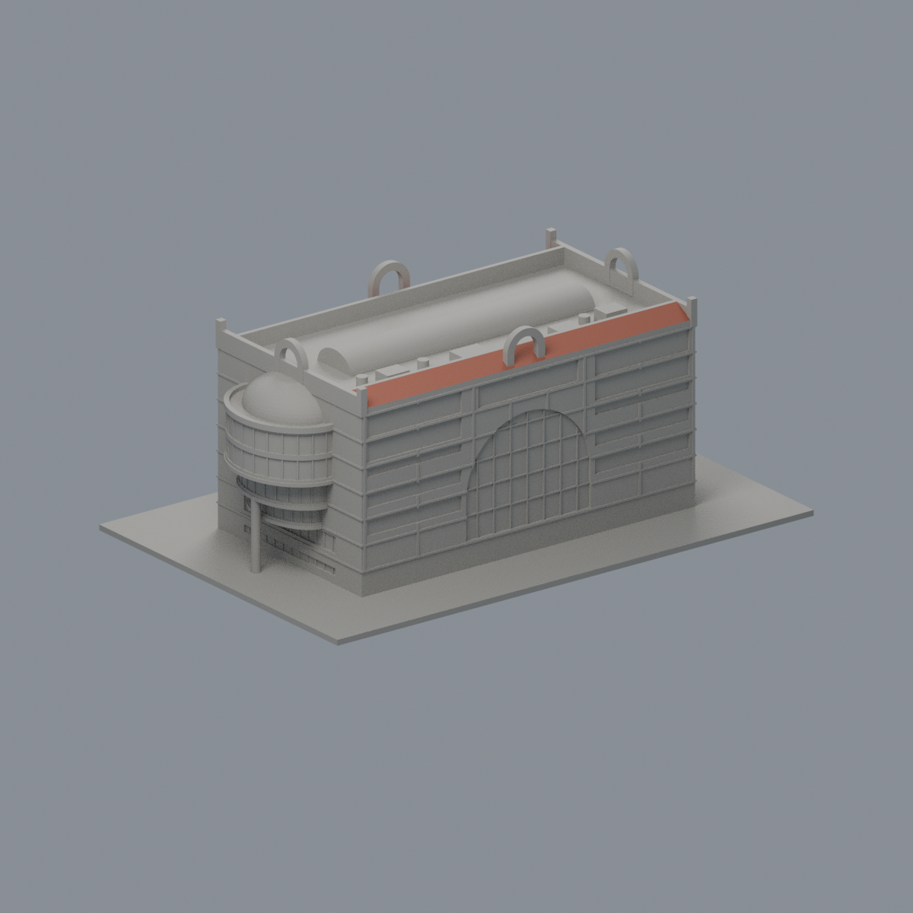
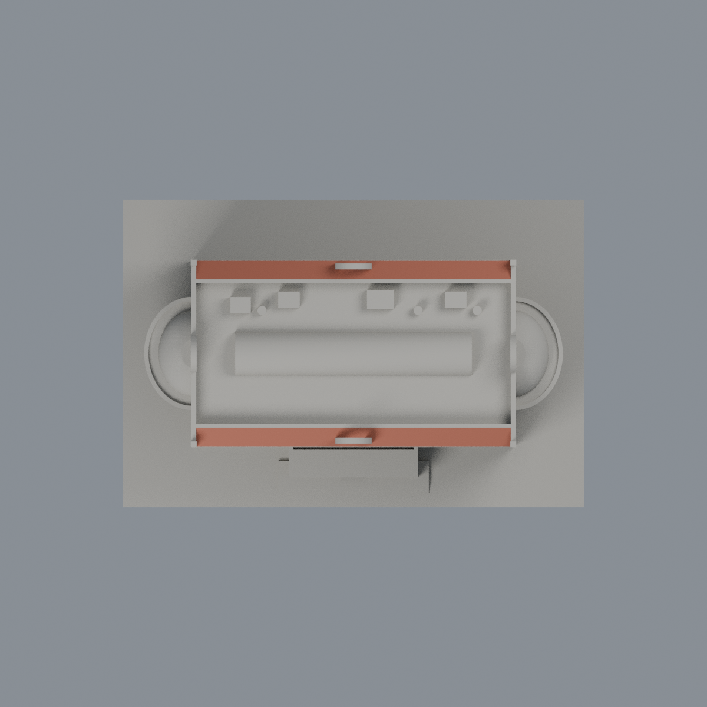

# 中華大學｜香山校本部｜行政暨圖資大樓

## 模型預覽

| 模型預覽 | 模型預覽 | 模型預覽 |
| :---: | :---: | :---: |
|  正面 |  左側 |  右側 |
|  背面：北窄坡有限補色 |  頂視 | |

[STL（不含色）](model.stl) · [現行彩色 3MF](appearance/chu-administration-library-appearance.3mf) · [現行 Blender](appearance/scene.blend) · [外觀、重建與校驗](appearance/README.md) · [來源與證據](sources.md)

現行版為同一棟既有模型。四個材質槽中，原 204 面前窗背、18 面南坡、8 面上前帶，共 230 面保留；再加 18 個完整北窄坡三角面，沿用既有南坡紅瓦近似色。合計 248 面有配色，19,432 面維持未知中性。這是成對屋坡同材延續的推估，不是獨立北立面照片確證、完整外牆復色或現況。未塗屋頂其他部位、主牆、冠部及簷邊。原 STL 位元、9,830 頂點、19,680 三角面、面序及 150 × 100 × 約 61.8 mm 尺度不變。不含鄰棟國際會議廳。

原幾何以公開外觀及校方資料作有限近似，未測繪、未實體試印。原檢查仍是 all-checks passed=false，兩程式非零退出、10 項局部例外及環根支承 71.6256% 未抹除；不能把局部例外或某一冠部的 100% 與整體放行混稱。來源原照只作私人核對，不附於套件。

[原工程驗證報告](https://github.com/hplin50643/taiwan-buildings-3d/blob/cb5044f0a43e95502514e7da26c07ba0494bc980/%E4%B8%AD%E8%8F%AF%E5%A4%A7%E5%AD%B8/%E9%A6%99%E5%B1%B1%E6%A0%A1%E6%9C%AC%E9%83%A8/buildings/chu-administration-library/QA.md)、[舊幾何與中性預覽](https://github.com/hplin50643/taiwan-buildings-3d/blob/cb5044f0a43e95502514e7da26c07ba0494bc980/%E4%B8%AD%E8%8F%AF%E5%A4%A7%E5%AD%B8/%E9%A6%99%E5%B1%B1%E6%A0%A1%E6%9C%AC%E9%83%A8/buildings/chu-administration-library/README.md)和[原工程完整校驗表](https://github.com/hplin50643/taiwan-buildings-3d/blob/cb5044f0a43e95502514e7da26c07ba0494bc980/%E4%B8%AD%E8%8F%AF%E5%A4%A7%E5%AD%B8/%E9%A6%99%E5%B1%B1%E6%A0%A1%E6%9C%AC%E9%83%A8/buildings/chu-administration-library/SHA256SUMS.txt)保留在固定 Git 快照。舊版檢查器與其舊預覽需在該快照一起重播，不拿來驗證現行 WebP 圖冊。
