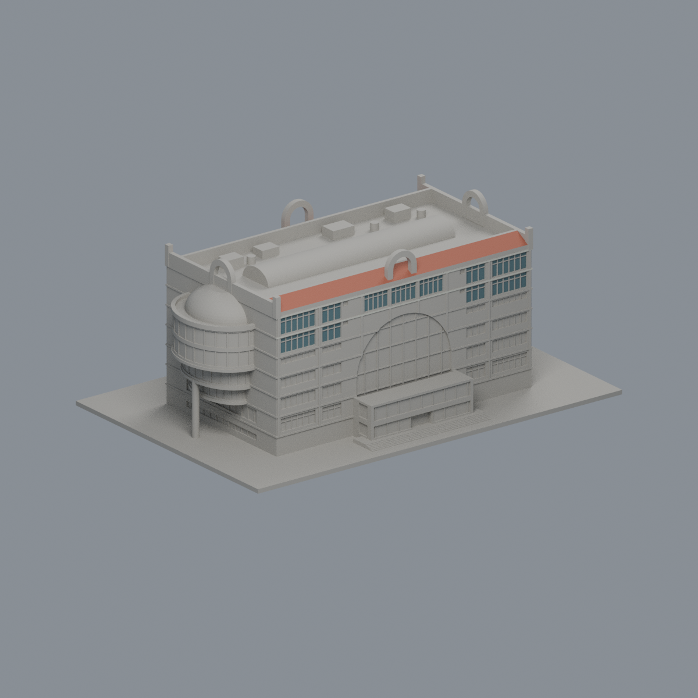
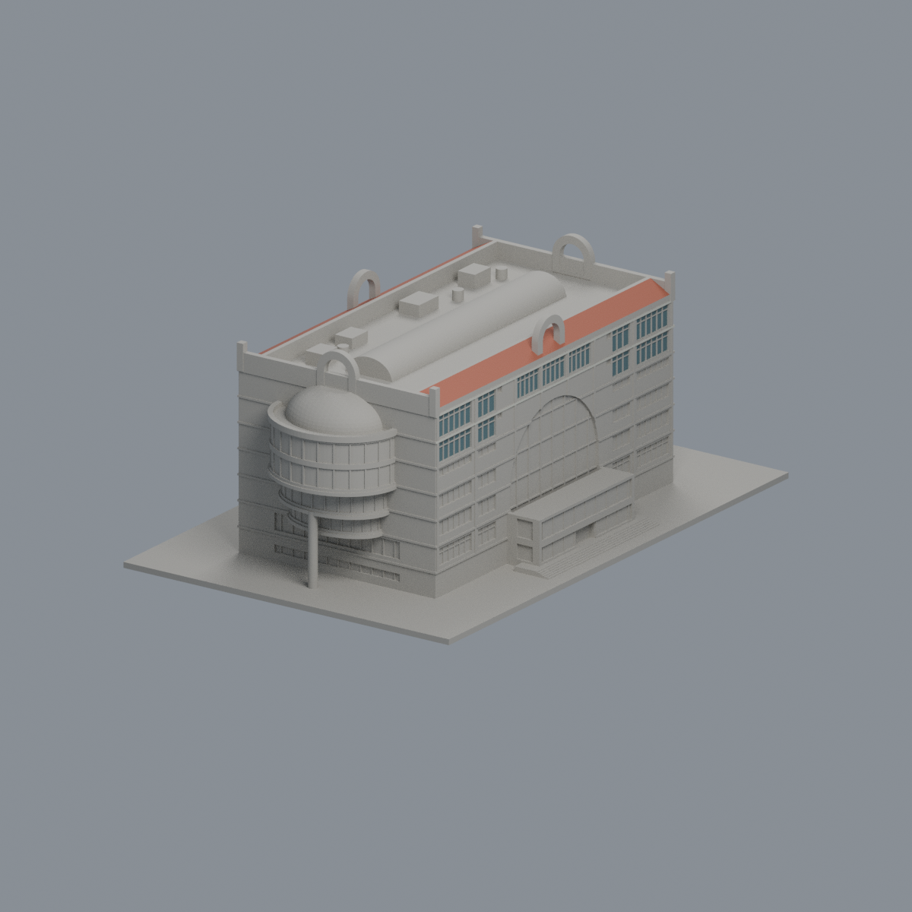
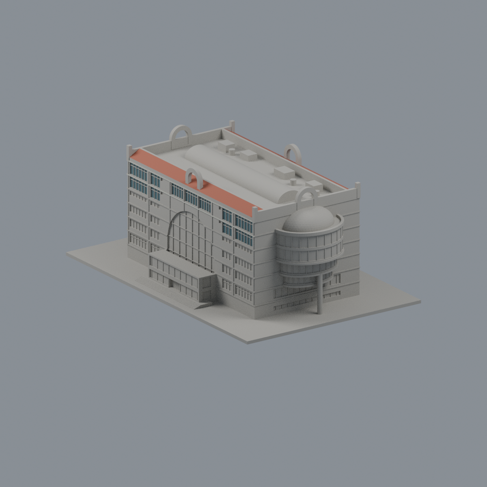
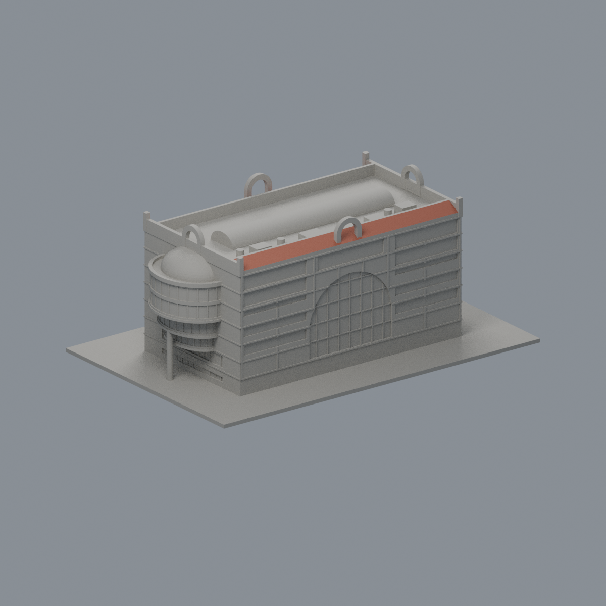
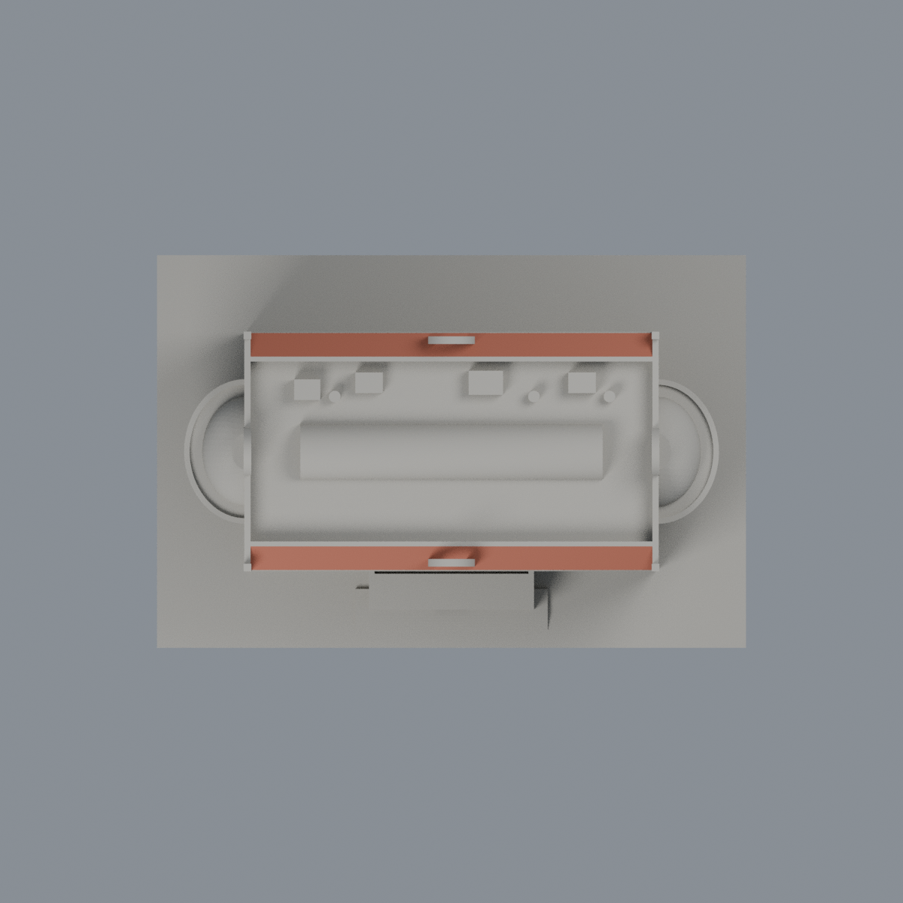

# 中華大學行政暨圖資大樓｜原面有限外觀層

| 正面 | 左側 | 右側 |
|---|---|---|
|  |  |  |
| 背面 | 頂視 | 同角度單色 |
| 北窄坡限域推論，其餘背牆中性  |  |  |

## 本次北側窄坡屋頂材質族延續

僅將北側原狹長坡面 18 個完整中性三角延用已色南坡的紅瓦代理材質 2。原 230 個已色面及全部原理由、四槽色盤材料不變；其餘 19,662 面不變。原 STL bytes、19,680 三角／9,830 點、座標、面序、繞向全部保留，不切面、不改厚度與造型。

選區以原設計坡面 z=29+(17.25−y)×1.8/3.45、y=13.8…17.25 與 x=−30…30 的有限域，核對每個原三角全部三頂點與朝上／北側外法向。扣除原端屏、角柱及兩拱腳後，完整投影域面積與解析域對稱差約 0.000015014 設計 m²、沒有內部三角重疊；實際坡面積 687.036372 mm²，解析值 687.036261 mm²。垂直簷邊、水平頂緣、內面／底面、拱腳、角柱、皇冠、全部牆窗及底座均不補色。

本輪重看校方攝影作品 27／43 原照，南坡紅瓦可辨。本次北坡明示為原成對屋頂的材料族延續推論，**不是獨立背面照片確證**；並非全屋頂塗紅或全棟精確復色。原照片攝影日期未知，2021 XMP 為編輯事件，不能當拍攝日或 2026 現況。色值未校正，非測得材料規格。照片只供私人審核，不加入公開包。

原製造限制完整保留：原 all-checks passed=false、兩原程式 exit1、10 項局部 proof failures 及其有限接受不等於嚴格測試全過；環根支承 71.6256116386% 不得與另一有限皇冠域的 100% 混稱。本次只驗證原幾何與配色保留，不重新認證工程、全方向壁厚、切片、縮尺或實體試印。

新版 QA 在 `qa-continuous-walls/`；歷史 QA、原 source 及舊校驗表均保留 bytes，只代表各自原版。現版校驗請用 `CONTINUATION-SHA256SUMS`。新重建 `python appearance/source/build_continuous_walls.py`，交換驗證 `verify_continuous_exchange.py`，Blender 使用 `render_continuous_walls.py`、`verify_continuous_scene.py`。`rebuild-continuous-source.zip` 含原 STL、必要程式與有限域，可孤立精確重建 3MF／逐面材料／色盤，不含第三方照片。

場景僅同步更新 evidence，明示原 230 個已色面保留及新增 18 個北窄坡面的同屋頂族推論，並非獨立背照證據。原 230 面中包括先前 8 個上前帶面，其隱端仍屬同帶材質推論，不改稱直接照片確證；其餘原屬性、全部材質定義與幾何不變。

## 前版說明與保留限制

這是既有模型的有限材質改善，不是新建築或完整立面復原。僅南向上部11個有限窗背區域204面、南側紅坡18面，共222個原面／1253.9417502698716mm²；其餘19458面保持中性代理。皇冠、混材大弧窗、側弧窗帶、磚牆、白色結構帶、下窗、背面、設備、樓梯及底座不染色。前後著色界線只是本輪證據界線，不宣稱實物存在材料接縫。色值為未經色卡校準的不透明展示代理，非精確反射率、透明玻璃或天空影像。

[彩色3MF](chu-administration-library-appearance.3mf) · [可編輯Blender](scene.blend) · [材質](palette.json) · [逐面索引](face-materials.json) · [重建包](rebuild-source.zip) · [校驗](SHA256SUMS.txt)

## 原幾何與歷史製造限制
原45檔完整保全。原STL bytes、19680三角面座標和順序完全不變；9830頂點、150×100×61.79999924mm。沒有切面、改網或為著色增加幾何。新QA驗證材質有限域、3MF嚴格讀入和實際修改存讀、Blend材質／頂點實改存讀、重開渲染及source ZIP解包重建；不是重跑或抹除原製造例外。

原 all-checks passed=false；check_layer_components.py 與 summarize_component_losses.py 原 exit1、10個具體局部proof failures保留。原README記載獨立複核與主審對這10個具體例外的有限接受，不等於所有嚴格測試全過。0.2mm步距、offset .071：309層／901原Polygon未消失或分裂；268筆逾1%損失含220拱耳樣本最大3.314017010267397%、48角柱樣本最大3.806060217503194%。10項角外原數值例外最大損失.001656514637mm²、深.00254911434mm；.005mm原邊帶外為0，不證明全域最小壁厚。

環根支承只有71.6256116386%（footprint70.2139305mm²、overlap50.2911571741mm²，cuts43.3625/42.9625mm）；0.4mm侵蝕後保留單一10.3833418866mm²核心。另一有限皇冠域224.791807mm²才有100%支承，不可混稱。1628原控制與有限皇冠／環根檢查未擴張重跑。背面近似、照片估高、不能任意縮小等原限制保留；未實體試印、未證明全方向壁厚或切片／收縮保證。

## 身分與年代
原 render_preview.py 及原saved Blend有舊CGU Activity Center metadata殘字；原檔原bytes保留，新scene已明確更正為CHU Administration Library。此為metadata更正，不是幾何修復。兩張官圖相機拍攝日期未知；2021 XMP為編輯／匯出事件，不是拍攝日期。2026-10-23是取閱日，非現況測繪日期；原跨年參考不因此獲得重新認證。

## 重建
解壓rebuild-source.zip，安裝source/requirements.txt，以Blender4.3.2依序執行 `python appearance/source/build_appearance.py`、`python appearance/source/verify_exchange.py`、`blender -b -t 4 --python appearance/source/render_appearance.py`、`blender -b -t 4 --python appearance/source/verify_scene.py`。選面使用實際有向叉積法向、三原頂點全在12有限域和支持平面、design容差0.0001（比例1.75），核對exact IDs，不用面中心。參閱[SOURCES](SOURCES.md)、[權利說明](LICENSE-NOTICE.md)及qa。

## 2026-11-13 有限外觀修正｜模型交付版
僅上層南側兩完整水平帶前面8個原三角補近似淺色#C4C5B8（roughness 0.78）。遮旗端部只沿原有限帶作推定，非校準色；9830頂點、19680三角及其餘指派不變。原10項局部工程證據失敗及有限接受限制保留；環根支承71.6256116386%不混同另一冠區100%。
模型與原生視角圖沿用完成候選的原bytes；不改幾何、不增加分界、不稱全棟精確配色或實體試印通過。原來源年代、工程及列印限制仍適用。先前敘述與審核屬其原版本，本段僅更新上述局部範圍。
本次只交付模型、必要重建輸入/腳本、預覽與此說明；完整研究與獨立審核紀錄另行保留，不在本批公開。PUBLIC-MODEL-SHA256SUMS只核本次所列公開產品，舊校驗與QA不代表本次新版。
