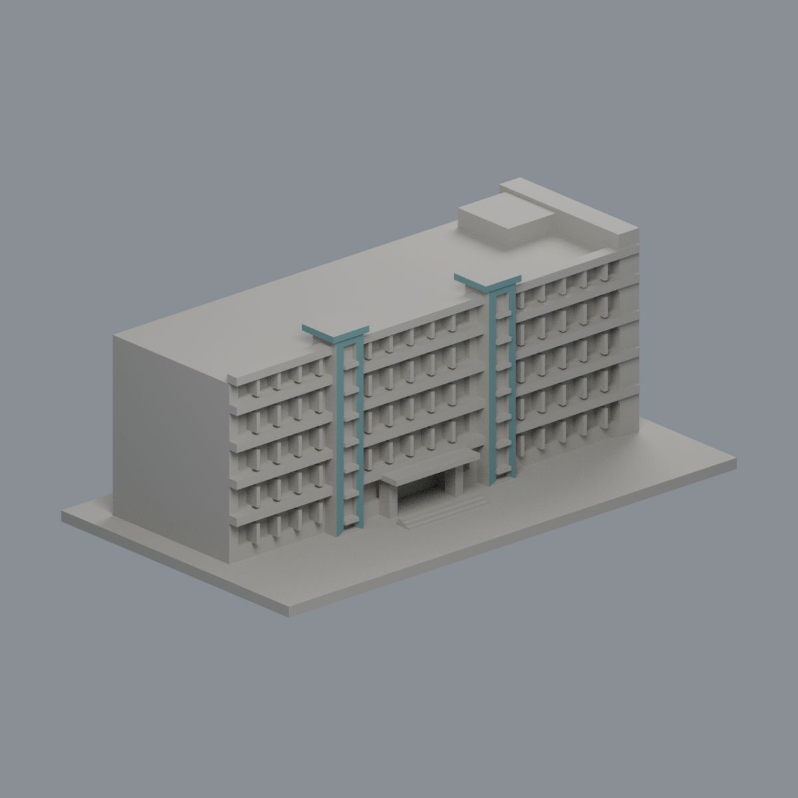
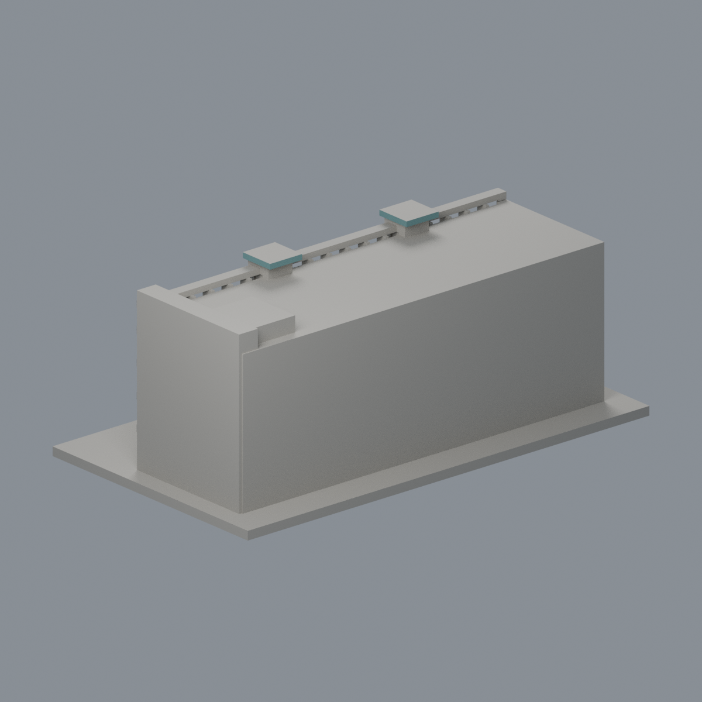

# H棟 學生活動中心

## 模型預覽

| 模型預覽 | 模型預覽 | 模型預覽 |
| :---: | :---: | :---: |
| 正面限域配色  | 塔帽限域延色，其餘後側中性  |  |

## 本次兩塔帽垂直側返延色

僅將兩座樓梯塔既有帽件的左右／後三個垂直邊，共六個完整矩形、12 個原三角，延用既有藍綠材質 1。原前框與帽前面 128 色面及兩槽原色盤完全保留；現 140 已色、3,168 未確認面，仍非全棟完成配色。3,308 原面／1,620 原點、150×86×58 mm 外包、STL bytes、座標、繞向、面序全不變，不新增原照片斜面或瓷磚幾何。

兩帽中心 x=−31／20，x±6、y=−17…−5、z=56…57.8 mm。各新增垂直面逐全頂點／四角矩形與原共面連通域檢查，六個域各為完整兩三角，解析 21.6 mm²、原網格 21.5999908447 mm²，總解析 129.6 mm²。帽水平頂／底、帽下方白色側頰、塔玻璃與窗橫框、主樓混合橫帶、其他牆頂及底座全部不染。原前框原已存在兩組各 64 面的混材共面邊界，全部原樣保留；新六域各整域單材且沒有新增混材域，絕不宣稱全模型共面都是單一材料。

本輪親看校史官方 https://www.hwai.edu.tw/var/file/0/1000/img/14.jpg 及私人局部放大：兩個樓梯塔前框呈藍綠，帽頂側短帶呈較暗藍色，其下側頰有淺白區，所以不能把整個塔側頰塗藍。只沿既有帽件垂直短邊延續原名義色族，側面陰影未當作精確另種油漆色，隱藏帽背是同構件材料推論而非背照獨立證明。原模型平板帽對照片有斜面前框是近似，不因本次延色提高測繪精度；未知拍攝日期，不宣稱 2026 現況，未色卡校準。私人照片與裁切不加入公開包。

原模型工程、簡化與未實體試印限制保留；本次 strict3MF／幾何等價 PASS 不是實體製造、支撐或全域壁厚保證。原 root STL、OBJ、scene、幾何生成器與單色預覽不動；新彩色版本在 appearance。歷史 appearance/qa、source 原程式、rebuild-source.zip、SHA256SUMS、SOURCES 等全部保留 bytes，仍記錄原 128 色面版本，不作新版統計。原 palette 中舊 scope 亦保留以護原始材料欄位，現版範圍以本段及 appearance/qa-continuous-cap 為準。

新檔為 mesh-data.npz、face-materials.json、hwai-activity-h-appearance.3mf、scene.blend 及十張 previews；新 QA 在 appearance/qa-continuous-cap，當前 hashes 在 CONTINUATION-SHA256SUMS。保留五原相機並增加右側、背立面、兩個較高視角及底視，十圖都完整框入建築，不是假造參考照或貼圖。Blender 一建築網格、可獨立材料與頂點編輯再存取，原材料名稱、RGBA／shader色與粗糙度保留。

重建 python appearance/source/build_continuous_cap.py，交換檢查 verify_continuous_exchange.py，Blender 執行 render_continuous_cap.py 及 verify_continuous_scene.py。新 rebuild-continuous-source.zip 可隔離精確重建 NPZ、逐面材料、3MF 與原色盤，且重跑嚴格交換檢查。只本地準備，不宣稱已上傳。

本輪全部原物件屬性與完整材質定義皆保留，僅 12 個指定面的材質指派延伸；原 palette scope 保留歷史文字，現行範圍以本節為準。舊校驗表與 QA 保留歷史 bytes，根 PUBLIC-MODEL-SHA256SUMS 與 appearance/CONTINUATION-SHA256SUMS 為現行校驗。

## 前版說明與保留限制

## 兩樓梯塔前框限域配色（2026-10-22）

[配色五視角、來源與限制](appearance/README.md) · [表面色3MF](appearance/hwai-activity-h-appearance.3mf) · [可編輯Blender](appearance/scene.blend)

僅兩塔實心前框124個完整面及小頂蓋前垂直面4面藍綠配色；玻璃、橫檔、側頰、雙色水平帶、主牆、屋面、後側與底板維持中性，不是整棟精準彩色。原STL bytes、3308三角面、幾何及歷史QA不變，不增套數。3MF為單網格表面色，非分色封閉體、切片或G-code；原薄處與支撐限制保留，未實體試印。照片日期未知，不代表完整2026現況；第三方照片不分發。

公開外觀近似模型。別名／去重：第一宿舍（同棟用途）。

## 觀察與近似
五層橫向長條、五排開窗、兩條凸出樓梯玻璃带、高低屋頂端牆、中央凹入口。

地圖I棟食品加工廠／自主學習中心在後側鄰接；此件只建H，接界與進深仍待精測。背側不杜撰窗格。前方機車棚與景觀省略。

[官方校園圖與用途](https://www.hwai.edu.tw/p/405-1000-35523%2Cc93.php?Lang=zh-tw) · [官方校史](https://www.hwai.edu.tw/p/16-1000-35517.php?Lang=zh-tw) · [官方外觀照片](https://www.hwai.edu.tw/var/file/0/1000/img/14.jpg)。2026-10-13查核；外觀照片無拍攝日期。原照片不随模型重製公開。

## 尺寸與檔案
- 含底板 150.0 × 86.0 × 58.0 mm，最長150mm；每棟獨立目估比例，無測繪尺寸。
- [STL](model.stl) · [Blender場景](scene.blend) · [Python重建](build_model.py) · [來源](sources.json)
- Python：安裝 requirements.txt，執行 build_model.py；Blender 4.3.2+ 執行 blender -b -P render_preview.py。

## 驗證與列印限制
- [原STL與重建驗證](validation.json)：原法向、兩面邊、頂點link單圈、正體積、單一連通外表面、無獨立封閉內腔、重建SHA及Blender幾何一致均通過。
- [0.2mm水平截面](valid-sections.json)：290層每個閉環及合成Polygon均有效；遇invalid會assert，未使用buffer修補。
- [0.8mm XY幾何薄篩](thin-feature-check.json)：58層；超過1%開口損失層數0，最大0.193%。微量損失位於凹窗直角、簷口及轉角，非獨立薄柱。最薄新增附牆格條約1.1mm；非全面壁厚證明。
- 遮簷、陽臺與柱廊上方可能需要支撐；支撐不能補償低於噴嘴解析度的細節。未作列印切片器驗證或實體試印。
- 背面素面是證據不足的簡化，並非實際建物没有窗。模型供展示／研究，不適合作施工、結構或室內用途。
