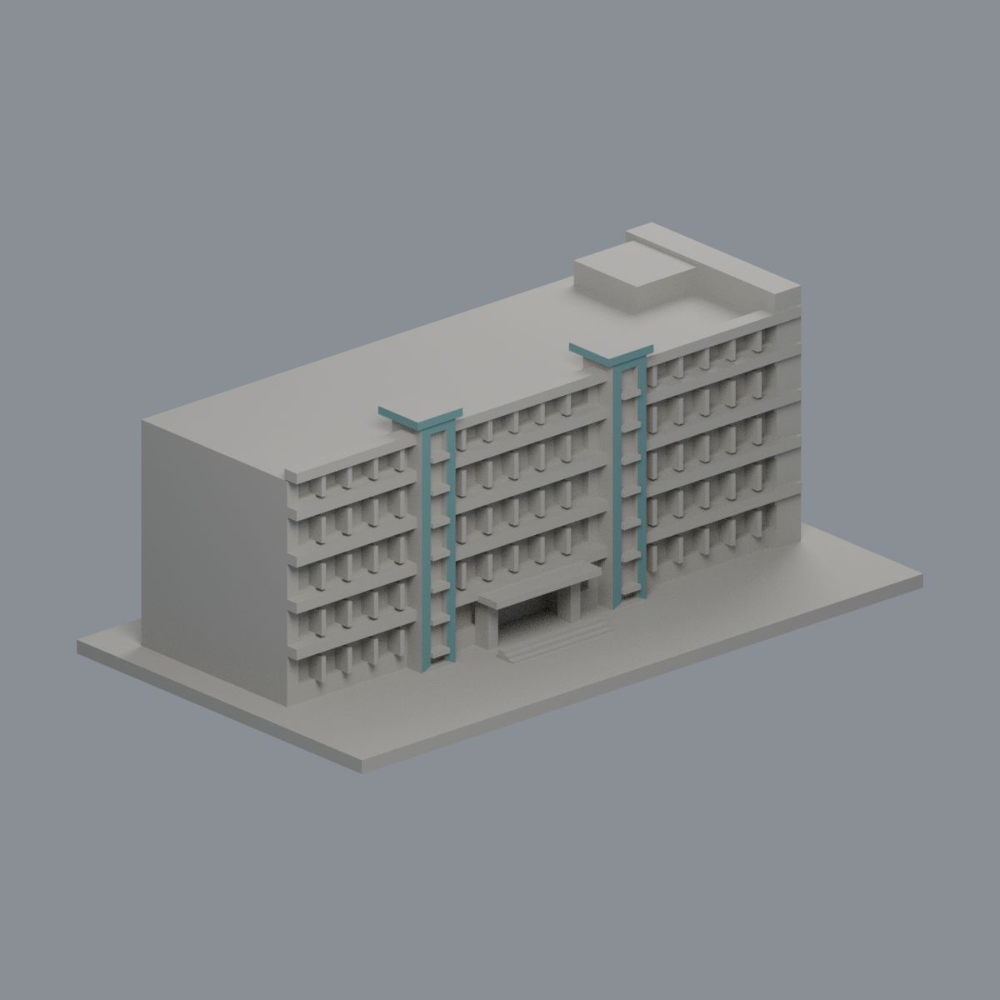
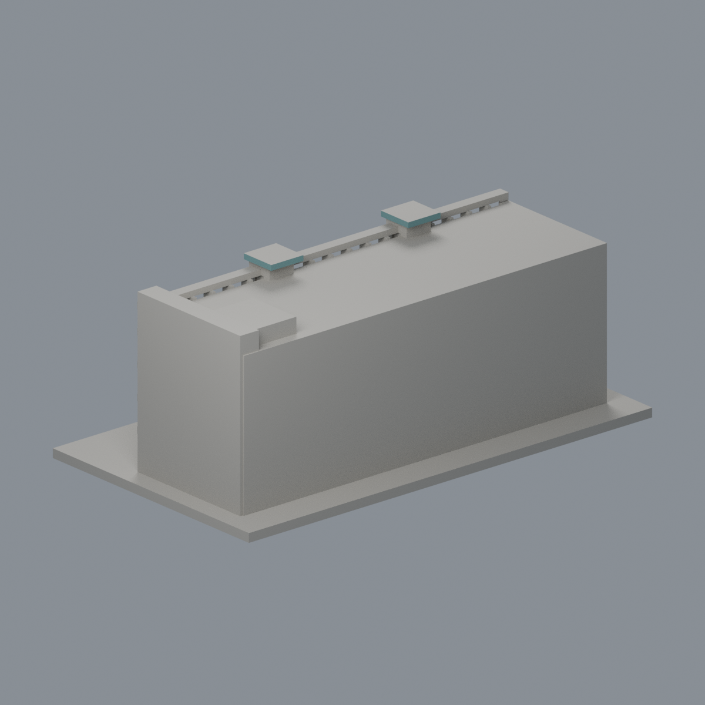
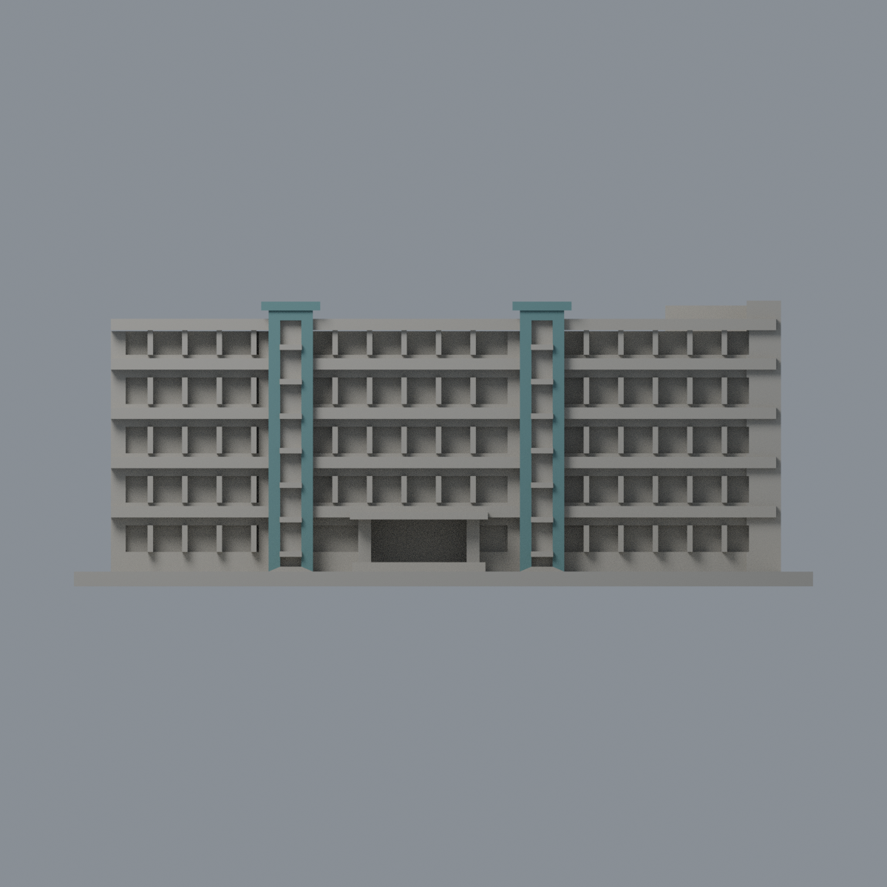
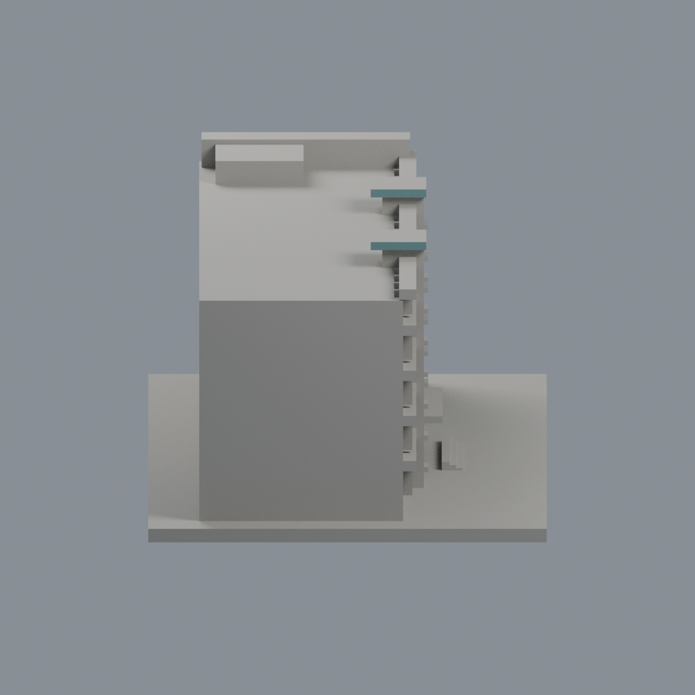
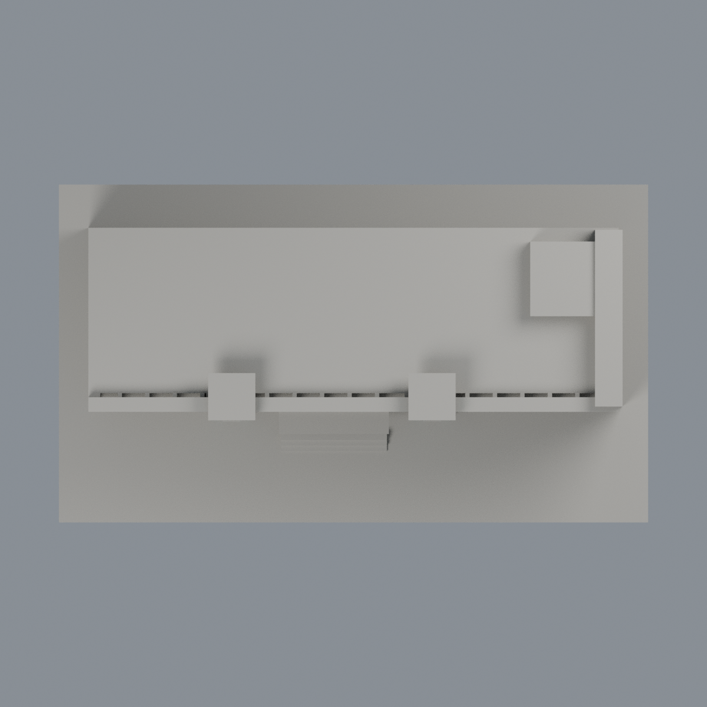

# 中華醫事科技大學 H棟學生活動中心｜樓梯塔前框限域配色

| 正面斜視 | 背面斜視 | 正立面 |
|---|---|---|
|  |  |  |

## 本次兩塔帽垂直側返延色

僅將兩座樓梯塔既有帽件的左右／後三個垂直邊，共六個完整矩形、12 個原三角，延用既有藍綠材質 1。原前框與帽前面 128 色面及兩槽原色盤完全保留；現 140 已色、3,168 未確認面，仍非全棟完成配色。3,308 原面／1,620 原點、150×86×58 mm 外包、STL bytes、座標、繞向、面序全不變，不新增原照片斜面或瓷磚幾何。

兩帽中心 x=−31／20，x±6、y=−17…−5、z=56…57.8 mm。各新增垂直面逐全頂點／四角矩形與原共面連通域檢查，六個域各為完整兩三角，解析 21.6 mm²、原網格 21.5999908447 mm²，總解析 129.6 mm²。帽水平頂／底、帽下方白色側頰、塔玻璃與窗橫框、主樓混合橫帶、其他牆頂及底座全部不染。原前框原已存在兩組各 64 面的混材共面邊界，全部原樣保留；新六域各整域單材且沒有新增混材域，絕不宣稱全模型共面都是單一材料。

本輪親看校史官方 https://www.hwai.edu.tw/var/file/0/1000/img/14.jpg 及私人局部放大：兩個樓梯塔前框呈藍綠，帽頂側短帶呈較暗藍色，其下側頰有淺白區，所以不能把整個塔側頰塗藍。只沿既有帽件垂直短邊延續原名義色族，側面陰影未當作精確另種油漆色，隱藏帽背是同構件材料推論而非背照獨立證明。原模型平板帽對照片有斜面前框是近似，不因本次延色提高測繪精度；未知拍攝日期，不宣稱 2026 現況，未色卡校準。私人照片與裁切不加入公開包。

原模型工程、簡化與未實體試印限制保留；本次 strict3MF／幾何等價 PASS 不是實體製造、支撐或全域壁厚保證。原 root STL、OBJ、scene、幾何生成器與單色預覽不動；新彩色版本在 appearance。歷史 appearance/qa、source 原程式、rebuild-source.zip、SHA256SUMS、SOURCES 等全部保留 bytes，仍記錄原 128 色面版本，不作新版統計。原 palette 中舊 scope 亦保留以護原始材料欄位，現版範圍以本段及 qa-continuous-cap 為準。

新檔為 mesh-data.npz、face-materials.json、hwai-activity-h-appearance.3mf、scene.blend 及十張 previews；新 QA 在 qa-continuous-cap，當前 hashes 在 CONTINUATION-SHA256SUMS。保留五原相機並增加右側、背立面、兩個較高視角及底視，十圖都完整框入建築，不是假造參考照或貼圖。Blender 一建築網格、可獨立材料與頂點編輯再存取，原材料名稱、RGBA／shader色與粗糙度保留。

重建 python appearance/source/build_continuous_cap.py，交換檢查 verify_continuous_exchange.py，Blender 執行 render_continuous_cap.py 及 verify_continuous_scene.py。新 rebuild-continuous-source.zip 可隔離精確重建 NPZ、逐面材料、3MF 與原色盤，且重跑嚴格交換檢查。只本地準備，不宣稱已上傳。

本輪全部原物件屬性與完整材質定義皆保留，僅 12 個指定面的材質指派延伸；原 palette scope 保留歷史文字，現行範圍以本節為準。舊校驗表與 QA 保留歷史 bytes，根 PUBLIC-MODEL-SHA256SUMS 與 appearance/CONTINUATION-SHA256SUMS 為現行校驗。

## 前版說明與保留限制

同一既有模型的外觀附加層，不新增建築套數。H兼第一宿舍用途，不另計；後接I棟不納入。含底板150 × 86 × 58 mm；1620頂點、3308三角面，原STL bytes、逐面座標、面序與拓撲不變。

[表面色3MF](hwai-activity-h-appearance.3mf) · [可編輯Blender](scene.blend) · [色表](palette.json) · [逐面指派](face-materials.json) · [來源](SOURCES.md)

## 只改可辨識完整面
兩樓梯塔實心前框與小頂蓋前垂直面，共128面採藍綠 #638A8B 未校準展示代理。每塔前框62面、頂蓋前面2面。全部三頂點在指定原平面與單一實心框條界內、外法向朝前才選取，不切面、不用重心跨界染色。

其餘3180面中性：玻璃槽後壁、槽側、外露橫檔、側頰、雙色水平大帶、主牆、右高端牆、入口招牌、窗群、樹遮部分、屋面、背面、左右側、底板。水平帶原面沒有白/藍綠分界，因此不整片染色。中性不是實景還原。保留原目估簡化幾何，不聲稱全棟精準彩色。

## 五個真實網格視角
相機名稱不是地理方位。由交付3MF同座標與逐面材質建立，非AI效果圖。


| 模型預覽 | 模型預覽 | 模型預覽 |
| :---: | :---: | :---: |
| 左側<br> | 頂視<br> |  |

## 重建
原model.stl置於appearance上層；依賴見source/requirements.txt；Blender 4.3.2。
```
python appearance/source/build_appearance.py
python appearance/source/verify_material_boundaries.py
python appearance/source/verify_exchange.py
blender -b -t 2 --python-exit-code 1 -P appearance/source/render_appearance.py
blender -b -t 2 --python-exit-code 1 -P appearance/source/verify_scene.py
```
原STL SHA256：6e1960bf13afe0f05ead516f8994e5fc83d220cd010d304b524a4a9231d020ee

QA核對精確座標與面序、有向水密、連通、頂點鏈、正體積、無重複/退化面。lib3mf strict零警告，材質實編存回讀保持其餘顏色與指派；SDK暫存回存小數誤差另列，不作交付。Blend材質同樣實編存回讀。乾淨重建比較3MF、色表、face-map和五PNG bytes；Blend僅主張語義一致。

## 原模型與列印限制
原README、歷史來源及QA保留，本次不重跑製造檢查、不把歷史篩查當全面壁厚保證。3MF是單網格表面色，不是各色封閉體、切片專案、噴頭映射或G-code。FFF GUI、多材料路徑、支撐可移除性及實體列印未測，不保證可印或免支撐。無室內/結構/測繪用途；照片日期未知，非2026完整現況。

[逐檔雜湊](SHA256SUMS) · [權利說明](LICENSE-NOTICE.md)
