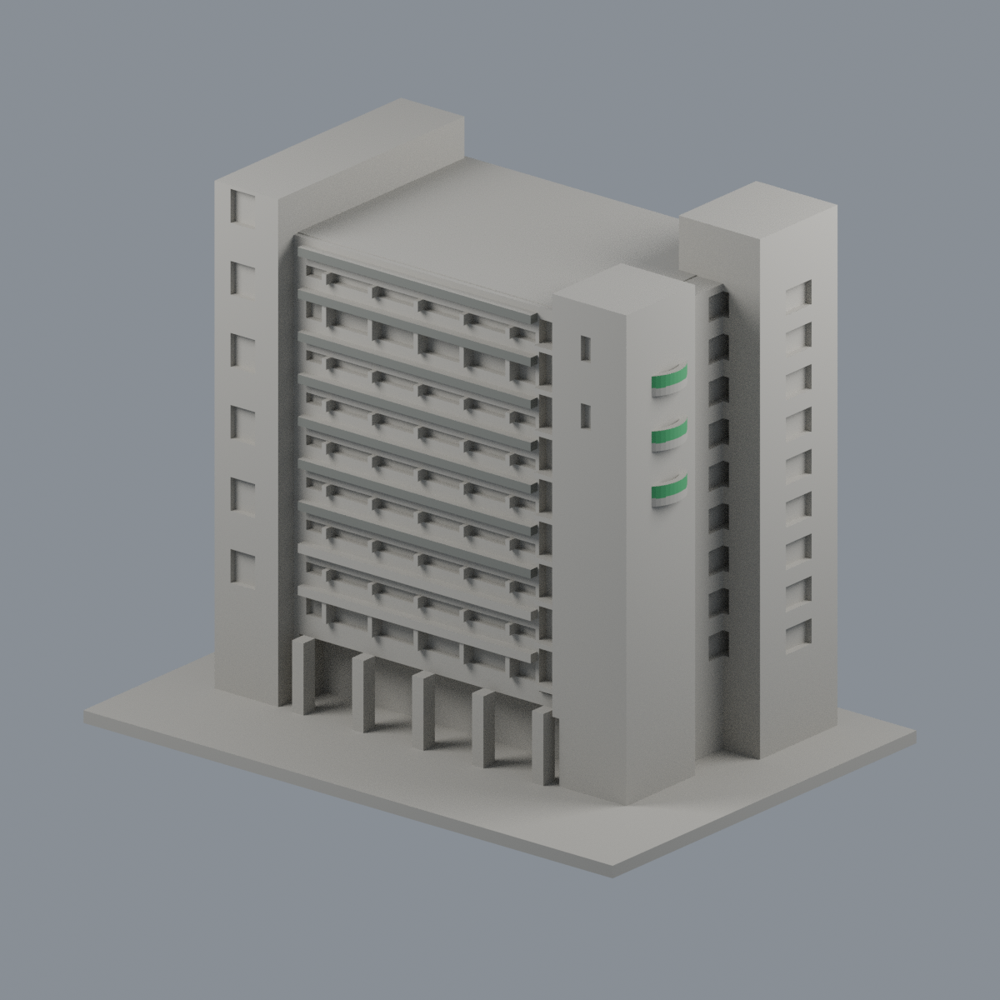
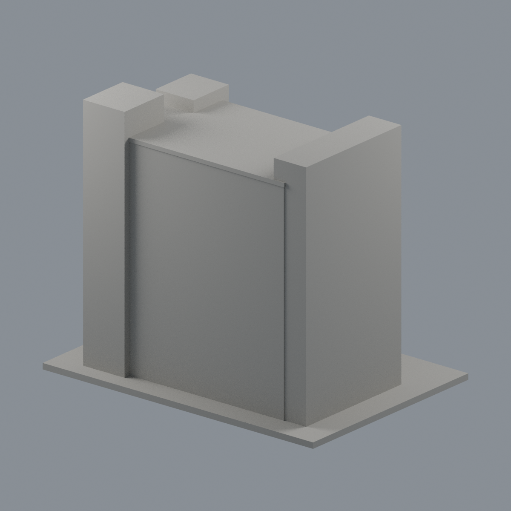

# K棟 民生大樓

## 模型預覽

| 模型預覽 | 模型預覽 | 模型預覽 |
| :---: | :---: | :---: |
| 正面限域配色  | 灰帶端返限域推論，其餘後側中性  |  |

## 本次 K 棟原灰帶垂直端返延色

僅將上段七條原已灰色的前側凸帶，左右垂直短端共 14 個完整矩形、28 個原三角，延用既有灰色材質 2（#777973）。原 122 色面，包括綠色曲欄 108 面與灰帶前面 14 面，以及三槽原色盤與原理由完全保留。新版材料面數為 2,854／108／42，仍非全棟配色完成。3,004 原面／1,504 原點、150×106×125.800003 mm 原尺寸、STL bytes、座標、繞向與面序完全不變，不增加或切割原三角。

七帶原盒 x=−40…26、y=−21.3…−18.7、z=49.2／59.2／69.2／79.2／89.2／99.2／109.2，厚高 2.1 mm。主牆前界 y=−19，所以只延色兩端 x=−40 或 26、y=−21.3…−19 的原露出垂直矩形；露出深 2.3 mm，埋入主牆的 0.3 mm 不補造。每個原矩形兩面、四角及全部三頂點與整個原共面連通分量精確核對，且與同條原灰前面共享完整端邊。單域解析 4.83 mm²，總解析 67.62 mm²，原網格 67.6201039123 mm²；微差來自原 float32 坐標，不修形。

重要範圍：不將前緣色一律推到天花或底面。七帶所有水平頂面／底面均維持原狀；綠色曲欄內側、頂緣與底面、下方兩條未登錄色帶、屋頂、塔柱、招牌牆、玻璃與底座皆不染。原版已存在 36 組混合材料共面分量，全部分量及逐面指派原樣保留；本次 14 新端域各完整單材，無新增混材域，不能宣稱全棟共面都是單材。

本輪親看官方 https://www.hwai.edu.tw/var/file/0/1000/img/14.jpg 全照與 K 棟裁切：棕色塔、淺色招牌牆、三個綠色弧形陽台及灰色水平帶，與既有 K 棟來源及原模型登錄一致。本次短端返是同一原灰帶構件的有界材料延續推論；微小／隱藏端面不是獨立校色或測量證據，不能只因陰影較暗就改色，也不外推成所有飾面相同。拍攝日未知、未校色，不宣稱 2026 現況；原目估進深與窗／構件簡化維持。私人來源照片與裁切不入公開包。

原工程檢查、目估、簡化及未實體試印限制全部保留。本次 strict3MF 與幾何等價 PASS 不是實體製造、支撐或全域壁厚保證。root STL、OBJ、scene、原生成器與單色預覽不動；彩色新版位於 appearance。歷史 QA、source 原程式、rebuild-source.zip、SHA256SUMS、SOURCES 等保持原 bytes，只描述各自歷史版，不能當新版統計。原 palette scope 如仍記錄 122 色面也保留，現版範圍以本段與 appearance/qa-continuous-bandreturns 為準。

新版含 mesh-data.npz、face-materials.json、hwai-minsheng-k-appearance.3mf、scene.blend 與十張 previews。保留五原相機，另加左側、背立面、高位前／後視、底視，十圖均完整框入所有原頂點。Blender 一建築網格、原灰帶 .84／其他原材 .78 粗糙度及名義色保留；材質與單點編輯改存重開、保存場景重渲染、strict3MF 材料往返均已測試。當前 hashes 在 CONTINUATION-SHA256SUMS。新增獨審的範圍限制保留，不以域審代替最終視圖驗證。

重建 python appearance/source/build_continuous_bandreturns.py；交換檢查 verify_continuous_exchange.py、邊界檢查 verify_continuous_boundaries.py；Blender 執行 render_continuous_bandreturns.py 與 verify_continuous_scene.py。rebuild-continuous-source.zip 可隔離精確重建 NPZ、逐面材料、3MF、原色盤並重跑嚴格交換與材料邊界驗證。這是本地交付準備，不宣稱已上傳。

本輪全部原物件屬性與完整材質定義皆保留，僅 28 個指定面的材質指派延伸；原 palette scope 保留歷史文字，現行範圍以本節為準。舊校驗表與 QA 保留歷史 bytes，根 PUBLIC-MODEL-SHA256SUMS 與 appearance/CONTINUATION-SHA256SUMS 為現行校驗。

## 前版說明與保留限制

## 三層綠弧陽臺外欄板限域配色（2026-10-22）

[配色五視角、來源與限制](appearance/README.md) · [表面色3MF](appearance/hwai-minsheng-k-appearance.3mf) · [可編輯Blender](appearance/scene.blend)

僅三層弧形陽臺外側垂直欄板108個完整facet面（每層36面）綠色配色；內弧、上沿、底面、側封口、平台非欄板區、玻璃、混材牆、屋面、後側與底板維持中性，不是整棟精準彩色。原STL bytes、3004三角面、幾何及歷史QA不變，不增套數。3MF為單網格表面色，非分色封閉體、切片或G-code；原薄處與支撐限制保留，未實體試印。照片日期未知，不代表完整2026現況；第三方照片不分發。

公開外觀近似模型。別名／去重：民生科技大樓。

## 觀察與近似
雙側不等高方塔、寬窄交替橫帶、偏右大面招牌牆、右側三段弧形陽臺、底層凹入口。

右側部分被H棟遮挡，陽臺與背側進深目估；未建空調、招牌文字、屋頂天線。陽臺欄杆以加厚實體矮牆表達，非原實體厚度。

[官方校園圖與用途](https://www.hwai.edu.tw/p/405-1000-35523%2Cc93.php?Lang=zh-tw) · [官方校史](https://www.hwai.edu.tw/p/16-1000-35517.php?Lang=zh-tw) · [官方外觀照片](https://www.hwai.edu.tw/var/file/0/1000/img/14.jpg)。2026-10-13查核；外觀照片無拍攝日期。原照片不随模型重製公開。

## 尺寸與檔案
- 含底板 150.0 × 106.0 × 125.8 mm，最長150mm；每棟獨立目估比例，無測繪尺寸。
- [STL](model.stl) · [Blender場景](scene.blend) · [Python重建](build_model.py) · [來源](sources.json)
- Python：安裝 requirements.txt，執行 build_model.py；Blender 4.3.2+ 執行 blender -b -P render_preview.py。

## 驗證與列印限制
- [原STL與重建驗證](validation.json)：原法向、兩面邊、頂點link單圈、正體積、單一連通外表面、無獨立封閉內腔、重建SHA及Blender幾何一致均通過。
- [0.2mm水平截面](valid-sections.json)：629層每個閉環及合成Polygon均有效；遇invalid會assert，未使用buffer修補。
- [0.8mm XY幾何薄篩](thin-feature-check.json)：126層；超過1%開口損失層數0，最大0.023%。微量損失位於凹窗直角、簷口及轉角，非獨立薄柱。最薄新增附牆格條約1.1mm；非全面壁厚證明。
- 遮簷、陽臺與柱廊上方可能需要支撐；支撐不能補償低於噴嘴解析度的細節。未作列印切片器驗證或實體試印。
- 背面素面是證據不足的簡化，並非實際建物没有窗。模型供展示／研究，不適合作施工、結構或室內用途。
