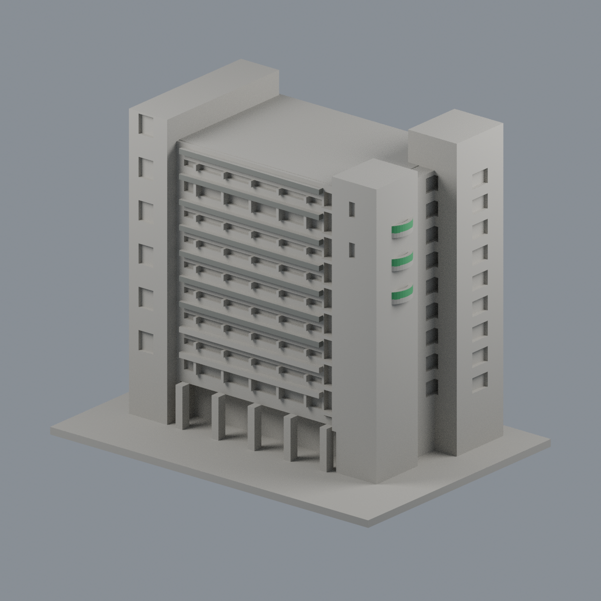
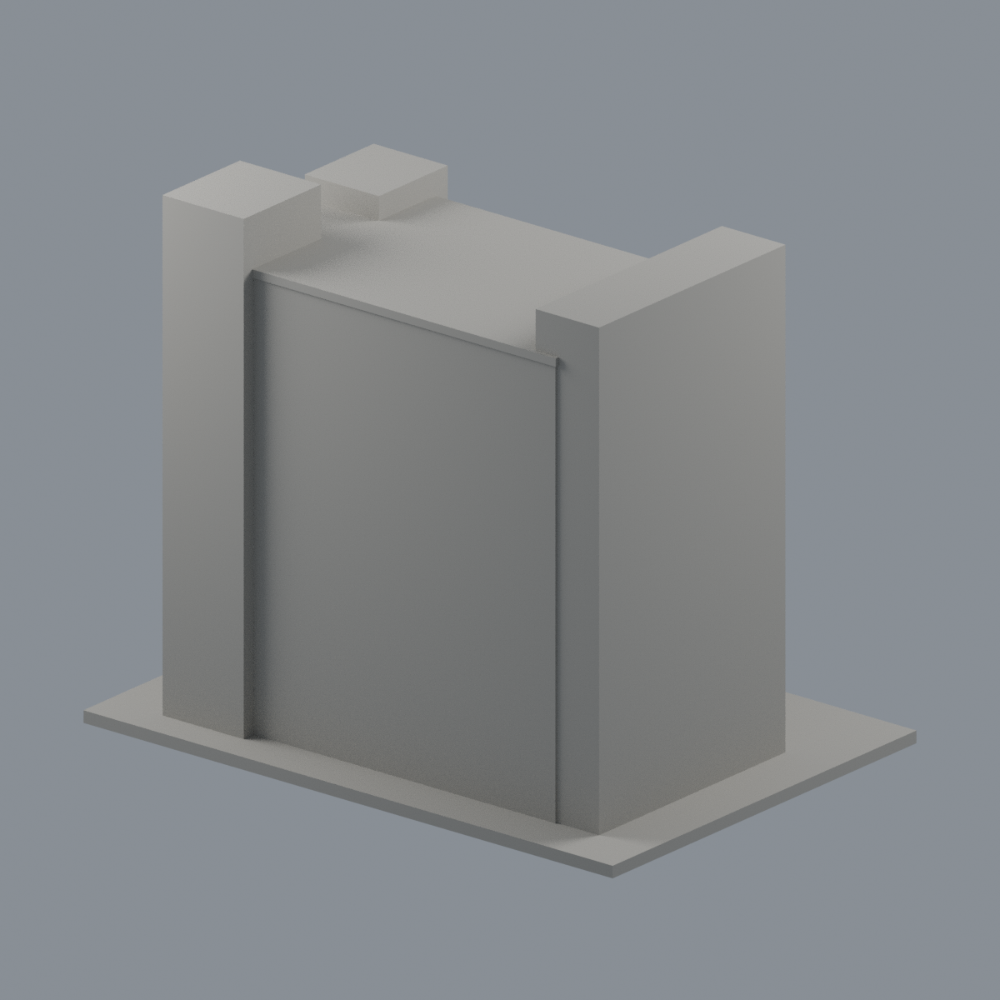
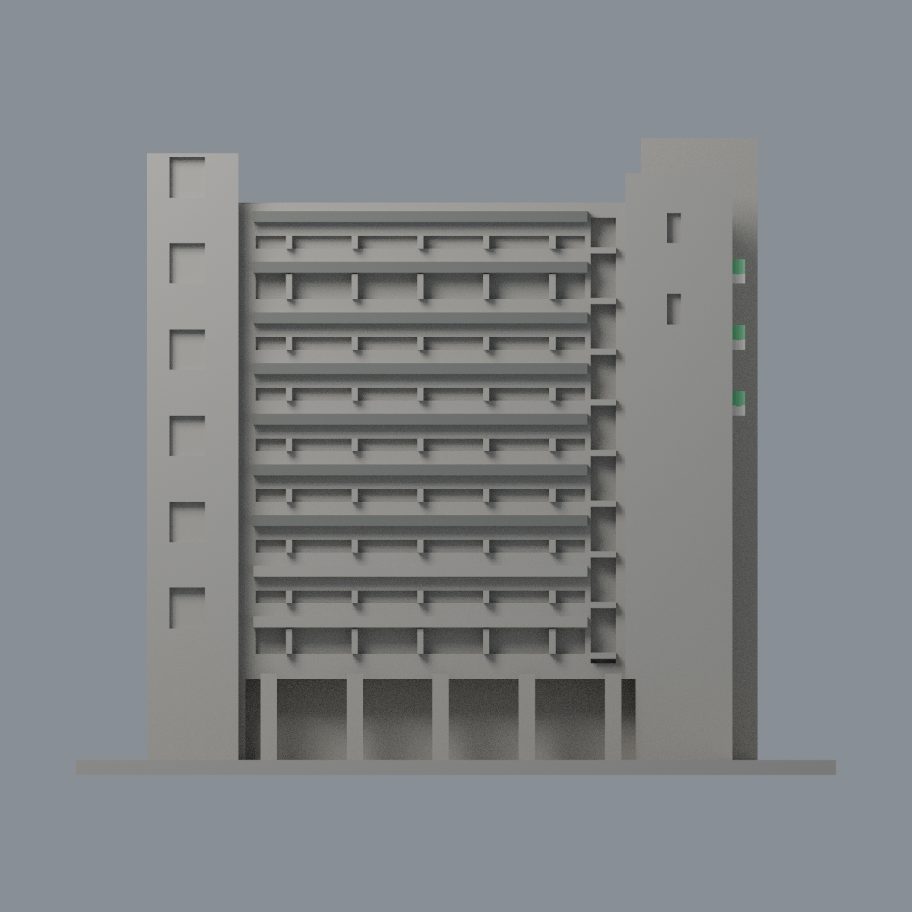
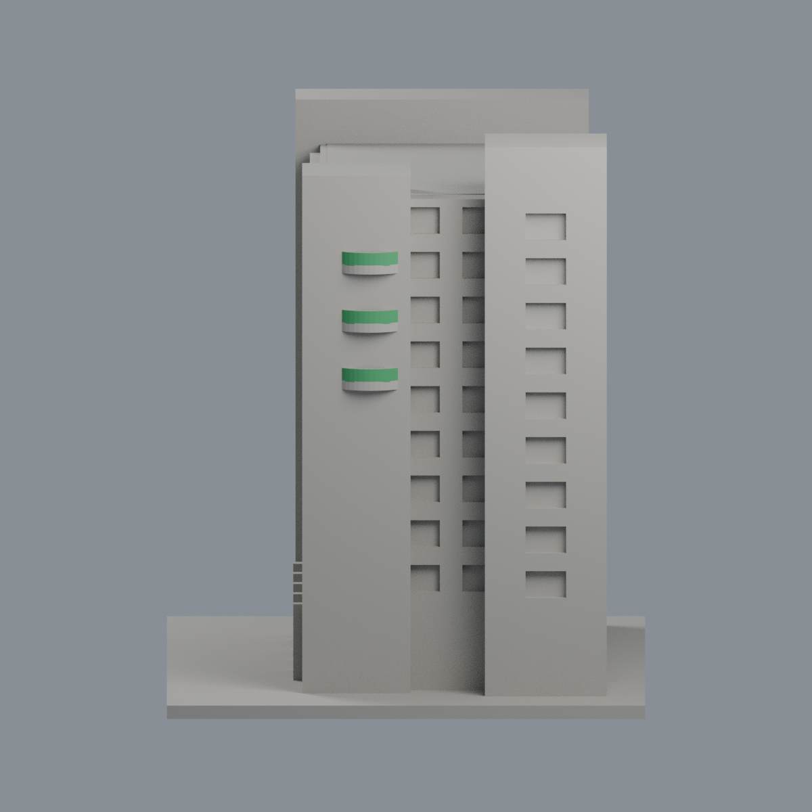
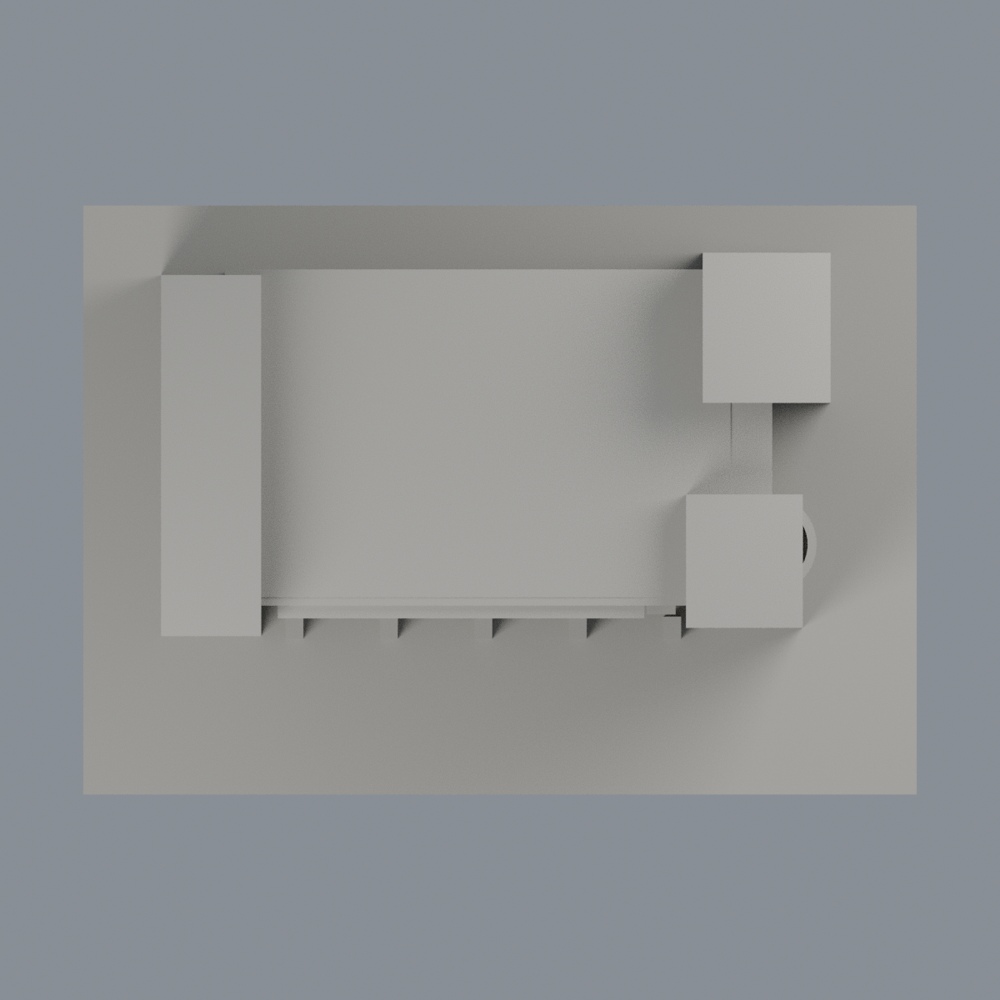

# 中華醫事科技大學 K棟民生大樓｜三層綠弧陽臺外欄板限域配色

| 正面右斜視 | 背面斜視 | 正立面 |
|---|---|---|
|  |  |  |

## 本次 K 棟原灰帶垂直端返延色

僅將上段七條原已灰色的前側凸帶，左右垂直短端共 14 個完整矩形、28 個原三角，延用既有灰色材質 2（#777973）。原 122 色面，包括綠色曲欄 108 面與灰帶前面 14 面，以及三槽原色盤與原理由完全保留。新版材料面數為 2,854／108／42，仍非全棟配色完成。3,004 原面／1,504 原點、150×106×125.800003 mm 原尺寸、STL bytes、座標、繞向與面序完全不變，不增加或切割原三角。

七帶原盒 x=−40…26、y=−21.3…−18.7、z=49.2／59.2／69.2／79.2／89.2／99.2／109.2，厚高 2.1 mm。主牆前界 y=−19，所以只延色兩端 x=−40 或 26、y=−21.3…−19 的原露出垂直矩形；露出深 2.3 mm，埋入主牆的 0.3 mm 不補造。每個原矩形兩面、四角及全部三頂點與整個原共面連通分量精確核對，且與同條原灰前面共享完整端邊。單域解析 4.83 mm²，總解析 67.62 mm²，原網格 67.6201039123 mm²；微差來自原 float32 坐標，不修形。

重要範圍：不將前緣色一律推到天花或底面。七帶所有水平頂面／底面均維持原狀；綠色曲欄內側、頂緣與底面、下方兩條未登錄色帶、屋頂、塔柱、招牌牆、玻璃與底座皆不染。原版已存在 36 組混合材料共面分量，全部分量及逐面指派原樣保留；本次 14 新端域各完整單材，無新增混材域，不能宣稱全棟共面都是單材。

本輪親看官方 https://www.hwai.edu.tw/var/file/0/1000/img/14.jpg 全照與 K 棟裁切：棕色塔、淺色招牌牆、三個綠色弧形陽台及灰色水平帶，與既有 K 棟來源及原模型登錄一致。本次短端返是同一原灰帶構件的有界材料延續推論；微小／隱藏端面不是獨立校色或測量證據，不能只因陰影較暗就改色，也不外推成所有飾面相同。拍攝日未知、未校色，不宣稱 2026 現況；原目估進深與窗／構件簡化維持。私人來源照片與裁切不入公開包。

原工程檢查、目估、簡化及未實體試印限制全部保留。本次 strict3MF 與幾何等價 PASS 不是實體製造、支撐或全域壁厚保證。root STL、OBJ、scene、原生成器與單色預覽不動；彩色新版位於 appearance。歷史 QA、source 原程式、rebuild-source.zip、SHA256SUMS、SOURCES 等保持原 bytes，只描述各自歷史版，不能當新版統計。原 palette scope 如仍記錄 122 色面也保留，現版範圍以本段與 qa-continuous-bandreturns 為準。

新版含 mesh-data.npz、face-materials.json、hwai-minsheng-k-appearance.3mf、scene.blend 與十張 previews。保留五原相機，另加左側、背立面、高位前／後視、底視，十圖均完整框入所有原頂點。Blender 一建築網格、原灰帶 .84／其他原材 .78 粗糙度及名義色保留；材質與單點編輯改存重開、保存場景重渲染、strict3MF 材料往返均已測試。當前 hashes 在 CONTINUATION-SHA256SUMS。新增獨審的範圍限制保留，不以域審代替最終視圖驗證。

重建 python appearance/source/build_continuous_bandreturns.py；交換檢查 verify_continuous_exchange.py、邊界檢查 verify_continuous_boundaries.py；Blender 執行 render_continuous_bandreturns.py 與 verify_continuous_scene.py。rebuild-continuous-source.zip 可隔離精確重建 NPZ、逐面材料、3MF、原色盤並重跑嚴格交換與材料邊界驗證。這是本地交付準備，不宣稱已上傳。

本輪全部原物件屬性與完整材質定義皆保留，僅 28 個指定面的材質指派延伸；原 palette scope 保留歷史文字，現行範圍以本節為準。舊校驗表與 QA 保留歷史 bytes，根 PUBLIC-MODEL-SHA256SUMS 與 appearance/CONTINUATION-SHA256SUMS 為現行校驗。

## 前版說明與保留限制

同一既有模型的外觀附加層，不新增建築套數。別名民生科技大樓，不是H學生活動中心或J護理大樓。含底板150 × 106 × 125.8 mm；1504頂點、3004三角面。原STL bytes、逐面座標、面序與拓撲不變。

[表面色3MF](hwai-minsheng-k-appearance.3mf) · [可編輯Blender](scene.blend) · [色表](palette.json) · [逐面指派](face-materials.json) · [來源](SOURCES.md)

## 只改可辨識完整面
三層弧形陽臺外側垂直欄板，共108完整面（每層36）採綠色 #3C9860 未校準不透明展示代理。全部三頂點必須同時位於原48邊外圓某一有限facet平面及單層高度範圍；法向朝外。不切面、不使用重心跨界染色。

初步徑向候選表為105面；終核另發現2640、2758、2876三個微小完整外facet面，原float32法向z誤差使初篩漏選。獨立驗證以48邊端點、有限邊投影、支持平面距離和單位外法向確認108面。保留逐面終核記錄，不拿徑向容差當最後依據。

其餘2896面中性：內弧、欄板上沿下底及側封口、平台非欄板區、玻璃/門窗、寬招牌混材牆、左塔、橫帶、低層遮擋、背面、屋頂和底板。中性不是實景還原。上方細黑欄杆未另建；原陽臺尺寸、深度和加厚矮牆屬目估簡化，不因配色而成為精密實測模型。

## 五個真實網格視角
相機名稱不是地理方位。由交付3MF同座標與逐面材質建立，非AI效果圖。


| 模型預覽 | 模型預覽 | 模型預覽 |
| :---: | :---: | :---: |
| 右側<br> | 頂視<br> |  |

## 重建與驗證
原model.stl置於appearance上層；依賴見source/requirements.txt；Blender 4.3.2。
```
python appearance/source/build_appearance.py
python appearance/source/verify_material_boundaries.py
python appearance/source/verify_exchange.py
blender -b -t 2 --python-exit-code 1 -P appearance/source/render_appearance.py
blender -b -t 2 --python-exit-code 1 -P appearance/source/verify_scene.py
```
原STL SHA256：1bf4de701702dbf94212b744219425d4bc813d5bcd156fefcc5d02076ff75662

QA核對精確座標與面序、有向水密、連通、頂點鏈、正體積、無重複/退化面。lib3mf strict零警告，材質實編存回讀保持其餘顏色與指派；SDK暫存回存小數誤差另列，不作交付。Blend材質同樣實編存回讀。乾淨重建比較3MF、色表、face-map和五PNG bytes；Blend僅主張語義一致。

## 原模型與列印限制
保留原README、歷史來源及QA。本次未重跑製造檢查，不把歷史篩查當全面壁厚保證。3MF是單網格表面色，不是各色封閉體、切片專案、噴頭映射或G-code。FFF GUI、多材料路徑、支撐可移除性及實體列印未測，不保證可印或免支撐。無室內/結構/測繪用途。照片日期未知，非2026完整現況。

[逐檔雜湊](SHA256SUMS) · [權利說明](LICENSE-NOTICE.md)


## 2026-11-13 有限外觀修正｜模型交付版

原108綠色外弧面不變；本次另14面上七條前垂直完整矩形使用近似灰 #777973／roughness .84，其他2882面仍中性。最低兩條、窗背／框／空調／招牌及所有帶側頂底不改。原排帶與窗列為粗代理，非測繪；照片日期未知，色值非校準，端部遮擋為有界同族推估。

模型、材質、原生視角圖與必要重建程式沿用完成候選，未改幾何或新切材界，不代表全館精確復色、現況或實體試印通過。原來源年代、工程與列印限制仍適用，舊說明與審核僅屬各自版本，本段更新上述局部範圍。

本次只公開模型、必要重建輸入／腳本、預覽與說明；完整來源、比較及研究審核不隨本批交付。根目錄PUBLIC-MODEL-SHA256SUMS僅校驗所列當前產品，舊表不驗證新版。重建ZIP只含必要重建檔與本說明；歷史來源及QA連結指儲存庫既有文件，非ZIP內的新增審核附件。
