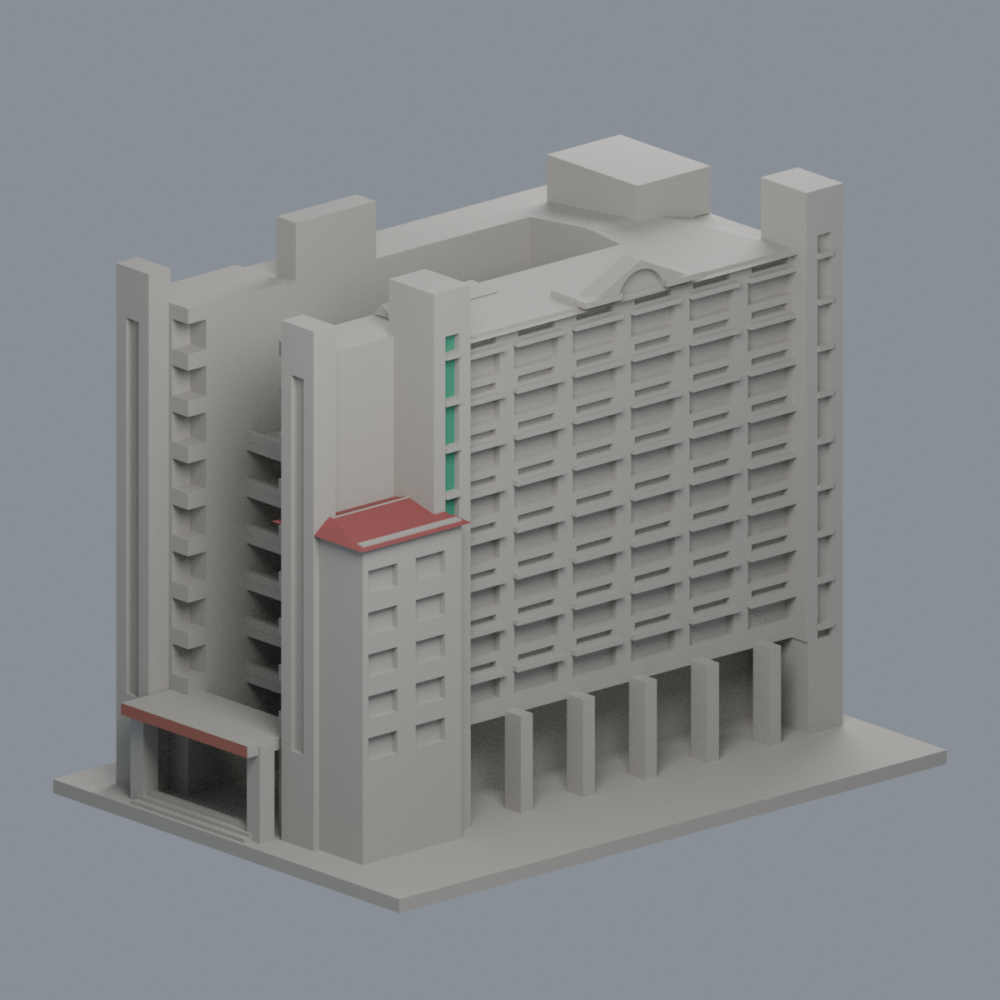
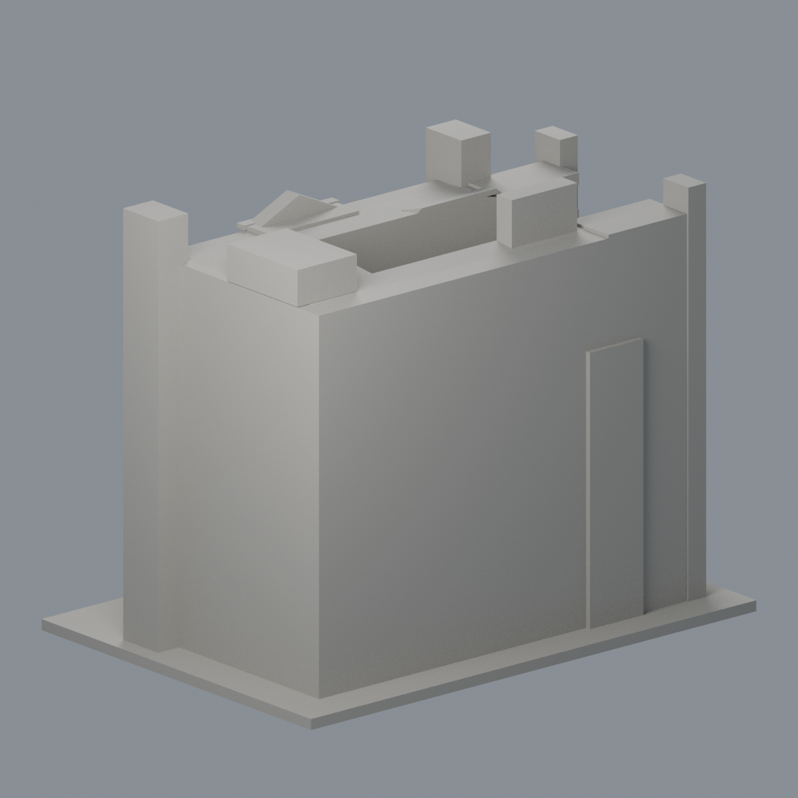

# J棟 護理大樓

## 模型預覽

| 模型預覽 | 模型預覽 | 模型預覽 |
| :---: | :---: | :---: |
| 正面限域配色  | 低翼後坡限域推論，其餘後側中性  |  |

## 本次 J 棟低翼原坡帽後坡延色

僅將原左前方低翼同一坡帽的後向餘面，共 8 個原三角，延用既有紅棕材質 1（#8C4847）。原 40 色面，包括紅棕前／左坡 16 面、綠色凹槽玻璃 22 面、入口磚色帶 2 面，全數保留；四槽材料名稱、RGBA 名義色與原 palette.json bytes 不變。新版 counts 為 4,468／24／22／2，仍非全棟配色完成。4,516 原面／2,230 原點、STL bytes、全部座標、繞向與面序不變，無新增或重建幾何。

有限域來自原 hip(-52,-19,71,30,28,3.2)，上口縮放 (.72,.03) 的後坡。原投影梯形四角為 (-67,-5)、(-37,-5)、(-41.2,-18.58)、(-62.8,-18.58) mm，坡面 z=71+(-5−y)×3.2/13.58。扣除原較高翼、前樓梯塔、側柱和較低翼頂部的布林接觸域後，是兩個完整共面露出島，各 4 面，不是未扣遮擋的整片梯形。逐面全頂點、整三角投影、原連通島及整個朝後／朝上支撐面皆核對，沒有跨接觸面延色。原面 IDs 為 3503、3506、3508、3510、3512、3517、3518、3520。解析面積 90.1268779031 mm²，原網格 90.1268630250 mm²；投影對稱差 0.00000403135 mm² 為原 float32 頂點微差，原面零重疊。接觸區不補造、不封洞，也不把原右坡小片、水平頂、其他屋頂、塔牆、玻璃或底座塗上紅色。

本輪親看官方 https://www.hwai.edu.tw/var/file/0/1000/img/14.jpg 全照與 J 棟局部，白色高塔、綠色樓梯帶、紅棕分段坡簷與低翼身份符合既有來源。只有同一低翼帽件已見前／側坡的色族可作延續依據；新增後坡為隱藏同帽材料推論，不是背照獨立證明。照片未知拍攝日、未校色，不能宣稱 2026 現況或量測級尺寸。原坡帽厚度、縮頂及高低翼比例依原目估模型，不藉本次補色提升精度。私人照片與裁切不入公開包。

原工程驗證、目估、簡化與未實體試印限制全部保留。本次 strict3MF／精確幾何等價 PASS 並非實體製造、支撐或全域壁厚保證。root STL、OBJ、scene、原幾何生成器及單色預覽不動；新彩色版在 appearance。歷史 QA、source 原程式、rebuild-source.zip、SHA256SUMS、SOURCES 等保持原 bytes，仍記錄舊版而非新版統計。原 palette scope 如記錄 40 色面也保留，現版範圍以本段及 appearance/qa-continuous-lowhiprear 為準。

新版包含 mesh-data.npz、face-materials.json、hwai-nursing-j-appearance.3mf、scene.blend 與十張 previews。保留五原相機，另加右側、背立面、高位前／後視、底視，十張均完整框入所有原頂點。Blender 材料及單點改存重開、原存檔重渲染、strict3MF 材料改存往返均已測試；磚帶 .88／玻璃 .4／其他 .78 原粗糙度保留。新 QA 在 appearance/qa-continuous-lowhiprear，新增獨審只涵蓋它明定的範圍，不以域審替代最終圖片驗證。當前 hashes 在 CONTINUATION-SHA256SUMS。

重建 python appearance/source/build_continuous_lowhiprear.py；交換檢查 verify_continuous_exchange.py；Blender 執行 render_continuous_lowhiprear.py 及 verify_continuous_scene.py。新 rebuild-continuous-source.zip 可隔離精確重建 NPZ、逐面材料、3MF、原色盤並重跑嚴格交換檢查。這是本地交付準備，不宣稱已上傳。

本輪全部原物件屬性與完整材質定義皆保留，僅 8 個指定面的材質指派延伸；原 palette scope 保留歷史文字，現行範圍以本節為準。舊校驗表與 QA 保留歷史 bytes，根 PUBLIC-MODEL-SHA256SUMS 與 appearance/CONTINUATION-SHA256SUMS 為現行校驗。

## 前版說明與保留限制

## 左前低翼瓦帽與單豎窗限域配色（2026-10-22）

[配色五視角、來源與限制](appearance/README.md) · [表面色3MF](appearance/hwai-nursing-j-appearance.3mf) · [可編輯Blender](appearance/scene.blend)

僅左前低翼前/左瓦坡16個完整面與單綠玻璃豎槽後壁22面配色；混材牆、山牆、其他窗槽、庭院、後側與未確認坡面維持中性，不是整棟精準彩色。原STL bytes、4516三角面、幾何及歷史QA不變，不增套數。3MF為單網格表面色，非分色封閉體、切片或G-code；原薄處與支撐限制保留，未實體試印。照片日期未知，不代表完整2026現況；第三方照片不分發。

公開外觀近似模型。別名／去重：科技教學大樓；體育一館為地下樓層用途，不另計棟。

## 觀察與近似
十層主塔、分段高低翼、兩層入口柱廊、側面深凹水平帶、綠玻璃樓梯豎帶、折線／弧線混合山牆及低翼坡簷。

底層被樹遮擋，柱距與挑空深度目估；照片右側與後側翼部不可完整辨讀，背側採簡化包絡。坡簷縮成可列印厚度，窗片、冷氣與文字省略。

[官方校園圖與用途](https://www.hwai.edu.tw/p/405-1000-35523%2Cc93.php?Lang=zh-tw) · [官方校史](https://www.hwai.edu.tw/p/16-1000-35517.php?Lang=zh-tw) · [官方外觀照片](https://www.hwai.edu.tw/var/file/0/1000/img/14.jpg)。2026-10-13查核；外觀照片無拍攝日期。原照片不随模型重製公開。

## V2：新增已識別深庭證據
[可讀「科技教學大樓」的入口照](https://www.flickr.com/photos/techexpo/9355047531/)與[2004-11-17入口全景](https://www.flickr.com/photos/techexpo/9357821208/)確認為J棟舊名；[跨層橋廊照片](https://www.flickr.com/photos/techexpo/9355047873/)顯示開頂深庭。本版保留向西敞開的院落、六層橋廊及入口柱棚，修正V1未見該面時的實心包絡。庭院深度、橋距為近似；歷史照片不代表逐處2026現況。

## 尺寸與檔案
- 含底板 150.0 × 107.0 × 120.0 mm，最長150mm；每棟獨立目估比例，無測繪尺寸。
- [STL](model.stl) · [Blender場景](scene.blend) · [Python重建](build_model.py) · [來源](sources.json)
- Python：安裝 requirements.txt，執行 build_model.py；Blender 4.3.2+ 執行 blender -b -P render_preview.py。

## 驗證與列印限制
- [原STL與重建驗證](validation.json)：原法向、兩面邊、頂點link單圈、正體積、單一連通外表面、無獨立封閉內腔、重建SHA及Blender幾何一致均通過。
- [0.2mm水平截面](valid-sections.json)：600層每個閉環及合成Polygon均有效；遇invalid會assert，未使用buffer修補。
- [0.8mm XY幾何薄篩](thin-feature-check.json)：120層；超過1%開口損失層數0，最大0.105%。微量損失位於凹窗直角、簷口及轉角，非獨立薄柱。最薄新增附牆格條約1.1mm；非全面壁厚證明。
- 遮簷、陽臺與柱廊上方可能需要支撐；支撐不能補償低於噴嘴解析度的細節。未作列印切片器驗證或實體試印。
- 背面素面是證據不足的簡化，並非實際建物没有窗。模型供展示／研究，不適合作施工、結構或室內用途。
