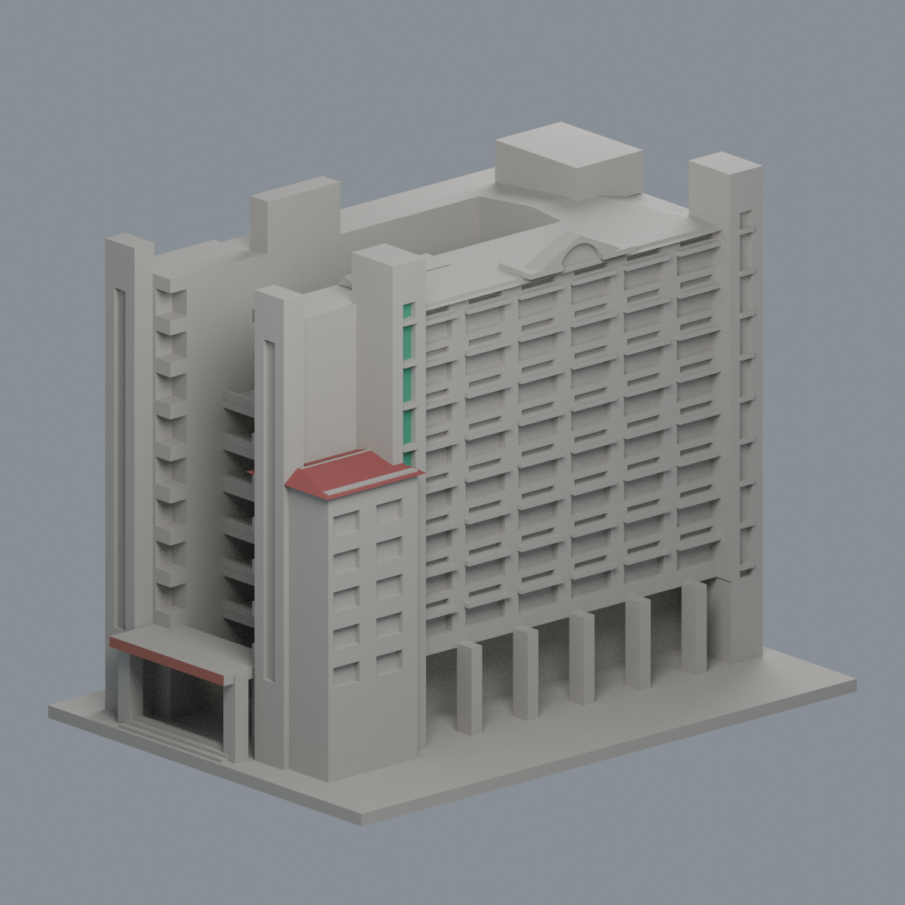
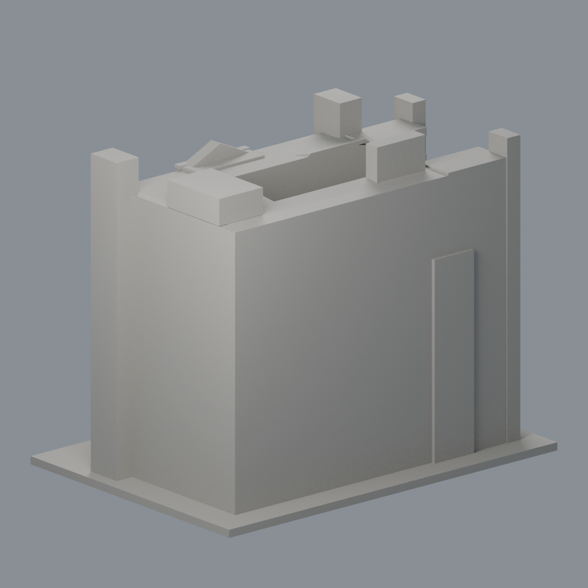
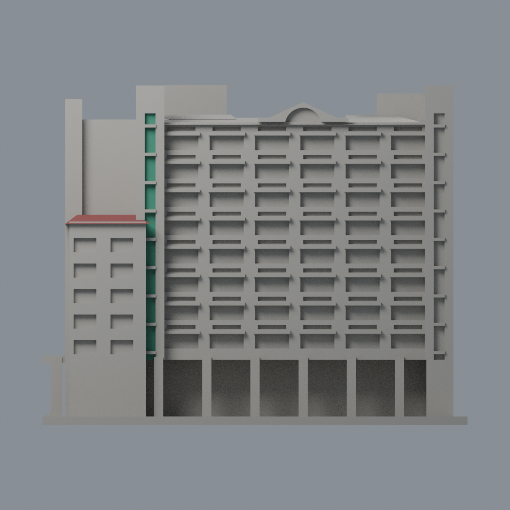
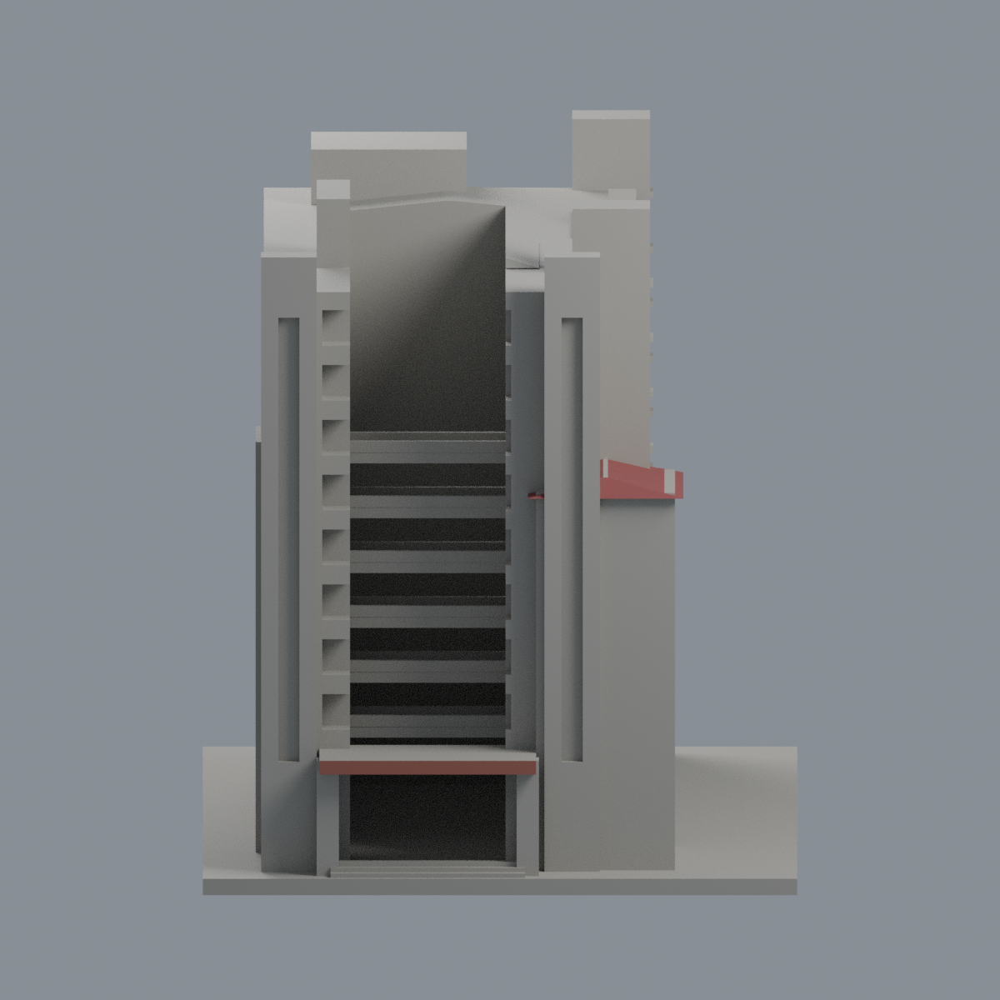
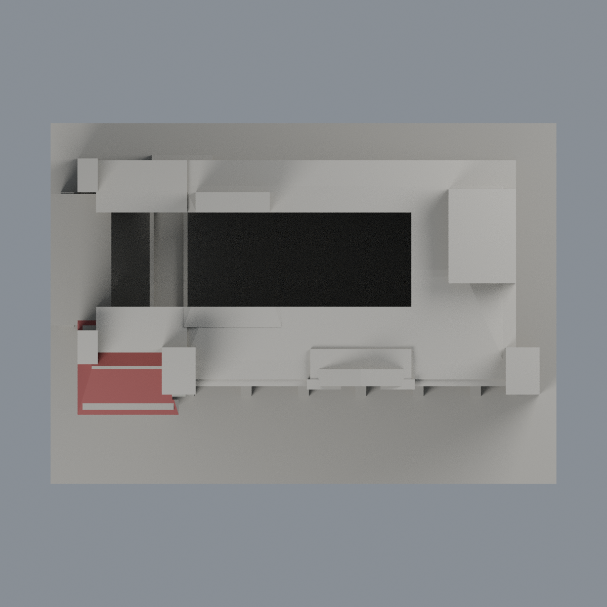

# 中華醫事科技大學 J棟護理大樓｜限域配色

| 正面斜視 | 背面斜視 | 正立面 |
|---|---|---|
|  |  |  |

## 本次 J 棟低翼原坡帽後坡延色

僅將原左前方低翼同一坡帽的後向餘面，共 8 個原三角，延用既有紅棕材質 1（#8C4847）。原 40 色面，包括紅棕前／左坡 16 面、綠色凹槽玻璃 22 面、入口磚色帶 2 面，全數保留；四槽材料名稱、RGBA 名義色與原 palette.json bytes 不變。新版 counts 為 4,468／24／22／2，仍非全棟配色完成。4,516 原面／2,230 原點、STL bytes、全部座標、繞向與面序不變，無新增或重建幾何。

有限域來自原 hip(-52,-19,71,30,28,3.2)，上口縮放 (.72,.03) 的後坡。原投影梯形四角為 (-67,-5)、(-37,-5)、(-41.2,-18.58)、(-62.8,-18.58) mm，坡面 z=71+(-5−y)×3.2/13.58。扣除原較高翼、前樓梯塔、側柱和較低翼頂部的布林接觸域後，是兩個完整共面露出島，各 4 面，不是未扣遮擋的整片梯形。逐面全頂點、整三角投影、原連通島及整個朝後／朝上支撐面皆核對，沒有跨接觸面延色。原面 IDs 為 3503、3506、3508、3510、3512、3517、3518、3520。解析面積 90.1268779031 mm²，原網格 90.1268630250 mm²；投影對稱差 0.00000403135 mm² 為原 float32 頂點微差，原面零重疊。接觸區不補造、不封洞，也不把原右坡小片、水平頂、其他屋頂、塔牆、玻璃或底座塗上紅色。

本輪親看官方 https://www.hwai.edu.tw/var/file/0/1000/img/14.jpg 全照與 J 棟局部，白色高塔、綠色樓梯帶、紅棕分段坡簷與低翼身份符合既有來源。只有同一低翼帽件已見前／側坡的色族可作延續依據；新增後坡為隱藏同帽材料推論，不是背照獨立證明。照片未知拍攝日、未校色，不能宣稱 2026 現況或量測級尺寸。原坡帽厚度、縮頂及高低翼比例依原目估模型，不藉本次補色提升精度。私人照片與裁切不入公開包。

原工程驗證、目估、簡化與未實體試印限制全部保留。本次 strict3MF／精確幾何等價 PASS 並非實體製造、支撐或全域壁厚保證。root STL、OBJ、scene、原幾何生成器及單色預覽不動；新彩色版在 appearance。歷史 QA、source 原程式、rebuild-source.zip、SHA256SUMS、SOURCES 等保持原 bytes，仍記錄舊版而非新版統計。原 palette scope 如記錄 40 色面也保留，現版範圍以本段及 qa-continuous-lowhiprear 為準。

新版包含 mesh-data.npz、face-materials.json、hwai-nursing-j-appearance.3mf、scene.blend 與十張 previews。保留五原相機，另加右側、背立面、高位前／後視、底視，十張均完整框入所有原頂點。Blender 材料及單點改存重開、原存檔重渲染、strict3MF 材料改存往返均已測試；磚帶 .88／玻璃 .4／其他 .78 原粗糙度保留。新 QA 在 qa-continuous-lowhiprear，新增獨審只涵蓋它明定的範圍，不以域審替代最終圖片驗證。當前 hashes 在 CONTINUATION-SHA256SUMS。

重建 python appearance/source/build_continuous_lowhiprear.py；交換檢查 verify_continuous_exchange.py；Blender 執行 render_continuous_lowhiprear.py 及 verify_continuous_scene.py。新 rebuild-continuous-source.zip 可隔離精確重建 NPZ、逐面材料、3MF、原色盤並重跑嚴格交換檢查。這是本地交付準備，不宣稱已上傳。

本輪全部原物件屬性與完整材質定義皆保留，僅 8 個指定面的材質指派延伸；原 palette scope 保留歷史文字，現行範圍以本節為準。舊校驗表與 QA 保留歷史 bytes，根 PUBLIC-MODEL-SHA256SUMS 與 appearance/CONTINUATION-SHA256SUMS 為現行校驗。

## 前版說明與保留限制

同一既有模型的外觀附加層，不新增建築套數。含底板150 × 107 × 120 mm；2230頂點、4516三角面，原STL bytes、逐面座標、面序與拓撲不變。

[表面色3MF](hwai-nursing-j-appearance.3mf) · [可編輯Blender](scene.blend) · [色表](palette.json) · [逐面指派](face-materials.json) · [來源](SOURCES.md)

## 只改可辨識、可分界的完整面
- 左前低翼瓦帽：僅原hip(-52,-19,71,30,28,3.2)朝前、朝左斜面，共16面，暗紅褐展示代理。
- 左前高柱單一綠玻璃豎帶：僅原凹槽後壁y=-25.5、x=-38.9..-35.1、z=23..110，共22面。既有橫檔、槽側壁不染綠；不透明代理不是光學玻璃。
- 其餘4478面維持中性：混材主牆、柱、山牆、橫窗組、背面、庭院、右後翼、不可見屋坡、底面及底板。中性不是實景顏色還原。
- 全三頂點在原斜平面/後壁與指定界限內才選取，不切三角面、不用重心跨界染色；未擴大到主塔屋帽或其他豎槽。原幾何簡化與目估比例保留。

## 五個真實網格視角
相機名稱不是地理方位。影像由交付3MF相同座標與逐面材質建立，非AI效果圖。


| 模型預覽 | 模型預覽 | 模型預覽 |
| :---: | :---: | :---: |
| 左側<br> | 頂視<br> |  |

## 重建與驗證
原model.stl置於appearance上層。Python依賴見source/requirements.txt；Blender 4.3.2。

```
python appearance/source/build_appearance.py
python appearance/source/verify_exchange.py
blender -b -t 2 --python-exit-code 1 -P appearance/source/render_appearance.py
blender -b -t 2 --python-exit-code 1 -P appearance/source/verify_scene.py
```

原STL SHA256：6a529f825d294ee1066af11a9202e2f55214a43a5c91959407cbfc0f9c24b290

交換QA核對精確座標與面序、有向水密、連通、頂點鏈、正體積、無重複/退化面。lib3mf strict零警告，實際材質編輯回存重讀保持其餘顏色與指派；SDK回存小數誤差另列，該暫存檔不交付。Blend同樣執行材質實編存回讀。乾淨重建比較3MF、色表、face-map及五PNG bytes；Blend僅主張語義一致，不主張binary一致。

## 列印與原模型限制
原歷史QA與原README保持不變，本次未重跑製造檢查。原0.2mm截面600層有效、0.8mm XY薄篩120層僅為歷史幾何篩查，並非全面壁厚保證。原簷口、陽臺、柱廊上方可能需支撐；綠玻璃薄槽與橫檔仍是原簡化幾何。

3MF是單網格表面色，不是各色封閉體、切片專案、噴頭映射或G-code。FFF GUI、多材料路徑、支撐可移除性及實體列印未測，不保證可印或免支撐。無室內/結構/測繪用途；照片日期未知，非2026完整現況。

[逐檔雜湊](SHA256SUMS) · [權利說明](LICENSE-NOTICE.md)


## 2026-11-13 有限外觀修正｜模型交付版

原紅瓦／綠豎窗材與面完全保持，僅原入口棚最前 x=-75 完整矩形2面補近似紅磚#A16457/.88，其餘4514面不改。照片為歷史2004日期字樣，非現況認證；粗平板缺天窗及格梁，僅前緣身分可對應，不染頂／底／側／柱／階。

模型、材質、原生視角圖與必要重建程式沿用完成候選，未改幾何或新切材界，不代表全館精確復色、現況或實體試印通過。原來源年代、工程與列印限制仍適用，舊說明與審核僅屬各自版本，本段更新上述局部範圍。

本次只公開模型、必要重建輸入／腳本、預覽與說明；完整來源、比較及研究審核不隨本批交付。根目錄PUBLIC-MODEL-SHA256SUMS僅校驗所列當前產品，舊表不驗證新版。重建ZIP只含必要重建檔與本說明；歷史來源及QA連結指儲存庫既有文件，非ZIP內的新增審核附件。
