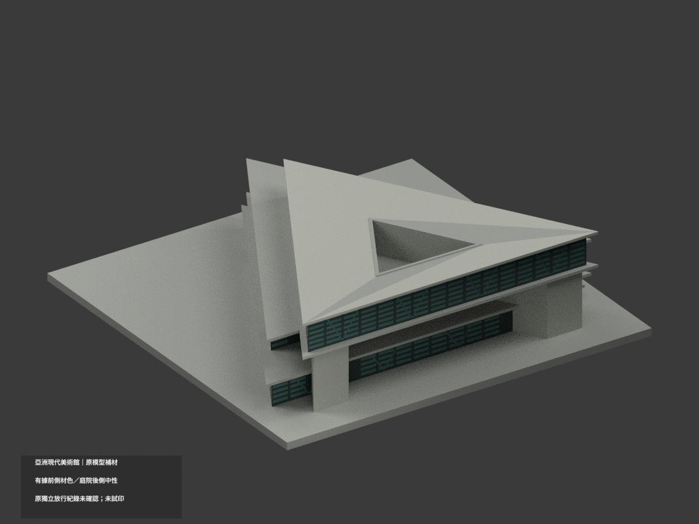
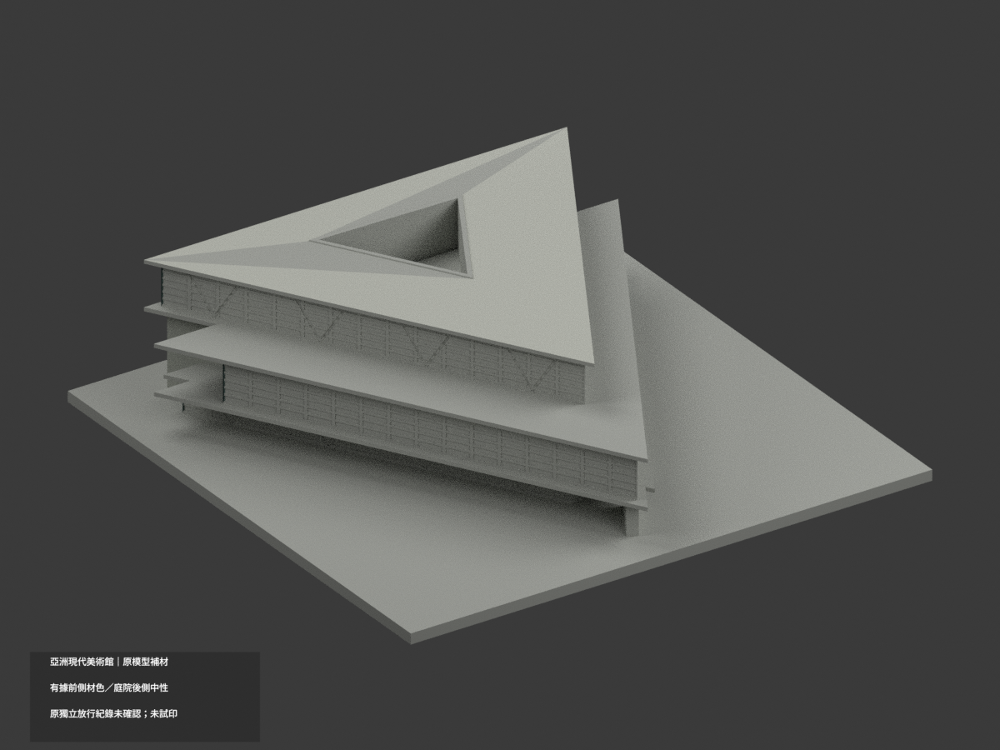
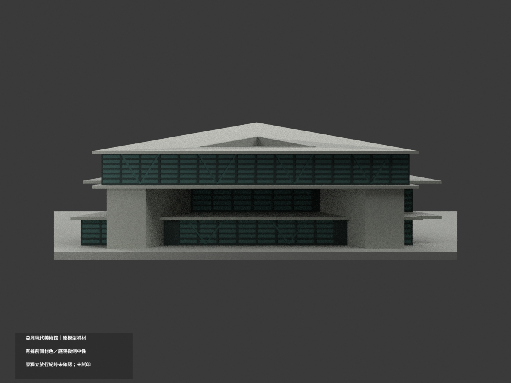
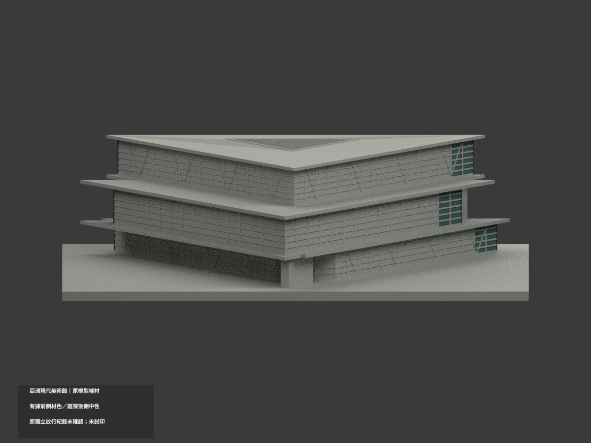
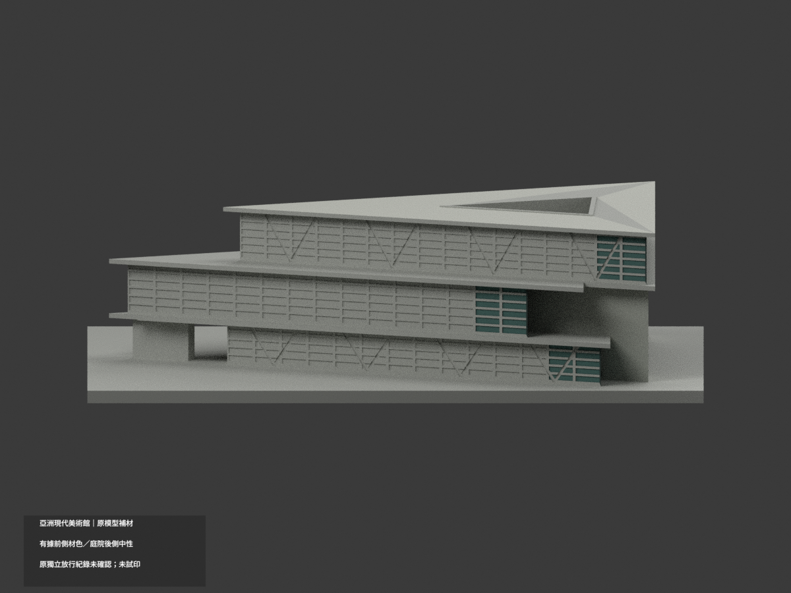
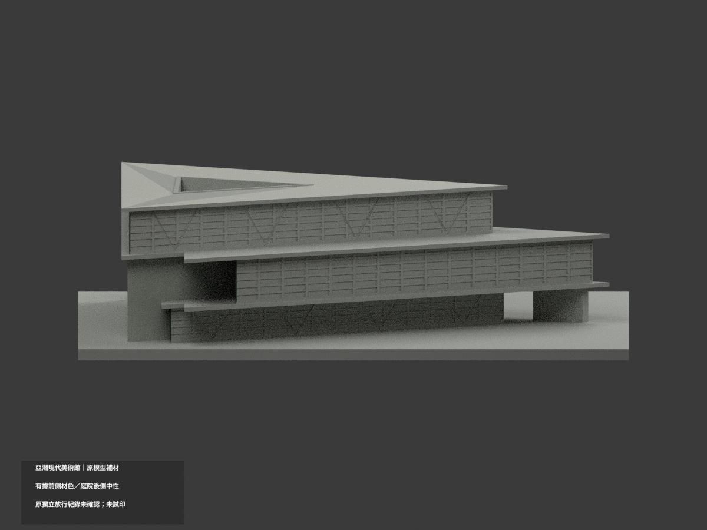
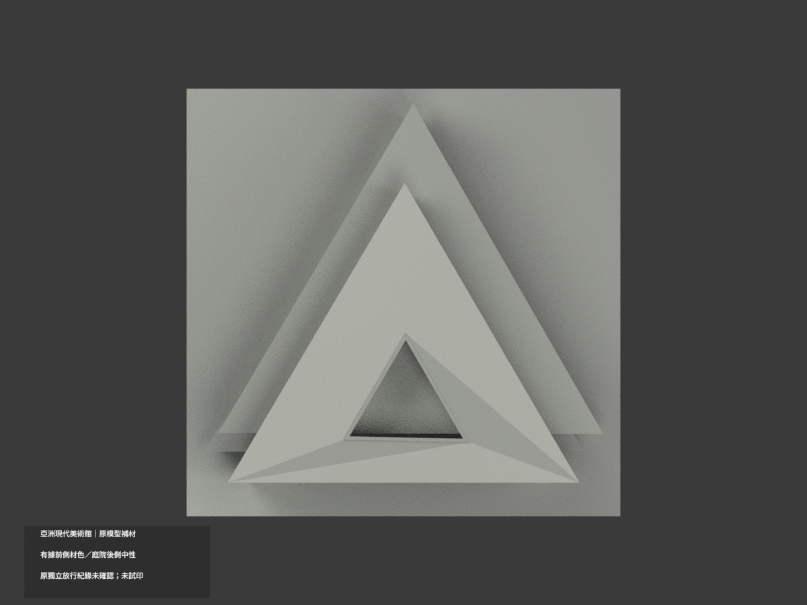
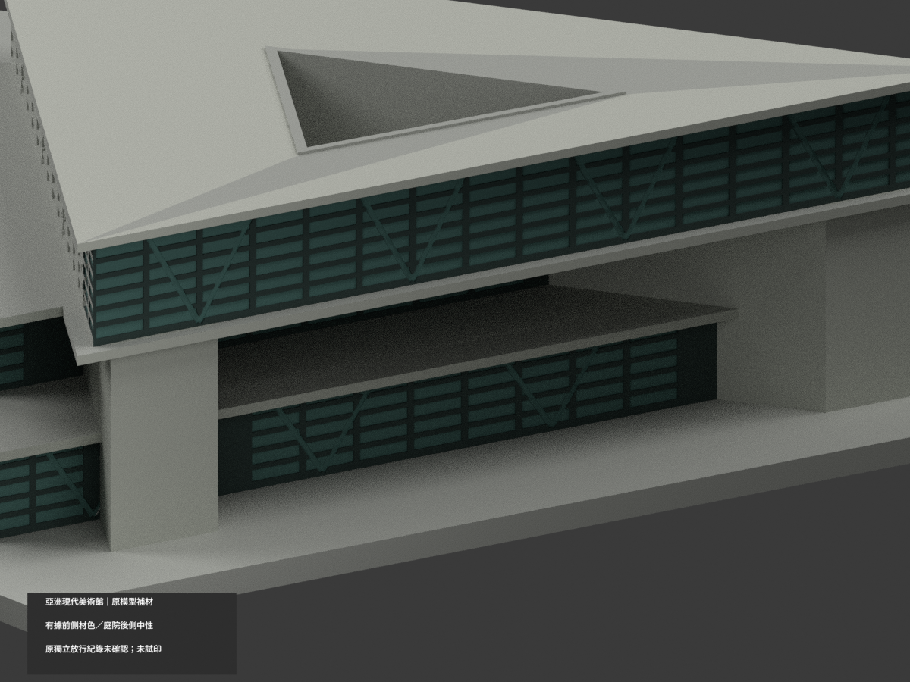
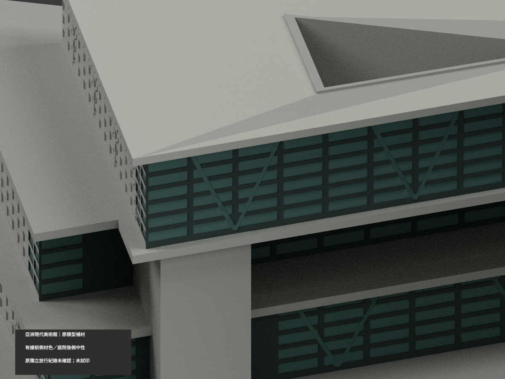
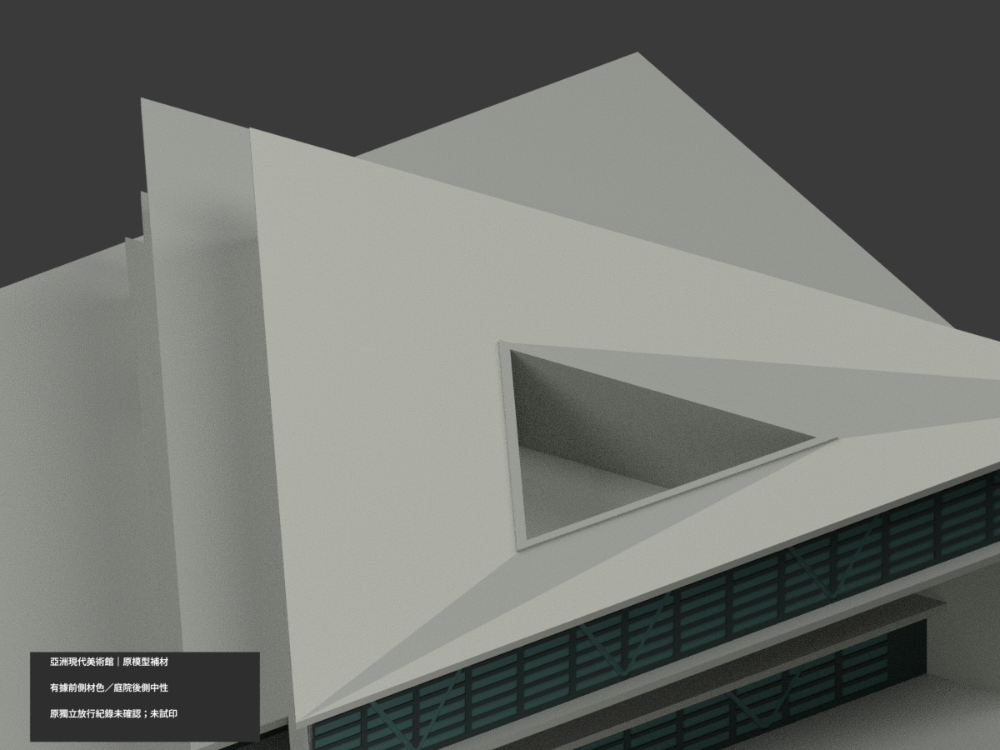

# 亞洲現代美術館｜既有模型有界材色更新

**具日期及範圍的完整原獨立放行紀錄未確認。** 這不是判定原審查失敗；既有公開狀態不代表所有 QA 或列印驗證完成。本次色彩來源審核與原三角身份驗證，**不能追認原幾何、測繪精度或原放行程序**。

| 總覽 | 背側 | 正面 |
|---|---|---|
|  |  |  |
|  |  |  |
|  |  |  |
|  |  |  |

## 材色範圍
- 同 `asia-modern-museum` 項目更新，count_delta=0；原 17290 個三角形、座標與 STL/build_model.py 位元組不變。原包無 OBJ，不虛稱有保留 OBJ。沒有新增或切割幾何。
- 前三層原幕牆凹pane採灰綠，既有窄窗格深灰；近前左角只選兩個完整原pane bay的保守對位，不延伸整條後向斜edge。這是原近似幾何的角部對位，不是照片量得的精確bay數。
- 兩前方厚混凝土端墩、可辨前樓板邊採灰；大幅上屋面依鳥瞰淺灰色族。未見端部、後部、北側支撐及中央三角庭院內部維持中性。
- 原V形只是幕牆後結構的示意淺刻線，本次同鄰近玻璃/陰影色族，不畫亮白外露骨架、不添柱梁，不宣稱精確結構數目。
- 右前端墩交界4片原V刻線背面材質未唯一，保中性；不宣稱混凝土內存在玻璃，也不把刻線染白當外骨架。
- 庭院是原屋面凹庭，不補地面階梯；原透明幕牆用實心凹pane近似，材色不等於新增透明室內。

## 來源、版本與權利
採 Designboom 2014-05-08 刊出之館方提供三照，以及美術館官方建築特色近照。刊日、圖檔名不等於確定拍攝日期；保留原 2013–2014 主要外觀近似版，不保證2026現況。
原照已私人保存，原圖不隨模型公開、不作照片貼圖；館方提供/署名不是無限制重製授權，未確認開放授權，不保證商用權利。HEX 為未校色展示近似。

## 原幾何限制與比例
[原完整說明](ORIGINAL-MONOCHROME-README.md) 保留原來源合成、未確定完整獨立放行紀錄與尺寸限制。原屋頂高17m只是16–19m有界估計，底層4.9/11m名義樓板，不是官方測量。航照視差/傾移及局部端點推定不因補色而消失。
原換算 x×2.15、(y−29)×2.15、3+z×2.15 mm，約1:465；底座150×148×3 mm是展示設計，不是基地。

## 格式與列印
[原 STL](model.stl) · [彩色 3MF](appearance.3mf) · [Blender](scene.blend) · [材質表](appearance-materials.json)
3MF basic materials 與 Blender 真正面材；STL不含色。五材質標籤不是已驗證五色/四色耗材切片專案。未實際列印，未產生切片工具路徑；挑簷、刻線及小尺度支撐需另查。

## 重建與 QA
依原 requirements 安裝依賴後執行 `build_model.py`、`colorize_model.py`、`export_appearance.py`、`validate_color.py`；Blender 執行 `render_color.py` 與 `verify_color_scene.py`。
`COLOR-FORMAT-GEOMETRY-QA.json` 只核本次與原件的STL bytes、逐三角座標、閉合正體積、3MF材質幾何及隔離重建；不是補發原建物完整幾何放行。`SCENE-QA.json` 重開真材質，`DELIVERY-QA.json` 綁十圖；人工色源/域審核另記。
原 `previews/`、`render_preview.py` 與原 QA/來源檔保留供歷程，不能替代本次上方十圖及新材色 QA；未刪任何原件。
