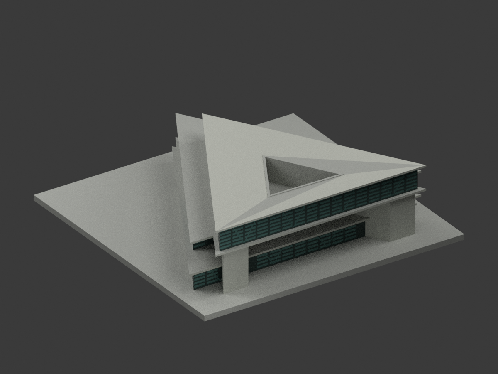
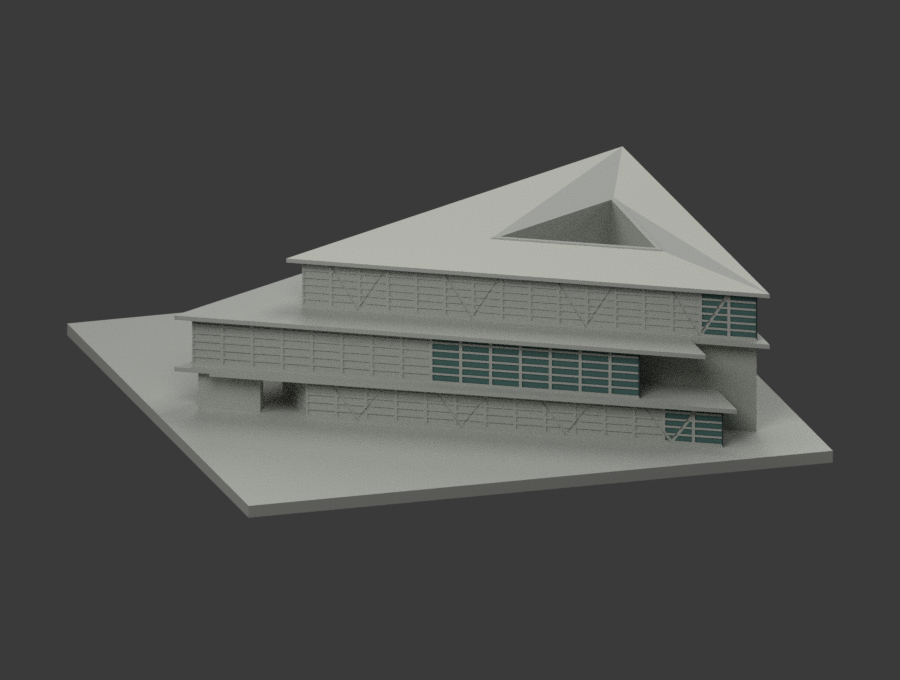

# 亞洲大學附屬現代美術館｜既有模型有界補色

## 模型預覽

| 現行代表視角 | 左側幕牆補色細節 | |
| :---: | :---: | :---: |
|  |  | |

[彩色 3MF](appearance.3mf) · [Blender 場景](scene.blend) · [幾何 STL（不含色）](model.stl) · [補色驗證](verification.json) · [代表渲染證明](front-render-proof.json) · [現行校驗碼](SHA256SUMS)

**具日期及範圍的完整原獨立放行紀錄未確認。** 這不是判定原審查失敗；既有公開狀態不代表所有 QA 或列印驗證完成。本次色彩來源審核與原三角身份驗證，**不能追認原幾何、測繪精度或原放行程序**。

## 最新補色範圍

由原模型正面左角往後，僅補二樓左側第 3 至第 7 個原有開間。五個開間各六個既有淺凹口：60 個凹底三角面接續原灰綠（#557974），230 個凹口返面接續原深灰（#364744）。返面的深灰表示格線與陰影的簡化，不表示真實窗框截面。最高列與原樓板相交的凹口上緣已被原幾何截去，不新增表面。開間編號來自原模型，不是實景逐窗測繪。

[參山國家風景區管理處實景照](https://www.trimt-nsa.gov.tw/_api/Image/85170/?r=1750218808797) 與 [館方提供並刊於 designboom 的實景照](https://www.designboom.com/wp-content/uploads/2014/05/tadao-ando-asia-university-museum-of-art-taiwan-designboom-03.jpg) 都由同一近端轉角看見長向幕牆、上方前伸展廊及混凝土端墩，可對位該段灰綠玻璃與深色格線。[館方建築特色](https://asiamodern.asia.edu.tw/p/412-1005-193.php?Lang=zh-tw) 另確認幕牆構造。2014 刊載日不是精確拍攝日期；參山處照片日期未查明。色值沿用原模型近似，不是校色，也不做透明玻璃或室內復刻。實景照片未隨包散布。

## 基準版已核對的材色與模型界線

- 同 `asia-modern-museum` 項目更新，count_delta=0；原 17290 個三角形、座標與 STL/build_model.py 位元組不變。原包無 OBJ，不虛稱有保留 OBJ。沒有新增或切割幾何。
- 前三層原幕牆凹pane採灰綠，既有窄窗格深灰；基準版近前左角只選兩個完整原 pane bay；本次僅增加下述五個開間。這是原近似幾何的角部對位，不是照片量得的精確bay數。
- 兩前方厚混凝土端墩、可辨前樓板邊採灰；大幅上屋面依鳥瞰淺灰色族。未見端部、後部、北側支撐及中央三角庭院內部維持中性。
- 原V形只是幕牆後結構的示意淺刻線，基準版同鄰近玻璃/陰影色族，不畫亮白外露骨架、不添柱梁，不宣稱精確結構數目。
- 右前端墩交界4片原V刻線背面材質未唯一，保中性；不宣稱混凝土內存在玻璃，也不把刻線染白當外骨架。
- 庭院是原屋面凹庭，不補地面階梯；原透明幕牆用實心凹pane近似，材色不等於新增透明室內。


## 來源、版本與權利
採 Designboom 2014-05-08 刊出之館方提供三照，以及美術館官方建築特色近照。刊日、圖檔名不等於確定拍攝日期；保留原 2013–2014 主要外觀近似版，不保證2026現況。
原照已私人保存，原圖不隨模型公開、不作照片貼圖；館方提供/署名不是無限制重製授權，未確認開放授權，不保證商用權利。HEX 為未校色展示近似。

## 原幾何限制與比例
[原完整說明](https://github.com/hplin50643/taiwan-buildings-3d/blob/f1c33922b9cdd91992147061e548bc8fd1fcd1b9/%E4%BA%9E%E6%B4%B2%E5%A4%A7%E5%AD%B8/%E9%9C%A7%E5%B3%B0%E6%A0%A1%E6%9C%AC%E9%83%A8/buildings/asia-modern-museum/ORIGINAL-MONOCHROME-README.md) 保留原來源合成、未確定完整獨立放行紀錄與尺寸限制。原屋頂高17m只是16–19m有界估計，底層4.9/11m名義樓板，不是官方測量。航照視差/傾移及局部端點推定不因補色而消失。
原換算 x×2.15、(y−29)×2.15、3+z×2.15 mm，約1:465；底座150×148×3 mm是展示設計，不是基地。


## 格式與列印

原五種材色與其他 17,000 個面保持原樣；幾何 STL 與基準版完全相同，3MF 使用基本材質標籤，Blender 可編輯逐面材質。未經切片或實際列印。相關幾何檢查如[原驗證紀錄](validation.json)只適用於相同 STL，不是完整的原獨立放行紀錄。

## 固定基準與重現

現行下載不需要舊檔。若要重建同一變更，將[歷史基準 Blender](https://github.com/hplin50643/taiwan-buildings-3d/blob/f1c33922b9cdd91992147061e548bc8fd1fcd1b9/%E4%BA%9E%E6%B4%B2%E5%A4%A7%E5%AD%B8/%E9%9C%A7%E5%B3%B0%E6%A0%A1%E6%9C%AC%E9%83%A8/buildings/asia-modern-museum/scene.blend)和[歷史基準 3MF](https://github.com/hplin50643/taiwan-buildings-3d/blob/f1c33922b9cdd91992147061e548bc8fd1fcd1b9/%E4%BA%9E%E6%B4%B2%E5%A4%A7%E5%AD%B8/%E9%9C%A7%E5%B3%B0%E6%A0%A1%E6%9C%AC%E9%83%A8/buildings/asia-modern-museum/appearance.3mf)下載到另一個目錄，使用 Blender 4.3.2 並指定實際路徑（程式核對基準檔 SHA-256）：

```sh
blender -b --disable-autoexec /path/to/baseline/scene.blend -t 2 --python-exit-code 1 \
  -P build_glazed_flank.py -- /path/to/baseline/appearance.3mf /tmp/asia-modern-museum-current
```

校驗以目前 SHA256SUMS 為準。[前次說明](https://github.com/hplin50643/taiwan-buildings-3d/blob/f1c33922b9cdd91992147061e548bc8fd1fcd1b9/%E4%BA%9E%E6%B4%B2%E5%A4%A7%E5%AD%B8/%E9%9C%A7%E5%B3%B0%E6%A0%A1%E6%9C%AC%E9%83%A8/buildings/asia-modern-museum/README.md)、[前次校驗](https://github.com/hplin50643/taiwan-buildings-3d/blob/f1c33922b9cdd91992147061e548bc8fd1fcd1b9/%E4%BA%9E%E6%B4%B2%E5%A4%A7%E5%AD%B8/%E9%9C%A7%E5%B3%B0%E6%A0%A1%E6%9C%AC%E9%83%A8/buildings/asia-modern-museum/SHA256SUMS)與[前次凍結紀錄](https://github.com/hplin50643/taiwan-buildings-3d/blob/f1c33922b9cdd91992147061e548bc8fd1fcd1b9/%E4%BA%9E%E6%B4%B2%E5%A4%A7%E5%AD%B8/%E9%9C%A7%E5%B3%B0%E6%A0%A1%E6%9C%AC%E9%83%A8/buildings/asia-modern-museum/FREEZE-MANIFEST.json)僅屬歷史，不能替代現行驗證。舊測試畫面及舊材色流程留在該固定提交，不是現行展示。
