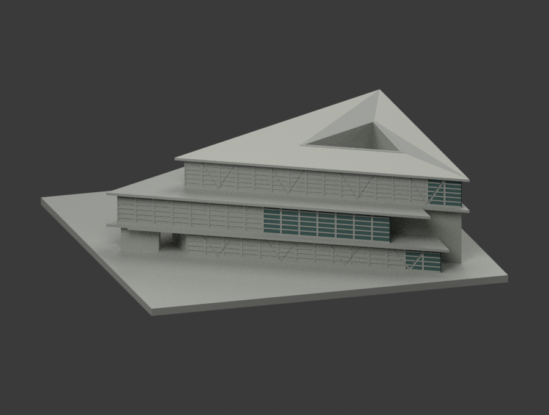

# 亞洲大學附屬現代美術館｜二樓左側幕牆補色



[下載彩色 3MF](glazed-flank.3mf) · [Blender 場景](glazed-flank.blend) · [原模型及代表圖](../README.md) · [逐面核對](verification.json) · [檔案校驗碼](SHA256SUMS)

由原模型正面左角往後，僅補二樓左側第 3 至第 7 個原有開間。五個開間各六個既有淺凹口：60 個凹底三角面接續原灰綠（#557974），230 個凹口返面接續原深灰（#364744）。返面的深灰表示格線與陰影的簡化，不表示真實窗框截面。最高列與原樓板相交的凹口上緣已被原幾何截去，不新增表面。開間編號來自原模型，不是實景逐窗測繪。

[參山國家風景區管理處實景照](https://www.trimt-nsa.gov.tw/_api/Image/85170/?r=1750218808797) 與 [館方提供並刊於 designboom 的實景照](https://www.designboom.com/wp-content/uploads/2014/05/tadao-ando-asia-university-museum-of-art-taiwan-designboom-03.jpg) 都由同一近端轉角看見長向幕牆、上方前伸展廊及混凝土端墩，可對位該段灰綠玻璃與深色格線。[館方建築特色](https://asiamodern.asia.edu.tw/p/412-1005-193.php?Lang=zh-tw) 另確認幕牆構造。2014 刊載日不是精確拍攝日期；參山處照片日期未查明。色值沿用原模型近似，不是校色，也不做透明玻璃或室內復刻。實景照片未隨包散布。

原五種材色及其他 17,000 個三角面完全不變。原代表圖、幾何、STL、三角庭院、其他樓層與未證側背面原樣保留。這不是新增建物、全館復色、測繪、現況認證或幾何補審。原模型中記載的幾何審核限制仍適用；未試印或作切片驗證。

重建（Blender 4.3.2；上層為兩個原始輸入，請另用獨立輸出目錄）：

```sh
blender -b ../scene.blend -t 4 --python-exit-code 1 \\
  -P build_glazed_flank.py -- ../appearance.3mf ./build-output
```

程式輸出模型、逐面核對與兩張暫用 PNG。公開預覽由 `_render_qa/candidate.png` 以 Pillow `lossless=True, method=6, exact=True` 轉成無失真 WebP；不發布暫用檔。
