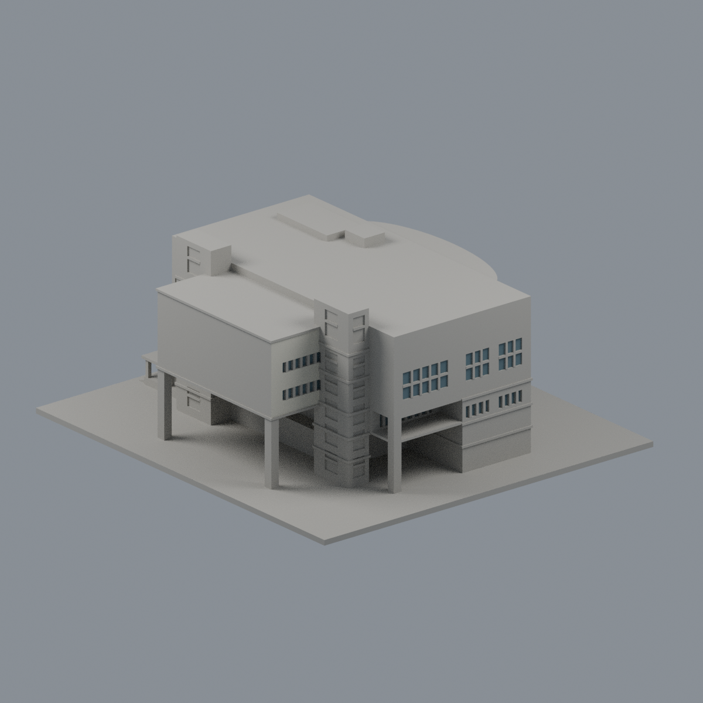
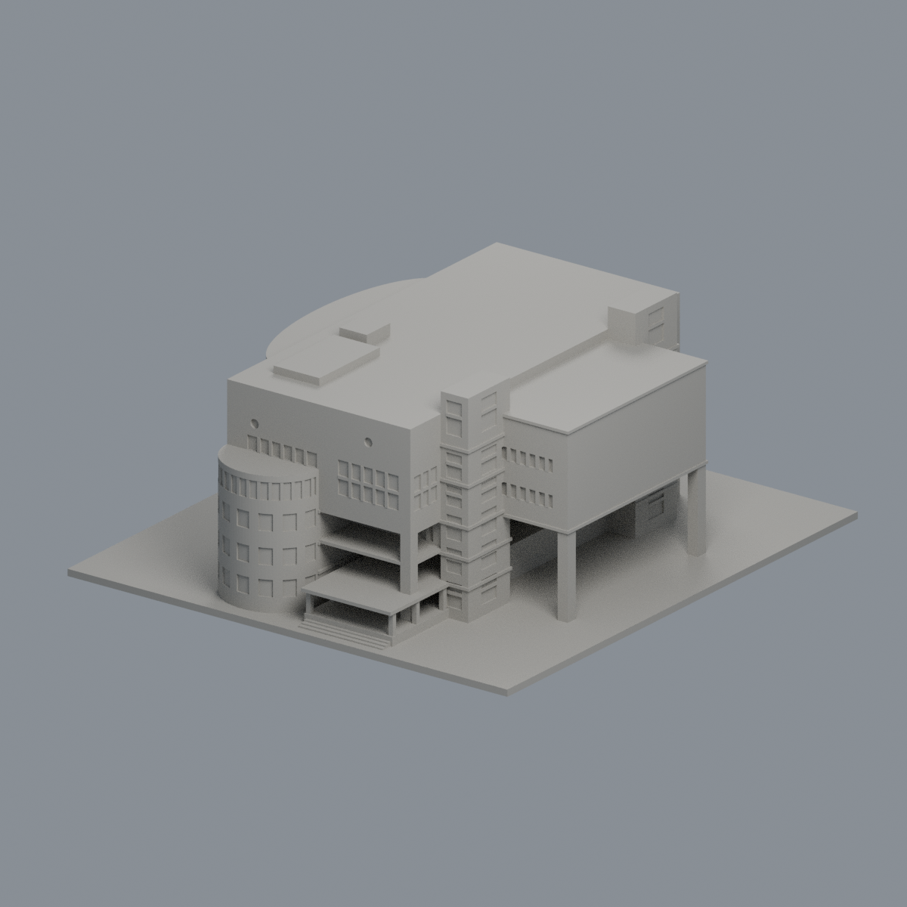
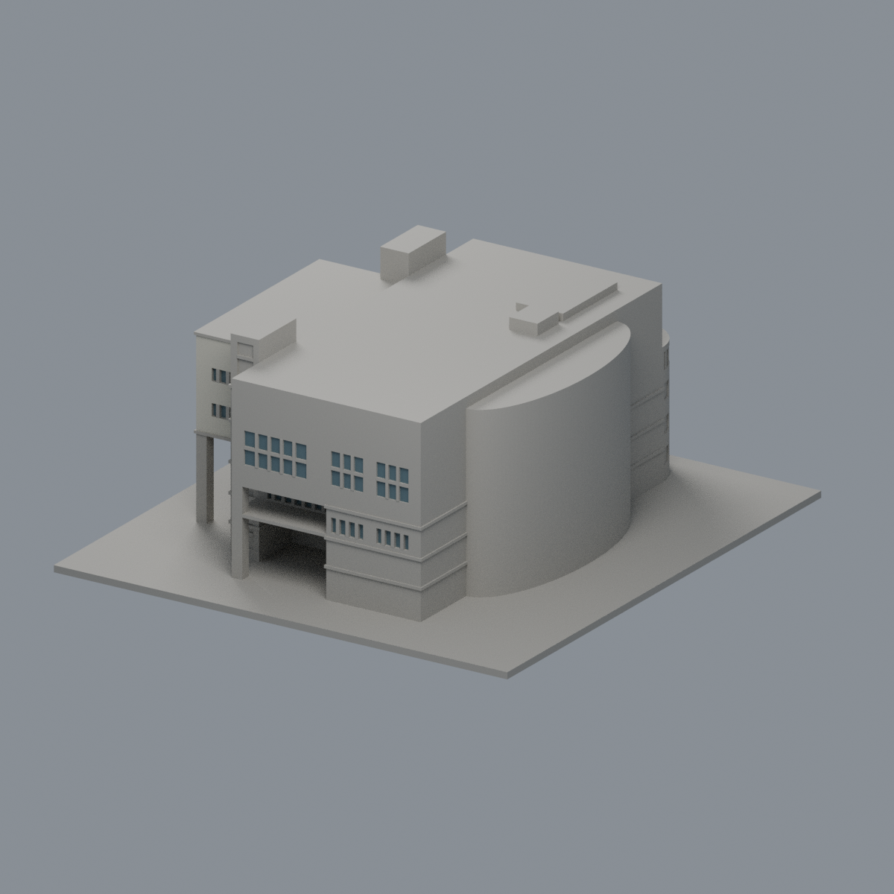
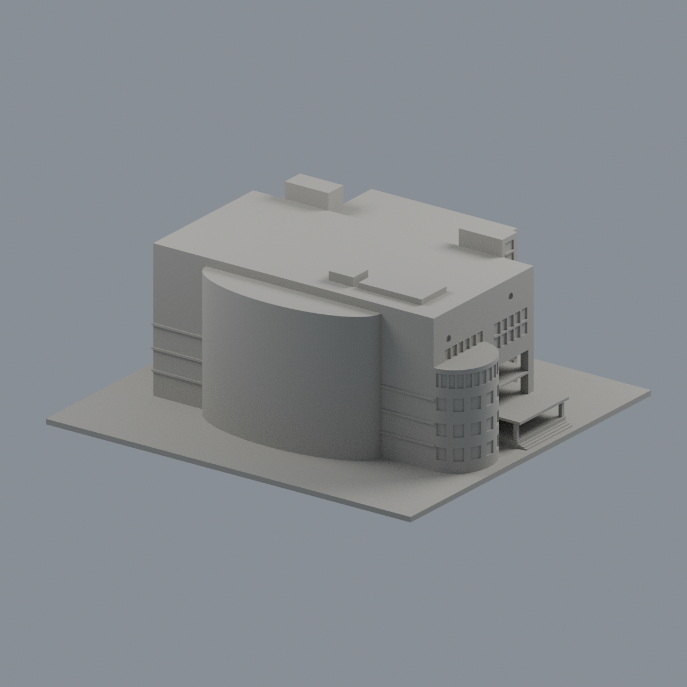
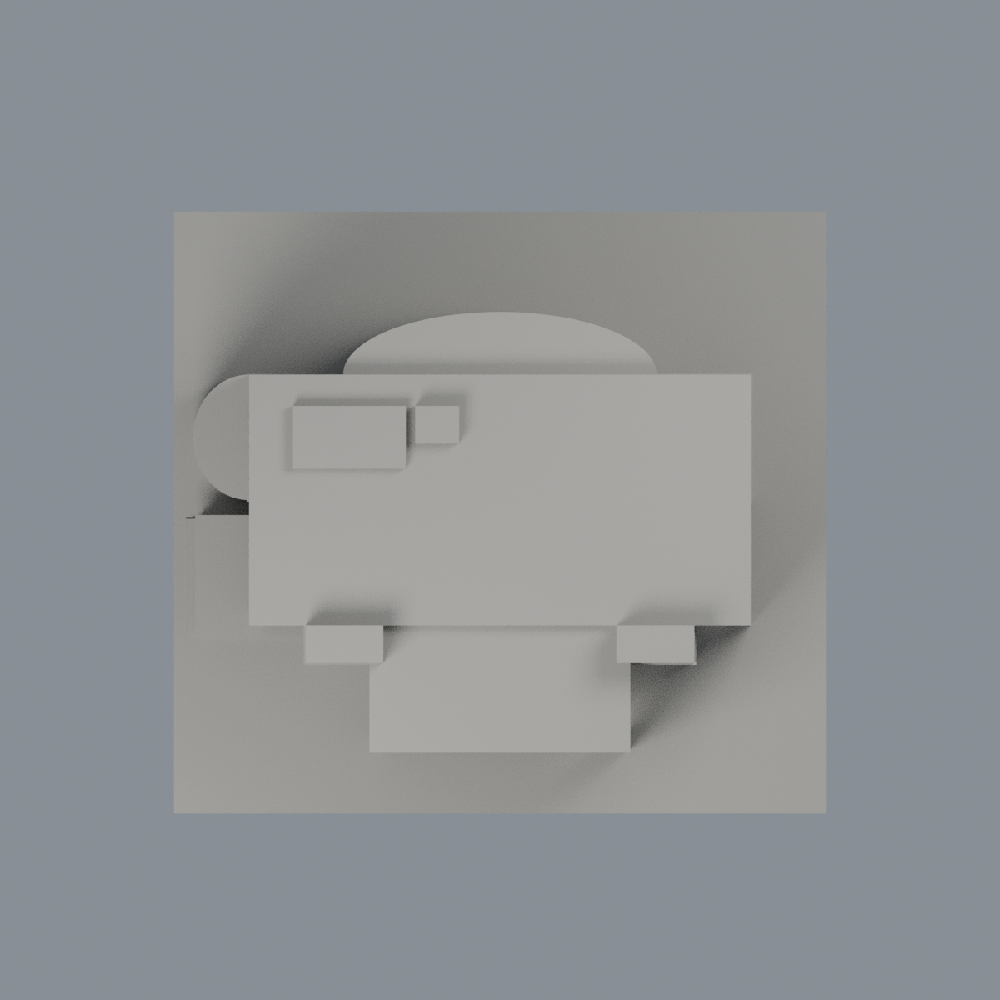

# 健行科技大學圖書館：東面窗背限域外觀層

既有模型的局部材質改善，新增模型套數為零，不修改原幾何；不是全館全彩復原，也不是2026現況調查。

- [雙材質3MF](uch-library-appearance.3mf) · [可編輯Blender](scene.blend) · [材質表](palette.json) · [逐面對照](face-materials.json)
- [正面](previews/front.png) · [左面](previews/left.png) · [右面](previews/right.png) · [背面](previews/rear.png) · [頂面](previews/top.png)
- [來源與年代](SOURCES.md) · [授權說明](LICENSE-NOTICE.md) · [重建原始碼包](rebuild-source.zip)

| 模型預覽 | 模型預覽 | 模型預覽 |
| :---: | :---: | :---: |
| 正面  | 左面  | 右面  |
| 背面  | 頂面  |  |

7180個原三角面保留座標與面序。僅官方照片支持的 +X 八組完整窗背104面（498.932503平方毫米）使用不透明低彩度灰藍代理材質；其餘7076面維持中性。八組為主體上層三組20/12/12、北半下層兩組8/8、南側凹陽臺真實窗背16、南側抬高翼兩組14/14。全部三頂點須落在同一有限平面範圍且實際叉積法向正確，不能以中心點選取、切面、重三角化或新增玻璃。陽臺空腔不是玻璃。

樓梯玻璃磚塔仍中性，不塗成深色玻璃窗；不透明牆、窗框、側壁、簷底、女兒牆、屋頂設備、西側半圓、北面、後面、底座及未知窗背均不染色。不把 +X 的照片證據鏡像到 -X。反射、百葉與陰影不構成新材質分區。色彩不是校色後的精準RGB，改善集中於東面局部窗背。

## 原始品質限制（本輪沒有修復）
原 strict 幾何QA仍為 false；保留693個 corner-loss polygons，以及作者76／獨立審查311條短 near-corner chords 的不同統計結果。外觀交換格式與材質檢核通過，不代表原模型全部QA通過、細節全準確、免支撐或可直接列印。沒有物理列印驗證。原始幾何、QA報告與例外保持不變。五地上層／兩地下層、T形抬高量體、柱墩、西側半圓、樓梯核心與北弧沿用既有模型；名義高度、北面開口、露臺及基地高程仍近似，不新增後側與屋頂來源閉合主張。

## 重建
在appearance上層保留原model.stl，安裝source/requirements.txt；執行 `python source/build_appearance.py`、`python source/verify_exchange.py`，再用 Blender 執行 `source/render_appearance.py` 與 `source/verify_scene.py`。固定 Cycles CPU/種子生成五圖，PNG移除時間metadata；3MF/map/palette及五圖以獨立乾淨重建比較bytes，Blend比較真正頂點與材質語義而非二進位一致。

## 2026-11-13 有限外觀修正｜模型交付版

在原104窗背維持不變下，僅東向南抬高翼完整62面補近似淺米磁磚背景 #CCC9BA/.88，其餘7014中性保持。全三角扣原窗洞/腰帶/梯核心交會，不切新界、不改幾何；不增加圖書館字樣/磚縫，不染頂底/轉角/玻璃磚塔。原strict=false及693 corner-loss、76或311短chord不同統計不改，沒有新製造或列印認證。

模型、材質、原生視角圖與必要重建程式沿用完成候選，未改幾何或新切材界，不代表全館精確復色、現況或實體試印通過。原來源年代、工程與列印限制仍適用，舊說明與審核僅屬各自版本，本段更新上述局部範圍。

本次只公開模型、必要重建輸入／腳本、預覽與說明；完整來源、比較及研究審核不隨本批交付。根目錄PUBLIC-MODEL-SHA256SUMS僅校驗所列當前產品，舊表不驗證新版。重建ZIP只含必要重建檔與本說明；歷史來源及QA連結指儲存庫既有文件，非ZIP內的新增審核附件。
