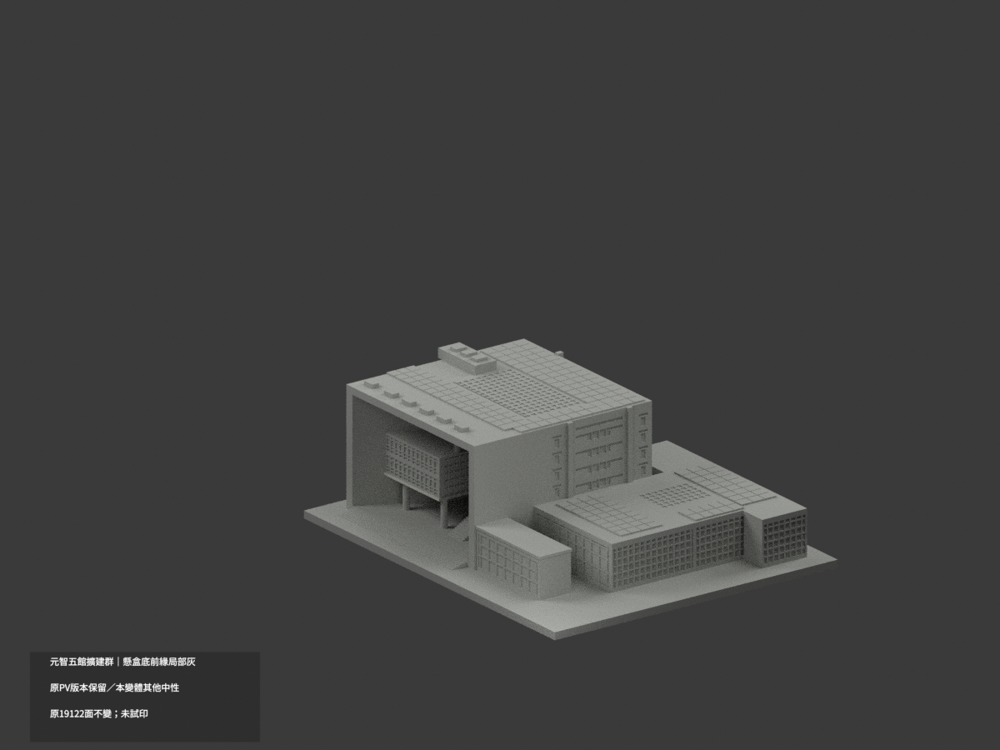
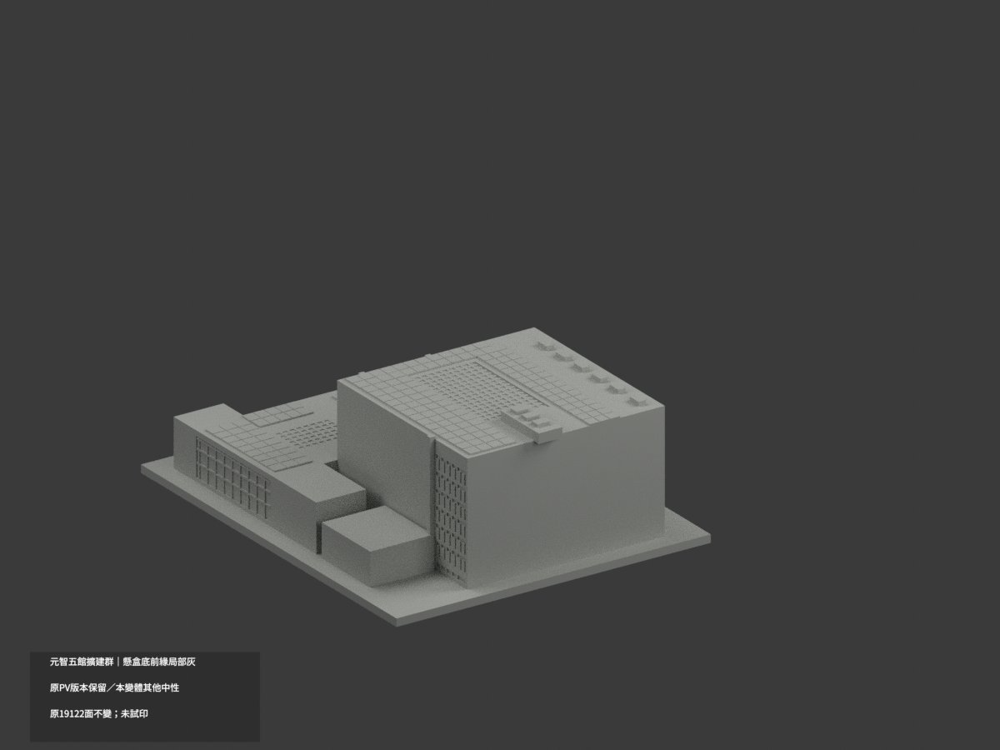
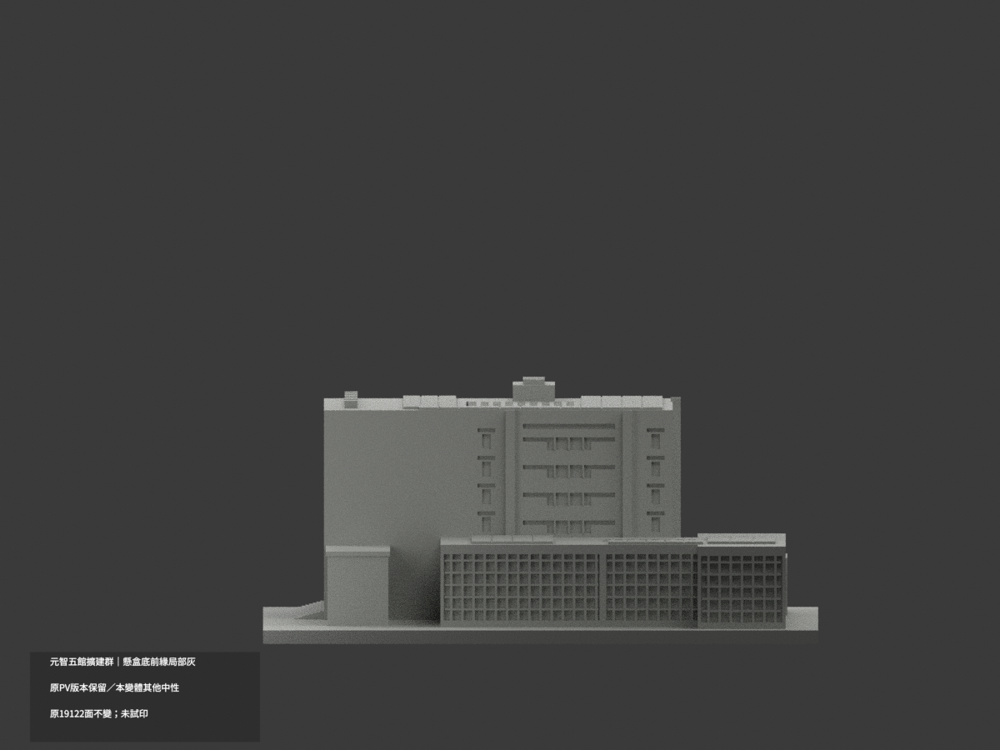
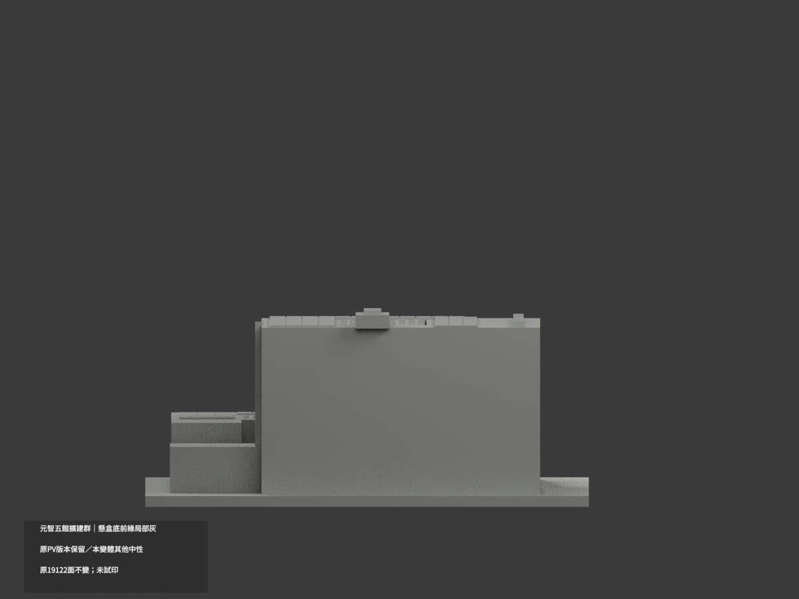
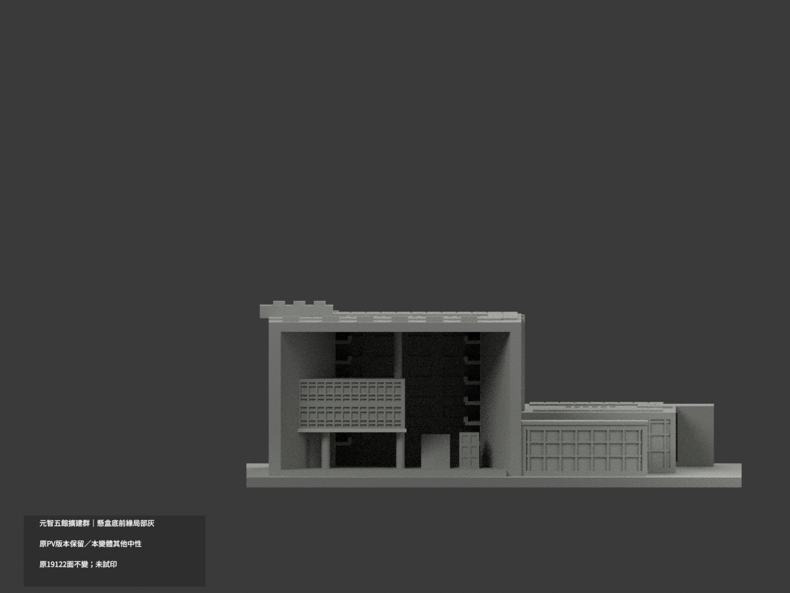
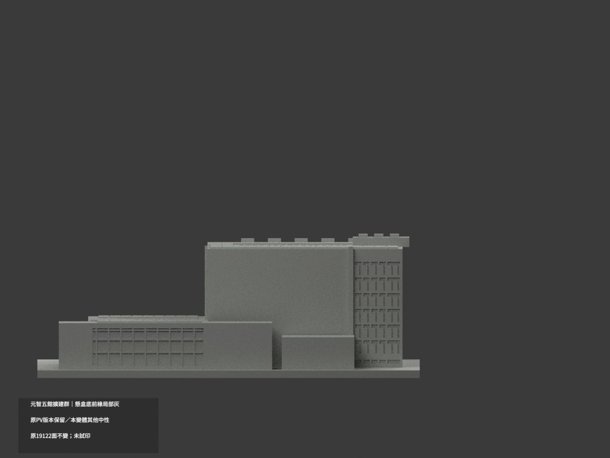
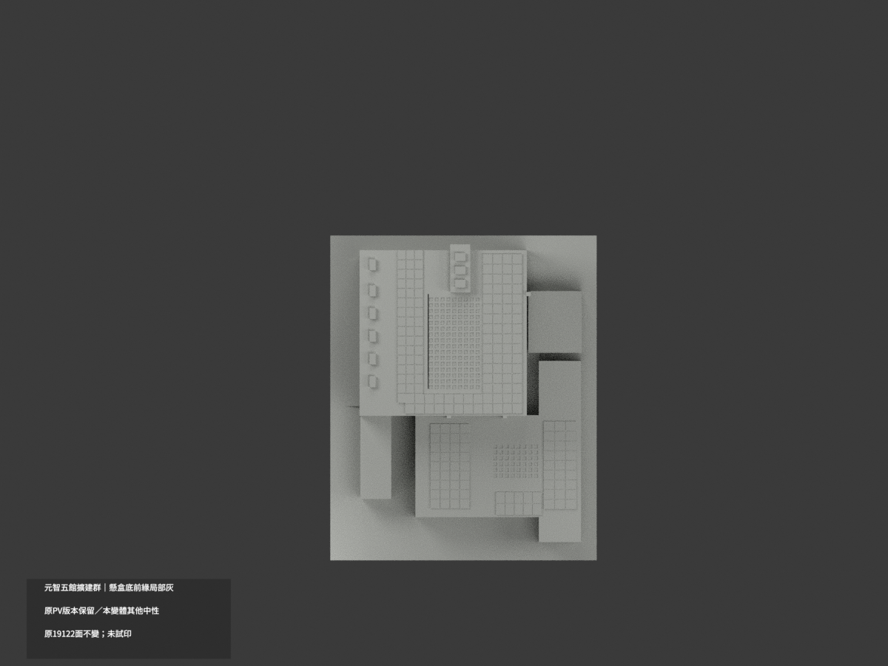
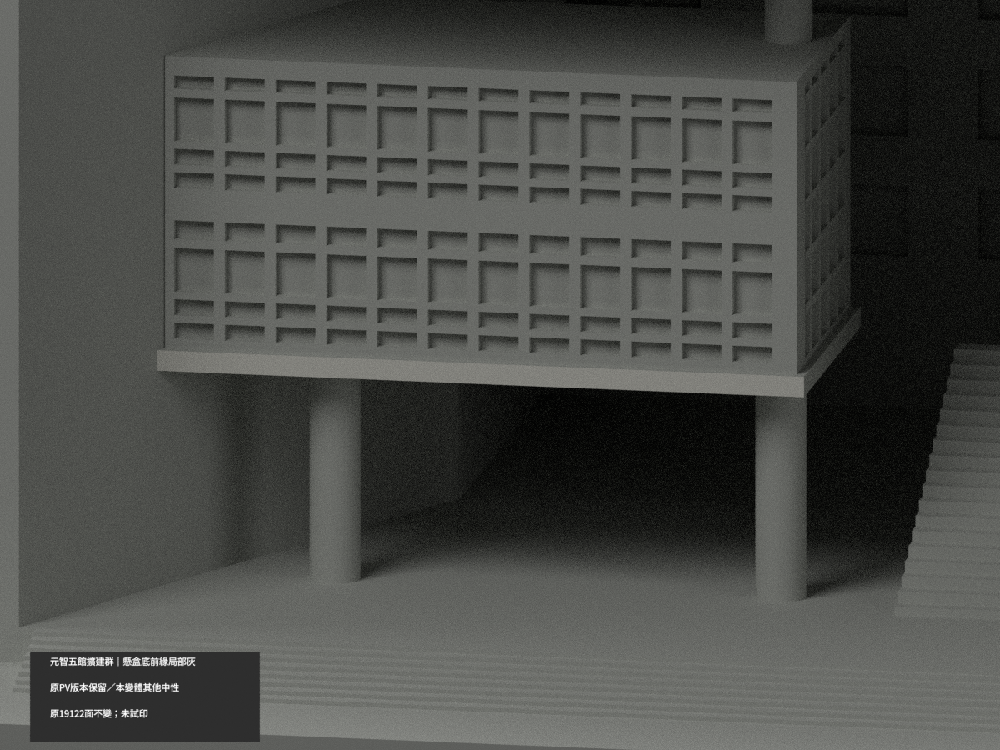
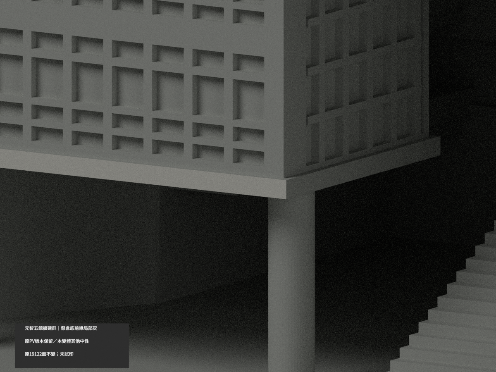
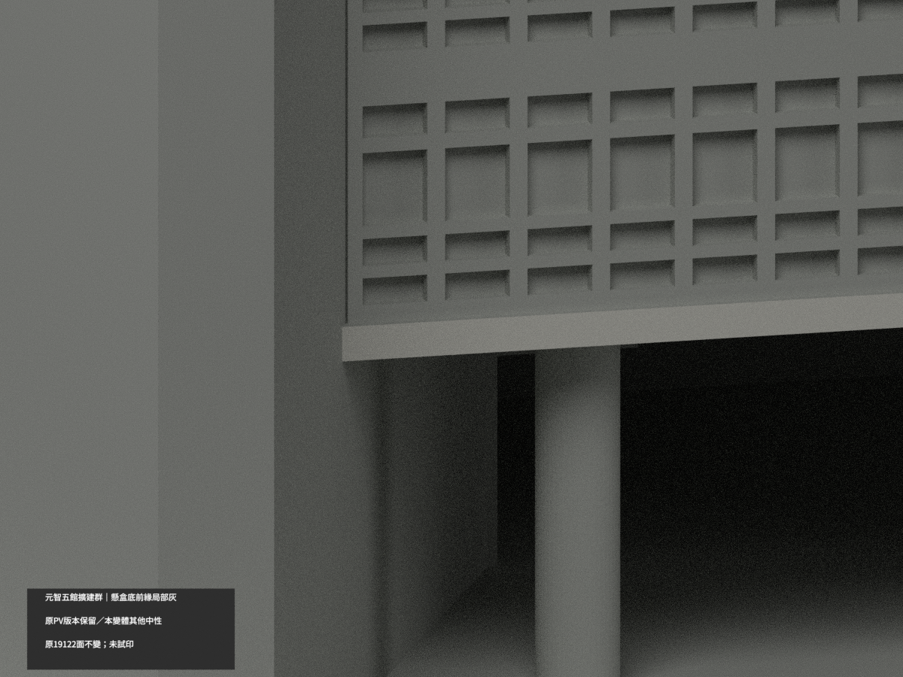

# 元智五館暨圖書館擴建群｜懸盒底前緣局部淺白灰

**此為獨立限縮材色變體；其餘未知域尚未完成分色。** partial_color_incomplete=true、fully_colored_exterior=false。僅懸盒底前緣完整2三角淺白灰；原2024光電展示與證據另版完整保留，不否定PV、不算新建築或真單色發現。

| 總覽 | 背側 | 正面 |
|---|---|---|
||||
||||
||||
||||

## 材色範圍
同 yzu-building5-library-extension 原項目，元智大學校本部五館暨2006圖書館擴建翼為單一相連群，不含相鄰六館、不拆新增套。same-item、count_delta=0，原19122三角/STL/build_model.py及29原件不變，immutable無OBJ。
整x=-28.95面恰2三角，單一完整共享邊component。全3頂點有限矩形y=-3.45..29.4187507629,z15.9..16.95；原1.5比例＋z3與斜框union截遠端，全保原界不填不裁。其餘19120面本變體均中性：主巨框、玻璃混細框反光、其他懸盒側頂底、屋頂/擴建/PV等。

## 原PV版本與新限縮版本並存
原scene具有PV來源知情展示，2024正射來源與已指派PV材色均完整保留，不歸類為無據任選或原單色。新變體只重審2018地面照片所證2面，不重放/不重計原PV分色；本變體PV中性只表示本輪未重驗，絕非原證據不存在，也不是移除原版本。原scene及README公開另存 ORIGINAL-SOURCE-GAP-scene.blend／ORIGINAL-SOURCE-GAP-README.md；原render_preview.py/previews/sources及全部原證據原bytes保留。
原scene物件名 HFU_Library_Bounded_Approximation 是模板殘名，保留原artifact與勘誤，不據此宣稱模型幾何屬華梵或淡江。新scene/3MF/四腳本/palette以 YZU Building 5 Library Extension partial color 獨立驗名，幾何完全不變。

## 來源與日期
親看訪客16/17實照，原來源描述2018-07-01；圖片無可驗capture時鐘，不把發表/檔名當實測。2016正射/2018地面/2024 PV為不同時期，非同年調查/2026現況；原1997/1998進駐與2006擴建時序不當照片日期。原照私人保存、不公開貼圖、不建人物，未確認CC/商用授權；原官方服務圖不是材色證據。

## 格式與重建
[原STL](model.stl) · [新限縮逐面3MF](appearance.3mf) · [新限縮Blender](scene.blend) · [原PV知情展示](ORIGINAL-SOURCE-GAP-scene.blend)
原估計1.5mm/m、含底最長150mm非精測。STL無色，3MF/Blender逐面材色非耗材切片或四色試印驗證。原build_model.py→colorize_model.py→export_appearance.py→validate_color.py；render_color.py/verify_color_scene.py。隔離Shapely2.1.2原build+color精確重建、全三角multiset/原bytes/共面均一/3MF/scene重開/十圖1200×900與hash；舊QA保歷史不冒新驗證。

## English scope
Separate restricted source-gap variant:2 complete lower west suspended-box fascia triangles pale off-white;19120 neutral. Original PV-aware display and2024 evidence remain intact,not arbitrary or erased. This2018ground-photo study does not re-audit or count inheritedPV color;neutral here is not denial of evidence. Original19122 triangles/29files unchanged,no originalOBJ. Original HFU object label is stale metadata preserved;new identity explicitly YZU Building 5 Library Extension partial color. One connected group/count0,not same-year fullcolor or2026 survey,no filament test.
