# 南臺生活機能館暨一體校門2016｜曲門外緣局部淺灰

**既有三材展示非單色；其餘未知域尚未完成分色。** partial_color_incomplete=true、fully_colored_exterior=false。僅曲門最高外立面60面淺灰，其他5270中性；原150柱角跨層樣本／1163短首弦、v1 HOLD與v2有限例外保留，不追認全域最薄壁或試印。

## 指定首頁與圖鑑代表圖保持原件

|  |
| :---: |
| 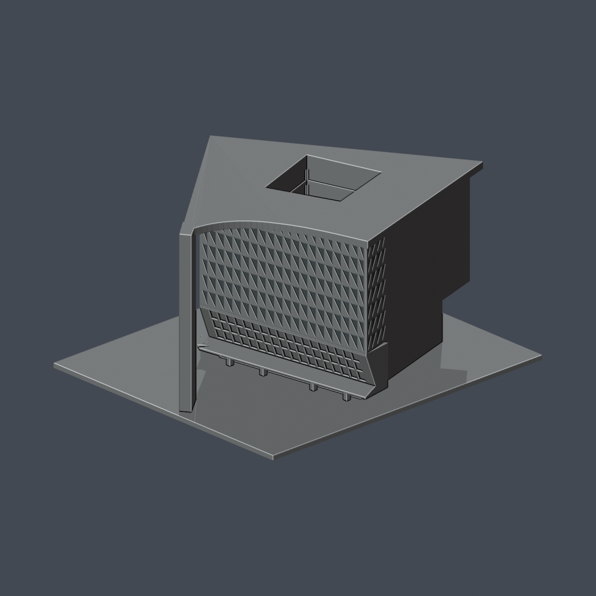 |
| 原指定校園三分之四代表圖 |

首頁、校級、校區圖鑑仍指定原 previews/homepage-three-quarter.png，36.87°偏轉／23.43°俯視、1200×1200原bytes不變。不是下方新補色preview，不以本次新增十圖取代首頁。原README公開另存 ORIGINAL-SOURCE-GAP-README.md，完整原指定與九張技術圖、三展示材、原scene/renderer保留。

## 附加本次材色QA十圖（不是首頁替代）
| 總覽 | 背側 | 正面 |
|---|---|---|
|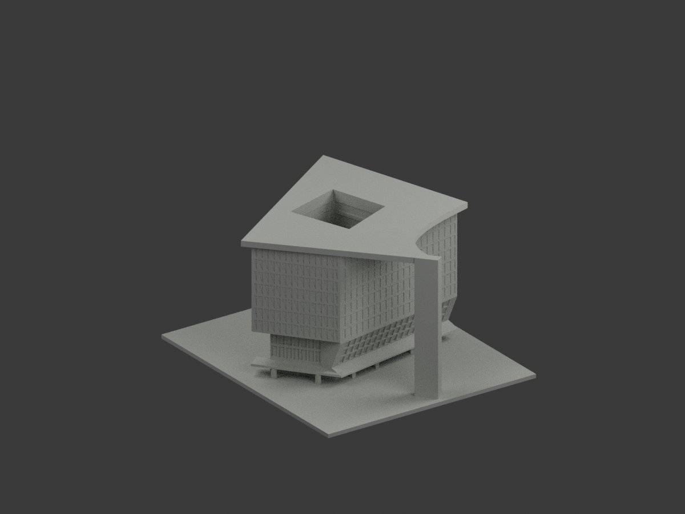|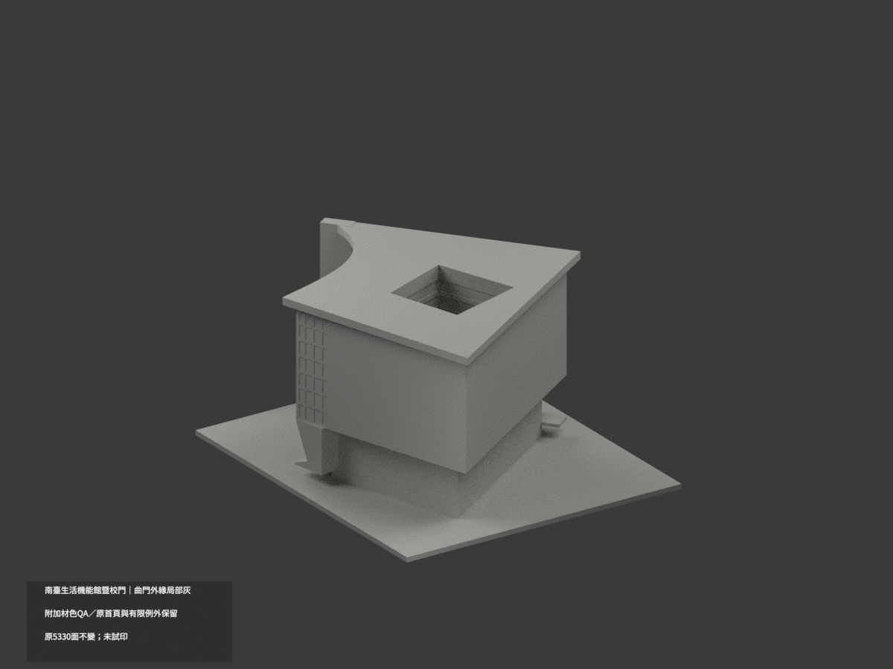|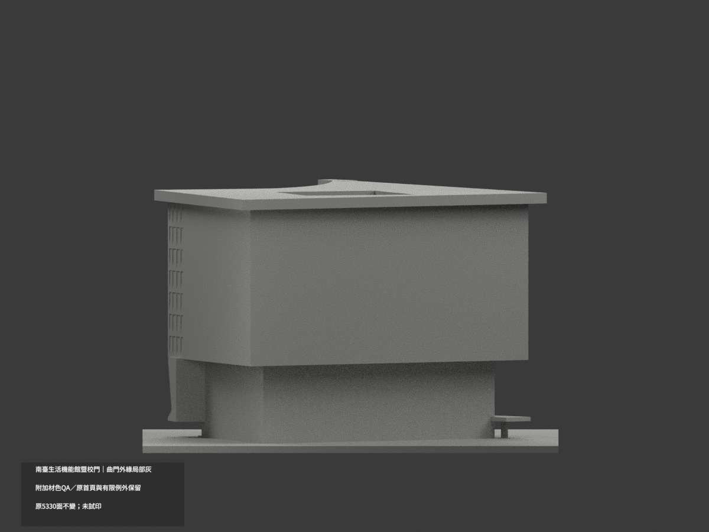|
|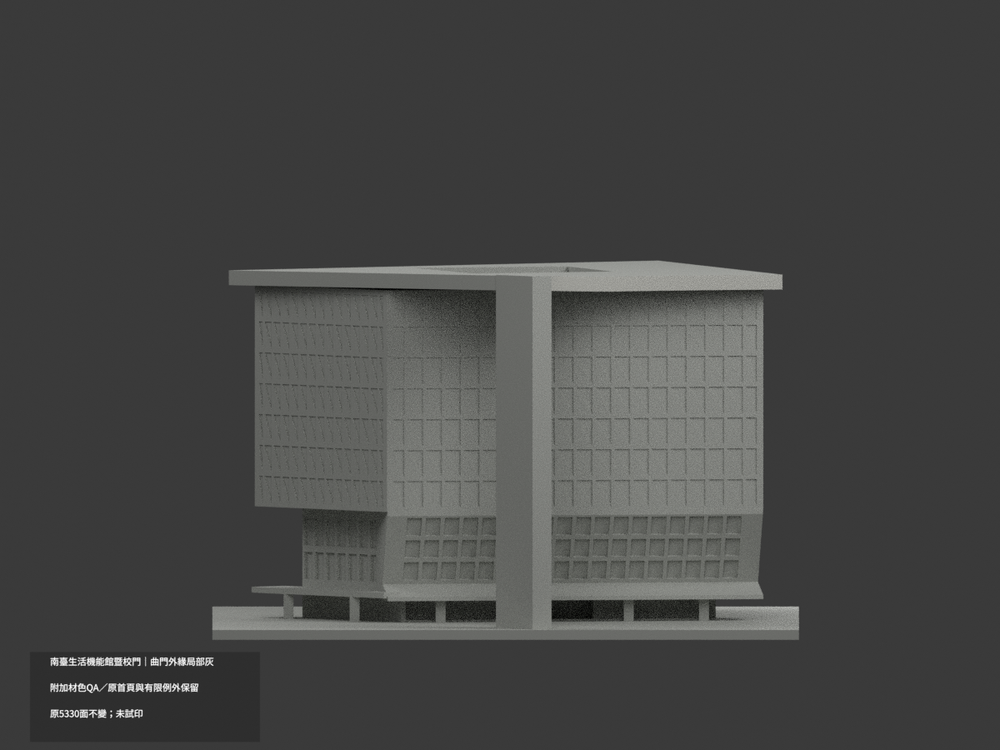|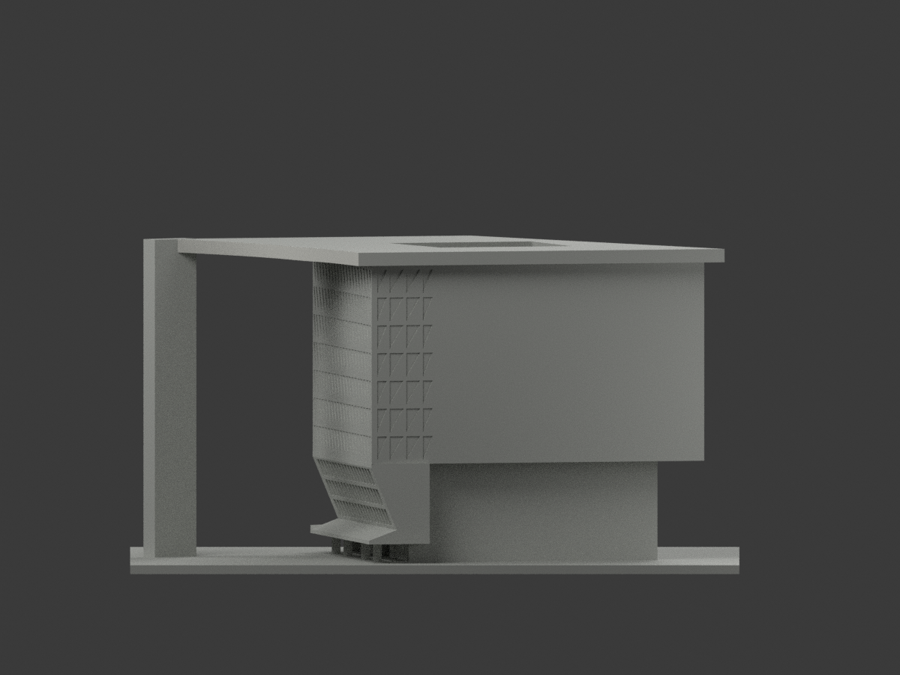|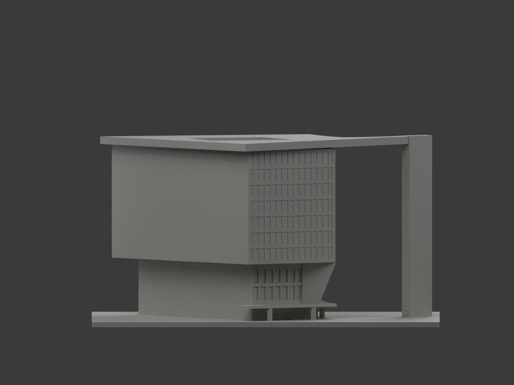|
|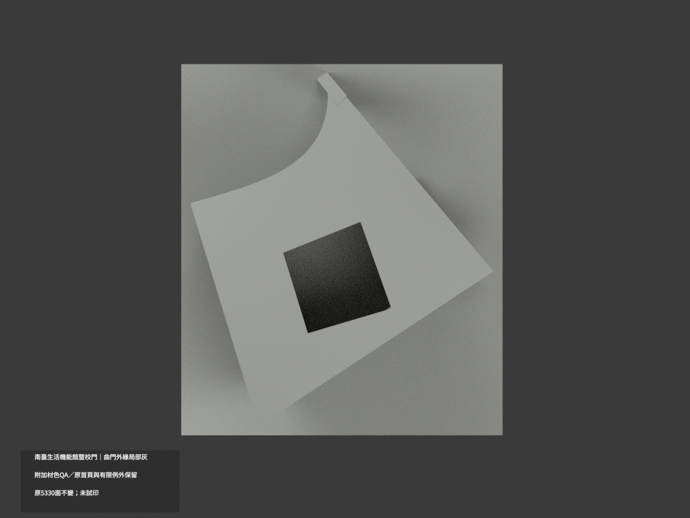|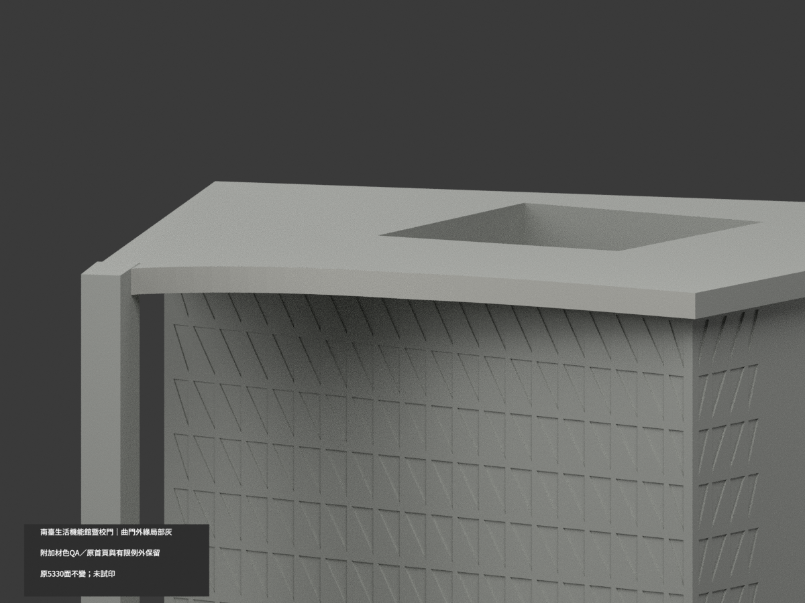|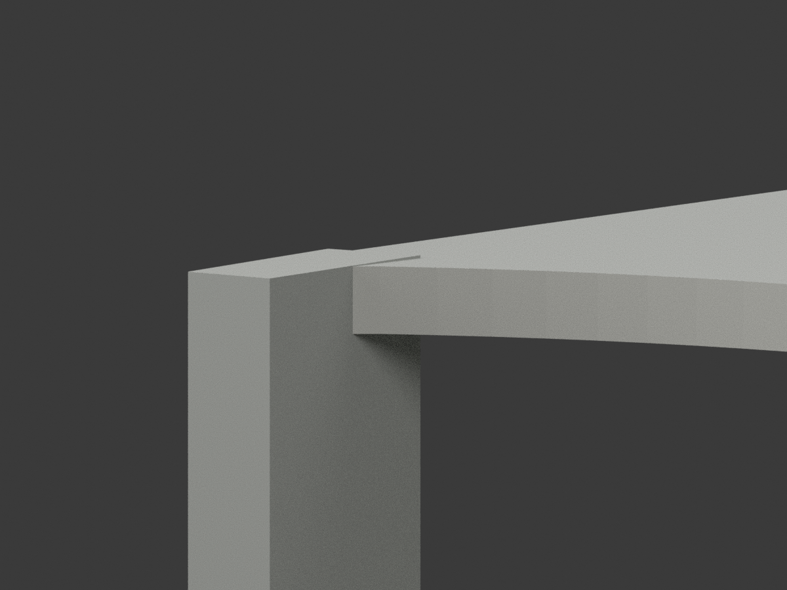|
|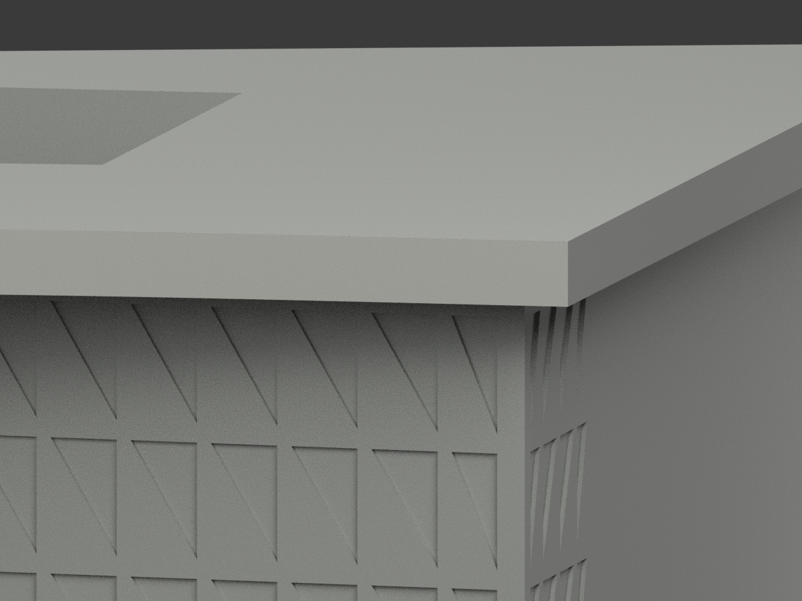|||

## 材色範圍
同 stust-living-services-gate-2016 原項目，南臺科技大學校本部生活機能館暨一體校門，現W磅礡館，same-item/count_delta=0；不含西鄰T棟，不拆門與館成兩件。原5330三角/43原件字節保留，immutable無OBJ，不造OBJ。
原cubic控制像素(970,500),(990,645),(880,673),(750,710)，32段全頂點有限chord，k0/1被原gateunion遮沒，k2..31各2共60。每段whole infiniteplane=finite，端點warp插值與末1.2*s平移均保，不以normal/centroid漏碎片，不補被遮部分。只曲門外垂直薄邊名義淺灰，不把完整屋頂/底/直回返也染灰。
其餘5270面中性：門柱徽字、三角主立面混磚薄框反光、折玻璃、低棚柱、天井、屋上/後服務側/基座。未知不借對稱。來源兩照接近同向不同構圖，非兩反面佐證；不公開照片不貼圖，不新增字與人物。

## 舊展示與原QA歷史
原3個neutral/base/roof展示材與scene公開保 ORIGINAL-SOURCE-GAP-scene.blend；原render_preview.py、previews/及原43件全歷史原bytes保留，新來源限定版本只60面。不是真單色發現，也不以新colorQA替原完整工程放行。
原6根方柱150跨層樣本（4北×24＋2東×27，不是150根），最大角損2.8933699911595454%、保留97.10663000884045%；0.41mm真角鄰域外0、指定方向最小2.1851273mm，是有限位置補證。
1163全網短首弦仍保留；最小0.0068209mm在NW凸角，不因內根37.469751mm而消失。57路邊/門角樣本側根5.3547935mm與偏移法向12.6522474mm都是有限方向，不冒全域最薄壁。v1鼻楔保持HOLD，v2源修與有限裁定全歷史保存，不回用舊V框短法向豁免。v2 V區917面6419密點最小0.9104671mm不等於整網>=0.8mm；403層927Polygon保留，36458密點/145832parity也是有限證據。
未實體試印、未切片器工具路徑、未全域最薄壁/強度/免支撐認證。未知背服務線/接館支承線、4F實底名義13.5m界12–15、官方館42.2m門43m/地下不外露限制均保。原129.969654×150×80.485580mm有界示意，非測繪。

## 來源及格式
親看建築師兩外觀實照；2016工程與URL2021/12不獨立證拍攝，不稱2026現況。未確認CC/商用授權，原照私人保存。
[原STL](model.stl) · [新增逐面3MF](appearance.3mf) · [新增Blender](scene.blend)
物件 STUST Living Services Gate 2016 partial color。原STL無色，3MF/scene不是四色耗材切片或試印認證。原build_model.py→colorize_model.py→export_appearance.py→validate_color.py，render_color.py/verify_color_scene.py。隔離Shapely2.1.2精確原build+color、三角multiset/原bytes/有限完整材域/3MF/scene重開/附加十圖只驗本次交付不改原幾何，無新全域列印背書。

## English scope
Bounded source-gap variant,not monochrome discovery:60 complete curved upper-gate outer fascia triangles palegray;5270 neutral.43originalfiles/5330triangles unchanged,noOBJ. Original3displaymaterials/history and designated homepage-three-quarter.png (36.87deg/23.43deg) preserved; newtenviews are additional QA,not homepage replacement.6posts150crosslayersamples/1163shortfirstchords/v1HOLD/v2finiteexceptions preserved,not global minimumwall/physicalprint certification. Sameitem/count0/no geometry repair;date/capture unverified.
