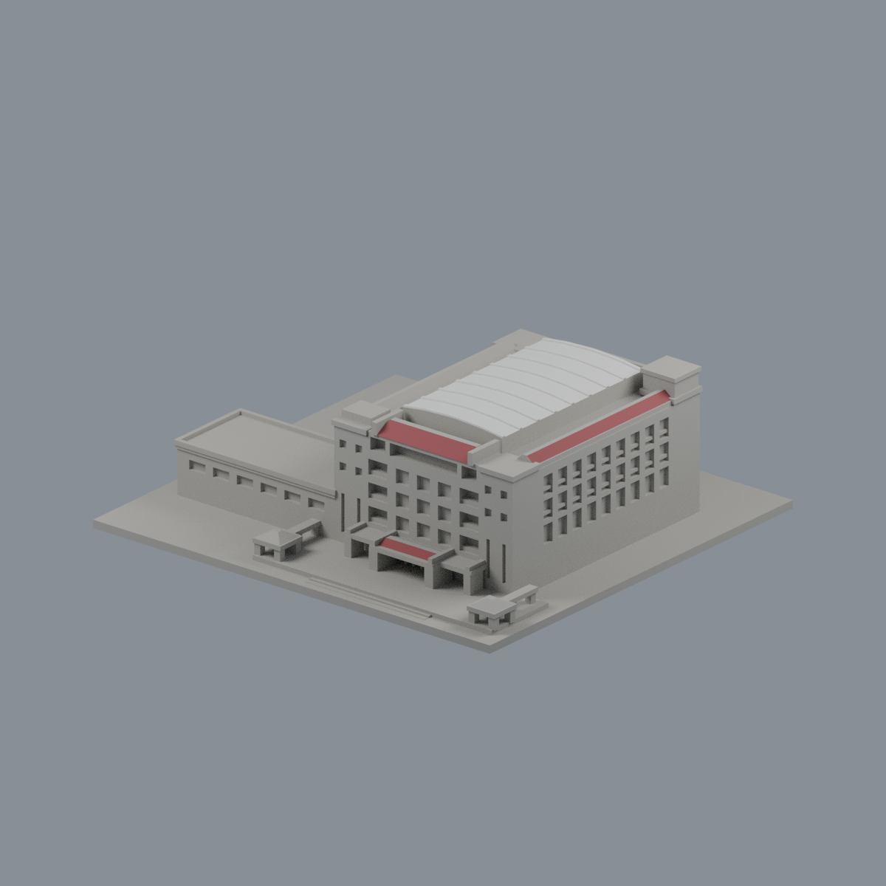
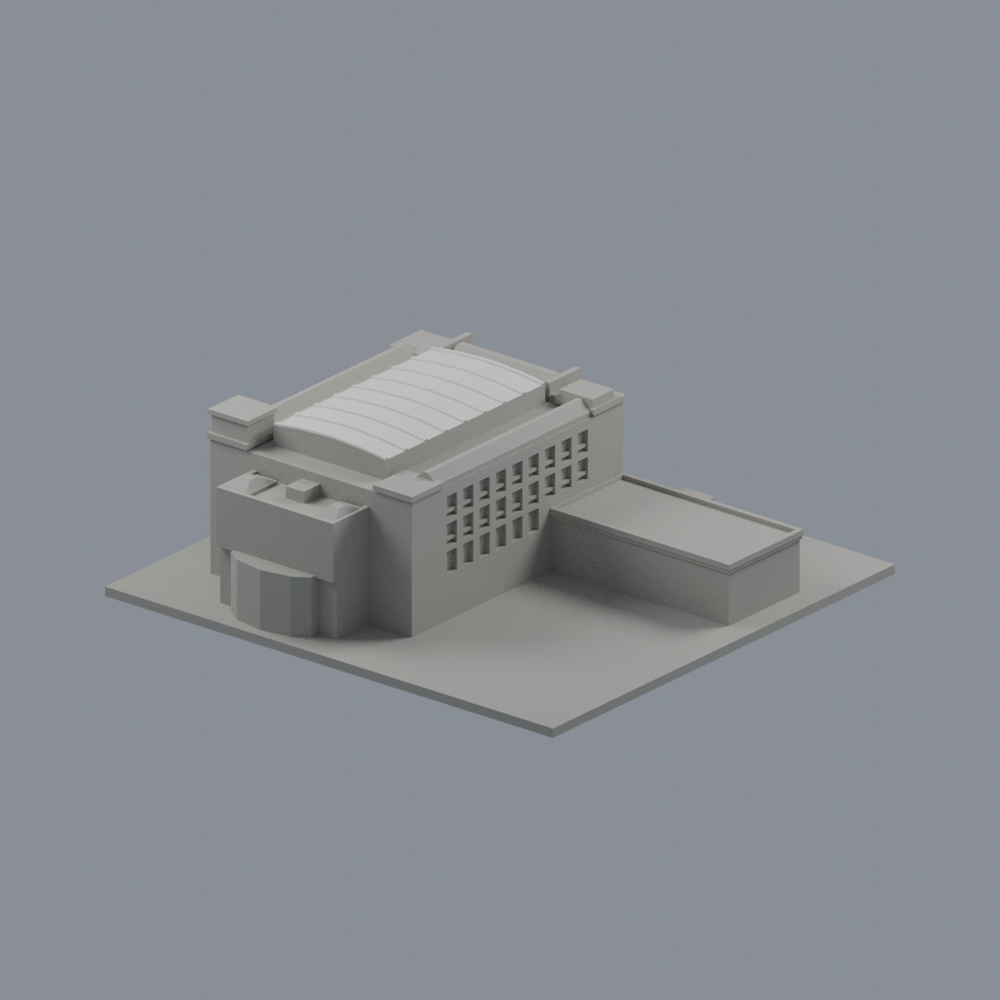
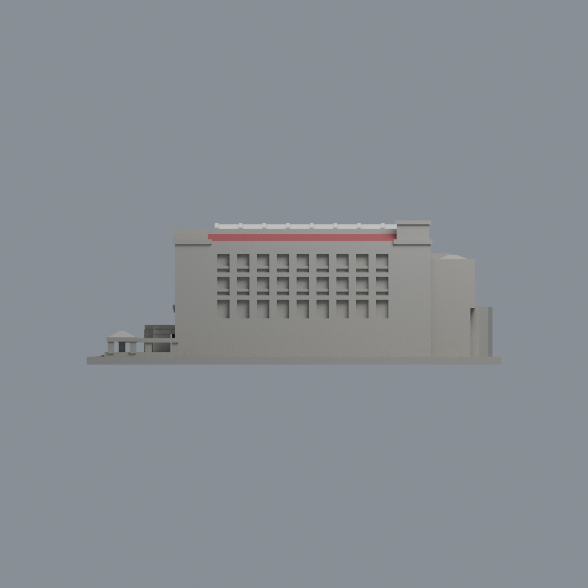
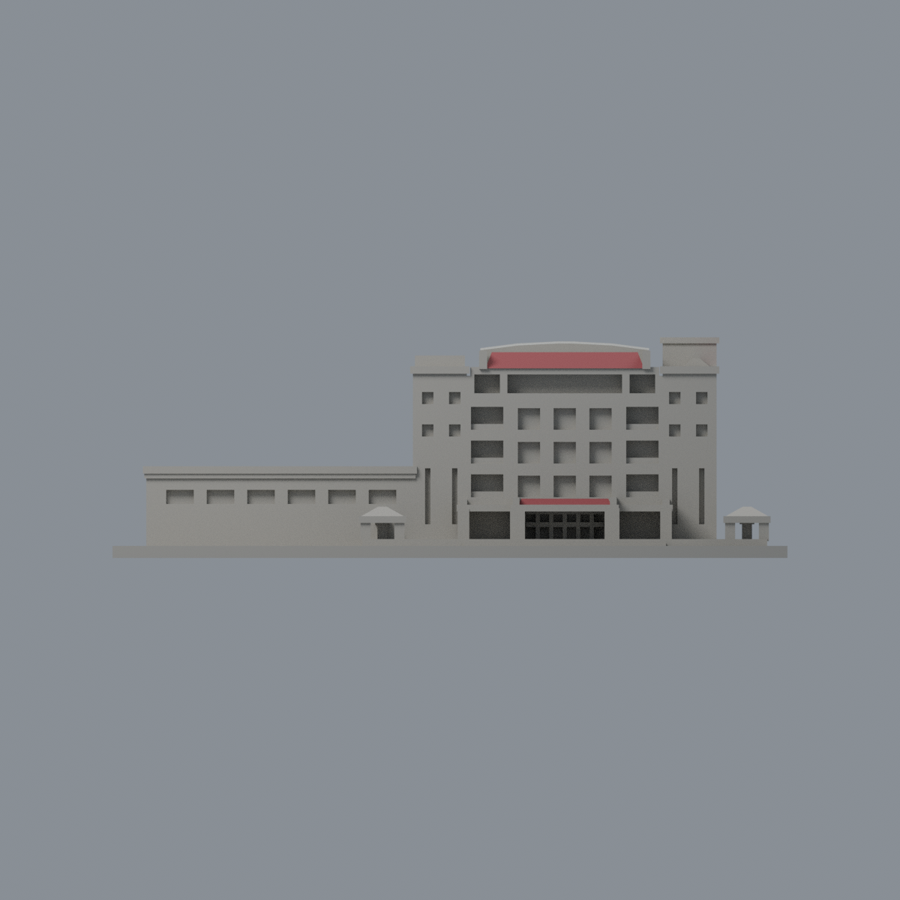
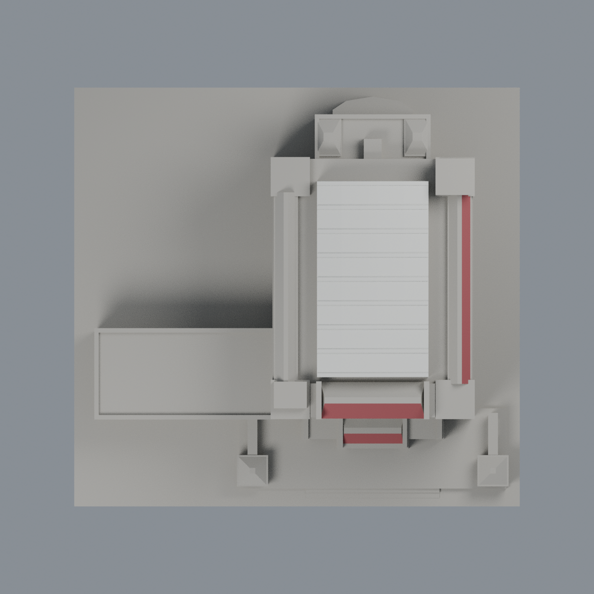

# 南華大學無盡藏圖書館：白覆蓋及前紅坡限域配色

| 模型預覽 | 模型預覽 | 模型預覽 |
| :---: | :---: | :---: |
|  |  |  |

[後左](previews/rear.png) · [右立面](previews/elevation.png) · [正立面](previews/side.png) · [俯視](previews/top.png)

| 模型預覽 | 模型預覽 | 模型預覽 |
| :---: | :---: | :---: |
| 後左  | 右立面  | 正立面  |
| 俯視  |  |  |

## 本次九道白屋頂橫肋薄側面補色

僅將大型覆蓋上的九道白橫肋前後薄側面，共 18 個有限帶面／180 個完整原三角延用既有白色槽 1。原 190 白面、14 紅面（含先前右側 6 原紅坡）及全部既有理由保留。現在中性 3,994、白 370、紅 14；原 4,378 三角／2,159 點、STL bytes、座標與面序皆不變。

逆變換 working=STL/1.5−(17,2,0)，各肋中心 y=−19.5+43j/8，側面 y±0.4、x=−12.5…12.5，高度介於原五段頂折線與其上 0.28。不能只以重心或三頂點判定：逐三角所有頂點，並核對三條邊與全部折線 x 分界交點，確保跨分段三角也完整落在同一肋帶域。每側原 10 面，實際總面積 283.498764 mm²，解析 18×25×0.28×1.5²=283.5 mm²；逐側差小於 0.0001 mm²。不切面、不補面，原折線、寬高及造型不變。

本輪親看官方 node5 航照四張 tile，圖書館白覆蓋與橫肋可辨；薄側面在此像素尺度不能逐面辨色。本次明示相同白肋構件連續材質推論，不把陰影線當異色、不宣稱背側直接照片證實、金屬／塗料規格或校色。航照 1970 日期為無效預設，實際拍攝日期未知；地面 2023/9/18 欄位亦非 EXIF，不據此聲稱 2023 屋頂存在或 2026 現況。

主白覆蓋的大型垂直端面、底面、肋 x 端與較深封邊交接、混合牆窗、屋架、服務盒及其他紅坡不擴色。既有 L 形比例和製造限制全部保留；不是新建一棟，未做實體試印或多料切片。原照片僅私人研究，不在公開包。

新版 QA 在 `qa-continuous-walls/`；原 QA、`qa-roof-continuation/` 和舊 checksum 留存歷史。新校驗用 `appearance/SHA256SUMS` 與根 `PUBLIC-MODEL-SHA256SUMS`。舊 README 190 白／8 紅為更早版本，以上保護 14 紅才是本輪起點。重建用 `python appearance/source/build_continuous_walls.py`、`verify_continuous_exchange.py`，Blender 背景執行 `render_continuous_walls.py`、`verify_continuous_scene.py`。ZIP 含原 STL、建模程式與正式完整肋側域，不含私人照片或初步漏面選取。

## 前版說明與保留限制

大林校本部既有L形圖書館，不是成均館、校門或其他學校建物。原4378面中，大型金屬覆蓋及九道橫肋頂面190個完整三角採柔白 #D9DAD5；前上層與入口向前紅坡各4面採紅褐 #984A4E。其餘4180面保持中性 #AAA79F。中性意為未確認，不代表實物皆灰色；不是全棟材質復原或2026現況。

## 來源與全頂點邊界
親看官方地面VR圖書館node1正面9塊tile完整拼接及官方node5航照原圖拼接。地面節點datetime=2023/9/18 下午02:41是系統欄位，不冒充EXIF攝影日；航照1970/1/1無效預設，確切攝影年未知。不同來源不聲稱同年；不聲稱白頂於2023已存在或2026現況已核。色碼為未校色視覺代理，非實測色票。

模型先逆變換working=(STL/1.5)-(17,2,0)。白覆蓋頂折線(-12.5,30.8)→(-7,31.5)→(-1,31.8)→(1,31.8)→(7,31.5)→(12.5,30.8)，深度y=-20..24。九道橫肋中心y=-19.5+43*i/8，寬0.8，頂高加0.28。5覆蓋段+9×5肋段共50個精確斜面，每個完整三角的全部3頂點必須在同一斜面及x/y支撐內，幾何法向向上且對應斜率。不是bbox或面重心猜測。

紅坡依原hip(0,-25.2,28.1,23.5,8.2,2.4,top=(.92,.17))及hip(0,-32,7.6,14,7.3,1.2,top=(.92,.18))，僅向-Y前斜面，逐頂點核精確斜平面與梯形支撐。端框、頂平面、後坡不染。垂直封邊、肋側面、黑走道、兩側窄屋頂、後端服務箱、粉褐牆、玻璃、布條、玻璃錐亭與未知後壁維持中性，不把實景色界跨入整片牆。全程不切面、不重網格。

## 檔案與重建
[彩色3MF](nhu-library-roofs-appearance.3mf) · [可編輯Blender](scene.blend) · [面映射](face-materials.json) · [色盤](palette.json) · [來源](SOURCES.md) · [權利](LICENSE-NOTICE.md) · [重建來源ZIP](rebuild-source.zip) · [校驗碼](SHA256SUMS)

保留原STL全部座標、4378三角面序及拓撲，尺寸150×141×49.05mm。原native場景唯一Warm stone preview only材質；本補充不改原件、歷史來源或製造QA。重建來源ZIP解壓為model.stl與appearance/source/，安裝requirements後順序執行build_appearance.py、verify_exchange.py、verify_material_boundaries.py，再以Blender 4.3.2+執行render_appearance.py、verify_scene.py。

驗證含lib3mf strict零警告、實際材質修改/存檔/重開、Blender實際材質修改/存檔/重開與其他材質/幾何保留。乾淨重建3MF、映射、色盤及五PNG逐byte比對；Blend僅語義一致，不宣稱binary決定性。3MF為單網格整面表面色，非分色封閉體、G-code或多色FFF保證；未切片器/實體試印。原OSM比例及目估外觀限制不變，不供施工。

## 2026-11-13 有限外觀修正｜模型交付版

原右gable +X外向完整6面0→既有紅族2，總紅14面/白190/中性4174，4378面幾何及原3材值保持。全頂點解析原斜平面及整三角支承扣端cap/servicecrown，未切界。原頂平、內坡、端框、左屋均不擴色；只紅底近似，照片可見細灰接縫/肋原未建，不聲稱完整材紋或測繪。

模型、材質、原生視角圖與必要重建程式沿用完成候選，未改幾何或新切材界，不代表全館精確復色、現況或實體試印通過。原來源年代、工程與列印限制仍適用，舊說明與審核僅屬各自版本，本段更新上述局部範圍。

本次只公開模型、必要重建輸入／腳本、預覽與說明；完整來源、比較及研究審核不隨本批交付。根目錄PUBLIC-MODEL-SHA256SUMS僅校驗所列當前產品，舊表不驗證新版。重建ZIP只含必要重建檔與本說明；歷史來源及QA連結指儲存庫既有文件，非ZIP內的新增審核附件。
