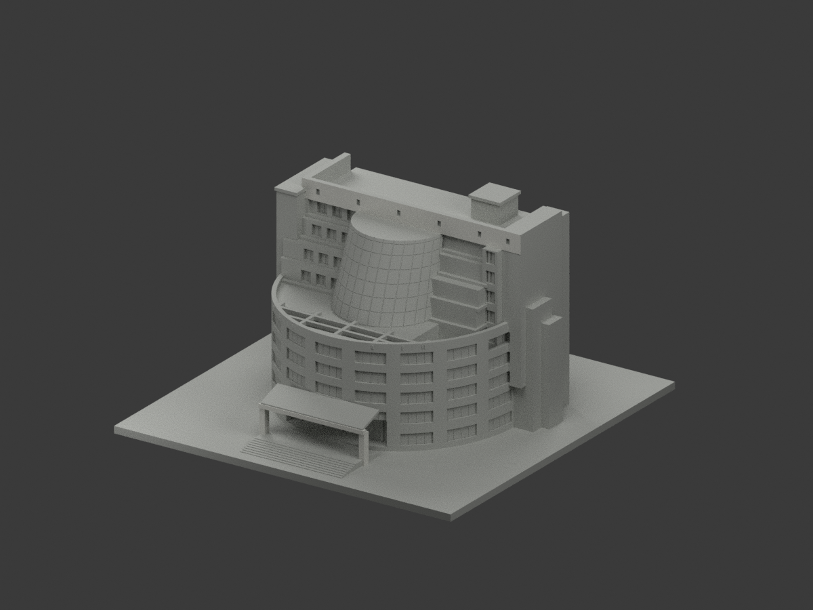
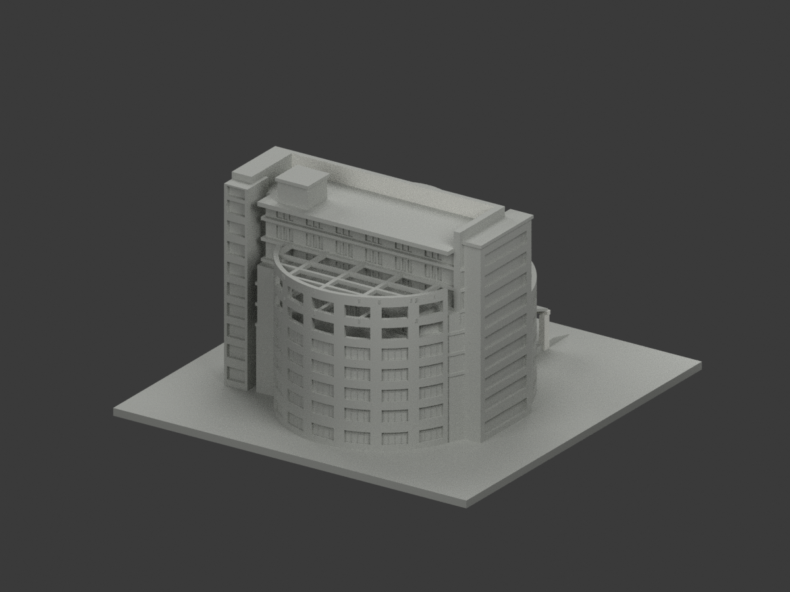
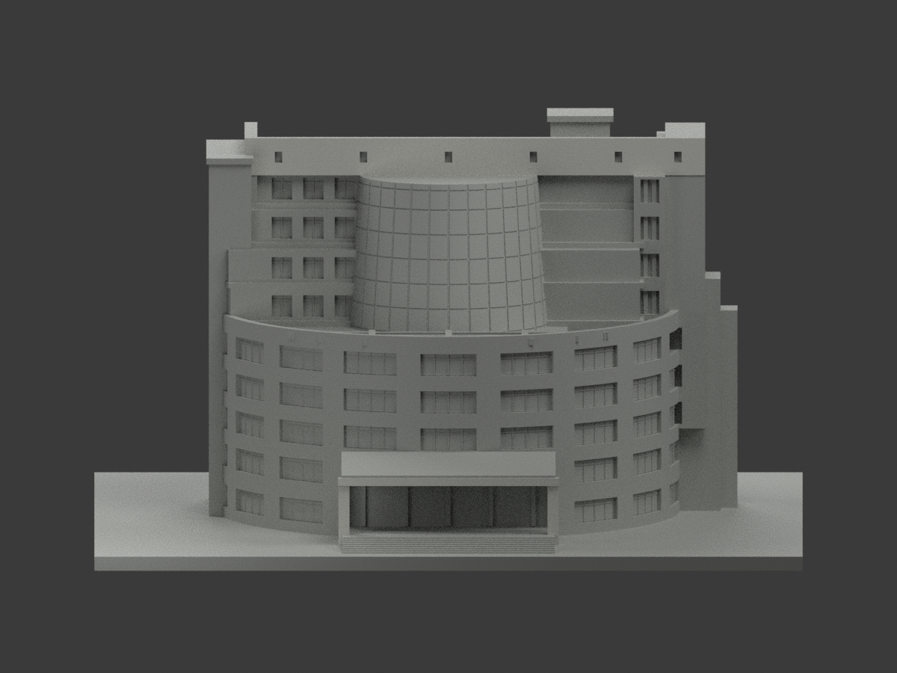
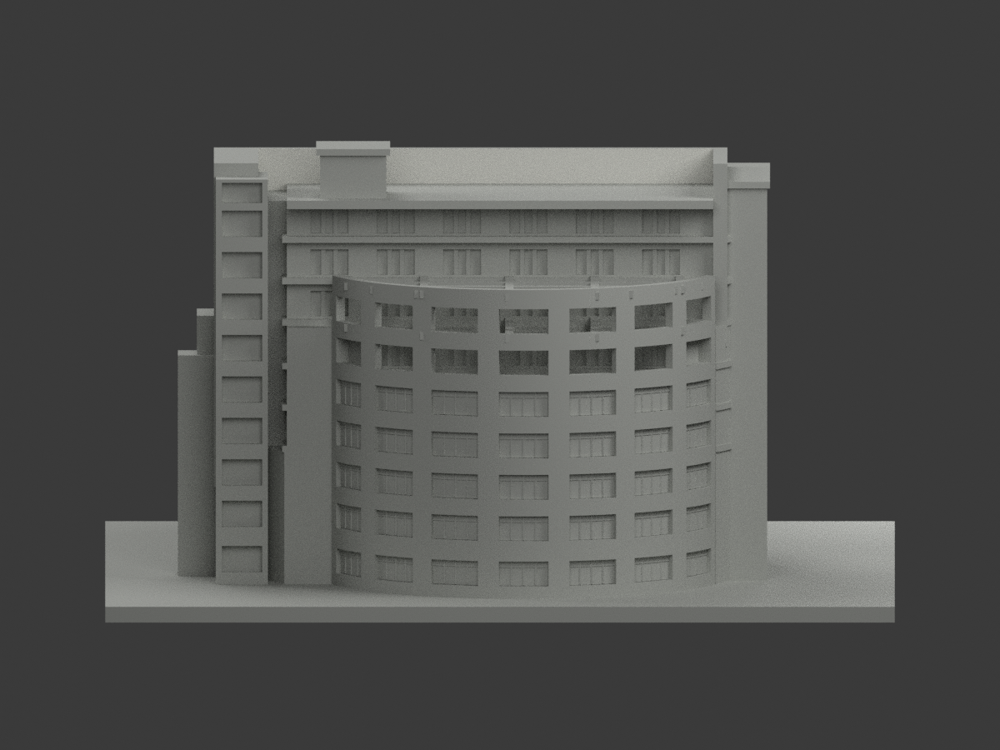
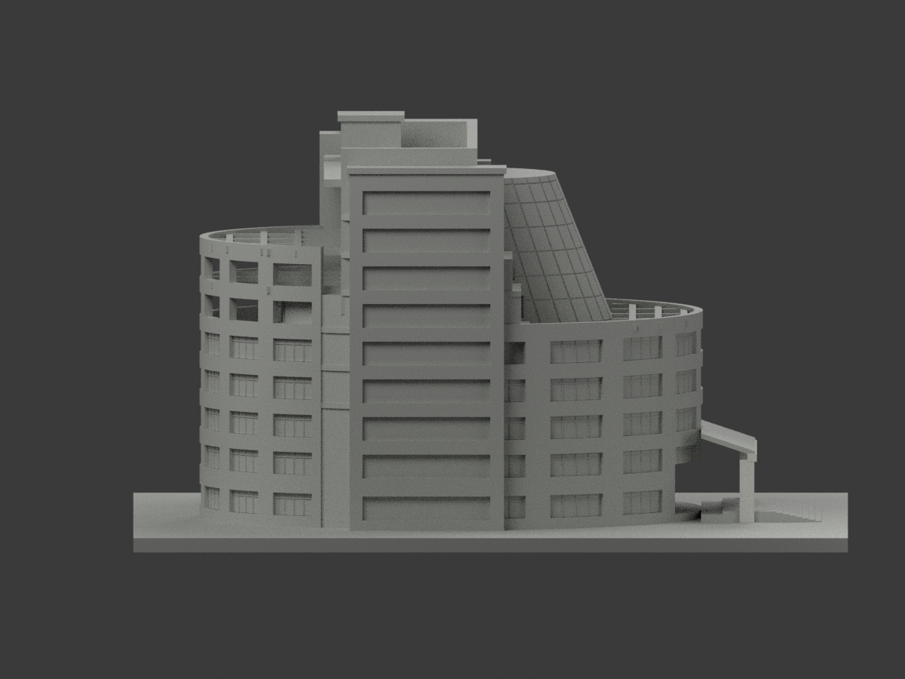
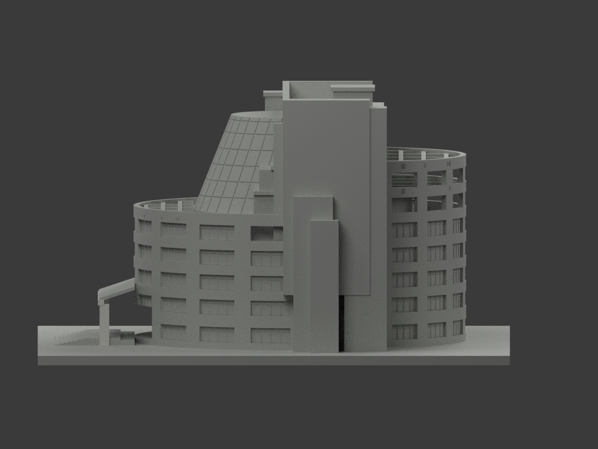
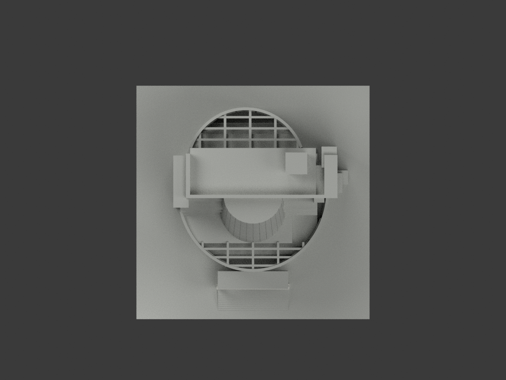
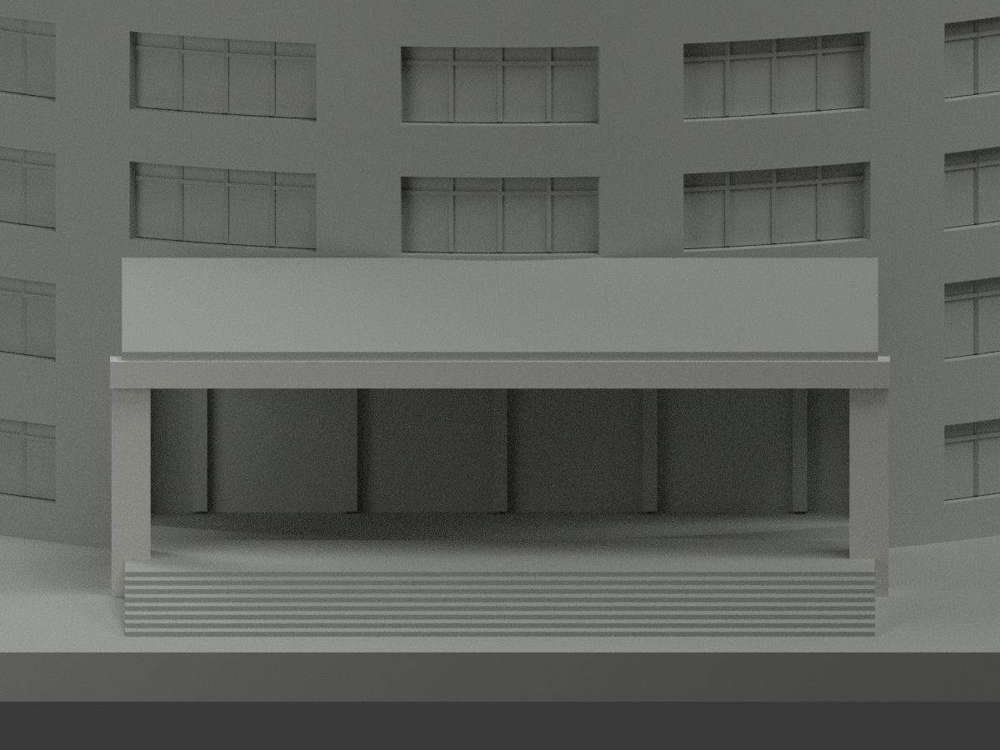
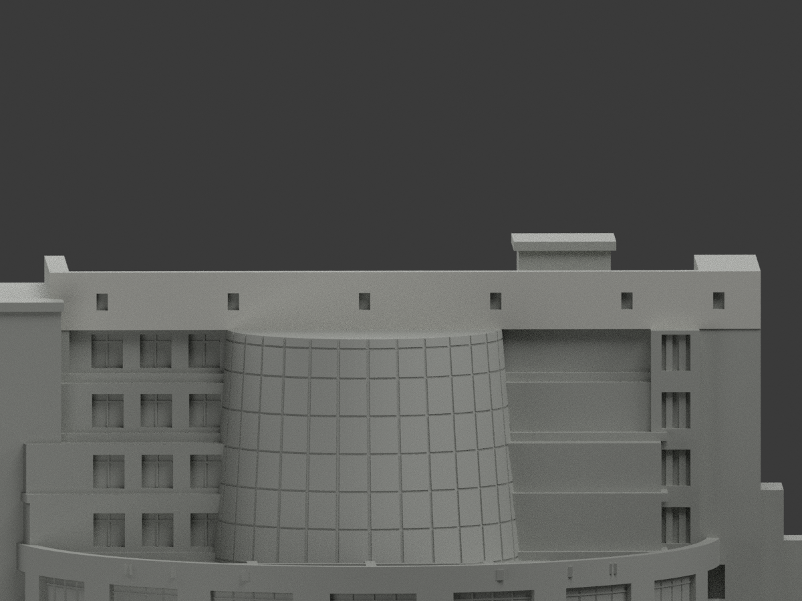
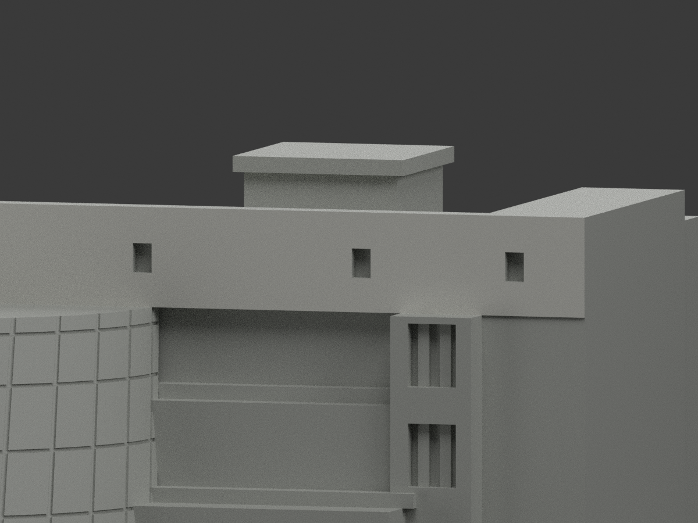

# 嘉南藥理大學王趁紀念圖書館｜同一南高牆背向面同材質延續

## 模型預覽

| 總覽 | 背側 | 正面 |
|---|---|---|
||||
||||
||||
||||

## 本次同一南高牆背向垂直面延色

僅將既有已白南高牆背面的 5 個原三角 [2188,2197,2221,2222,2223] 延用灰白材料 0，不是整棟後立面補白。原南高牆正面與入口框架共 139 色面、原兩槽色盤全部不變，現 144 面灰白、65,542 面未知中性，仍是局部配色。65,686 原面／32,643 原點、STL bytes、座標、繞向及面序精確保留，原外包約 150×150×85.800003 mm，S=1.8、BASE=3 未改。仍是同一 L 棟，不含 Q 棟或校園，count_delta=0。

有界面在 y=−3.06 mm、朝 +Y。原未縮放六角 x/z 域 [(-22.5,40.7),(22.5,40.7),(22.5,40),(25.5,40),(25.5,44.4),(-22.5,44.4)] 以 S=1.8、z 加 BASE=3 還原；這是同一高牆由原左右連接牆及機房屋頂扣除後的完整外露背面。整個支撐平面、有限域與共面連通域皆等於這 5 原三角，沒有挑大面片、切三角或跨塗屋頂。解析面積 (48×3.7+3×0.7)×1.8²=582.228 mm²，原三角 582.2276808472 mm²，形域對稱差 <0.0005 mm² 且無三角內重疊。原前窗槽、左右高側牆、其他主牆、曲玻璃、北弧屏、廣屋頂、入口棚與地面全保留原色，不補造洞或幾何。

親看校方官方相簿 5962，URL https://libcvod.cnu.edu.tw/sysdata/album/71/d14d01b8cf78a13eed9da0ba9b4e9965_xl.jpg ，下載 SHA 與原來源紀錄一致。南斜照支持同一高牆灰白色族、並與曲玻璃及屋頂區分；新背面在該照不可見，明示為同牆材料延續推論，絕非背面照片確證、逐面測繪或 2026 現況。相簿名 20170322 不等於獨立驗證拍攝日期，色值未色卡校準。私人來源照片不入公開包、不作貼圖。

全部原工程限制繼續保留：v2 只接受有限例外，原 459 opening 警告、方向性短弦、728 接點與 533 二面／195 三面控制、v1 HOLD 歷史未被改寫。補色與 strict 3MF 交換通過，不代表全域壁厚、支撐、切片或實體列印已獲證。原 78 件、原五材展示對比、既有 original-classification-version／interchange／首頁歷史預覽均不動，不把原分類版本改作本次色基準。

現版根 color-mesh.npz、appearance.3mf、scene.blend 與十張 PNG 對應新 qa-continuous-highwall/，現版 hashes 在 CONTINUATION-SHA256SUMS。原 ENTRY-FRAME-*、COLOR-*、appearance-materials.json、source、舊 checksum／manifest 及下方原說明保留 bytes，代表原 139 面版本，不是新版 144 面統計。新 3MF 以精確原 float32 座標表示及合法物件預設材料通過 strict 零警告。Blender 保留一建築網格與原隱藏說明／背板，後者不是列印幾何。

重建 python continuous-highwall-source/build_continuous.py；交換驗證 verify_exchange.py；Blender 執行 render_continuous.py，再 strip_previews.py 與 Blender verify_scene.py。rebuild-continuous-source.zip 隔離重建 NPZ／3MF／原 palette 完全一致，不含照片。本包為本地完成準備，不宣稱已上傳。

場景僅同步更新 source_mesh_sha256 以對應新材質指派檔，並更新 scope，明示原 139 色面保留、同一南高牆 5 個背向面灰白推論，並非整棟後立面補白。原簡化幾何、其他未知建築後側中性及所有工程限制保留；其餘原屬性、全部材質定義與幾何不變。palette.json 原 bytes 完全保留。原指定首頁 previews/front.png 與 previews/rear.png 維持原檔，本頁十張圖僅為本輪局部配色預覽，不取代指定首頁；原五材分類展示仍屬歷史版本。

本頁為現行說明；根 README.zh-TW.md 與 SHA256SUMS 保留歷史 bytes。完整現行校驗以 CONTINUATION-SHA256SUMS 為準。

## 前版說明與保留限制（完整歷史文字）

# 嘉南藥理大學王趁紀念圖書館｜南高牆與入口框架局部灰白

**局部補色未完成：原 48 個南高牆與入口楣正面保留，新增入口楣與兩側柱共 91 面灰白；共 139 面有名義配色，65,547 面仍為未知中性色。側返、背面與頂底面的同構件連續色屬合理推定，非逐面實測或 2026 現況。** partial_color_incomplete=true、fully_colored_exterior=false。原五材是預覽對比非單色，本次source-gap獨立變體保留原全78件/首頁/交換檔；不含鄰Q棟。原v2限定例外、459個opening警告、728槽角點533二面/195三面與方向性短弦、v1 HOLD皆保，**新色審不追認全域壁厚、支撐或實體可列印**。

## 原指定首頁保持
[原南正面首頁](previews/front.png) · [原北背面](previews/rear.png)，原圖bytes不變，下方十圖是本次新增局部色QA視圖，不取代原首頁。

## 材色範圍
同 cnu-wang-chen-library，same-item/count_delta=0，原65686三角與78件不變，無原OBJ不新增。原 S=1.8、BASE=3 的南高牆正面 46 面與入口楣正面 2 面完全保留。本次依原 build_model.py 的有限盒形邊界選取入口楣 34 面、左右柱 27 與 32 面，其中 2 面為既有配色，新增 91 面。全部三頂點、共面連通域與原 Boolean 分片已核對，沒有新增切面。校方照片可見入口框架為灰白色；同構件背側、頂面與底面採連續色推定。名義 HEX 不是精確磁磚色票；玻璃斜棚、曲玻璃、其他牆面、北側與屋面維持原中性，不新增磚縫。
官相簿20170322嘉南廣場-72南照提供色族，20200224與20250910北照只輔助範圍；檔名不是獨立拍攝時間或2026現況證。原2003新館RC九層/B2描述不把所有層等高化；L棟不混旁Q。

## 原版與有限QA原樣保留
完整原78件在 original-classification-version/ 與原路徑歷史檔；原README/scene另有ORIGINAL-SOURCE-GAP-公開alias，原render_preview.py、previews與interchange完整bytes保留。舊QA aliases僅綁歷史子包，不綁新增圖；不捏造舊hash。新 appearance.3mf/scene.blend 為 139 面局部配色版本，原五材與精確sRGB/線性RGBA交換限制不改。
原v2有限接受不等於全域通過：459跨層opening警告最大3.9331514275%，角外非零薄損保留；459caliper/1866附加首弦皆指定方向，不推全方向壁厚。728槽角點仍含533二面、195三面與原pair失敗，不以14代表點根18.4541mm泛稱全族。0.252mm側向短弦、原0.072mm頂帶中間稿/v1 HOLD歷程完整保；本次不重新repair或重跑以抹除警告。
含底150mm、名義1m→1.8mm、底3mm。最高46m照片試配、40–52m敏感範圍非測得；54×58m為弧屋量級不是所有外包。逐層退縮/封閉曲玻璃/淺框/透空格梁均原近似，未試印、不保證免支撐，不任意縮小。原模型名義與版本差異依原README全文保留。

## 來源、格式與再現
[校方官方相簿](https://libcvod.cnu.edu.tw/)，原頁/照片只私人核對，不公開貼圖；未證自由商用，不套專案授權。
[原STL](model.stl) · [新增逐面3MF](appearance.3mf) · [新場景](scene.blend) · [原完整版本](original-classification-version/README.md)
物件 CNU Wang Chen Library partial color。原build_model.py精確隔離重建，colorize_model.py/export_appearance.py/validate_color.py/render_color.py/verify_color_scene.py驗本variant。兩材不是四色切片或試印認證。

## English scope
Bounded entrance-frame color update, not a full exterior repaint. The original 48 south highwall/lintel front faces remain. A further 91 original lintel and pier faces receive the same nominal gray-white, for 139 colored faces and 65,547 unknown-neutral faces. The official photo supports the light entrance frame; color continuity on its side, rear, top and soffit faces is explicitly inferred. Glazed canopy, curved glazing and other walls are unchanged. All 65,686 triangles, original STL, original homepage views and historical files are retained. Same item, count delta zero, no OBJ. Photograph filename dates do not certify capture date or current 2026 condition. Existing 459 opening warnings, 728 junction-point limitations, directional short chords and v1 HOLD history remain. No renewed global printability certification or physical print.

## 本次入口框架核對

[來源與推定範圍](ENTRY-FRAME-SOURCE-QA.json) · [獨立核對](ENTRY-FRAME-INDEPENDENT-QA.json) · [原局部補色說明](qa/entry-frame-previous/README.md)。照片只供私人核對，不隨模型公開。
