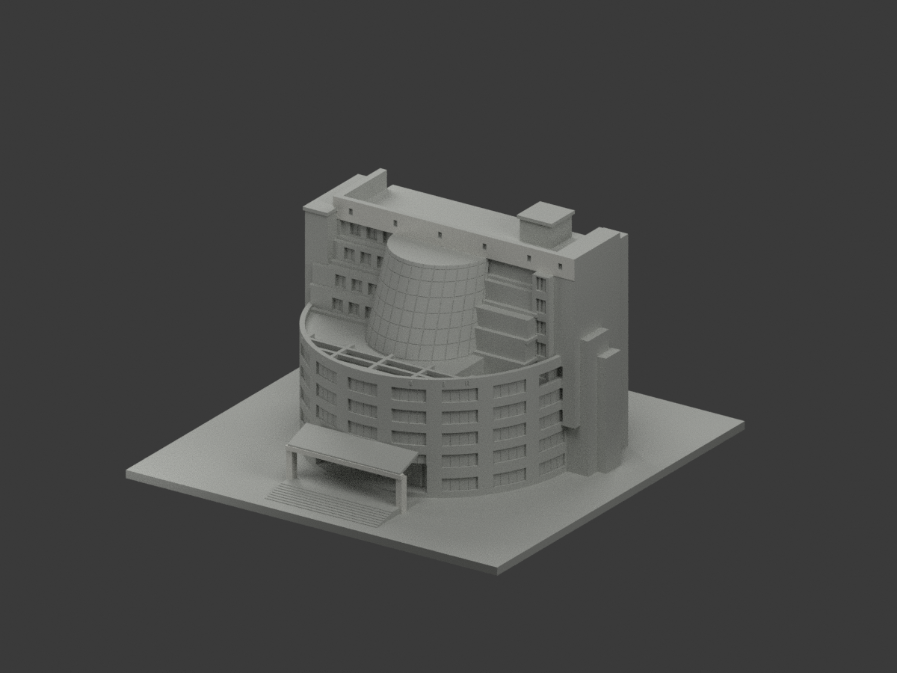
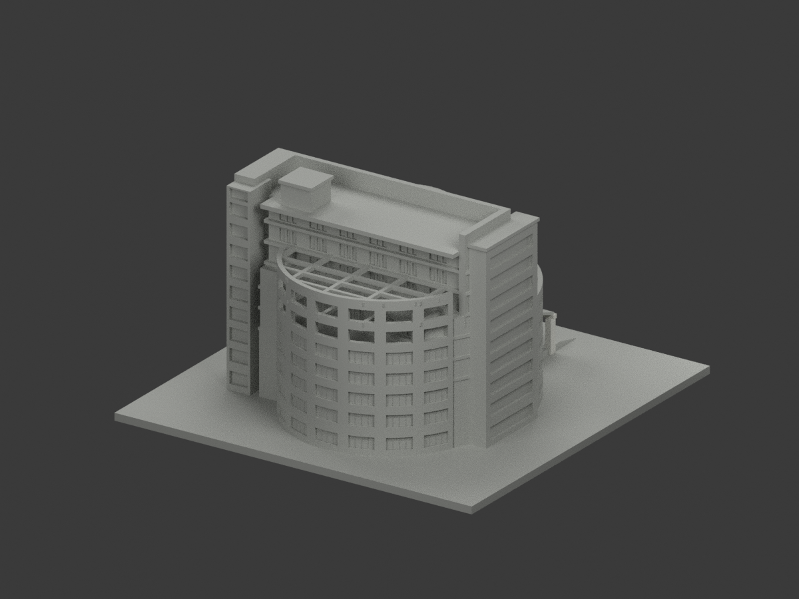
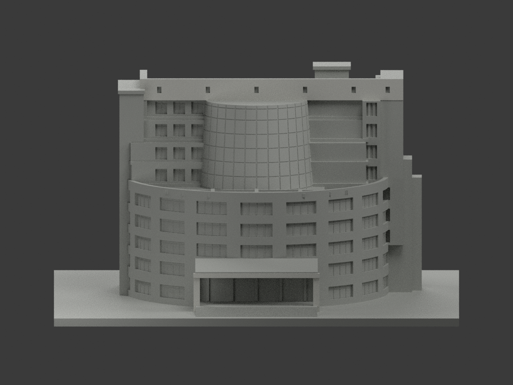
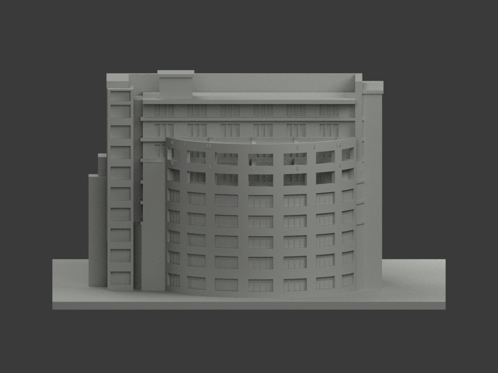
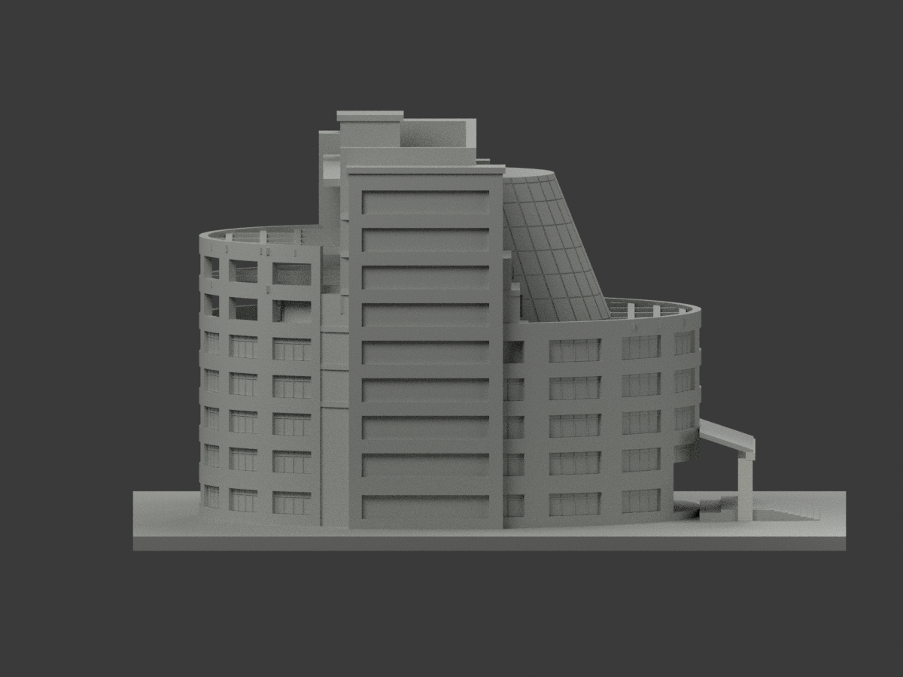
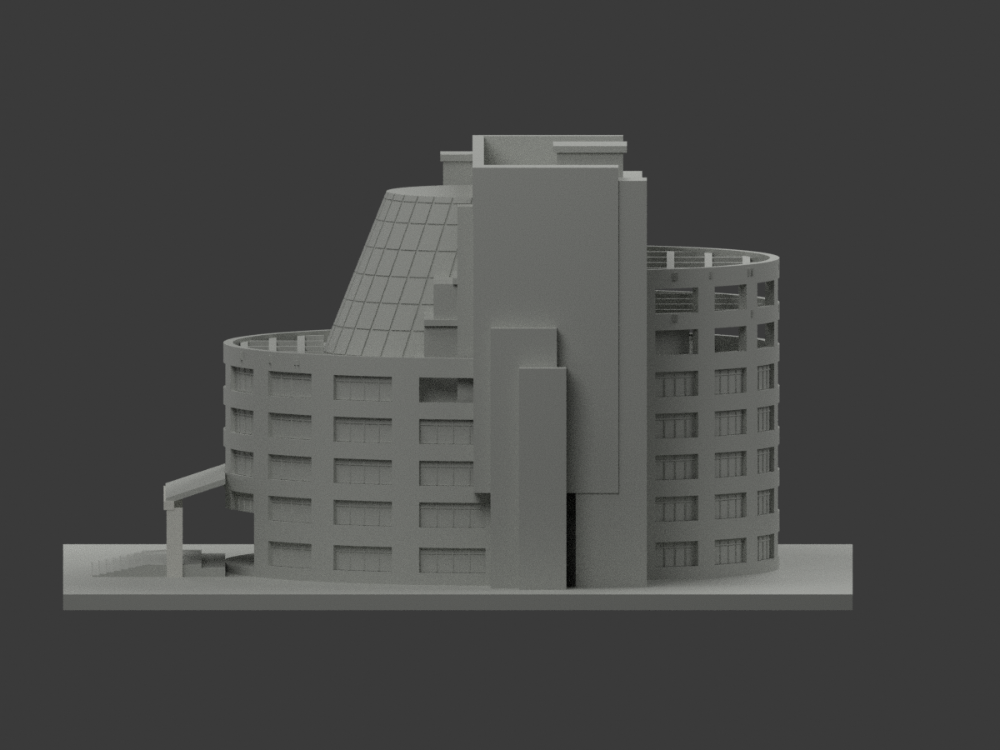
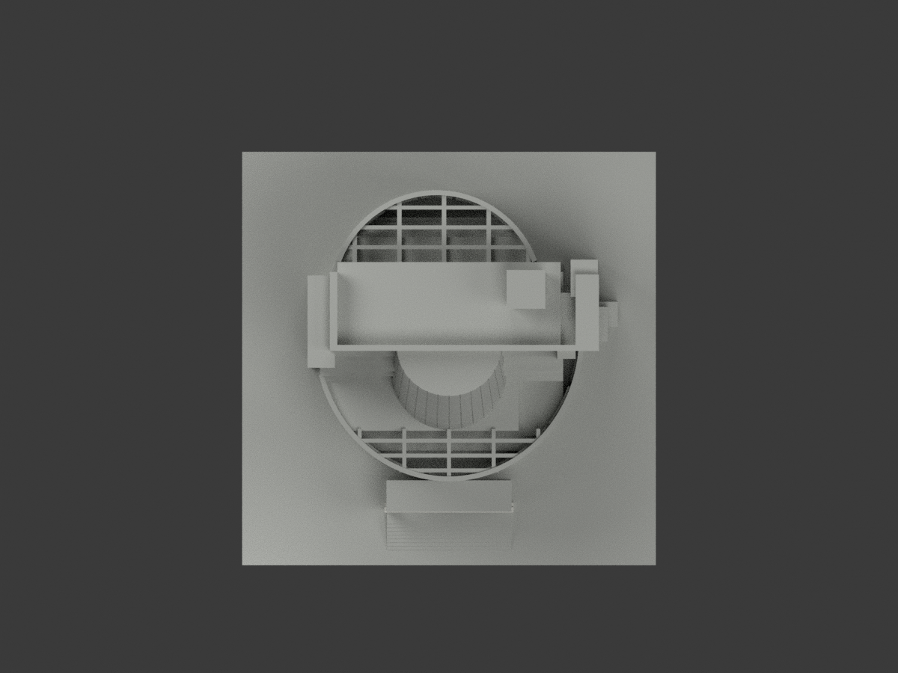
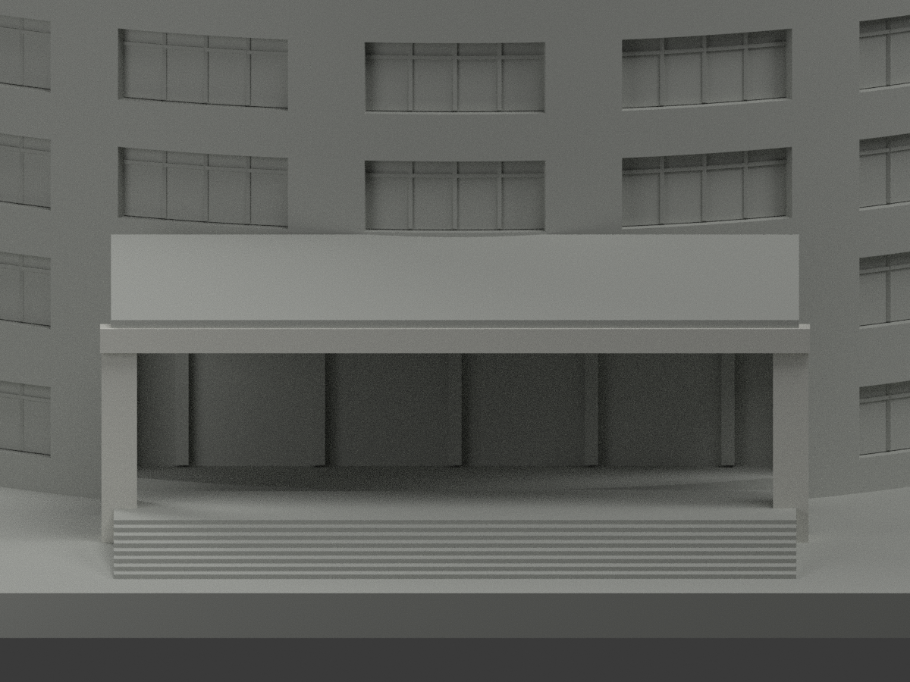
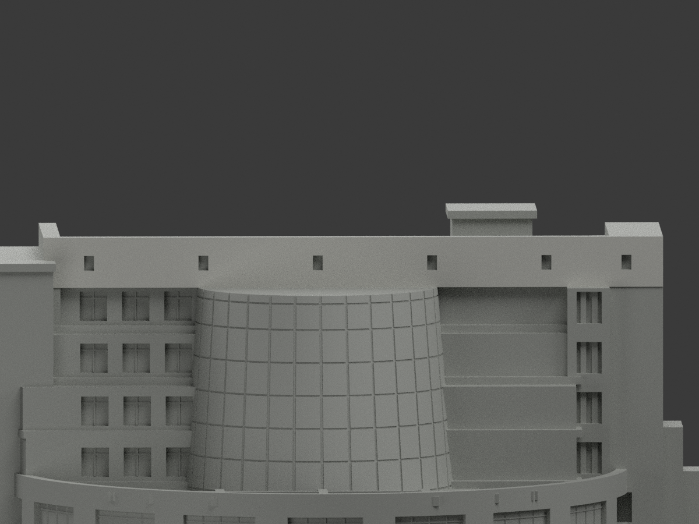
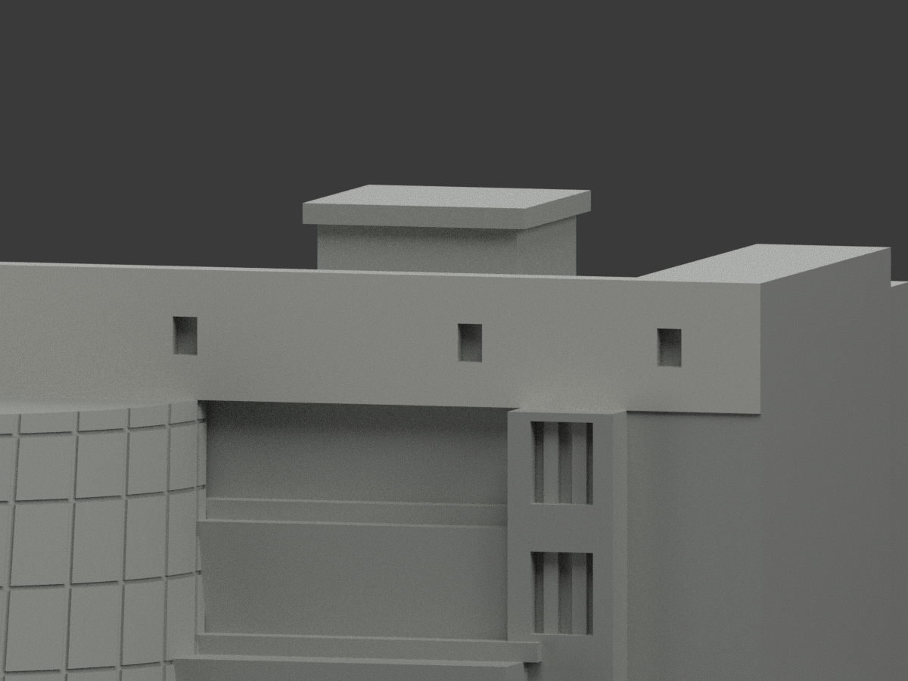

# 嘉南藥理大學王趁紀念圖書館｜南高牆與入口框架局部灰白

**局部補色未完成：原 48 個南高牆與入口楣正面保留，新增入口楣與兩側柱共 91 面灰白；共 139 面有名義配色，65,547 面仍為未知中性色。側返、背面與頂底面的同構件連續色屬合理推定，非逐面實測或 2026 現況。** partial_color_incomplete=true、fully_colored_exterior=false。原五材是預覽對比非單色，本次source-gap獨立變體保留原全78件/首頁/交換檔；不含鄰Q棟。原v2限定例外、459個opening警告、728槽角點533二面/195三面與方向性短弦、v1 HOLD皆保，**新色審不追認全域壁厚、支撐或實體可列印**。

## 原指定首頁保持
[原南正面首頁](previews/front.png) · [原北背面](previews/rear.png)，原圖bytes不變，下方十圖是本次新增局部色QA視圖，不取代原首頁。

| 總覽 | 背側 | 正面 |
|---|---|---|
||||
||||
||||
||||

## 材色範圍
同 cnu-wang-chen-library，same-item/count_delta=0，原65686三角與78件不變，無原OBJ不新增。原 S=1.8、BASE=3 的南高牆正面 46 面與入口楣正面 2 面完全保留。本次依原 build_model.py 的有限盒形邊界選取入口楣 34 面、左右柱 27 與 32 面，其中 2 面為既有配色，新增 91 面。全部三頂點、共面連通域與原 Boolean 分片已核對，沒有新增切面。校方照片可見入口框架為灰白色；同構件背側、頂面與底面採連續色推定。名義 HEX 不是精確磁磚色票；玻璃斜棚、曲玻璃、其他牆面、北側與屋面維持原中性，不新增磚縫。
官相簿20170322嘉南廣場-72南照提供色族，20200224與20250910北照只輔助範圍；檔名不是獨立拍攝時間或2026現況證。原2003新館RC九層/B2描述不把所有層等高化；L棟不混旁Q。

## 原版與有限QA原樣保留
完整原78件在 original-classification-version/ 與原路徑歷史檔；原README/scene另有ORIGINAL-SOURCE-GAP-公開alias，原render_preview.py、previews與interchange完整bytes保留。舊QA aliases僅綁歷史子包，不綁新增圖；不捏造舊hash。新 appearance.3mf/scene.blend 為 139 面局部配色版本，原五材與精確sRGB/線性RGBA交換限制不改。
原v2有限接受不等於全域通過：459跨層opening警告最大3.9331514275%，角外非零薄損保留；459caliper/1866附加首弦皆指定方向，不推全方向壁厚。728槽角點仍含533二面、195三面與原pair失敗，不以14代表點根18.4541mm泛稱全族。0.252mm側向短弦、原0.072mm頂帶中間稿/v1 HOLD歷程完整保；本次不重新repair或重跑以抹除警告。
含底150mm、名義1m→1.8mm、底3mm。最高46m照片試配、40–52m敏感範圍非測得；54×58m為弧屋量級不是所有外包。逐層退縮/封閉曲玻璃/淺框/透空格梁均原近似，未試印、不保證免支撐，不任意縮小。原模型名義與版本差異依原README全文保留。

## 來源、格式與再現
[校方官方相簿](https://libcvod.cnu.edu.tw/)，原頁/照片只私人核對，不公開貼圖；未證自由商用，不套專案授權。
[原STL](model.stl) · [新增逐面3MF](appearance.3mf) · [新場景](scene.blend) · [原完整版本](original-classification-version/README.md)
物件 CNU Wang Chen Library partial color。原build_model.py精確隔離重建，colorize_model.py/export_appearance.py/validate_color.py/render_color.py/verify_color_scene.py驗本variant。兩材不是四色切片或試印認證。

## English scope
Bounded entrance-frame color update, not a full exterior repaint. The original 48 south highwall/lintel front faces remain. A further 91 original lintel and pier faces receive the same nominal gray-white, for 139 colored faces and 65,547 unknown-neutral faces. The official photo supports the light entrance frame; color continuity on its side, rear, top and soffit faces is explicitly inferred. Glazed canopy, curved glazing and other walls are unchanged. All 65,686 triangles, original STL, original homepage views and historical files are retained. Same item, count delta zero, no OBJ. Photograph filename dates do not certify capture date or current 2026 condition. Existing 459 opening warnings, 728 junction-point limitations, directional short chords and v1 HOLD history remain. No renewed global printability certification or physical print.

## 本次入口框架核對

[來源與推定範圍](ENTRY-FRAME-SOURCE-QA.json) · [獨立核對](ENTRY-FRAME-INDEPENDENT-QA.json) · [原局部補色說明](qa/entry-frame-previous/README.md)。照片只供私人核對，不隨模型公開。
