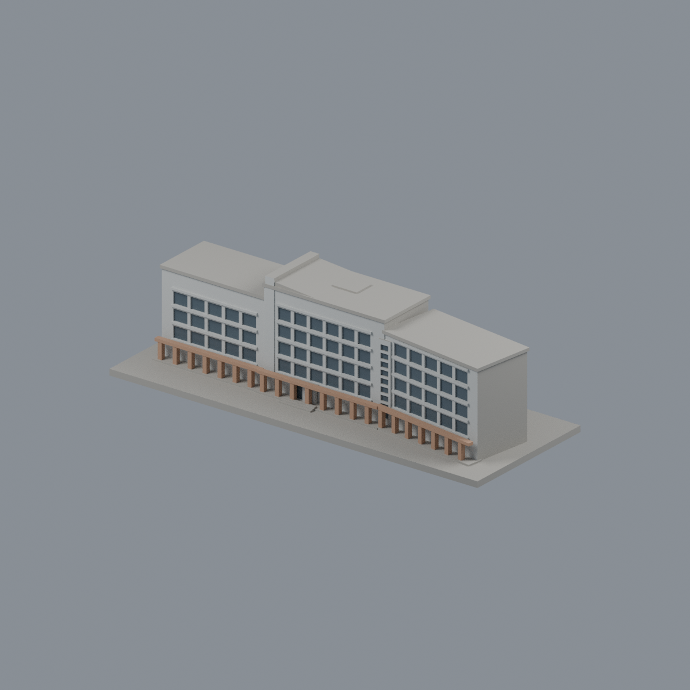
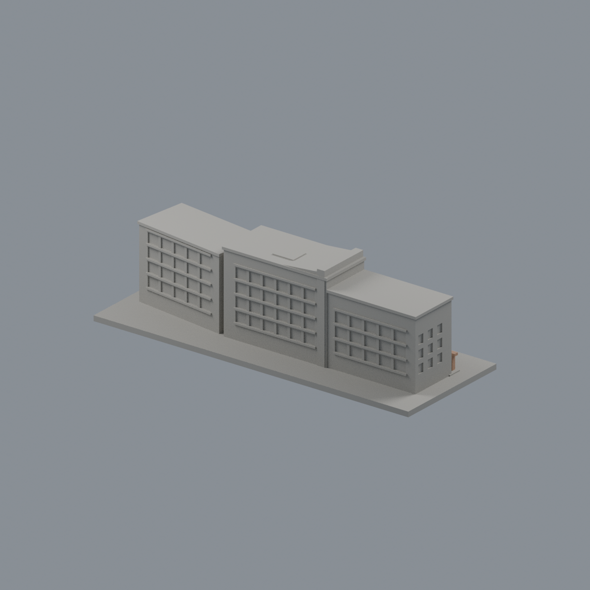

# 國家衛生研究院竹南院區｜行政大樓

## 模型預覽

| 模型預覽 | 模型預覽 | 模型預覽 |
| :---: | :---: | :---: |
|  北側與入口柱廊 |  背面：未知部分中性 | |

[STL（不含色）](model.stl) · [現行彩色 3MF](appearance/nhriadmin-appearance.3mf) · [現行 Blender](appearance/scene.blend) · [外觀、重建與校驗](appearance/README.md) · [來源與證據](manifest.json)

沿用同一棟既有行政大樓：原 3,622 三角面、1,767 頂點、全座標、面序及 150 × 56 × 42.75 mm 尺寸不變。四材質：北側包板及橫肋淺灰、僅原低柱廊暖砂岩、原離散凹窗背採暗灰代理；未知屋頂、端面、背面與底座中性。這不是全部外觀復色或現況測繪。

只呈現原有公開外觀近似，不附第三方照片，不含室內、實驗室、設備或保全資訊。協會案例文章 2014 年刊登，照片拍攝日期不明。未重新核定原工程 QA、切片、支撐或試印。

[原工程驗證報告](https://github.com/hplin50643/taiwan-buildings-3d/blob/1fa7d0e4c55ca0ffcd7854dead95572ca8e3a2e8/%E5%9C%8B%E5%AE%B6%E8%A1%9B%E7%94%9F%E7%A0%94%E7%A9%B6%E9%99%A2%E7%AB%B9%E5%8D%97%E9%99%A2%E5%8D%80/buildings/zhunan-administration/validation.json)、[舊幾何與中性預覽](https://github.com/hplin50643/taiwan-buildings-3d/blob/1fa7d0e4c55ca0ffcd7854dead95572ca8e3a2e8/%E5%9C%8B%E5%AE%B6%E8%A1%9B%E7%94%9F%E7%A0%94%E7%A9%B6%E9%99%A2%E7%AB%B9%E5%8D%97%E9%99%A2%E5%8D%80/buildings/zhunan-administration/README.md)和[原工程完整校驗表](https://github.com/hplin50643/taiwan-buildings-3d/blob/1fa7d0e4c55ca0ffcd7854dead95572ca8e3a2e8/%E5%9C%8B%E5%AE%B6%E8%A1%9B%E7%94%9F%E7%A0%94%E7%A9%B6%E9%99%A2%E7%AB%B9%E5%8D%97%E9%99%A2%E5%8D%80/buildings/zhunan-administration/SHA256SUMS)保留在固定 Git 快照。舊版檢查器與其舊預覽需在該快照一起重播，不拿來驗證現行 WebP 圖冊。
