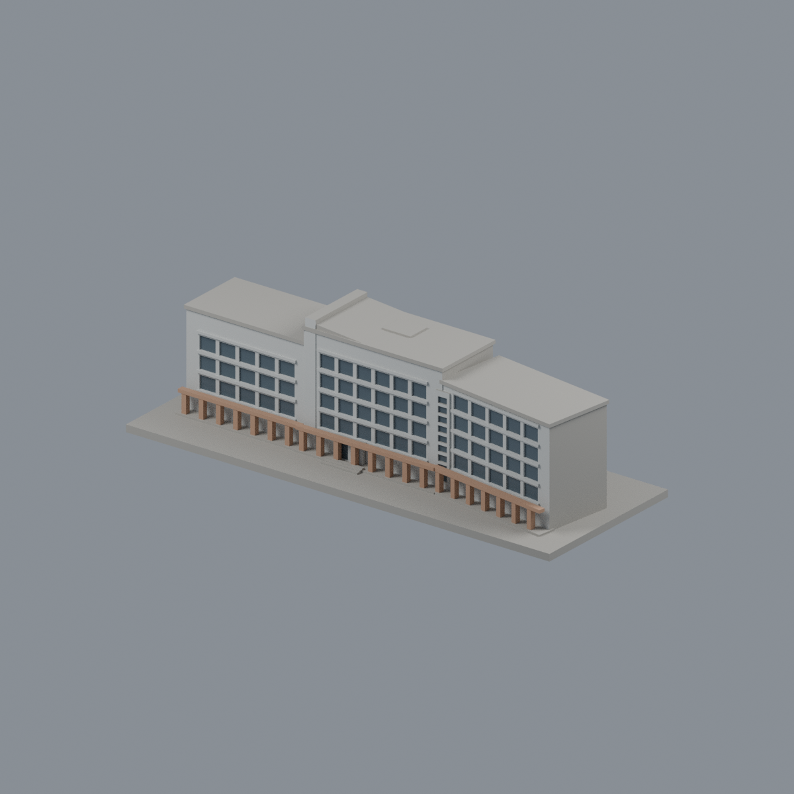
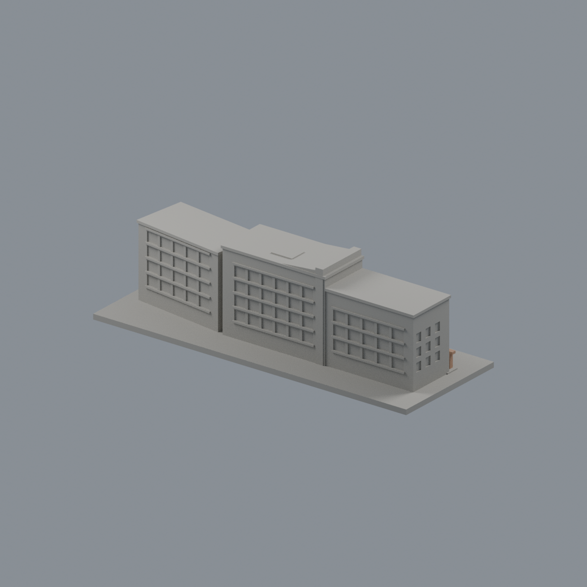
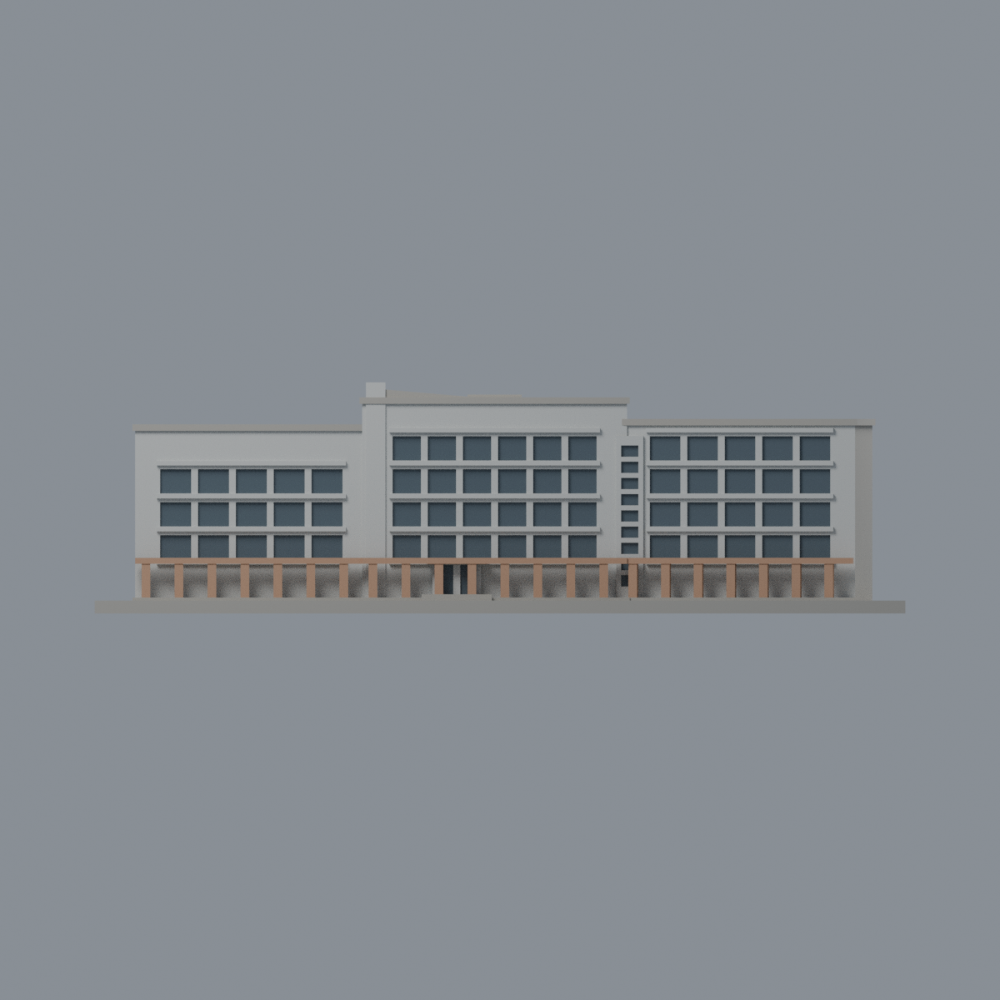
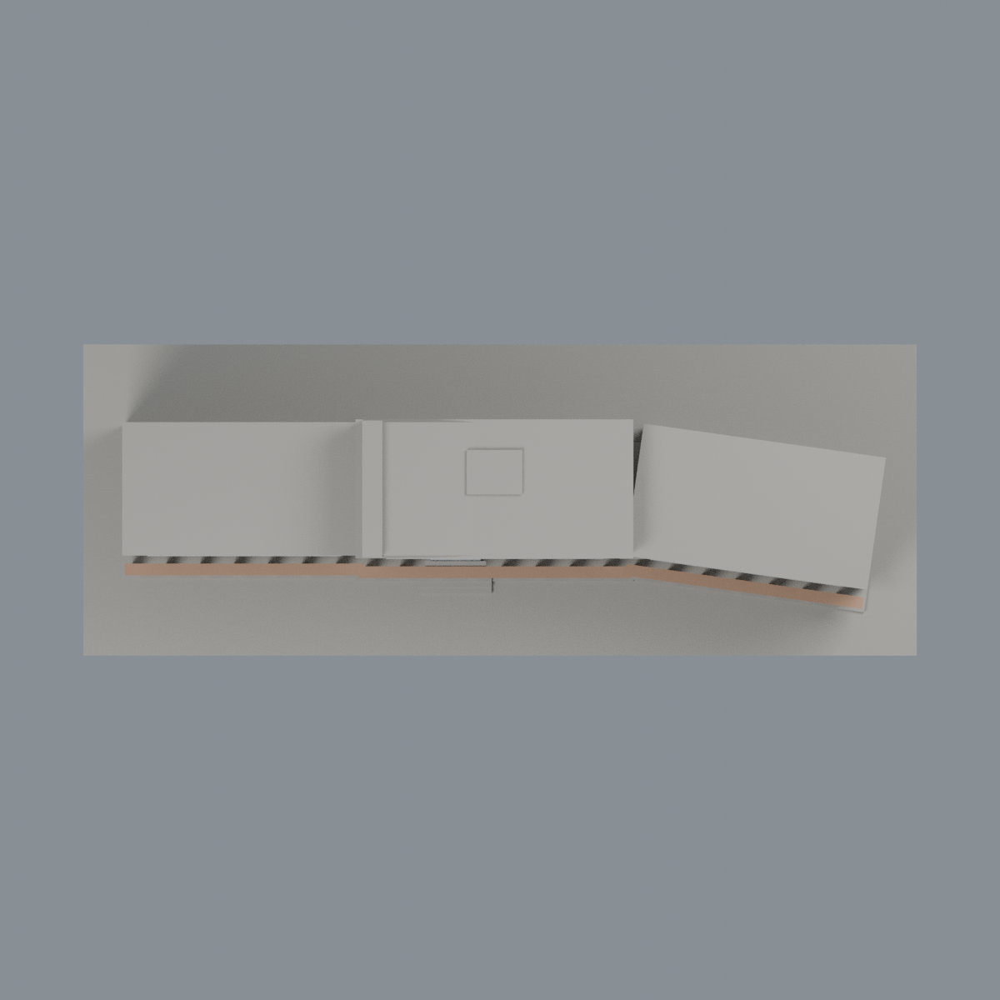

# 國衛院竹南行政大樓｜現行限域外觀

## 模型預覽

| 模型預覽 | 模型預覽 | 模型預覽 |
| :---: | :---: | :---: |
|  北側與入口柱廊 |  背面：未知部分中性 |  正立面 |
|  頂視 | | |

[現行 3MF](nhriadmin-appearance.3mf) · [現行 Blender](scene.blend) · [原 STL](../model.stl) · [當前校驗表](../CURRENT-SHA256SUMS) · [渲染來源與視角](render-proof.json)

沿用同一棟既有行政大樓：原 3,622 三角面、1,767 頂點、全座標、面序及 150 × 56 × 42.75 mm 尺寸不變。四材質：北側包板及橫肋淺灰、僅原低柱廊暖砂岩、原離散凹窗背採暗灰代理；未知屋頂、端面、背面與底座中性。這不是全部外觀復色或現況測繪。

只呈現原有公開外觀近似，不附第三方照片，不含室內、實驗室、設備或保全資訊。協會案例文章 2014 年刊登，照片拍攝日期不明。未重新核定原工程 QA、切片、支撐或試印。

[來源覆核](qa/source-review.json) · [交換核對](qa/exchange-validation.json) · [限制描述核對](qa/metadata-scope-validation.json)

## 重現與歷史

現行三個模型格式可以獨立開啟。需要重建時，在暫存目錄解壓[獨立重建源碼](rebuild-source.zip)，依該包依賴以 Python 執行 `appearance/source/build_appearance.py`；交換使用 `verify_exchange.py`，Blender 4.3.2 使用 `render_appearance.py`。原重建流程的 PNG 中間檔只在暫存處用於校驗，不作公開預覽。現行 WebP 由最新已發布 Blender 場景直接重渲，不改材色。

[前次配色與界線](https://github.com/hplin50643/taiwan-buildings-3d/blob/1fa7d0e4c55ca0ffcd7854dead95572ca8e3a2e8/%E5%9C%8B%E5%AE%B6%E8%A1%9B%E7%94%9F%E7%A0%94%E7%A9%B6%E9%99%A2%E7%AB%B9%E5%8D%97%E9%99%A2%E5%8D%80/buildings/zhunan-administration/appearance/README.md)、[前次外觀校驗](https://github.com/hplin50643/taiwan-buildings-3d/blob/1fa7d0e4c55ca0ffcd7854dead95572ca8e3a2e8/%E5%9C%8B%E5%AE%B6%E8%A1%9B%E7%94%9F%E7%A0%94%E7%A9%B6%E9%99%A2%E7%AB%B9%E5%8D%97%E9%99%A2%E5%8D%80/buildings/zhunan-administration/appearance/SHA256SUMS)和[原工程校驗](https://github.com/hplin50643/taiwan-buildings-3d/blob/1fa7d0e4c55ca0ffcd7854dead95572ca8e3a2e8/%E5%9C%8B%E5%AE%B6%E8%A1%9B%E7%94%9F%E7%A0%94%E7%A9%B6%E9%99%A2%E7%AB%B9%E5%8D%97%E9%99%A2%E5%8D%80/buildings/zhunan-administration/SHA256SUMS)只供歷史驗證，不是現行3MF、場景或預覽的下載入口。歷史報告與原重建流程以固定提交保全，不改內容。
