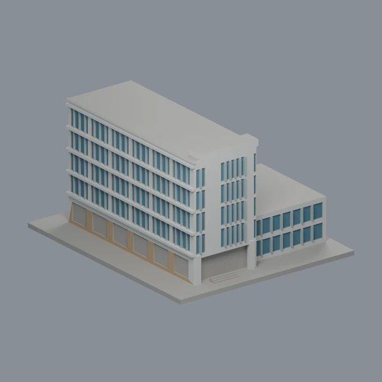
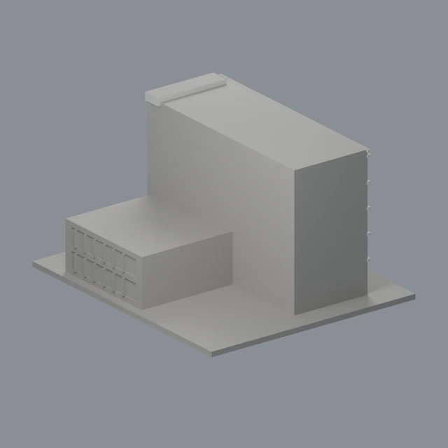
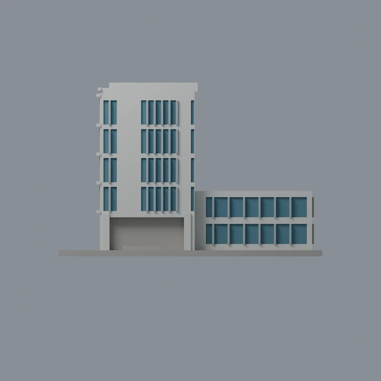
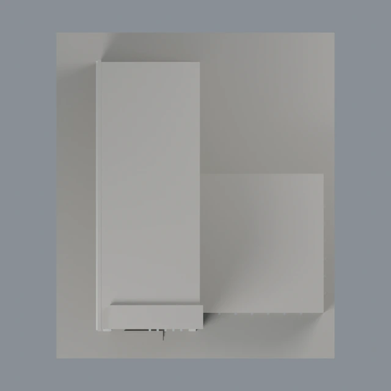

# 國衛院竹南院區既有生物製劑先導工廠｜現版外觀展示

| 正面斜視 | 背面斜視 | 正立面 |
| :---: | :---: | :---: |
|  |  |  |
|  | | |

四張大圖為現存五材質 Blender 以原鏡位重繪的無損 WebP。範圍只含公開外觀的主量體與附接低翼，未獲來源支持的側面、背面與屋面維持中性。未改現存幾何或材色。

[現版 3MF](../appearance/nhribio-appearance.3mf) · [現版 Blender](../appearance/scene.blend) · [原 STL](../model.stl) · [資料與範圍](../README.md) · [配色依據](../appearance/README.md) · [渲染驗證](render-proof.json) · [展示校驗](SHA256SUMS)
