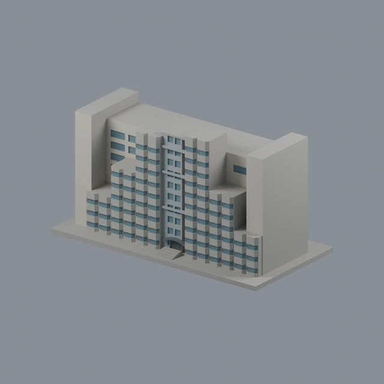
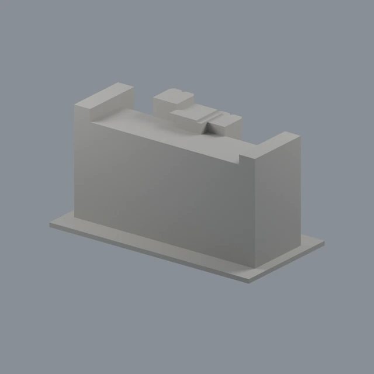
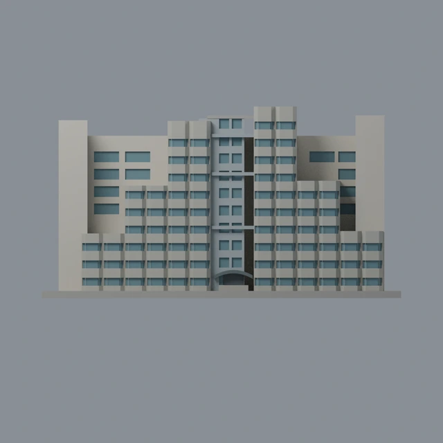
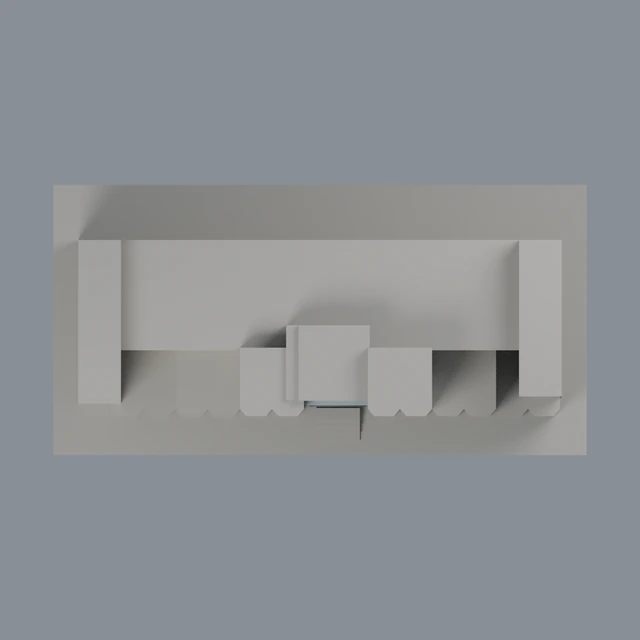

# 國衛院竹南院區二期單人宿舍｜WebP 展示

## 模型預覽

四個原視角均從同一現行六材質 Blender 場景重繪。點縮圖觀看無失真 WebP，同角度與原 PNG 逐像素相同。

| 模型預覽 | 模型預覽 | 模型預覽 |
| :---: | :---: | :---: |
|  正面斜視 |  背面斜視 |  正立面 |
|  頂視 |  |  |

[模型和原工程說明](../README.md) · [現行 Blender](../appearance/scene.blend) · [現行 3MF](../appearance/nhridorm2-appearance.3mf) · [STL](../model.stl) · [OBJ](../model.obj)

既有公開外觀模型，不是實測復刻。幾何與材色均未變更；照片未能辨識的側、背與屋面依舊為中性色。未重建室內，未實際試印。原 README、PNG、模型及兩份工程校驗表均保留；本頁另附[展示校驗](DISPLAY-SHA256SUMS)及[渲染證明](render-proof.json)。
