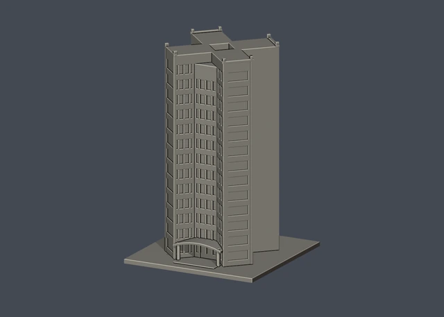
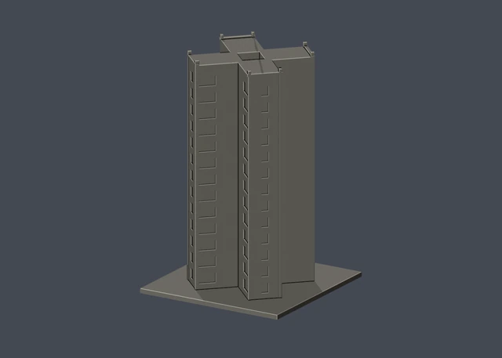
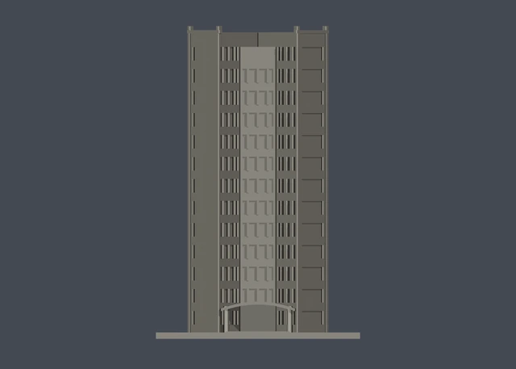

# 國衛院竹南院區有眷宿舍｜現版外觀預覽

| 正面斜視 | 背面斜視 | 正立面 |
| :---: | :---: | :---: |
|  |  |  |

三張無損 WebP 使用原鏡位，由同一份現版 Blender 重繪。顏色是單一展示材質，不是實際外牆顏色；沒有修改模型、配色或幾何。僅保留公開來源可見的外部輪廓，不推定未見側背面細節。

[現版 Blender](../scene.blend) · [原 STL](../model.stl) · [原 OBJ](../model.obj) · [模型與來源](../README.md) · [渲染證據](render-proof.json) · [展示校驗](SHA256SUMS)
