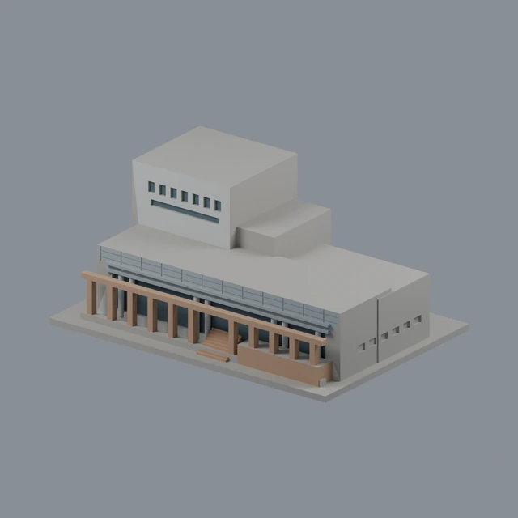
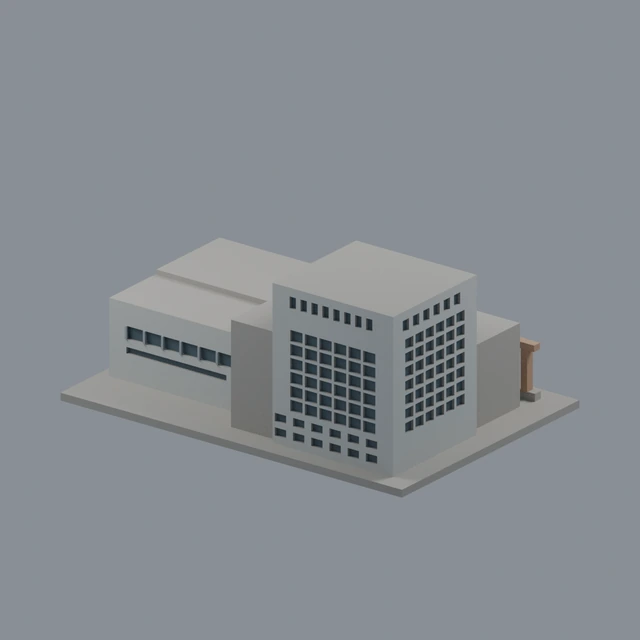
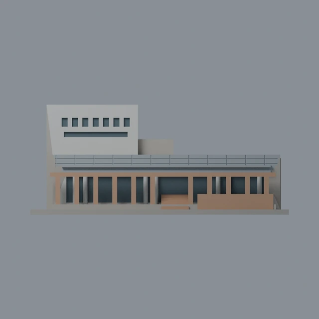
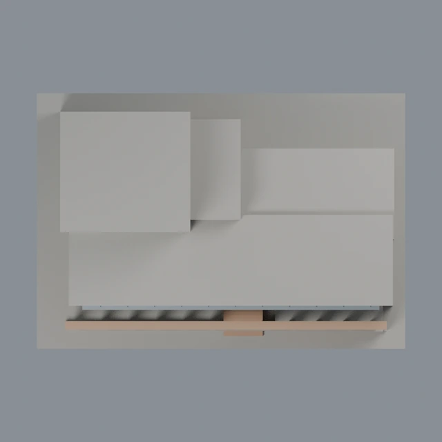

# 國衛院竹南院區圖書資訊大樓｜現版模型預覽

點選縮圖可看同一角度的無損 WebP 大圖。

| 正面斜視 | 背面斜視 | 正立面 |
| :---: | :---: | :---: |
|  |  |  |
|  | | |

四張圖從既有五材質 Blender 場景重繪，未修改網格、配色或鏡位。模型僅為既有公開外觀的近似，不代表現況紀錄；未獲確認的牆面與屋面維持原有中性色。

[彩色 3MF](../appearance/nhrilib-appearance.3mf) · [可編輯 Blender](../appearance/scene.blend) · [STL](../model.stl) · [OBJ](../model.obj) · [渲染來源](render-proof.json) · [展示校驗表](SHA256SUMS)

[原模型範圍與重建](../README.md) · [原外觀配色與來源界線](../appearance/README.md)。原 PNG、場景、重建資料和技術校驗表均保留。
