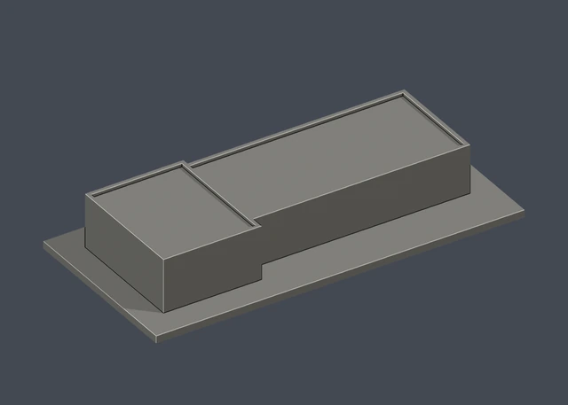
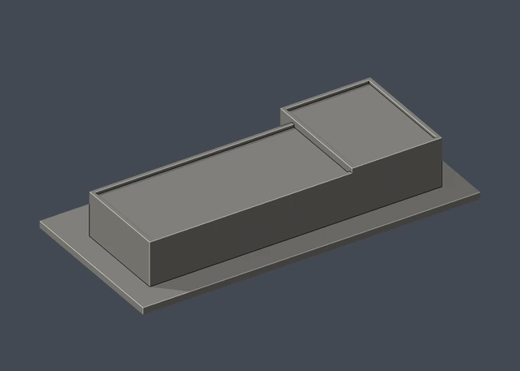

# 國衛院竹南院區機電中心｜初步近似量體｜現版外觀預覽

| 模型預覽 | 模型預覽 | 模型預覽 |
| :---: | :---: | :---: |
|  正面斜視 |  背面斜視 |  正立面 |

三張無損 WebP 使用原鏡位，由同一份現版 Blender 重繪。顏色是單一展示材質，不是實際外牆顏色；沒有修改模型、配色或幾何。建物身分信心中等，仍是公開歷史影像支持的初步外觀近似，不作現況或工程辨識。

[現版 Blender](../scene.blend) · [原 STL](../model.stl) · [原 OBJ](../model.obj) · [模型與來源](../README.md) · [渲染證據](render-proof.json) · [展示校驗](SHA256SUMS)
