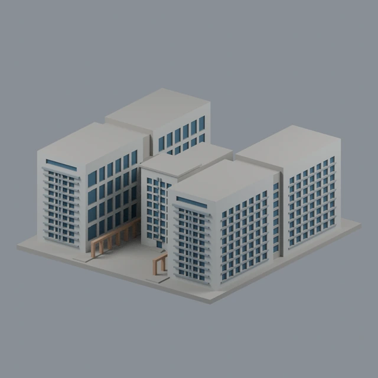
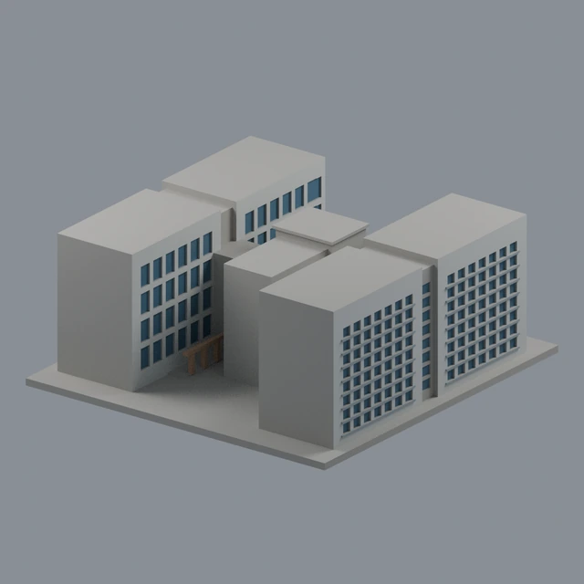
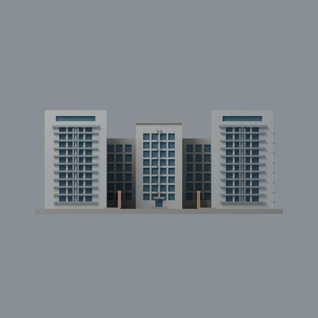
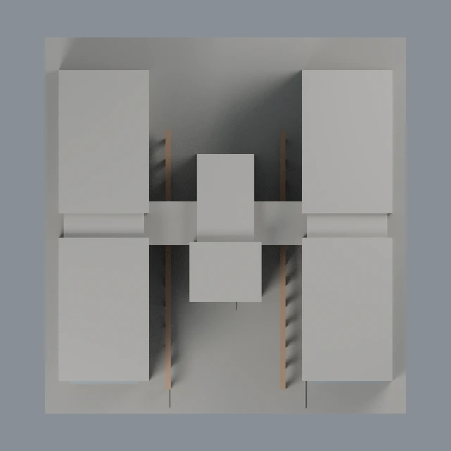

# 國衛院竹南院區研究大樓 R1／R2｜現版外觀展示

| 模型預覽 | 模型預覽 | 模型預覽 |
| :---: | :---: | :---: |
|  正面斜視 |  背面斜視 |  正立面 |
|  頂視 |  |  |

四張大圖為現存五材質 Blender 以原鏡位重繪的無損 WebP。範圍只含公開照片中的雙翼及兩者間的中央量體；有來源支持的外長側保留既有色彩，證據不足的遠端牆、中央後側與屋面維持中性。未改現存幾何或材色。

[現版 3MF](../appearance/nhrir12-appearance.3mf) · [現版 Blender](../appearance/scene.blend) · [原 STL](../model.stl) · [資料與範圍](../README.md) · [配色依據](../appearance/README.md) · [渲染驗證](render-proof.json) · [展示校驗](SHA256SUMS)
