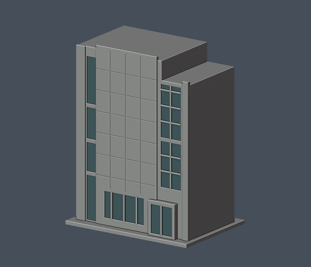
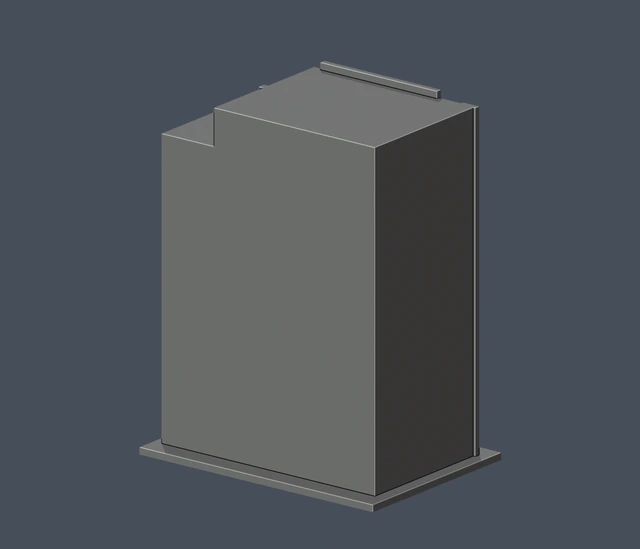

# 國衛院竹南院區 station 48 白色塔狀外觀量體｜現版外觀預覽

| 正面斜視 | 背面斜視 | 正立面 |
| :---: | :---: | :---: |
|  |  |  |

三張無損 WebP 使用原鏡位，由同一份現版 Blender 重繪。外觀、顯示材質、相機方向及幾何均未修改。此為原有外觀近似模型的圖片格式更新，未提供未知側背面或完整設施的新推論。

[現版 Blender](../scene.blend) · [原 STL](../model.stl) · [原 OBJ](../model.obj) · [模型與來源](../README.md) · [渲染證據](render-proof.json) · [展示校驗](SHA256SUMS)
