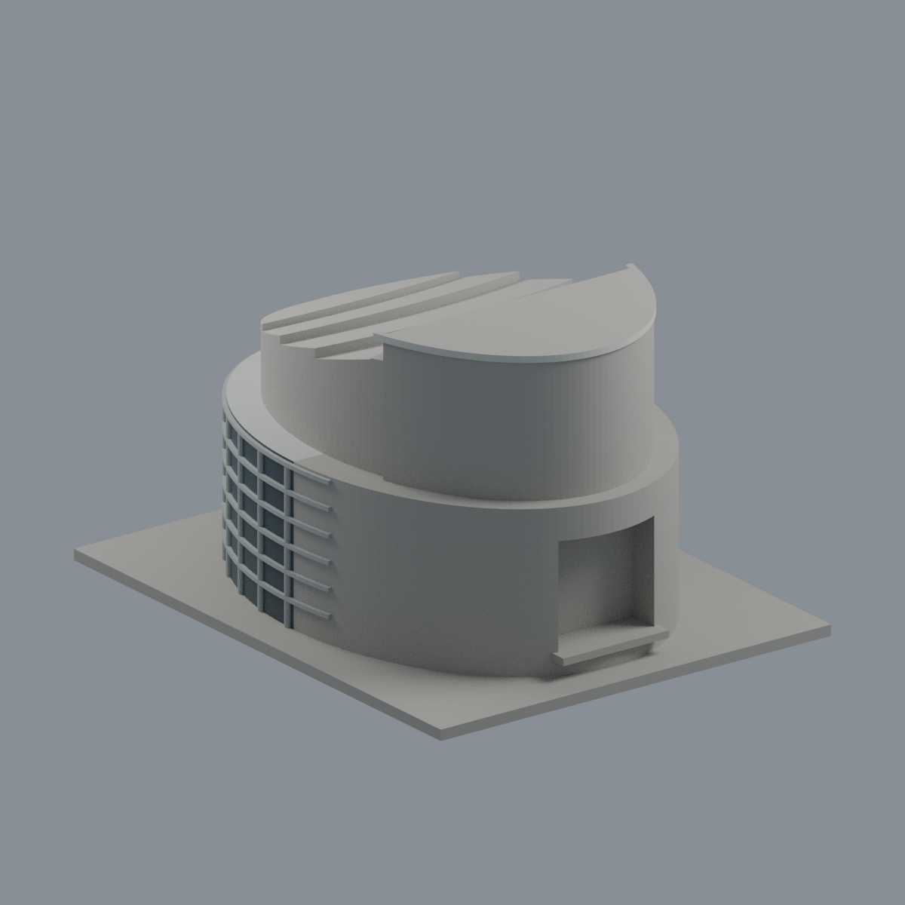
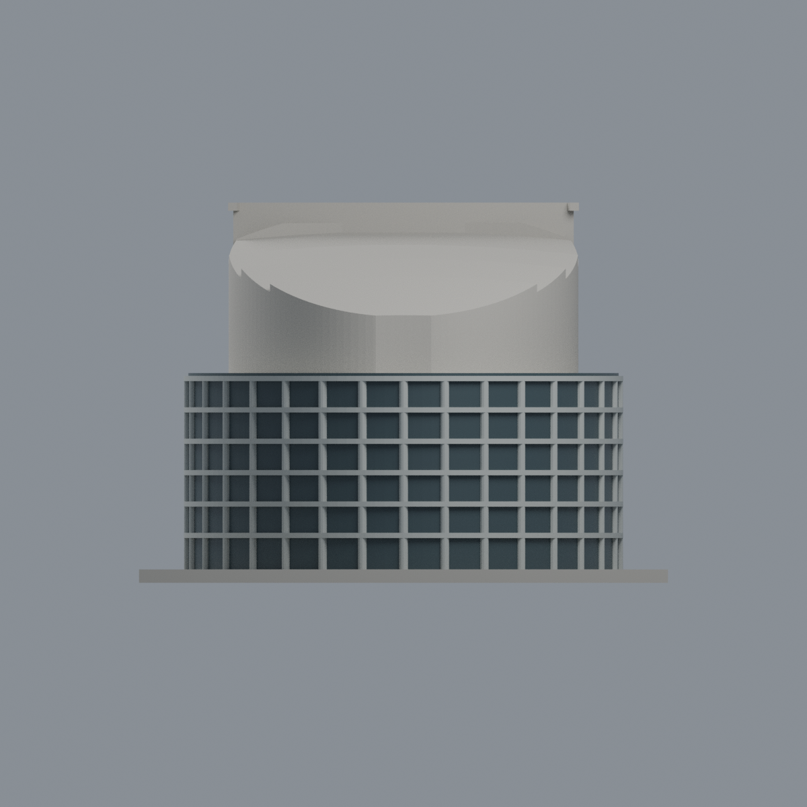
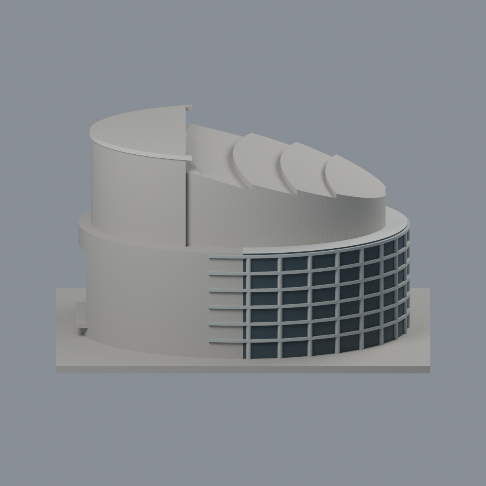
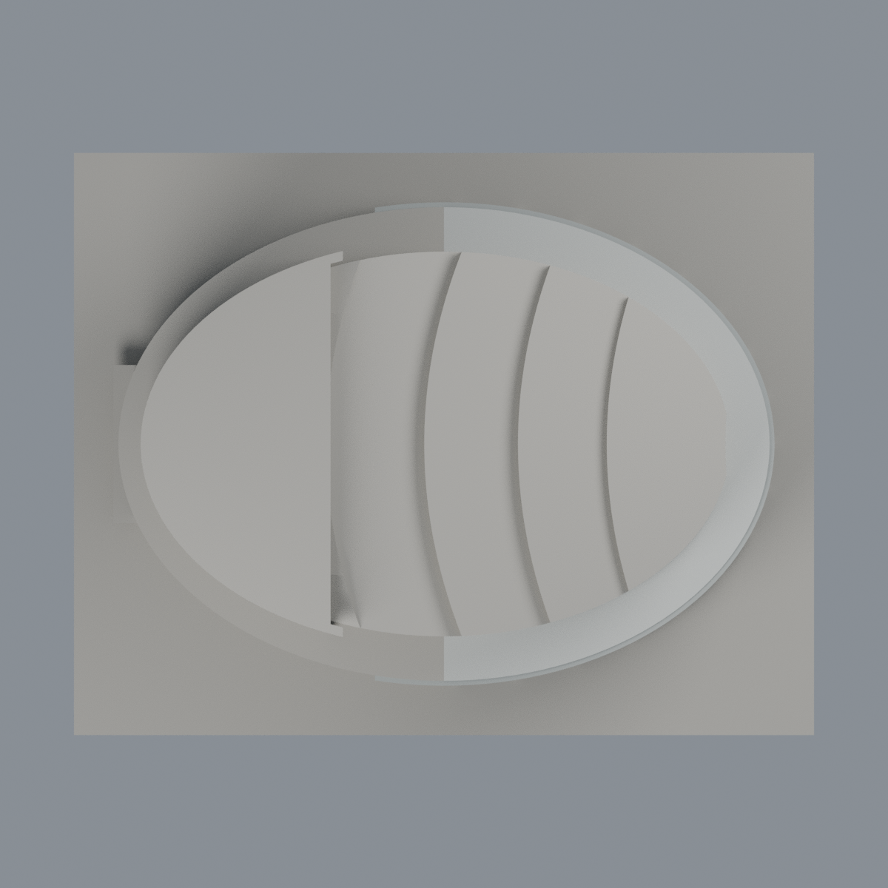

# 中央大學大禮堂｜現行模型 WebP 預覽

外弧連續補色版（2026-11-17）。五視圖以同一版本的渲染原檔逐像素無損轉換；展示不改模型，也不是整棟新測繪或試印。

[彩色 3MF](../appearance/ncu-auditorium-appearance.3mf) · [可編輯 Blender](../appearance/scene.blend) · [原 STL](../model.stl) · [現行渲染紀錄](../appearance/qa/continuous-rim-render-manifest.json) · [WebP 與模型對照](proof.json) · [展示校驗和](SHA256SUMS)

<table>
  <tr>
    <td align="center" valign="top"> 前廳斜視</td>
    <td align="center" valign="top"> 後舞台斜視</td>
    <td align="center" valign="top"> 前廳立面</td>
  </tr>
  <tr>
    <td align="center" valign="top"> 側視</td>
    <td align="center" valign="top"> 頂視</td>
    <td></td>
  </tr>
</table>

[本次展示調整前的外觀說明](https://github.com/hplin50643/taiwan-buildings-3d/blob/6f305e2967d5670c894ae535fa590a3df5c40679/%E5%9C%8B%E7%AB%8B%E4%B8%AD%E5%A4%AE%E5%A4%A7%E5%AD%B8/%E6%A0%A1%E6%9C%AC%E9%83%A8/buildings/ncu-auditorium/appearance/README.md)與[舊公開校驗清單](https://github.com/hplin50643/taiwan-buildings-3d/blob/6f305e2967d5670c894ae535fa590a3df5c40679/%E5%9C%8B%E7%AB%8B%E4%B8%AD%E5%A4%AE%E5%A4%A7%E5%AD%B8/%E6%A0%A1%E6%9C%AC%E9%83%A8/buildings/ncu-auditorium/PUBLIC-MODEL-SHA256SUMS)以版本固定連結保留，既有原始 PNG 及歷史清單不更動。舊清單與現行模型校驗分屬不同批次，不混作這次驗證依據。
