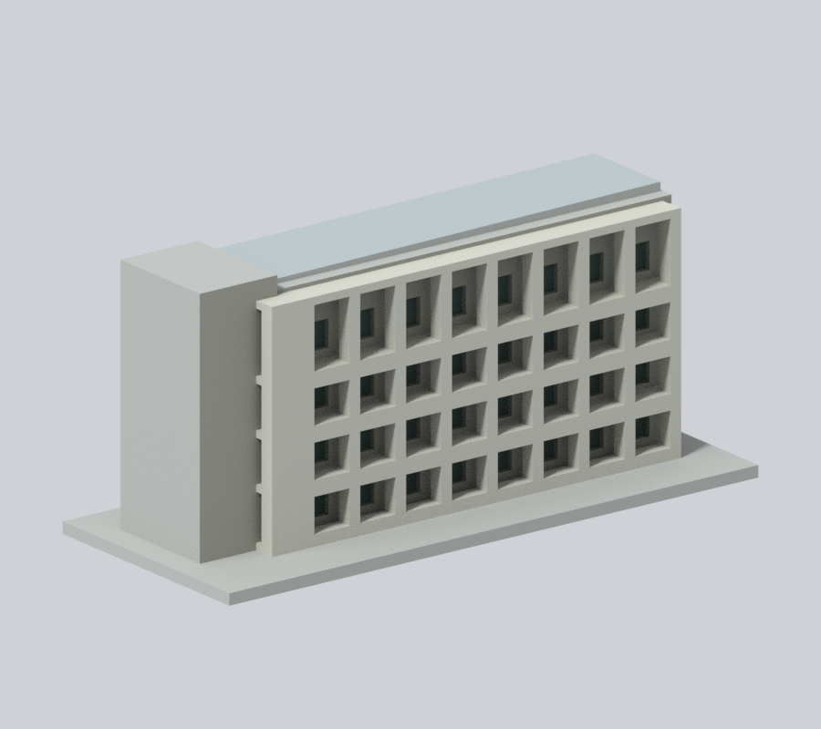
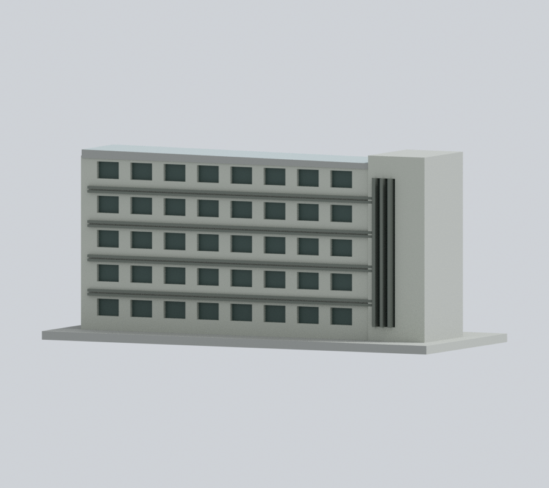
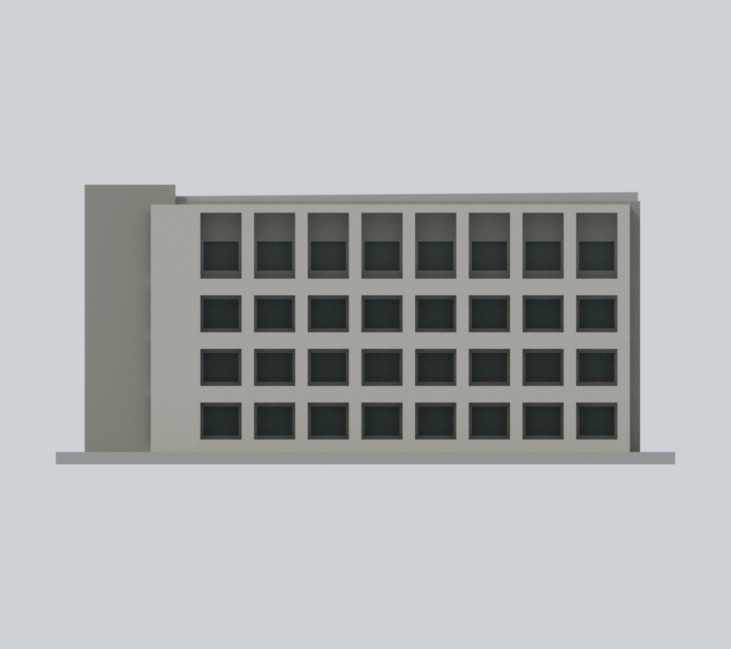
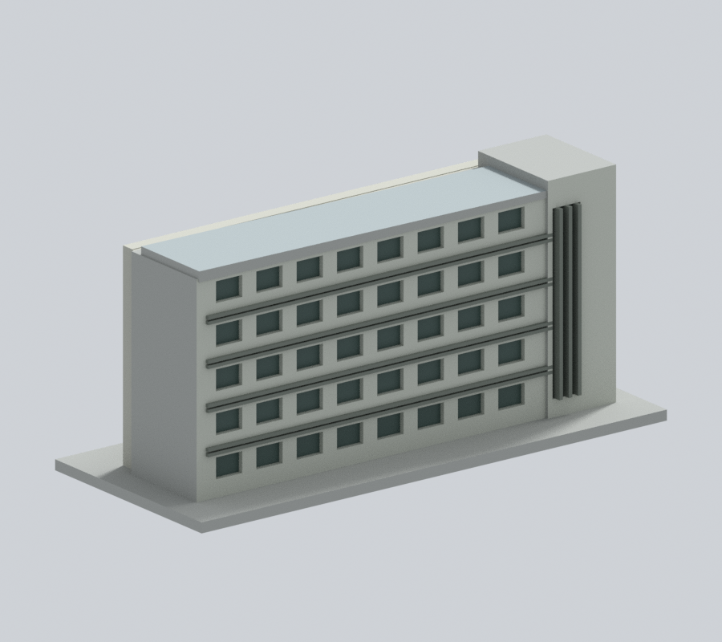
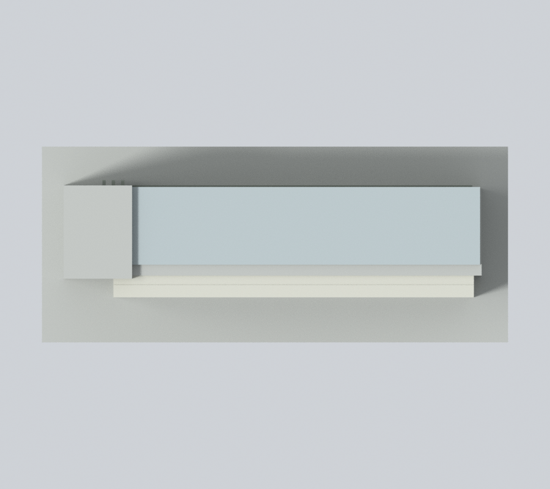

# 國立中央大學工程五館B棟增建翼（2014–2015工程）｜150 mm 外觀模型

## 模型預覽

| 新彩色深框側 | 新彩色另一長側 | 新彩色正面 |
| :---: | :---: | :---: |
|  |  |  |
| 新彩色反向斜視 | 新彩色上視 | 彩色下載 |
|  |  | [彩色3MF](appearance.3mf) · [彩色Blender](appearance.blend) |

[左側](appearance/left.png) · [右側](appearance/right.png) · [原版深框側對照](appearance-review-v2/original-front.png) · [原版另一側對照](appearance-review-v2/original-rear.png)

### 照片近似彩色預覽

依B棟2014–2015增建工程兩張完工實景：淺灰米深框、灰褐凹壁、深灰綠窗、另一長面淺灰及較深灰原遮陽／核心直柵。原簡化斜蓋淡灰藍近似，不稱精確光電板；未知平屋頂與截斷端中性。

僅本增建條翼，不含舊AB圓入口或獨立C；照片旁亮白舊樓未套色。原三圖、geometry／尺寸／STL／OBJ／scene與首頁／校級選圖不變；詳[來源與重建限制](APPEARANCE.md)。

## 第二次補色：既有窗洞完整回折面

本次僅將 614 個原中性三角面延續同一構件的既有外牆色：深框側 32 個窗洞的左右窗洞側壁、上緣、窗台 256 面沿用灰褐；另一長側 40 個窗洞 320 面與核心直柵凹口 38 面沿用淺灰。既有窗背、框格、遮陽及直柵材質均不改。這些是原模型已構造的窗洞壁面，不是新造窗戶，也不是把建築人工平截面冒充真實背牆。

兩張工程實照已重新讀取。實照支持相鄰牆的材質家族；每個隱藏窗台／上緣的色澤仍屬同構件連續性推估，不聲稱逐面測量。原有 1,640 個非中性色面及全部七個材質的 RGBA、roughness 保留；1,099 頂點、2,338 三角面、transform 與約 150 × 63 × 67.8 mm 尺寸完全不變。

仍保留中性的 84 面：人工底座 28、未知平屋頂 8、兩個人工／未明窄端 4、核心高低差側面 34、簡化斜蓋邊緣及底面 10。核心側面跨越灰褐與淺灰外牆，原網格沒有足夠材料分界，本次不替它假造分界。斜蓋也不據外觀假定為精確光電模組。

七張本次彩色圖：深框斜視、另一側斜視、正面、來源角、左、右、上視。另附兩張與新版完全相同相機及光線的原色面配置對照。均以 Cycles CPU、96 samples、單執行緒、停用降噪、900 × 800 渲染，不含文字浮水印與 PNG 文字 metadata。相機名稱只是模型座標視角，並非地理方位。

詳細證據見 [逐面邊界審核](appearance-review-v2/boundary-continuity-audit.json)、[幾何與 3MF 核對](appearance-review-v2/model-verification.json)、[來源紀錄](appearance-review-v2/source-register.json)、[九張圖檢視](appearance-review-v2/color-continuity-review.json) 與 [乾淨重建](appearance-review-v2/clean-rebuild-equality.json)。舊 appearance-review 為第一版歷史，本次以 appearance-review-v2 及 appearance-freeze.json 為準。原首頁／校級代表圖、previews、STL、OBJ、scene 與建模來源不變。

原照片拍攝日期不明，不聲稱 2026 全棟現況。原估計尺寸、深框與遮陽支撐／薄特徵限制、未正式切片與未實體試印等限制仍適用。

此為公開外觀資料研究模型，非測繪、施工或正式切片檔。每棟獨立縮尺，含底座最長150 mm，不能直接當作同一比例校園拼圖。本檔尺寸約 150 × 63 × 67.8 mm。

## 保留的識別特徵
- 狹長五層翼及端部較高樓梯核心
- 一側深框格、頂層較高雙層凹廊節奏
- 另一側水平窗帶/粗化遮陽、階梯屋頂端部

## 證據與簡化
- 僅2014–2015增建長條翼，不包含舊AB圓形入口複合樓，也不包含獨立C棟。模型在與舊B相接處平截簡化，不可把它當工五全區。
- 設計/營造頁兩張實景提供兩個長向立面，照片拍攝年未註，建築期間不是拍照年。第一張部分裁切；全長、深度、灣數與端部銜接比例仍目測。
- 官方2014決算同時列AB/C保養及B增建，C並非B增建翼之另一名稱。官方動土電子報標題日期2013/03/17與同頁2014其他事件不一致，不據此斷定拍攝/完工年。
- 後向照片所見屋頂斜覆蓋只以連續薄量體近似，不宣稱精確光電陣列。百葉、格柵加厚與合併，未重建設備/管線。

全部來源及照片/設計圖區分見 sources.json。來源原照片、PDF、內部對照圖不隨模型發布。照片年代不同，不聲稱完整2026現況。

## 檔案與重建
- model.stl：單一連通列印實體，單位毫米
- scene.blend：由交付STL匯入的可編輯網格（不是參數化BIM）；預覽材質只供展示
- build_model.py：可攜參數化量體來源，無需來源照片即可重建
- previews/front.png、rear.png、elevation.png：從實際STL渲染，不是設計效果圖；名稱為相機視角，非精確方位

使用 Python 3.12，依 requirements.txt 準備相依套件，Blender 4.3.2。

    python build_model.py
    blender -b -t 2 -P render_preview.py
    python validate_model.py
    python check_layers.py
    python check_thin_features.py

## 幾何檢查及列印限制
原始STL法線與繞序一致、水密、每邊兩面、頂點鏈單環、單連通表面、無分離內腔殼、正體積、乾淨重建同SHA-256、已存Blender/STL三角幾何一致，詳 validation.json（passed=True）。

0.2 mm幾何截面共 339 層，全部閉合=True。另以1 mm間距檢查0.8 mm XY形態開運算薄特徵，0 層損失面積超過1%；尖角也會被計入，見 thin-feature-check.json。這不是全域壁厚保證，也不是正式切片或試印。

底座平放。深格廊板、外挑框架與屋面小挑簷需支撐與橋接評估，不能保證免支撐。建議先以0.4 mm噴嘴、0.2 mm層高在實際切片軟體檢查外壁、橋接、支撐可移除性與底板附著，再決定列印設定。小窗框、曲面尖端與薄簷口可能不完整重現；不得將幾何通過寫成「免支撐、保證可印」。

SHA256SUMS含可發布檔案雜湊。尚未實體試印。此為全校持續研究中的一件，不代表全校完成。

## 檔案下載與實際模型預覽

[STL](model.stl) · [可編輯 Blender](scene.blend) · [Python 來源](build_model.py) · [完整驗證](validation.json) · [來源](sources.json)

以上為模型渲染。兩個長側有工程照片，但窄端及相接舊樓截斷面仍未明；rear 相機不等於地理背面，也沒有同相機逐點實景配準。

## 截面數值方法修訂與補查

本發布包已直接採用canonical-edge-v2薄篩工具與結果，固定共邊插值方向，要求節點度數2、閉環及各Polygon有效，再做1 mm間距的0.8 mm XY開運算。舊版可能因共邊端點分開計算後取整而漏環，不能沿用舊面積值。這項修正不改STL、Blender或重建來源；真實薄特徵警示照常保留。

另以0.2 mm間距逐層補查閉環及Polygon有效性，共 339 層通過，見[有效性報告](contour-validity-check.json)與[可攜檢查程式](check_contour_validity.py)。這項較密補查沒有做薄篩開運算；薄篩採樣間距仍是1 mm。兩者都不是正式切片、試印或全域壁厚保證。
