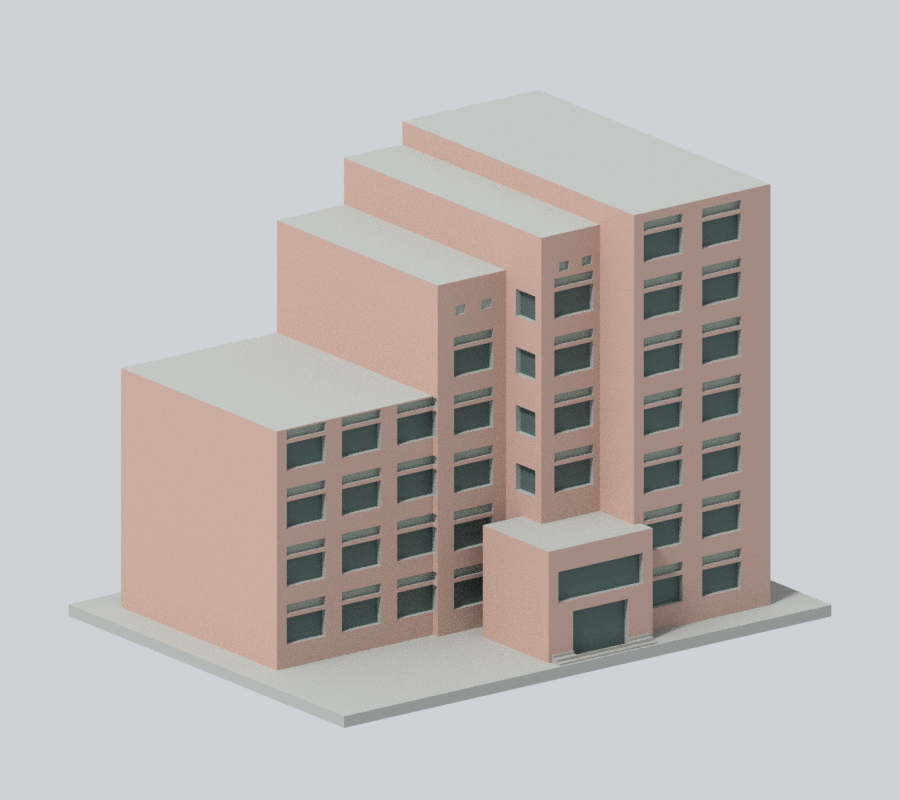
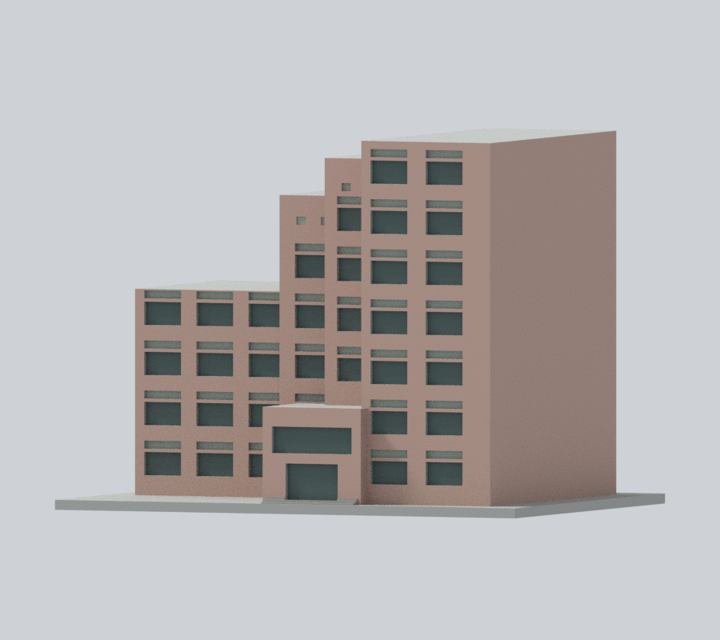
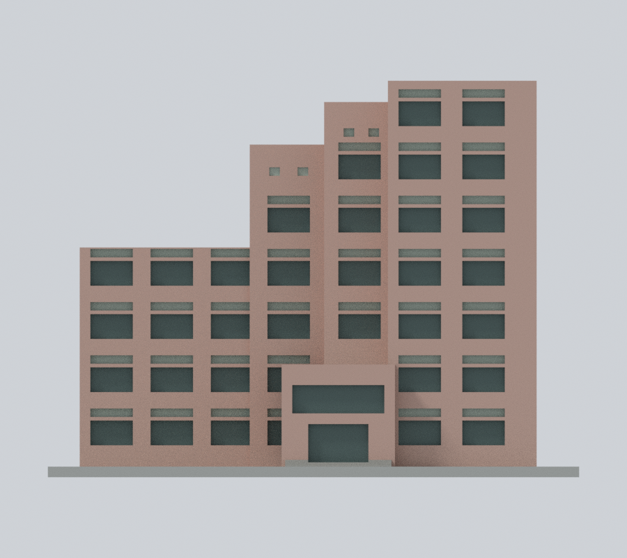
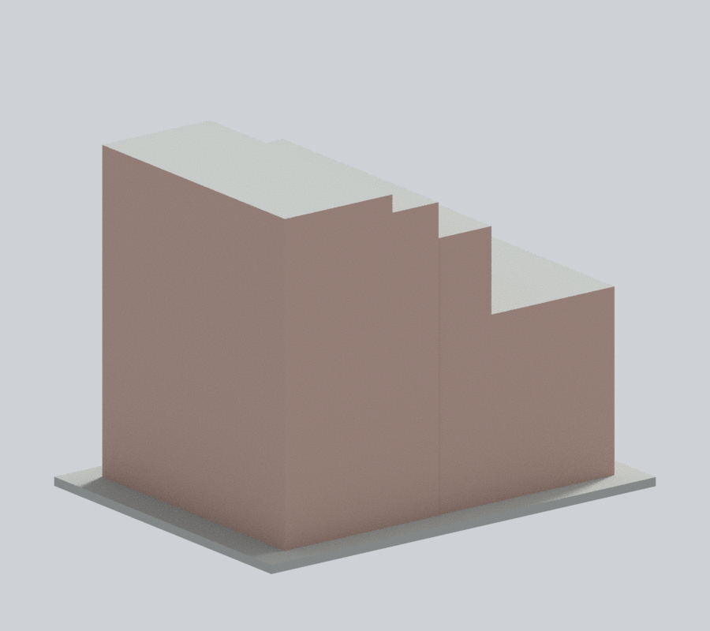
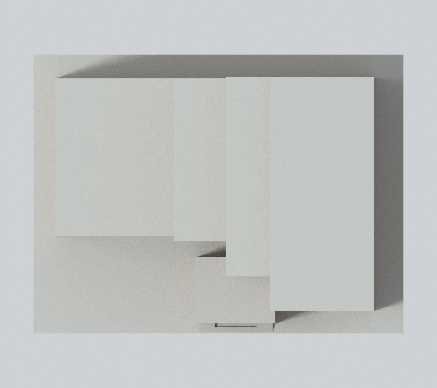

> **建物身分與現況限制（獨立核對）**：本模型以 1992 年（民國 81 年）落成的舊鴻經館主體為辨識對象，不應稱為 2002 年（民國 91 年）啟用的鴻經新館。校方募款頁將兩館分別記述，校史也明記 2002 年另擴建與舊館相連的新館。模型既有階梯量體與突出入口可對應校史舊館照片；本次未重新測繪，也未逐一確認兩館連接處的幾何邊界，不宣稱模型完整涵蓋新館。
> 校方身分來源：https://w2.math.ncu.edu.tw/fundraising ；校史與 2010 年改色來源：https://ncusec.ncu.edu.tw/no90/page2.pdf
> **本版不是 2026 年修繕後配色紀錄**：尚未取得可核實 2026 年外牆修繕後色彩的照片或竣工色票，不能由修繕訊息推斷已換色，也不能認定修繕後仍維持本版粉色。本版僅表達校史記載的 2010 年改色及所附照片之近似外觀。

> **色彩修訂與年代限制（2026-11-17）**：校方第 90 期校友刊物〈校史回顧：鴻經館〉明載鴻經館 1992 年落成時為磚紅色，2010 年整修成粉紅色；本版依該文附帶的改色後照片，將既有正面牆材及新增 66 面側背延伸統一修訂為近似低飽和粉色 `#BA9E92`。這是人工視覺近似，非校正測色或官方色票。影像拍攝日未核實，不代表 2026 現況全面核實；側背牆仍是同構件材質延伸推估。原窗、窄窗帶、台階、屋頂材質及幾何不變。
> 來源：https://ncusec.ncu.edu.tw/no90/page2.pdf
> 舊 HJB 照片及舊 QA 中紅褐色描述屬舊版記錄，不能作本版粉色的依據。

# 國立中央大學鴻經館｜150 mm 外觀模型

## 模型預覽

| 新彩色斜前 | 新彩色近來源角度 | 新彩色正面 |
| :---: | :---: | :---: |
|  |  |  |
| 新彩色背面（外牆同材質推估） | 新彩色上視（未知中性） | 彩色下載 |
|  |  | [彩色3MF](appearance.3mf) · [彩色Blender](appearance.blend) |

### 照片近似彩色預覽

色彩已依下述校史照片修訂；HJB 舊實照僅保留原構件辨識：粉色前牆／入口、灰綠主窗背、較淡窄高窗帶與灰階梯。窄帶包含玻璃／窗簾／空調的綜合表觀，不新增設備；後外側牆面延伸本次修訂的粉色（材料連續性推估），屋頂中性。

原三圖、STL／OBJ／scene.blend／全部geometry／尺寸及首頁／校級選圖不變。來源照片裁頂且左端遮擋，不能把前牆材質族近似延伸當完整逐層已驗；詳[來源範圍及重建限制](APPEARANCE.md)。

此為公開外觀資料研究模型，非測繪、施工或正式切片檔。每棟獨立縮尺，含底座最長150 mm，不能直接當作同一比例校園拼圖。本檔尺寸約 150 × 113 × 111.8 mm。

## 保留的識別特徵
- 左低右高的分段階梯屋頂與前後退縮量體
- 前突低層入口亭
- 水平高窗帶與錯層窗群

## 證據與簡化
- 校方與Commons可核正面分段進退，後側及左翼盡端被樹遮蔽/未可見，後面素面且長深估計。
- 高低翼階梯輪廓保留但不保證準確屋頂高度、每段深度或背面輪廓。
- 窗框、窄高窗、入口柱梁與尺度加厚近似；未重建看不清的細部。
- 2013正面與校方未知拍年照片支撐外觀研究，不代表2026現況。

全部來源及照片/設計圖區分見 sources.json。來源原照片、PDF、內部對照圖不隨模型發布。照片年代不同，不聲稱完整2026現況。

## 檔案與重建
- model.stl：單一連通列印實體，單位毫米
- scene.blend：由交付STL匯入的可編輯網格（不是參數化BIM）；預覽材質只供展示
- build_model.py：可攜參數化量體來源，無需來源照片即可重建
- previews/front.png、rear.png、elevation.png：從實際STL渲染，不是設計效果圖；名稱為相機視角，非精確方位

使用 Python 3.12，依 requirements.txt 準備相依套件，Blender 4.3.2。

    python build_model.py
    blender -b -t 2 -P render_preview.py
    python validate_model.py
    python check_layers.py
    python check_thin_features.py

## 幾何檢查及列印限制
原始STL法線與繞序一致、水密、每邊兩面、頂點鏈單環、單連通表面、無分離內腔殼、正體積、乾淨重建同SHA-256、已存Blender/STL三角幾何一致，詳 validation.json（passed=True）。

0.2 mm幾何截面共 559 層，全部閉合=True。另以1 mm間距檢查0.8 mm XY形態開運算薄特徵，0 層損失面積超過1%；尖角也會被計入，見 thin-feature-check.json。這不是全域壁厚保證，也不是正式切片或試印。

底座平放。入口突出屋簷、凹窗上緣及量體轉折須切片檢查局部支撐。建議先以0.4 mm噴嘴、0.2 mm層高在實際切片軟體檢查外壁、橋接、支撐可移除性與底板附著，再決定列印設定。小窗框、曲面尖端與薄簷口可能不完整重現；不得將幾何通過寫成「免支撐、保證可印」。

SHA256SUMS含可發布檔案雜湊。尚未實體試印。此為全校持續研究中的一件，不代表全校完成。

## 檔案下載與實際模型預覽

[STL](model.stl) · [可編輯 Blender](scene.blend) · [Python 來源](build_model.py) · [完整驗證](validation.json) · [來源](sources.json)

以上展示為交付彩色外觀模型的渲染；rear所示側背牆色為同材質推估，幾何仍簡化，不代表有同視角實景佐證。相機視角不是精確地理方位。

## 截面數值方法修訂與補查

本發布包已直接採用canonical-edge-v2薄篩工具與結果，固定共邊插值方向，要求節點度數2、閉環及各Polygon有效，再做1 mm間距的0.8 mm XY開運算。舊版可能因共邊端點分開計算後取整而漏環，不能沿用舊面積值。這項修正不改STL、Blender或重建來源；真實薄特徵警示照常保留。

另以0.2 mm間距逐層補查閉環及Polygon有效性，共 559 層通過，見[有效性報告](contour-validity-check.json)與[可攜檢查程式](check_contour_validity.py)。這項較密補查沒有做薄篩開運算；薄篩採樣間距仍是1 mm。兩者都不是正式切片、試印或全域壁厚保證。

## 2026-11-17 同構件側背外牆補色

將低翼、中高翼、右高翼及前突入口亭的 66 個原中性外牆三角面延伸為本次修訂的粉色牆材。採原完整外牆平面與全頂點邊界判定，不切新面、不新增窗洞。這是依同棟同構件的材料連續性推估，沒有新增側背實照佐證，不宣稱為實際完整外觀或 2026 現況。原照片裁頂及左端遮擋限制仍保留。

原 758 頂點／1512 三角面、面序、transform、尺寸及其餘 1446 面的材質索引保留；其中原正面牆材也從紅褐修訂為粉色，因此不能稱全部顏色不變。五種材料中只修改牆材色值，另四種材料值不變；屋頂、窗洞回折、底座及原階梯保持。原 STL／OBJ／scene.blend、舊預覽、歷史幾何檢查與首頁選圖不改；歷史 QA 只對應當時版本，本版新增[補色驗證](appearance-continuity-verification.json)。

現版重建：`blender -b -t 1 --python-exit-code 1 -P build_appearance.py`；重開與 3MF 核對：`blender -b -t 1 --python-exit-code 1 -P verify_wall_continuity.py`。五張預覽沿用原相機及 900 × 800、32 samples 設定，從實際模型渲染。未實體試印。
