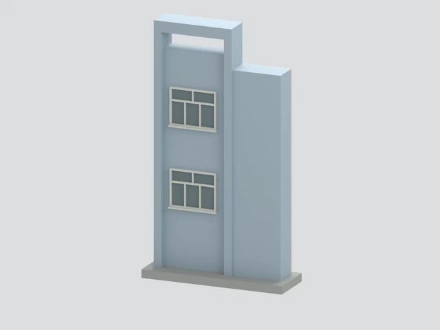
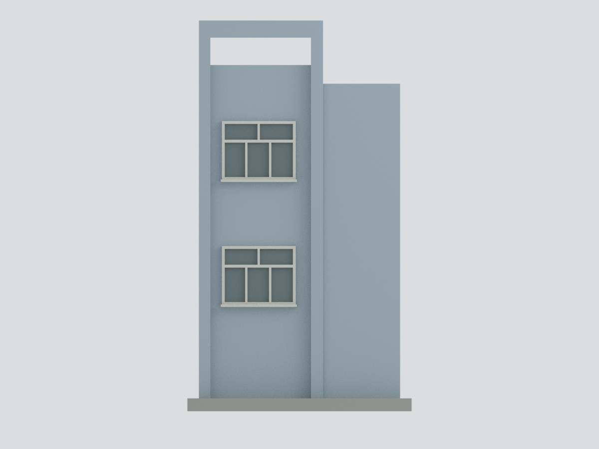
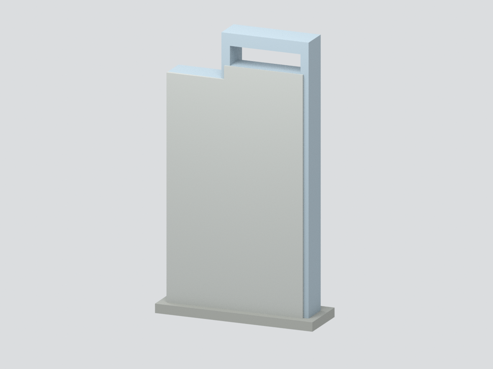
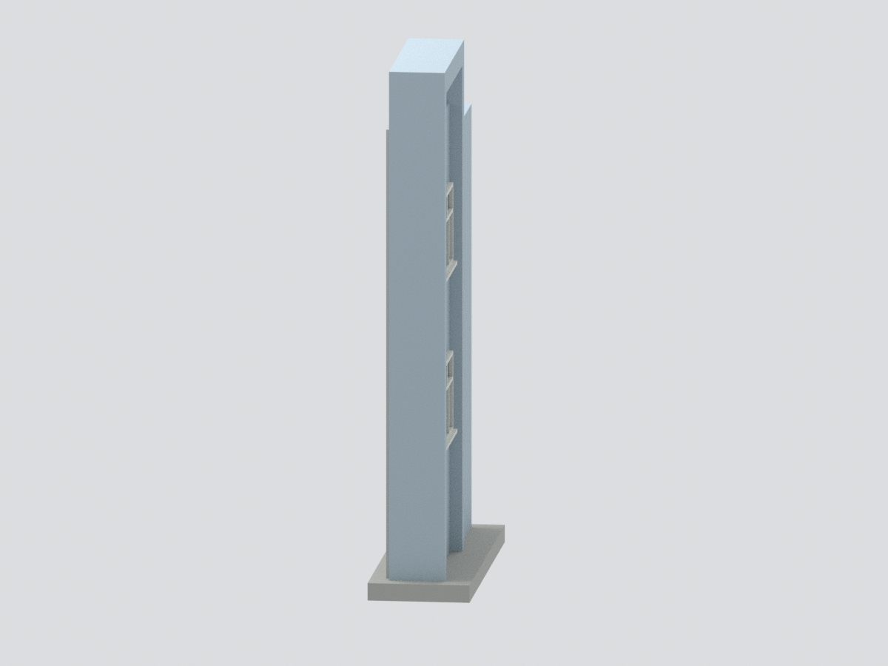
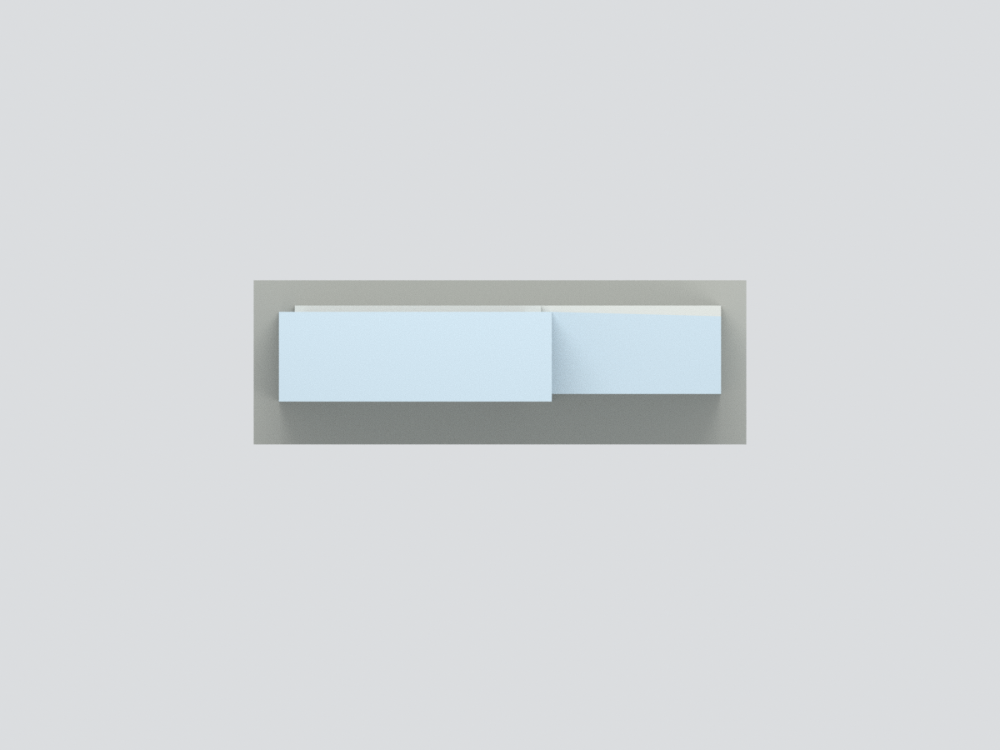
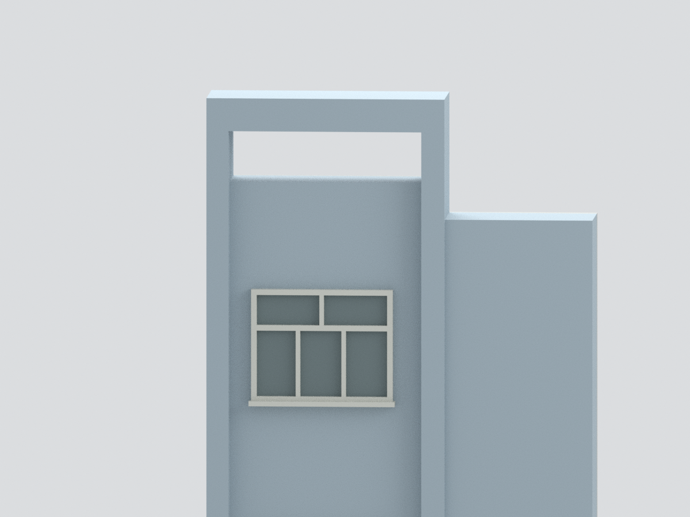

# 國立中央大學據德樓｜階梯側兩窗高框與館名牆立面截段

六張 WebP 大圖由現版模型渲染，與留存 PNG 解碼後的像素完全相同。這只是有限立面截段，不是整棟，也不是建築現場照片。

|  |  |  |
| :---: | :---: | :---: |
| 正面斜視 | 正立面 | 模型背側 |
|  |  |  |
| 模型左端 | 模型頂視 | 高框與窗細節 |

背側與厚度為模型閉合，不代表實際背立面；最後一張是高框與窗細節，不是完整入口。原件未實體試印。

[回模型與範圍說明](../README.md) · [STL](../model.stl) · [彩色 3MF](../model.3mf) · [可編輯 Blender](../scene.blend) · [重建與 QA](../REBUILD.md) · [原交付校驗](../SHA256SUMS)

[WebP 展示校驗](SHA256SUMS) · [展示影像核對](RENDER-PROOF.json)

原 PNG、每個相機的渲染回條、模型與重建檔都留在原位置，展示版不替代原工程交付。
