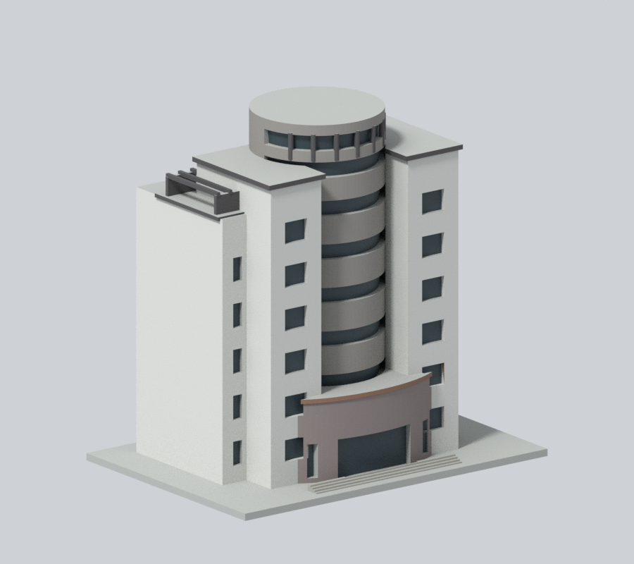
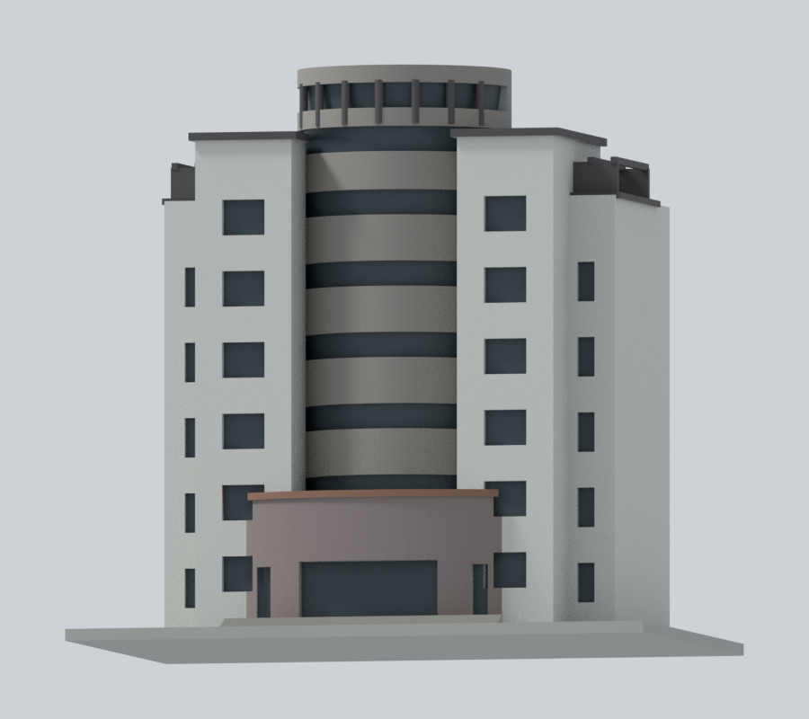
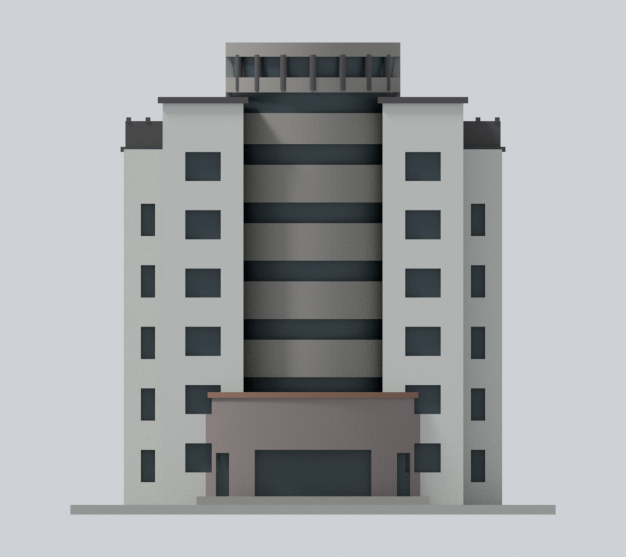
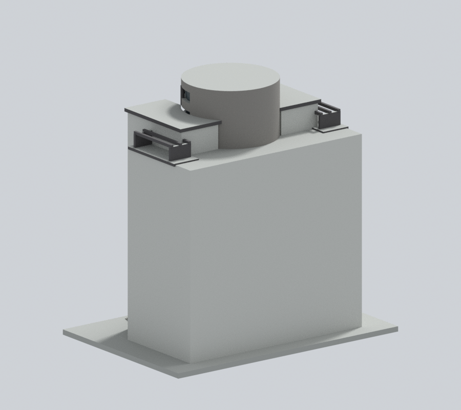
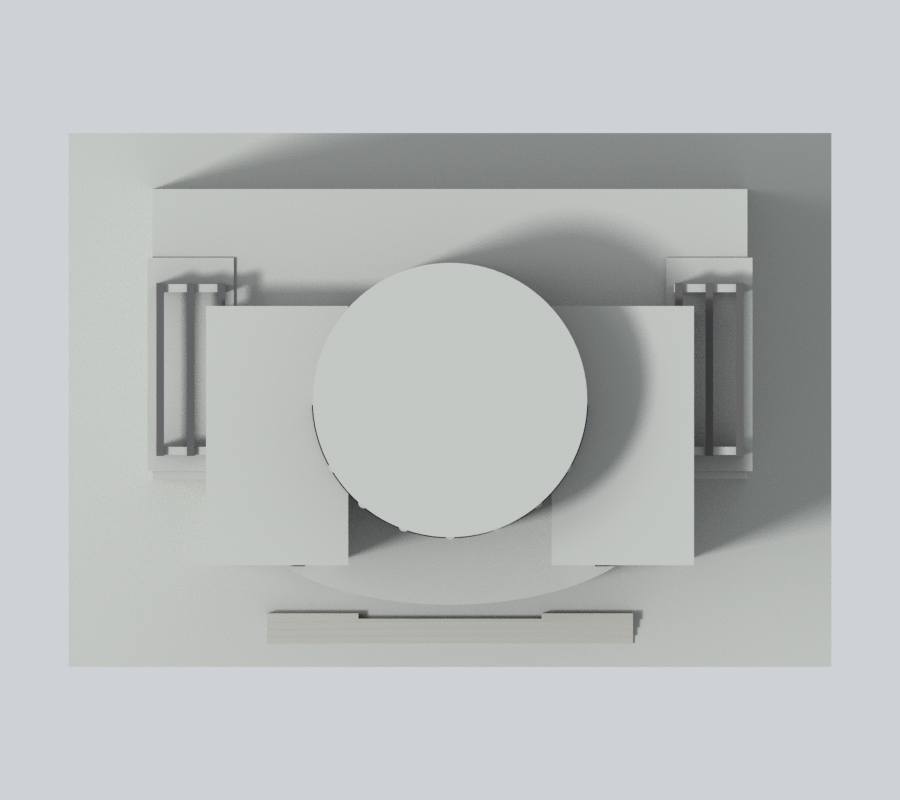

# 國立中央大學國鼎圖書資料館｜150 mm 外觀模型

## 模型預覽

| 新彩色斜前 | 新彩色近來源低視角 | 新彩色正面 |
| :---: | :---: | :---: |
|  |  |  |
| 新彩色背面（同材質延伸推估） | 新彩色上視（屋頂未知中性） | 彩色下載 |
|  |  | [彩色 3MF](appearance.3mf) · [彩色 Blender](appearance.blend) |

### 側背外牆延續補色（保留幾何並修正8面舊誤彩）

依校方無障礙地圖國鼎圖書館實照：淺灰雙翼正面、灰褐中央柱面、暗藍灰窗帶、深灰既有框架、灰粉褐低弧入口與棕褐細簷。本版將原淺灰翼牆延伸至既有側背外殼、灰褐延伸至圓柱外向表皮，並將原深灰簷口延伸至同一簷板的垂直邊，合計254個原中性三角面。另修正8個被舊棚架中心點規則誤染深灰的後牆三角面，避免殘留假的斜色界；其餘原彩面保留。這是同建物材料連續性推估，不是背面照片逐面認證。水平屋頂、底座、內向布林接縫及無可靠材料界線的混合面保留中性；淡粉米入口小板仍省略，不切新面、造框或新增背窗。

補充[左側](appearance/left.png)、[右側](appearance/right.png)及[同相機對照](appearance-review-v2/comparison.png)：上排斜前、下排斜後，左原版、右新版，圖內無文字。

原三圖、原 STL／OBJ／scene.blend／幾何尺寸及首頁／校級選圖均不變；照片拍攝日未知，不移用其他Commons檔EXIF日期，不稱2026現況。詳[配色來源與重建限制](APPEARANCE.md)。

此為公開外觀資料研究模型，非測繪、施工或正式切片檔。每棟獨立縮尺，含底座最長150 mm，不能直接當作同一比例校園拼圖。本檔尺寸約 150 × 105 × 145.8 mm。

## 保留的識別特徵
- 高圓柱中央核心、兩側較高直柱翼與外側低翼
- 前方弧形入口突出量體及階梯
- 中央水平玻璃帶、兩側頂部棚架及分層簷口

## 證據與簡化
- 兩張可讀實照均偏正面；無可靠背面照片，後部深度估計且保持素面。
- 模型不確定完整圓柱在後部如何接合，使用融合實體近似，不表示有實測圓形平面。
- 窗帶、棚架加厚，空調、文字、欄杆細節省略；不對樓高或樓層尺度作精密聲稱。
- Commons頁面摘要稱2013-06-01，但目前檔案版本/EXIF為2013-09-30，採目前檔案日期並保留差異。

全部來源及照片/設計圖區分見 sources.json。來源原照片、PDF不隨模型發布；新增對照僅包含模型渲染。照片年代不同，不聲稱完整2026現況。

## 檔案與重建
- model.stl：單一連通列印實體，單位毫米
- scene.blend：由交付STL匯入的可編輯網格（不是參數化BIM）；預覽材質只供展示
- build_model.py：可攜參數化量體來源，無需來源照片即可重建
- previews/front.png、rear.png、elevation.png：從實際STL渲染，不是設計效果圖；名稱為相機視角，非精確方位

使用 Python 3.12，依 requirements.txt 準備相依套件，Blender 4.3.2。

    python build_model.py
    blender -b -t 2 -P render_preview.py
    python validate_model.py
    python check_layers.py
    python check_thin_features.py

## 幾何檢查及列印限制
原始STL法線與繞序一致、水密、每邊兩面、頂點鏈單環、單連通表面、無分離內腔殼、正體積、乾淨重建同SHA-256、已存Blender/STL三角幾何一致，詳 validation.json（passed=True）。

0.2 mm幾何截面共 729 層，全部閉合=True。另以1 mm間距檢查0.8 mm XY形態開運算薄特徵，0 層損失面積超過1%；尖角也會被計入，見 thin-feature-check.json。這不是全域壁厚保證，也不是正式切片或試印。

底座平放。弧形入口凹口、屋頂棚架與水平窗帶上沿需切片評估支撐。建議先以0.4 mm噴嘴、0.2 mm層高在實際切片軟體檢查外壁、橋接、支撐可移除性與底板附著，再決定列印設定。小窗框、曲面尖端與薄簷口可能不完整重現；不得將幾何通過寫成「免支撐、保證可印」。

SHA256SUMS含可發布檔案雜湊。尚未實體試印。此為全校持續研究中的一件，不代表全校完成。

## 原建築設計者
黃祖權／中華建築師事務所。建築學會作品表列1998年，校方另載1999年落成，日期用途不同。

## 檔案下載與實際模型預覽

[STL](model.stl) · [可編輯 Blender](scene.blend) · [Python 來源](build_model.py) · [完整驗證](validation.json) · [來源](sources.json)

以上皆由交付STL渲染；rear所示未知背側簡化，不代表有同視角實景佐證。相機視角不是精確地理方位。

## 截面數值方法修訂與補查

本發布包已直接採用canonical-edge-v2薄篩工具與結果，固定共邊插值方向，要求節點度數2、閉環及各Polygon有效，再做1 mm間距的0.8 mm XY開運算。舊版可能因共邊端點分開計算後取整而漏環，不能沿用舊面積值。這項修正不改STL、Blender或重建來源；真實薄特徵警示照常保留。

另以0.2 mm間距逐層補查閉環及Polygon有效性，共 729 層通過，見[有效性報告](contour-validity-check.json)與[可攜檢查程式](check_contour_validity.py)。這項較密補查沒有做薄篩開運算；薄篩採樣間距仍是1 mm。兩者都不是正式切片、試印或全域壁厚保證。

## 棚架梁頂六完整原域補色 v3
僅將六根原棚架橫梁z=122.7頂面的六個完整有限共面域12面，由中性0延用原深灰框材4；其餘5120面、8材值、geometry與transform不變。原所有朝上屋面中性規則也遮掉真正梁頂，這次依原生成器梁構件界與全頂點判定，不切網格、不塗滿屋頂。梁頂未在地面照直見，為同梁家族延伸推估；梁數、形狀仍是既有簡化估計。
原官方LIB_KT照片本輪普通下載多次503，未重新實看，不能沿用舊來源登錄宣稱此次成功。改讀原sources.json所列Wikimedia Commons原幅及檔案頁，國鼎招牌、鼎形與兩側深灰棚架明確；此張檔案EXIF DateTimeOriginal為2013-09-30，頁面早期摘要日期不同，不當作2026現況或獨立驗證攝影日期。保留原材色，不做校準色或實測材料宣稱。原官方來源快照完整保留，新來源依PERGOLA-TOP-SOURCE-QA.json；照片僅私用不公開。
原基線root SHA256SUMS全部57條實讀吻合，58原blob核同，無基線checksum例外；BASELINE-CHECKSUM-AUDIT.json列原expected/actual及保留快照精確對應，不把舊hash套新根檔。原v2側背延伸/八後牆修正、所有原工程與列印限制保留。七張原生900×800圖/相機/燈光設定保留，未實體試印，不保證可印或免支撐。
