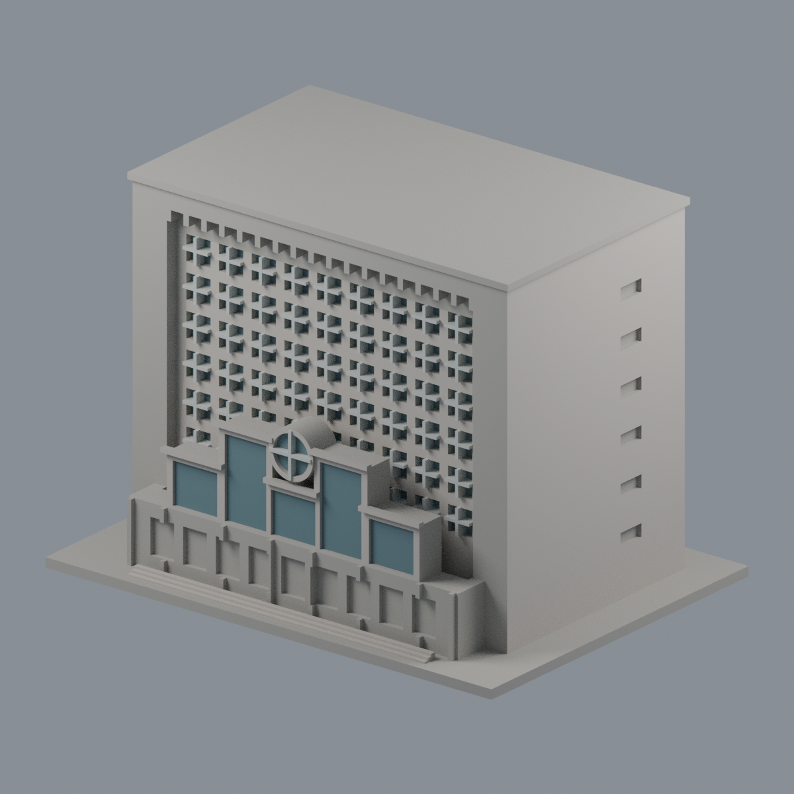
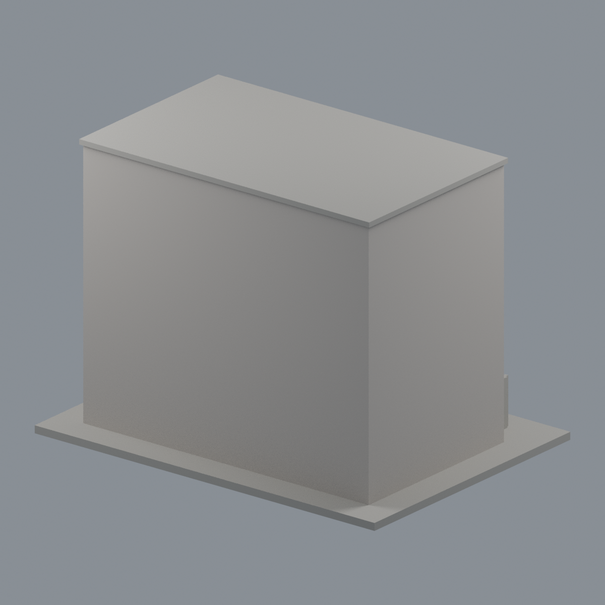
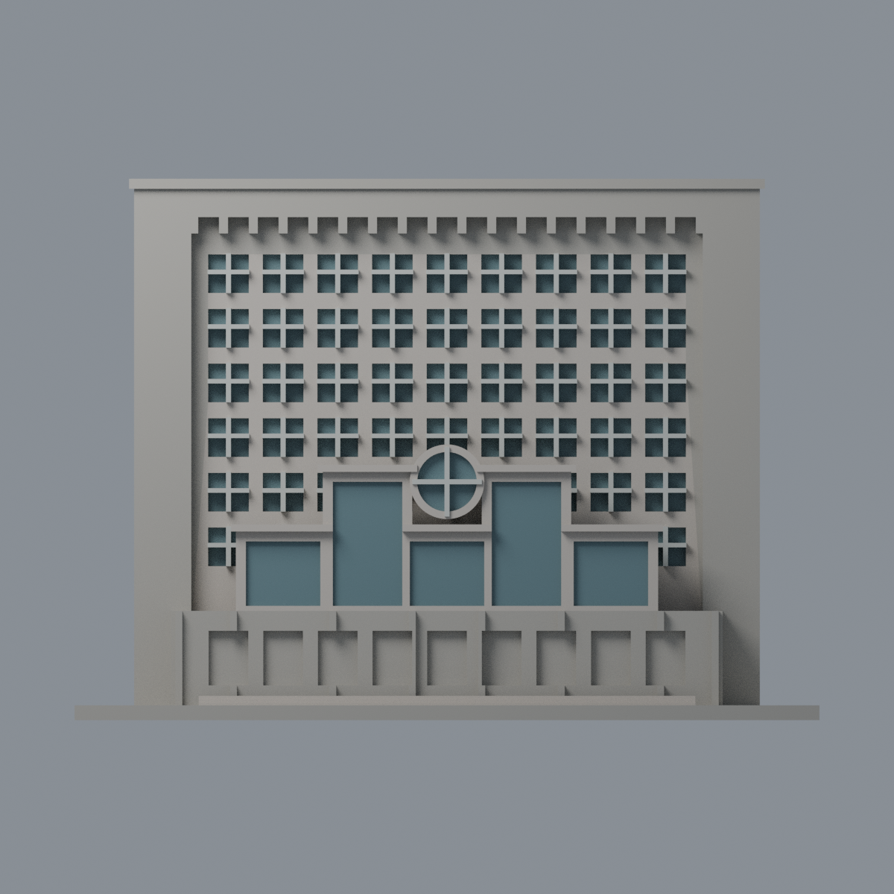
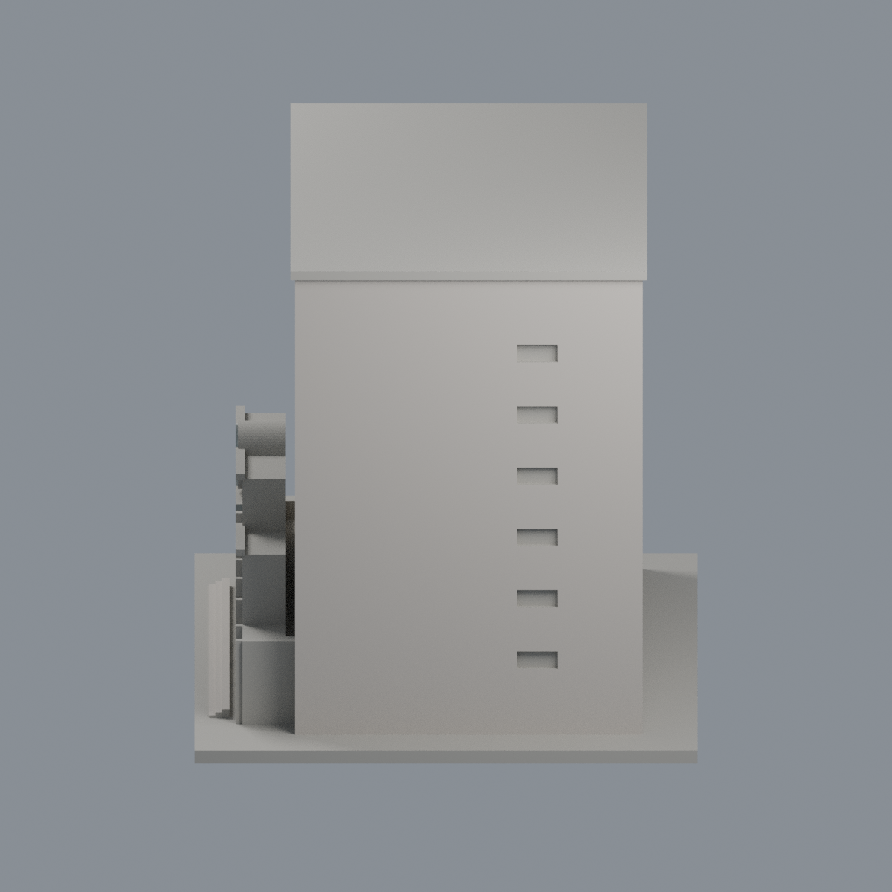
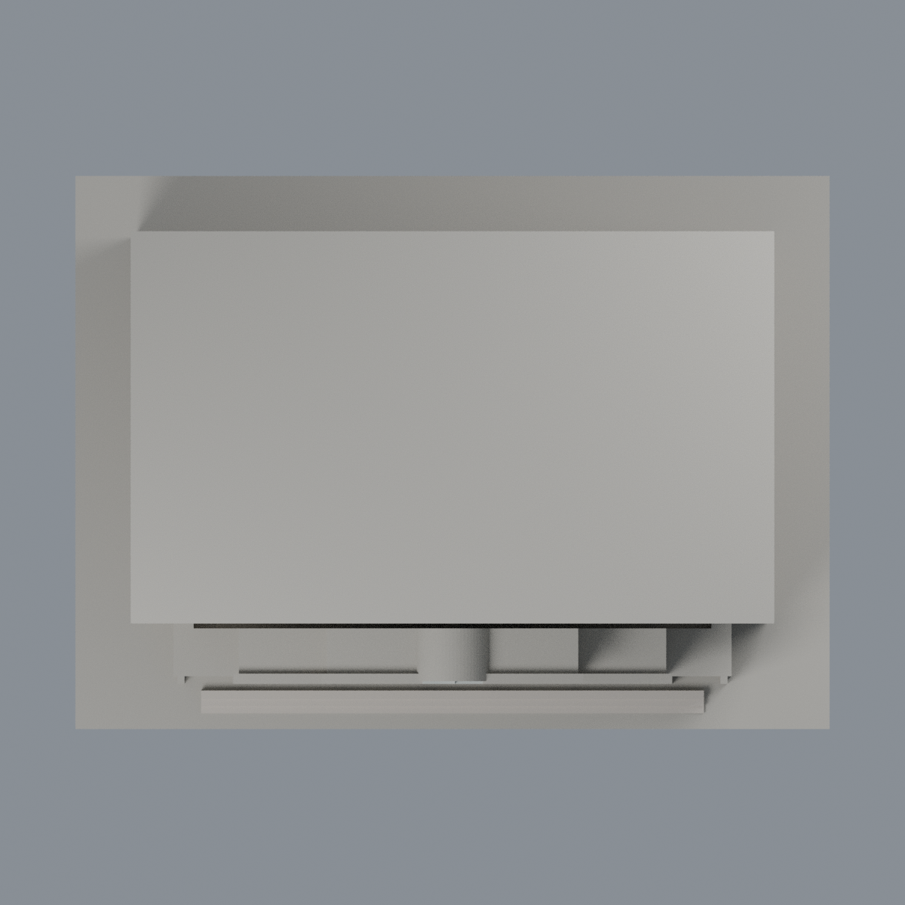

# 國立中央大學總圖書館｜正面配色與主體外牆延伸

同一既有模型的附加外觀層，不增加棟數，不替換固定首頁代表圖。150 × 110 × 109 mm；6,688個完整三角面及其面序、全部原STL bytes保持不變，不切面或增加幾何。

[表面色3MF](ncu-main-library-appearance.3mf) · [可編輯Blender](scene.blend) · [逐面指派](face-materials.json) · [色表](palette.json) · [來源](SOURCES.md)

## 2026-11-17 主體外牆補色（當前版本）

依同質外牆材料連續性，將原本中性的左、右、背側主體外牆 42 個完整三角面延伸為既有淡暖灰磁磚代理色 #BEB7AE。這是**合理推估，不是側／背照片逐面查證**；色值未校準，也不證明 2026 現況。沒有添加未見的窗、磁磚紋、文字或幾何。

原 STL bytes、3,344 個頂點、6,688 個三角面及面序不變；其餘 6,646 面保留前版指派，包括既有正面、玻璃、銀灰框及 12 面入口階梯。側窗 60 個凹槽內壁／背面、屋頂、簷口、底座與混合材質入口區未改。三側補色面積合計 28,696 mm²，為模型表面面積，不是實際建築量測。

同一套件的外觀更新，不新增棟數、不變更首頁代表圖；五個原視角、燈光、1200 × 1200 解析度與 CPU 48 samples 保留。背面素面仍是原模型幾何簡化，補色不等於完成背立面細節。未重跑物理試印或製造驗證。

當前重建：`python appearance/source/extend_wall_color.py`，再執行 `blender -b -t 4 --python-exit-code 1 -P appearance/source/render_current.py`。原 `build_current.py` 是前版 12 面階梯版本，單獨執行會還原前版；以下舊 QA、ZIP 說明與中性範圍為歷史記錄，本節及 PUBLIC-MODEL-SHA256SUMS 為當前交付範圍。重建包僅含原模型及必要程式與公開說明，無私人參考照片。

## 歷史版本配色界線
- 正面可限域完整面使用淡暖灰磁磚代理，不添加磁磚紋或招牌文字。不是校準RGB。
- 僅實際離散窗背、上層入口矩形窗背與圓窗凹入圓盤灰藍；原十字框淡銀灰。外圓環不是玻璃，正面整片內凹牆不是玻璃。
- 六排重複網格的高處超出近照範圍；沿用相同窗背材質屬**有界重複材料推論**，不是逐窗現況查證。格數與框厚仍是原模型可印代理。
- 底層左右窗在實景有不透明裙板，但原網格缺那些邊界，故底層全部留中性，不把九個整凹面塗成藍玻璃。未能獨立定位之頂端細窗帶、屋頂、背面、側面與底座中性；中性不代表實景顏色。
- 全頂點/完整三角面限域，跨界面保持中性；不使用重心色帶、不切面，不新增玻璃厚度、室內、文字、植栽或倒影。

## 五個實際網格視角
相機名稱不是地理方位；影像由交付3MF及逐面材質渲染，不是AI效果圖。

| 前斜視 | 後斜視 | 正立面 |
|---|---|---|
|  |  |  |

| 模型預覽 | 模型預覽 | 模型預覽 |
| :---: | :---: | :---: |
| 側視<br> | 頂視<br> |  |

## 可攜重建及QA
原model.stl放於appearance上層；依賴見source/requirements.txt，Blender 4.3.2。

```
python appearance/source/build_appearance.py
python appearance/source/verify_exchange.py
python appearance/source/verify_material_boundaries.py
blender -b -t 2 --python-exit-code 1 -P appearance/source/render_appearance.py
blender -b -t 2 --python-exit-code 1 -P appearance/source/verify_scene.py
```

lib3mf嚴格讀取零警告，單材質實編回存重開保持其他色與指派。SDK六位小數回存誤差單獨記錄；該暫存編輯檔不交付。Blender實編回存重開保持幾何/面序與其他材質。乾淨重建3MF、逐面表、色表、五PNG須byte一致；不宣稱Blend二進位確定性。

## 原製造限制保留
原模型目測深度、素面背側及近照年代限制保留。歷史0.2mm截面545層閉合與有效性檢查、1mm間距0.8mm XY開運算薄篩0層損失超1%，不是全域壁厚保證。本次只增配色，不重跑製造層檢或物理試印。底座平放；入口前框、圓窗上緣、簷口可能需支撐，小窗框與曲面尖端可能不完整列印。

3MF是單網格表面色，不是分色封閉實體、噴頭映射、切片專案或G-code。FFF GUI、多材料路徑、支撐移除及實印未測，不保證可印或免支撐。不是測繪、施工、BIM或完整2026現況。

[逐檔雜湊](SHA256SUMS) · [權利說明](LICENSE-NOTICE.md)

原STL SHA256：c100700000dfb445be70dab4615a2654875ba3de9ae63e0f0c1c096bec2f6d74


## 2026-11-14 有限外觀修正（重新建置交付版）

# Bounded original entrance steps tile-family approximation

Fresh reconstruction, not lost-build recovery. Only12 original-neutral faces of3 entrance treads/front risers use existing material3 pale_warm_gray_front_tiles #BEB7AE/.78. Original4 shaders and other6676 indices, STL/geometry/order unchanged. No new material. This is a subdued warm-gray tile-family background approximation, not gray-stone certification or calibrated color.

First front riser is clipped at basez3. Upper tread endsy=-47.35 while porch startsy=-44.5, retaining the original2.85mm gap. Original3 coarse steps/proportions are not individually surveyed real steps; fine nosing lines and partially obscured endpoints remain approximate. Skirts, rear riser, base, porch/platform and other surfaces excluded; no geometry repair.

Six complete analytic-plane shared-edge BFS domains and source-step rectangular support checked bidirectionally. Area640.0000095367432mm², outside0.000333786011008641mm² and reverse missing0.0003242492677912878mm² explicitly nonzero float32 deviations; per-domain tolerance .001mm².

Historical QA/root README/OBJ remain bytes-preserved, not current verification. Install source/requirements-current.txt, run build_current.py then verify_current.py and Blender render_current.py. Five native1200² CPU48 views unchanged. Original engineering/manufacturing/print restrictions remain.

# Public reference links

- https://storage.googleapis.com/world-study-prod/media/school_photo/1650/4ecd44cf-7019-459e-a202-6c2ed53b24e4.JPG
- https://in.ncu.edu.tw/~ncu57006/uploads/20210423132949728.jpg
- https://military.ncu.edu.tw/download/114.07.21%E9%98%B2%E7%81%BD%E8%A8%88%E7%95%AB-%E5%85%AC%E5%91%8A%E7%94%A8.pdf
- https://deow.jp/taiwan/school/national-central-university/

DEOW front photograph0 primary step-family evidence; official PDF page14 lower image confirms identity and facade family but crops stairs; wide photo1 other facade does not replace step evidence. EXIF source0 self-reports2018-09-27 without offset and is not authenticated. Official PDF2025 document dates are not shutter dates. No private photographs or hashes redistributed.

現版共 4 個顯示材質（含未知中性色）。上方原材質數、面域與QA描述為歷史版本，僅由本節有限範圍更新。本版是重新建置，不是尋回遺失草稿；不新增幾何或擴充補色範圍。

本節提及原ZIP/QA/校驗數目屬歷史記錄，不是現版ZIP清單。現版ZIP僅含原STL、必要舊建置與渲染程式、三支現版包裝／驗證程式、requirements-current.txt與本README及授權說明（如原有）。完整來源研究、照片、私人審核與廣泛校驗清單不公開。PUBLIC-MODEL-SHA256SUMS僅核當前交付產品；原QA不替代當前驗證。

現版命令：`python -B appearance/source/build_current.py`、`python -B appearance/source/verify_current.py`、`blender -b -t 4 --python-exit-code 1 --python appearance/source/render_current.py`。依requirements-current.txt安裝必要依賴。直接執行舊builder會重建歷史配色。包裝程式僅執行固定本地舊程式，新增材質時只替換新材質粗糙度運算；寫模型、材質、場景、原視角PNG與當前本地QA。歷史報告先保存再還原；原不存在時只刪該次產生的舊名報告。不進行網路或憑證操作。

