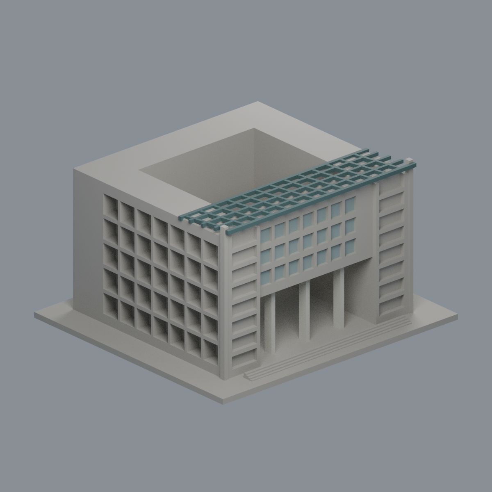
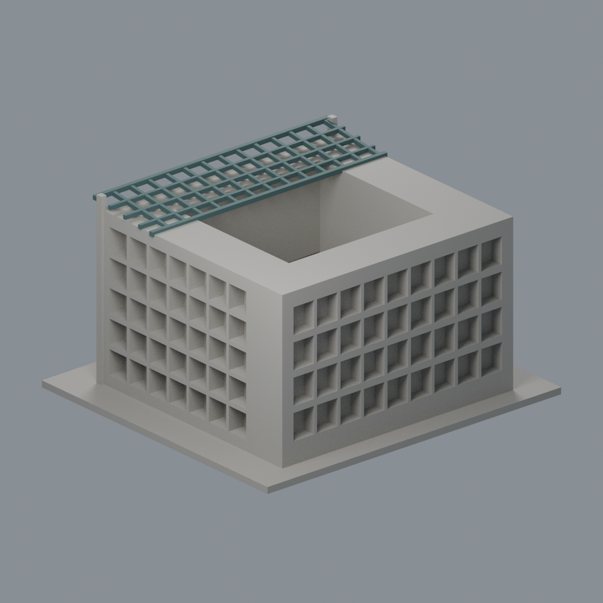
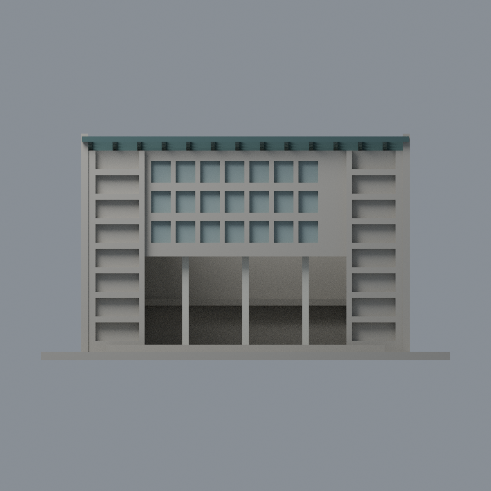
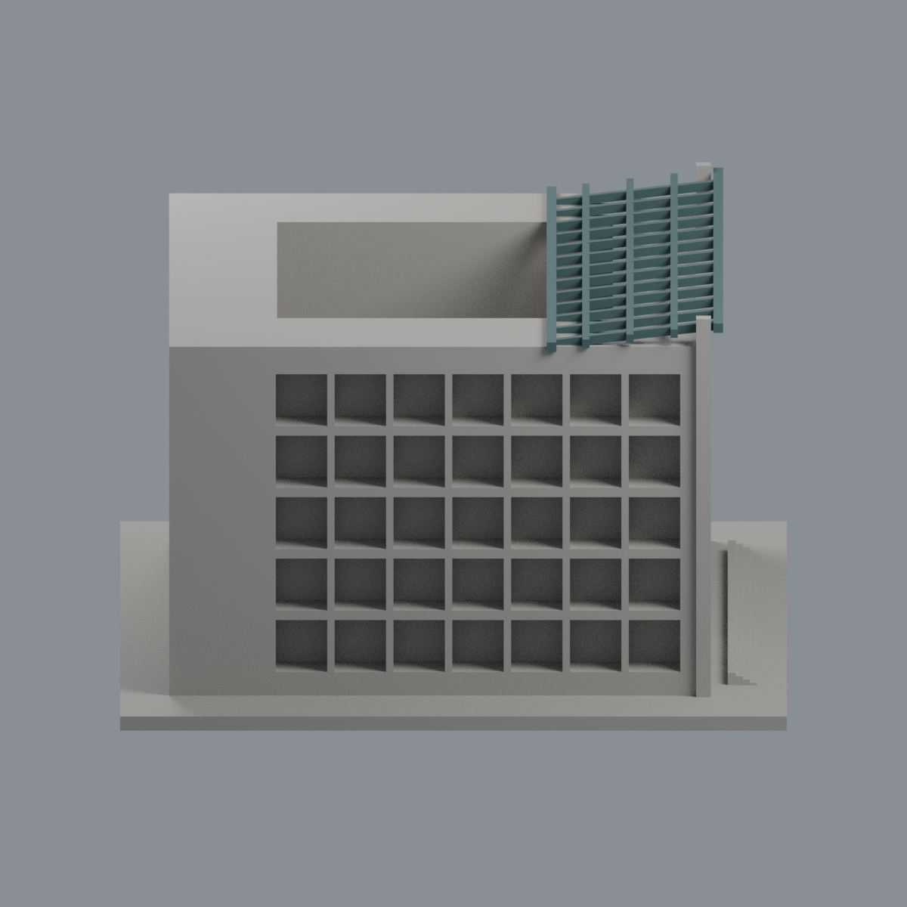
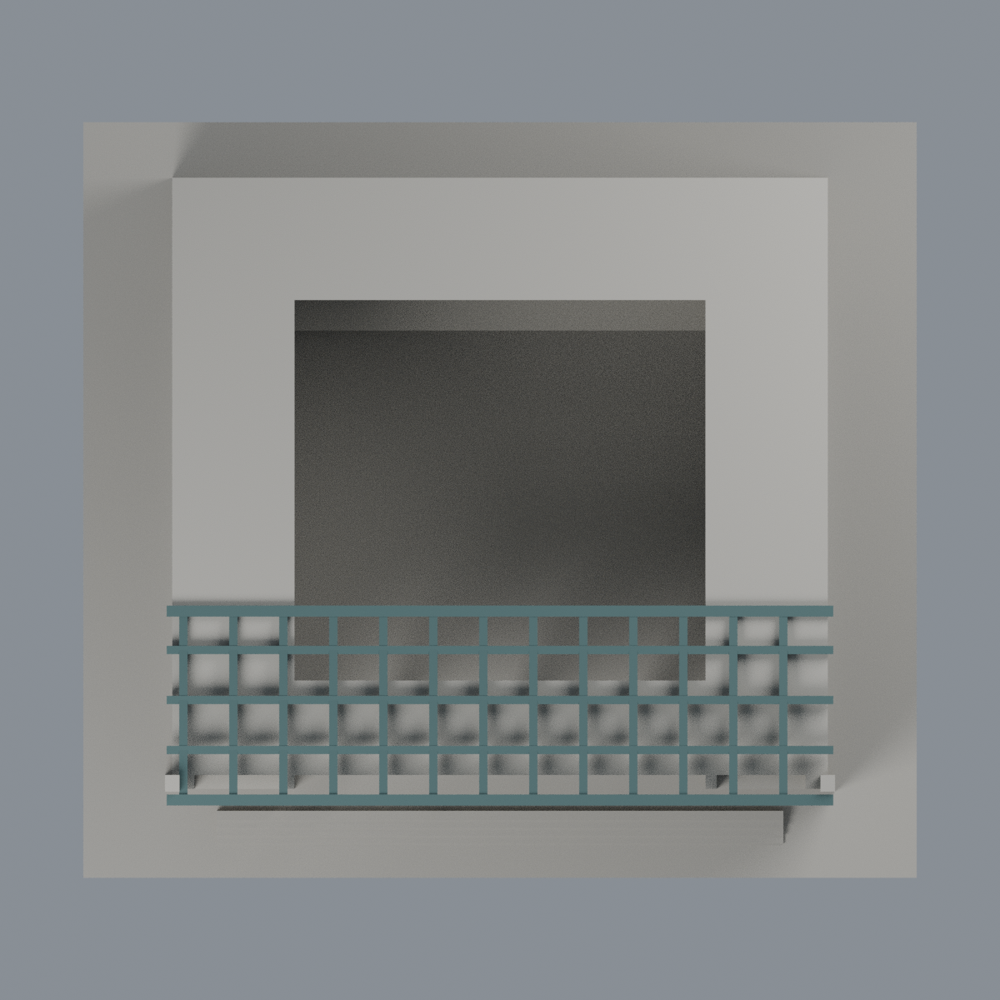

# 國立中央大學國鼎光電大樓｜限域外觀配色

這是**國鼎光電大樓，不是國鼎圖書資料館**。本版只為原150 × 136 × 83 mm模型增加可編輯外觀層，不新增模型套數，不修改原STL、座標、4138三角面序或拓撲。

## 2026-11-17 同柱連續補色（目前交付版）

依使用者希望補齊同材質其他面的方向，將中央三根柱子原有正面淡灰 `#C5C5BB` 延伸至其側面與背面，共新增18個原三角面。三柱總計24面；其餘4,114面維持原中性／格棚／玻璃設定。這是**同一柱體連續材質的合理推估**，不是新增側後實景佐證，也不推定石材種類或現況精確色票。原有前面6面保持不變；相對上一版其餘4,120面的材質完全相同。

模型幾何、STL雜湊、4,138三角面座標與面序完全不變；沒有整片塗滿未知牆面、窗格、底座或屋頂。最新色票數量為中性2,578面、深灰綠格棚1,494面、淡灰藍42面、柱體淡灰24面。下方舊版範圍與 QA 為歷史記錄，不代表本次已重跑全部舊流程。[本版重建來源包](continuous-column-source.zip)。最新獨立交換檢查：[連續柱面驗證](qa/continuous-columns-verification.json)。五圖與可編輯場景由本版3MF重新渲染。

重建目前版本：`python appearance/source/build_continuous_columns.py`，接著 `blender -b -t 2 -P appearance/source/render_current.py`。保留原有薄處、支撐、未實體試印限制；表面色3MF不是分色封閉實體。

## 歷史初版配色範圍
- 深灰綠 `#456161`：斜格棚13縱梁、3橫梁及前後header完整原梁表面，共1494面。保留孔洞，不加玻璃頂板。
- 淡灰藍 `#8C9E9E`：正面中央7×3共21個凹格的背平面，每窗2面、合42面。這是玻璃的**不透明實體背襯代理**，不是真透明幕牆、室內或反射。
- 中性 `#AAA79F`：其餘2602面。側後深凹遮陽格不當成整片玻璃；側窗、凹槽側頰、不透明框、未知內院、屋頂、後立面與底座不擴色。中性不代表實際外牆顏色。

色票是歷史實景參考的低飽和展示近似，非色差校準或實測。承造商照片EXIF為2010-11-04與2011-02-09；官方2025文件內照片攝影日期未知，均不冒稱2026現況。保留原五層判定；合案七層不是本棟樓層。

## 下載與重建
[彩色3MF](ncu-optoelectronics-appearance.3mf) · [可編輯Blender](scene.blend) · [面材質映射](face-materials.json) · [色票](palette.json) · [可攜來源包](rebuild-source.zip) · [來源](SOURCES.md) · [權利](LICENSE-NOTICE.md)

在含原 `model.stl` 的父目錄使用 Python 3.12、requirements.txt依賴及Blender 4.3.2：

    python appearance/source/build_appearance.py
    python appearance/source/verify_material_boundaries.py
    python appearance/source/verify_exchange.py
    blender -b -t 2 --python-exit-code 1 -P appearance/source/render_appearance.py
    blender -b -t 2 --python-exit-code 1 -P appearance/source/verify_scene.py

3MF與Blend皆為完整原網格，不是局部色片。只使用完整三角面，不切面、不重網格；獨立半空間＋表面平面核對排除相鄰屋面誤收，兩材質區無交疊。lib3mf strict零警告，真實改色/保存/重開保留其他材質與面指派；Blender同樣實際編輯/保存/重開。乾淨重建比較3MF、maps、palette與5張PNG的bytes；Blend比語義而非主張binary可重現。

| 正向 | 背向 | 立面 |
|---|---|---|
|  |  |  |

| 模型預覽 | 模型預覽 | 模型預覽 |
| :---: | :---: | :---: |
| 側向  | 頂向  |  |

五圖由本次實際3MF完整網格渲染；相機名稱不是精確地理方位，背側/頂部中性不代表有同向實景佐證。

## 原模型與製造限制保留
原模型量體、院落比例為照片目測，非測繪/BIM/施工檔；後立面完整孔數及未見內院簡化，頂棚、柱、格條加厚。原415層0.2 mm閉環有效性檢查與1 mm採樣0.8 mm XY開運算薄篩是歷史幾何QA，本次未重算。保留z=82.071 mm兩根2.6×3 mm門框頂端開運算損失1.77%警示；不是發現小於0.8 mm薄壁，也非全域壁厚保證。大入口跨量體、格棚與內廊仍需切片支撐/橋接及移除性檢查；未正式切片或實體試印，不保證免支撐或可印。3MF材質不保證特定切片器自動多色列印。

## 2026-11-14 有限外觀修正（重新建置交付版）

# Bounded central column-front background approximation

Fresh reconstruction, not lost-build recovery. Only6 original-neutral triangles on3 central column front faces receive new material3 central_column_front_pale_gray_background_approximation #C5C5BB/.88. Original3 shaders and other4132 indices, STL/geometry/order unchanged.

Front domains at y=-44.5, x=-22/0/22, original width2.4, z3..38. Original box extends to38.1 but elevated host begins38; embedded0.1 excluded. Sides/backs, host/soffit, railings and stairs excluded. Original rectangular count/shape/proportions are coarse proxies of real column system, lower railing occlusion is not resolved. Pale-gray background family only, not stone certification, measured registration or calibrated color.

Three complete analytic-plane shared-edge BFS domains verified against original column rectangle minus host with bidirectional coverage. Area252.00011014938354mm² versus analytic252mm²; outside0.00011014938364750648mm² is nonzero float32 width deviation, reverse missing0; per-domain tolerance .001mm².

Historical QA/root README/OBJ remain bytes-preserved, not current verification. Install source/requirements-current.txt; run build_current.py, verify_current.py, Blender render_current.py. Five native1200² CPU48 cameras unchanged. Original engineering/thin-feature/manufacturing restrictions remain, no physical print certification.

# Public reference links

- https://www.reiju.com.tw/files/Project/09-Financial%20%26%20Educational%20institution/15-%E4%B8%AD%E5%A4%AE/09015.jpg
- https://www.reiju.com.tw/files/Project/09-Financial%20%26%20Educational%20institution/15-%E4%B8%AD%E5%A4%AE/C.jpg
- https://www.reiju.com.tw/files/Project/09-Financial%20%26%20Educational%20institution/15-%E4%B8%AD%E5%A4%AE/C-11.jpg
- https://military.ncu.edu.tw/download/114.07.21%E9%98%B2%E7%81%BD%E8%A8%88%E7%95%AB-%E5%85%AC%E5%91%8A%E7%94%A8.pdf
- https://www.reiju.com.tw/product/detail/09015

Contractor photo0 central entrance primary pillar-family evidence; official PDF page20 upper image supplementary. PDF lower engineering-building image and side/rear photos1/2 not transferred to central columns. Three image GETs succeeded; contractor webpage GET404 was not read as content. Source0 EXIF self-reports2011-02-09; sources1/2 2010-11-04, no offset and not authenticated. Official PDF2025 dates not shutter dates. No private images or hashes redistributed.

現版共 4 個顯示材質（含未知中性色）。上方原材質數、面域與QA描述為歷史版本，僅由本節有限範圍更新。本版是重新建置，不是尋回遺失草稿；不新增幾何或擴充補色範圍。

本節提及原ZIP/QA/校驗數目屬歷史記錄，不是現版ZIP清單。現版ZIP僅含原STL、必要舊建置與渲染程式、三支現版包裝／驗證程式、requirements-current.txt與本README及授權說明（如原有）。完整來源研究、照片、私人審核與廣泛校驗清單不公開。PUBLIC-MODEL-SHA256SUMS僅核當前交付產品；原QA不替代當前驗證。

現版命令：`python -B appearance/source/build_current.py`、`python -B appearance/source/verify_current.py`、`blender -b -t 4 --python-exit-code 1 --python appearance/source/render_current.py`。依requirements-current.txt安裝必要依賴。直接執行舊builder會重建歷史配色。包裝程式僅執行固定本地舊程式，新增材質時只替換新材質粗糙度運算；寫模型、材質、場景、原視角PNG與當前本地QA。歷史報告先保存再還原；原不存在時只刪該次產生的舊名報告。不進行網路或憑證操作。
