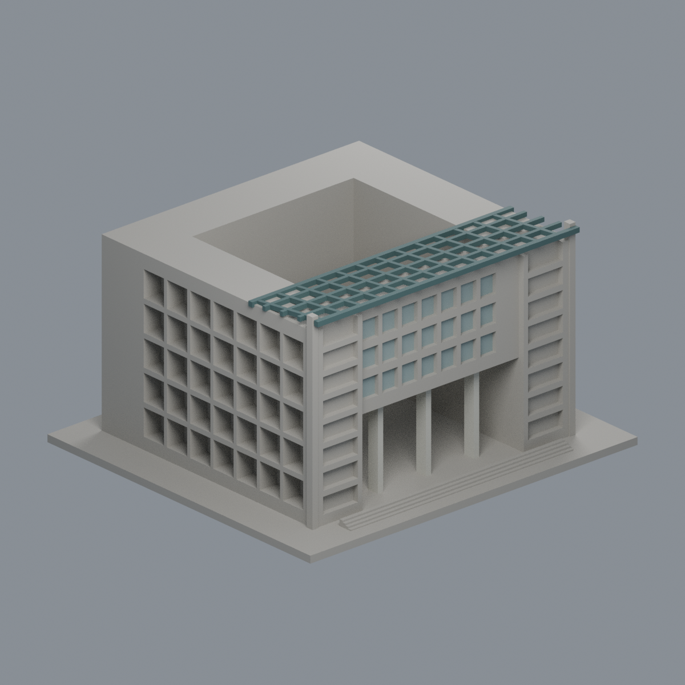
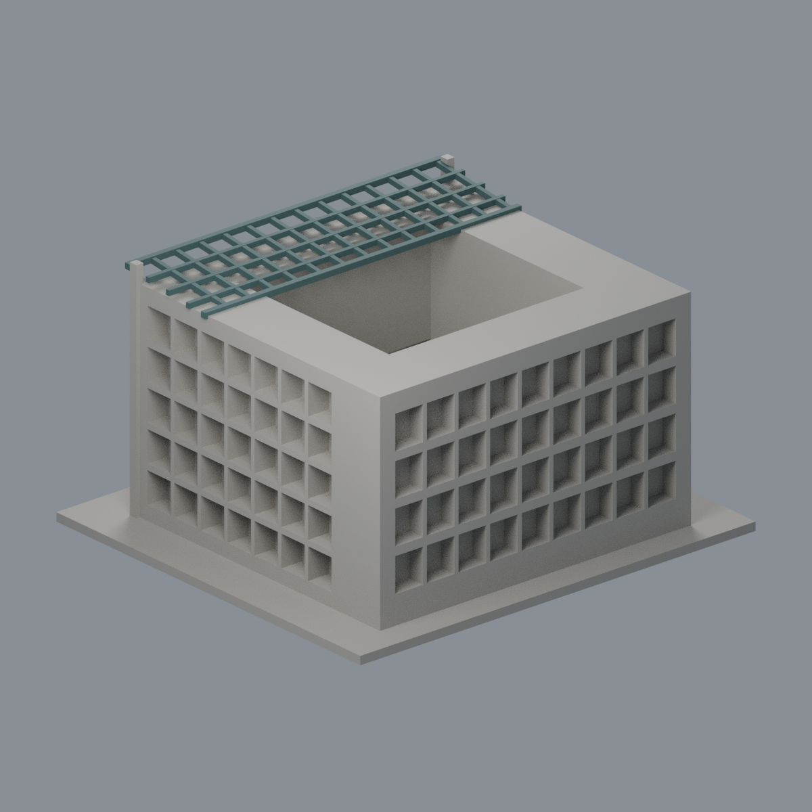
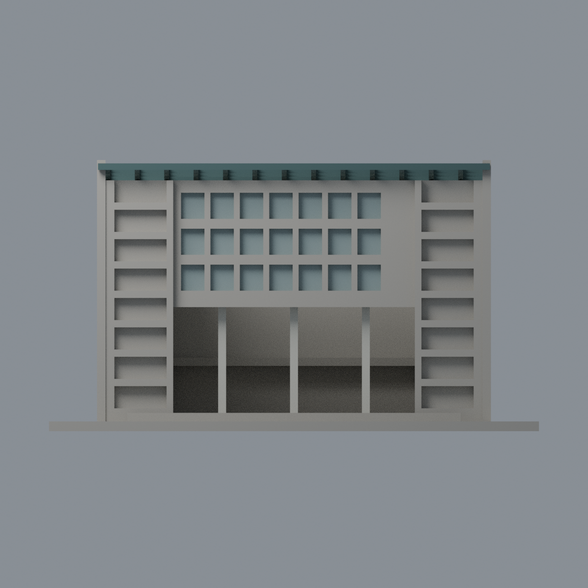
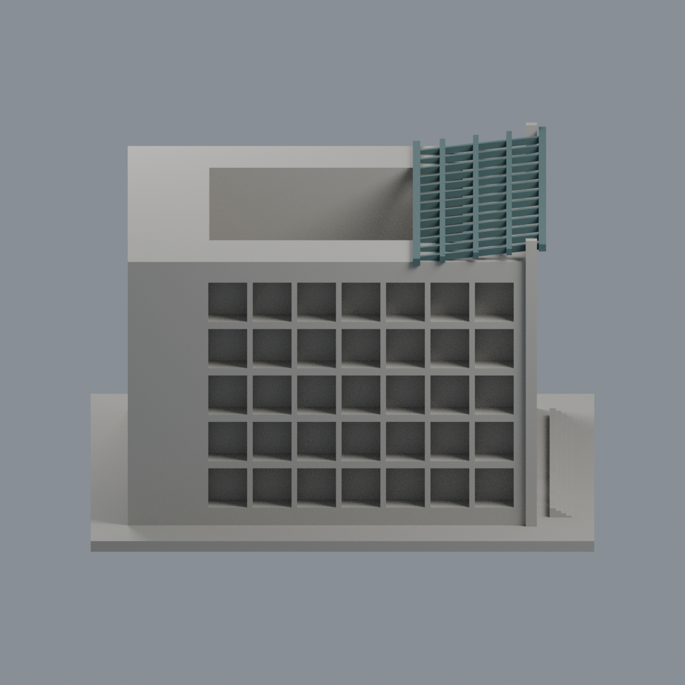
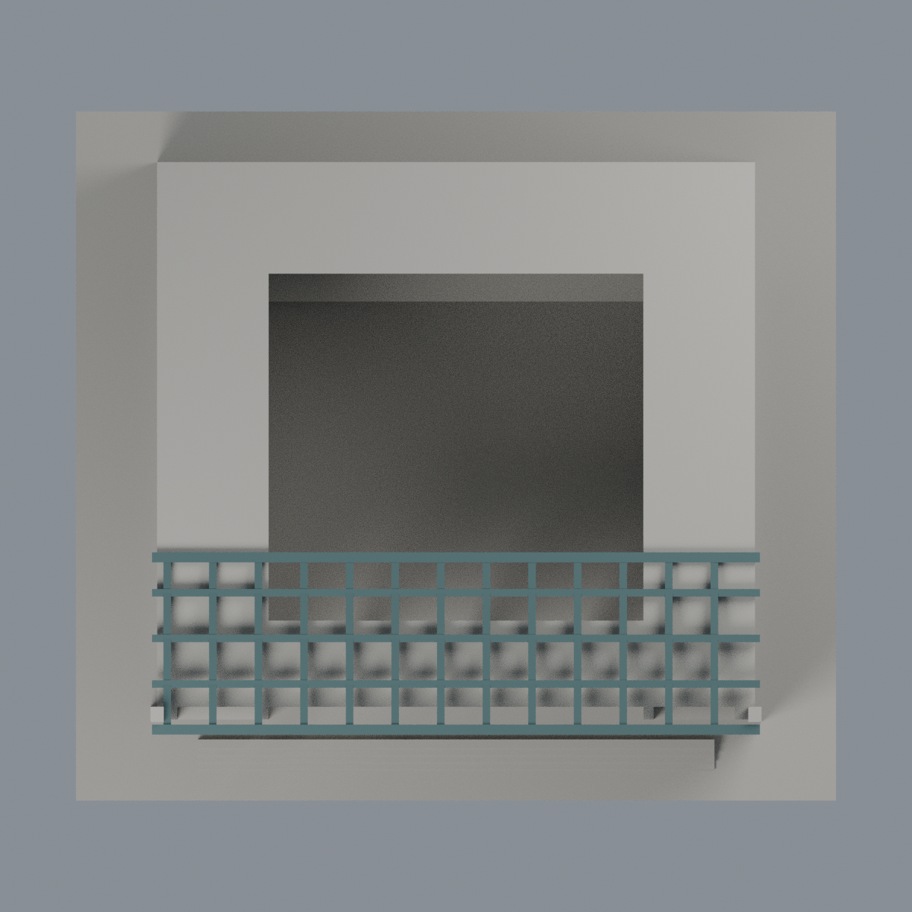

# 中央大學國鼎光電大樓｜現行模型 WebP 預覽

現行版把中央三柱原有淡灰色延伸到同柱側、背面，18 個新增面屬既有同材質連續性推估；不代表新實景佐證。保留原格棚、中央窗背與未確認區域的限制。這次只換展示格式，沒有新增補色、變更幾何或實體試印。五個畫面以同一版 3MF 按原鏡位重新渲染核對。

[原模型說明與限制](../README.md) · [外觀材質說明](../appearance/README.md) · [彩色 3MF](../appearance/ncu-optoelectronics-appearance.3mf) · [可編輯 Blender](../appearance/scene.blend) · [中性 STL](../model.stl) · [現行工程校驗](../SHA256SUMS) · [渲染對照](render-proof.json) · [展示校驗](SHA256SUMS)

| 模型預覽 | 模型預覽 | 模型預覽 |
| :---: | :---: | :---: |
|  正面斜視 |  背側斜視 |  正立面 |
|  側視 |  俯視 |  |
