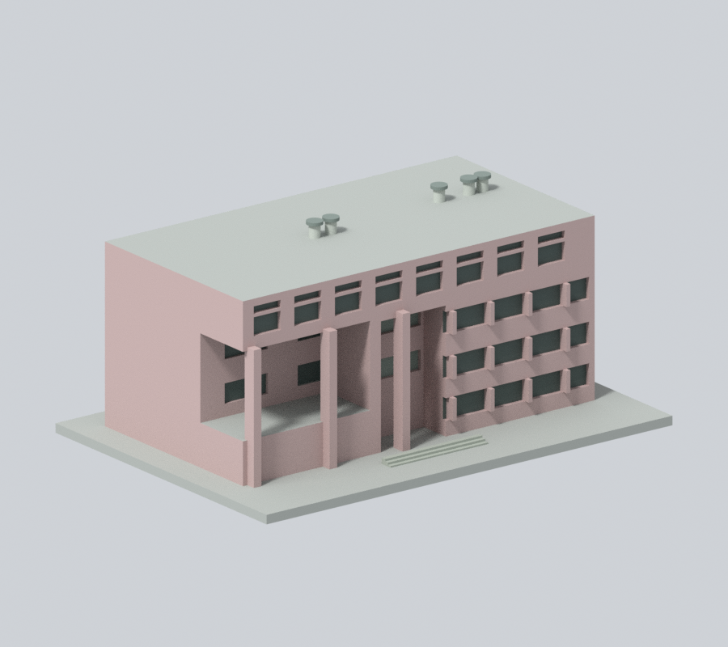
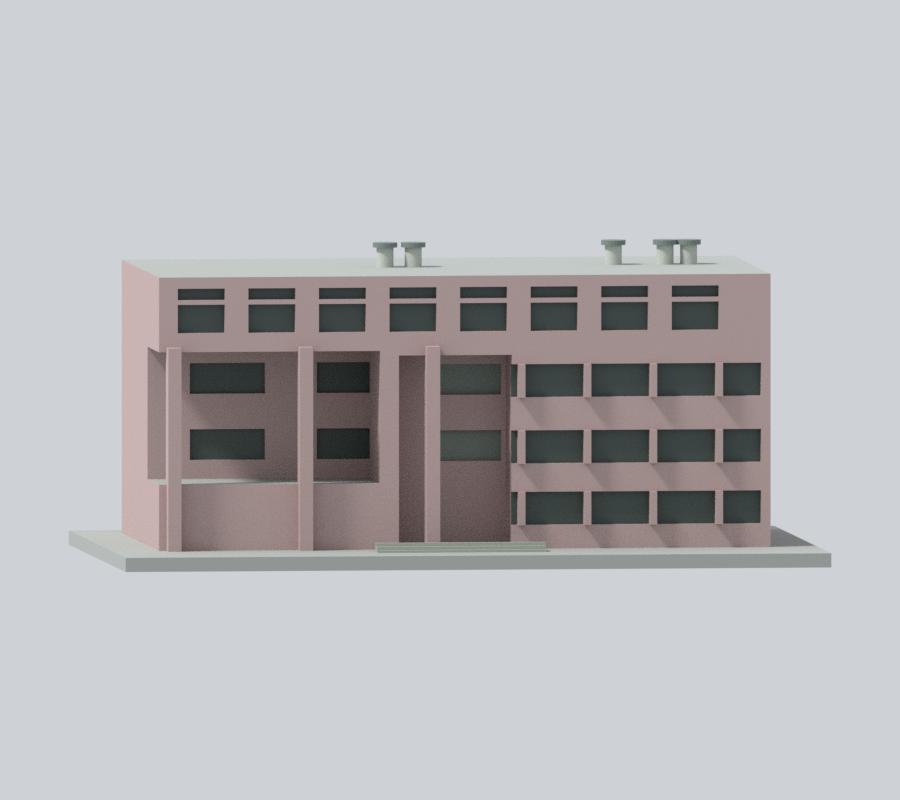
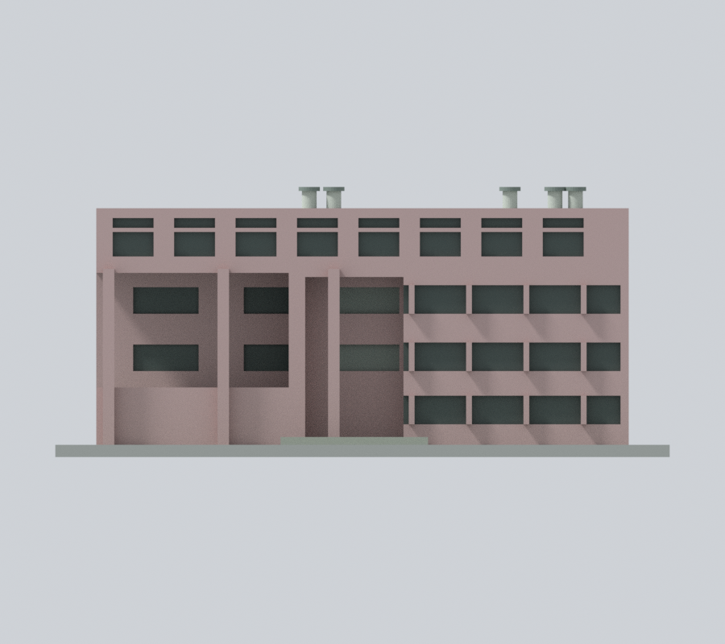
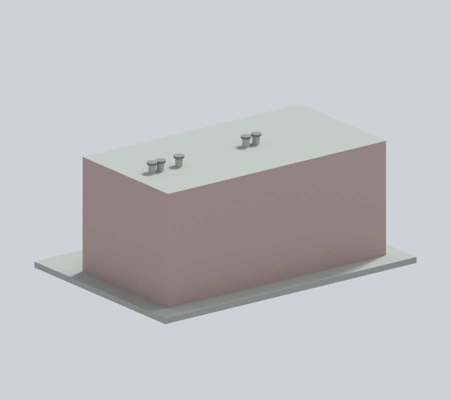
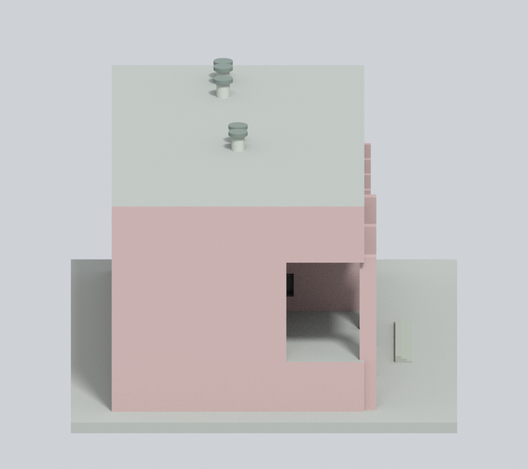
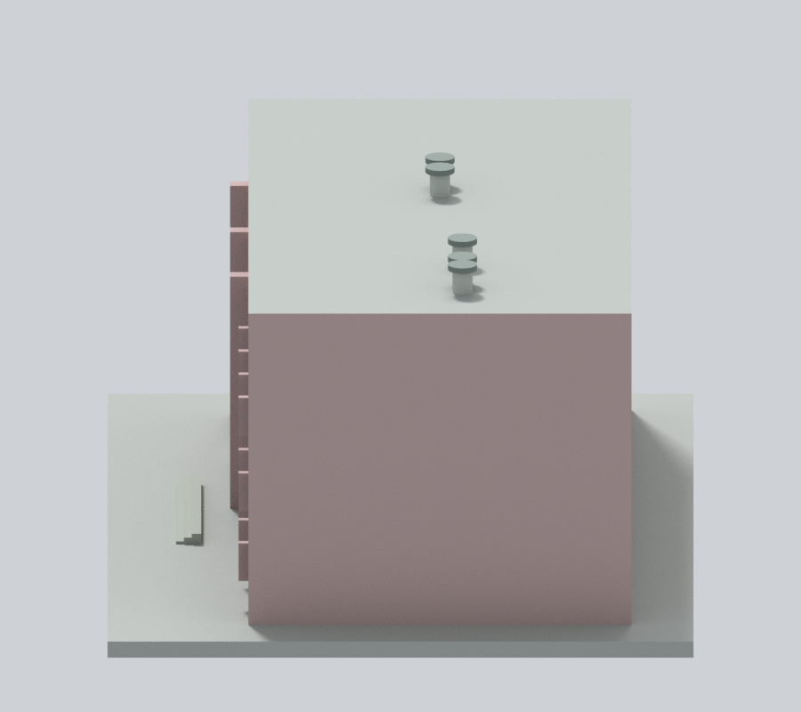
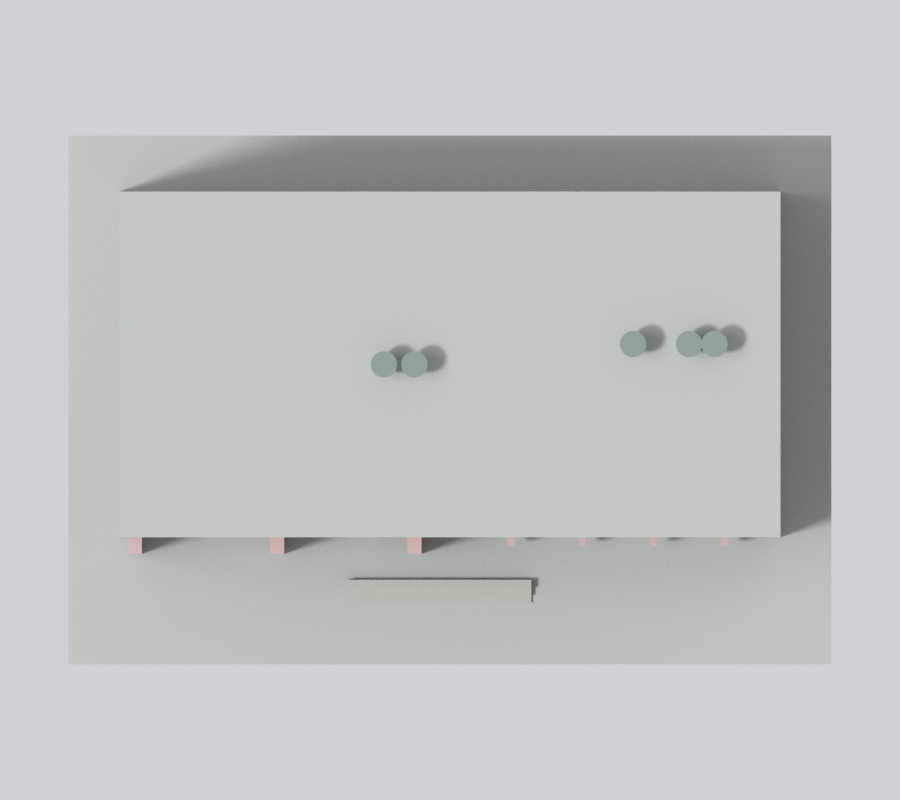

# 國立中央大學科學三館｜現行彩色模型預覽

這七張 WebP 都是現行彩色模型的渲染，已按原鏡位重跑並逐像素核對。既有版本在 236 個有完整界線的面上延伸原粉灰色。左右外牆與背面是同建物材質推估，沒有同角度實景佐證。屋頂、底座、樓板及未確認的窗凹保留中性色。這次只更新展示，不新增補色、不改模型幾何，也未做實體試印。

[模型說明與限制](../README.md) · [材色證據](../APPEARANCE.md) · [彩色 3MF](../appearance.3mf) · [可編輯 Blender](../appearance.blend) · [中性 STL](../model.stl) · [工程校驗](../SHA256SUMS) · [渲染對照](render-proof.json) · [展示校驗](SHA256SUMS)

| 模型預覽 | 模型預覽 | 模型預覽 |
| :---: | :---: | :---: |
|  彩色斜前 |  彩色近來源角度 |  彩色正面 |
|  彩色背面（材色推估） |  彩色左側 |  彩色右側 |
|  彩色俯視（屋頂保留中性色） |  |  |
