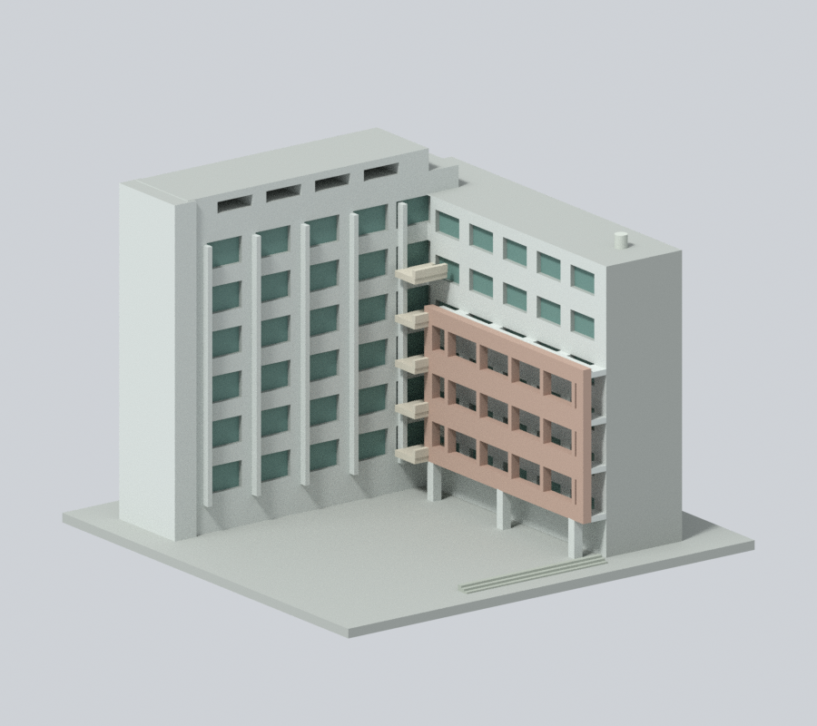
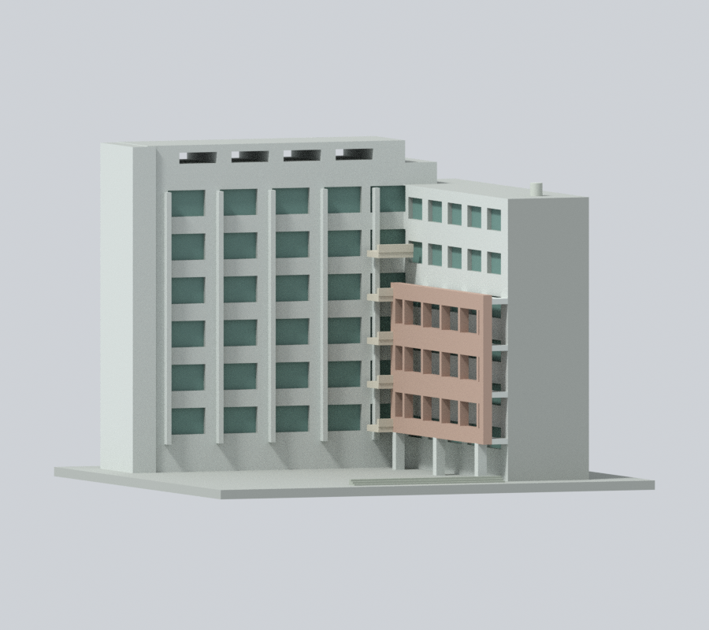
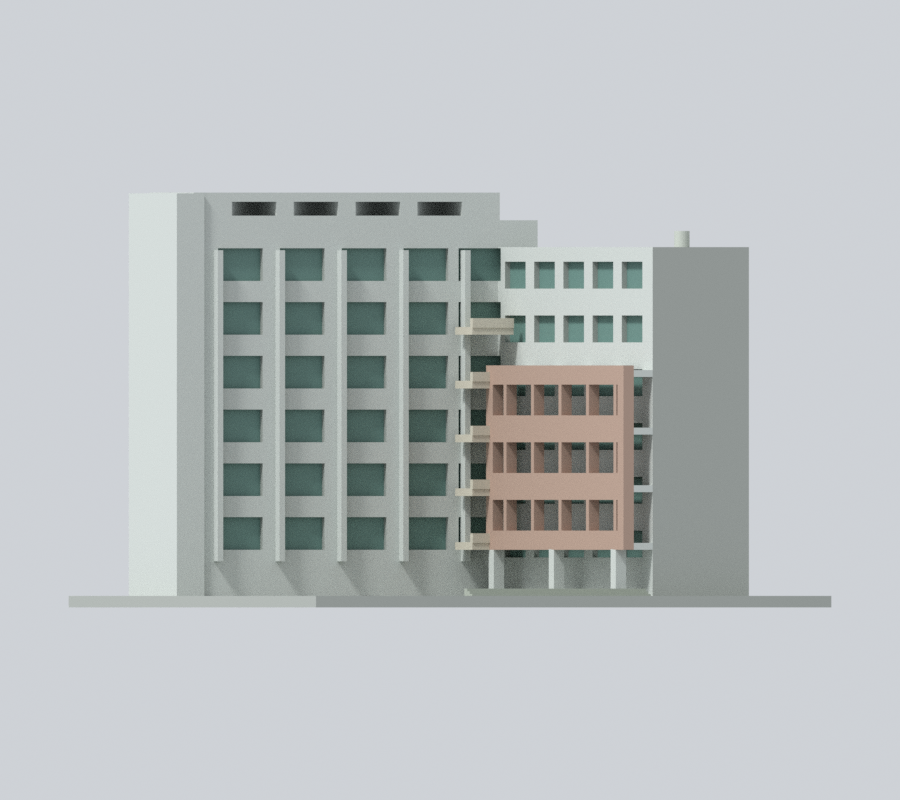
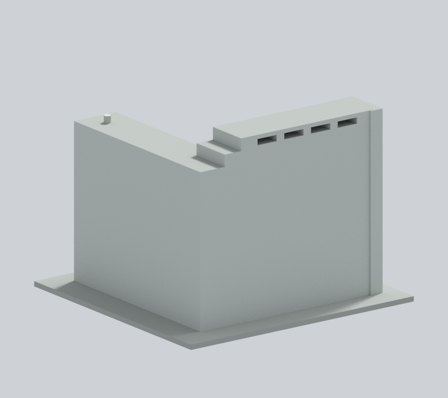
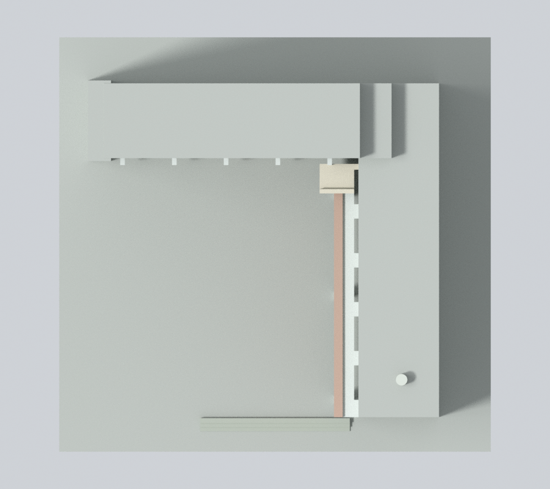

# 國立中央大學科學五館｜150 mm 外觀模型

## 模型預覽

| 新彩色內院斜視 | 新彩色低角度 | 新彩色院側立面 |
| :---: | :---: | :---: |
|  |  |  |
| 新彩色外背 | 新彩色上視 | 彩色下載 |
|  |  | [彩色3MF](appearance.3mf) · [彩色Blender](appearance.blend) |

### 照片近似彩色預覽

依校方與Commons內院實照：原兩翼白灰、窗背青灰綠、下遮屏灰粉褐、轉角陽台米白；屏後牆與下柱不整體染粉。本輪在原彩色上補 48 個原中性面：完整側背與高端牆支持面延續原白灰，屬同構件材料連續性推估，沒有同角度背側實照。右翼前端疑有下層混材但原網格無完整界線，整面仍中性；屋頂、底座、窗洞回折也不擴染。不增黃色面板或細構件。

原三圖、geometry／尺寸／STL／OBJ／scene與首頁／校級選圖不變；詳[來源與重建限制](APPEARANCE.md)。

此為公開外觀資料研究模型，非測繪、施工或正式切片檔。每棟獨立縮尺，含底座最長150 mm，不能直接當作同一比例校園拼圖。本檔尺寸約 150 × 144 × 108 mm。

## 保留的識別特徵
- L形高低雙翼及內角院落
- 外推的低層水平遮陽壁與下方支柱
- 內角分層小陽台、左翼高女兒牆開孔及直向框架

## 證據與簡化
- 兩張實照皆從內院看雙翼，並非完整外側四向照片；外側背面素面。
- 翼厚、院深、層數節奏与陽台量測缺精確資料，按可辨識層次近似。
- 遮陽壁、陽台欄板、窗框加厚；不仿造看不清的機電與精細欄杆。
- 來源2013與校方拍年不明照片，只保留主要量體，不聲稱2026測繪現況。

全部來源及照片/設計圖區分見 sources.json。來源原照片、PDF、內部對照圖不隨模型發布。照片年代不同，不聲稱完整2026現況。

## 檔案與重建
- model.stl：單一連通列印實體，單位毫米
- scene.blend：由交付STL匯入的可編輯網格（不是參數化BIM）；預覽材質只供展示
- build_model.py：可攜參數化量體來源，無需來源照片即可重建
- previews/front.png、rear.png、elevation.png：從實際STL渲染，不是設計效果圖；名稱為相機視角，非精確方位

使用 Python 3.12，依 requirements.txt 準備相依套件，Blender 4.3.2。

    python build_model.py
    blender -b -t 2 -P render_preview.py
    python validate_model.py
    python check_layers.py
    python check_thin_features.py

## 幾何檢查及列印限制
原始STL法線與繞序一致、水密、每邊兩面、頂點鏈單環、單連通表面、無分離內腔殼、正體積、乾淨重建同SHA-256、已存Blender/STL三角幾何一致，詳 validation.json（passed=True）。

0.2 mm幾何截面共 540 層，全部閉合=True。另以1 mm間距檢查0.8 mm XY形態開運算薄特徵，0 層損失面積超過1%；尖角也會被計入，見 thin-feature-check.json。這不是全域壁厚保證，也不是正式切片或試印。

底座平放。突出陽台、各層外推廊板、架空遮陽壁與女兒牆孔上緣需要局部支撐檢查。建議先以0.4 mm噴嘴、0.2 mm層高在實際切片軟體檢查外壁、橋接、支撐可移除性與底板附著，再決定列印設定。小窗框、曲面尖端與薄簷口可能不完整重現；不得將幾何通過寫成「免支撐、保證可印」。

SHA256SUMS含可發布檔案雜湊。尚未實體試印。此為全校持續研究中的一件，不代表全校完成。

## 檔案下載與實際模型預覽

[STL](model.stl) · [可編輯 Blender](scene.blend) · [Python 來源](build_model.py) · [完整驗證](validation.json) · [來源](sources.json)

以上是實際彩色模型渲染。rear 的完整側背外牆採同構件白灰延續推估，保留原素面幾何，不代表同角度實景或查證現況。相機視角不是精確地理方位。

## 截面數值方法修訂與補查

本發布包已直接採用canonical-edge-v2薄篩工具與結果，固定共邊插值方向，要求節點度數2、閉環及各Polygon有效，再做1 mm間距的0.8 mm XY開運算。舊版可能因共邊端點分開計算後取整而漏環，不能沿用舊面積值。這項修正不改STL、Blender或重建來源；真實薄特徵警示照常保留。

另以0.2 mm間距逐層補查閉環及Polygon有效性，共 540 層通過，見[有效性報告](contour-validity-check.json)與[可攜檢查程式](check_contour_validity.py)。這項較密補查沒有做薄篩開運算；薄篩採樣間距仍是1 mm。兩者都不是正式切片、試印或全域壁厚保證。

## 側背補色審核（color-v2）

[左側](appearance/left.png) · [右側](appearance/right.png) · [同鏡位原正面](appearance-review-v2/original-front.png) · [同鏡位原背面](appearance-review-v2/original-rear.png) · [完整材料／幾何／邊界審核](appearance-review-v2/color-continuity-review.json)

原尺寸、1509 頂點／3246 三角面、transform、所有已彩面與每個材料 RGBA／roughness 不變。原三張 previews、STL／OBJ／scene、建模腳本、原幾何 QA 與首頁／校級代表圖均不替換。新七圖為 Cycles CPU、96 samples、900 × 800、單執行緒、無降噪；兩張原版對照僅恢復原面材料，使用相同相機與光照。仍須檢查支撐與橋接，尚未實體試印。
