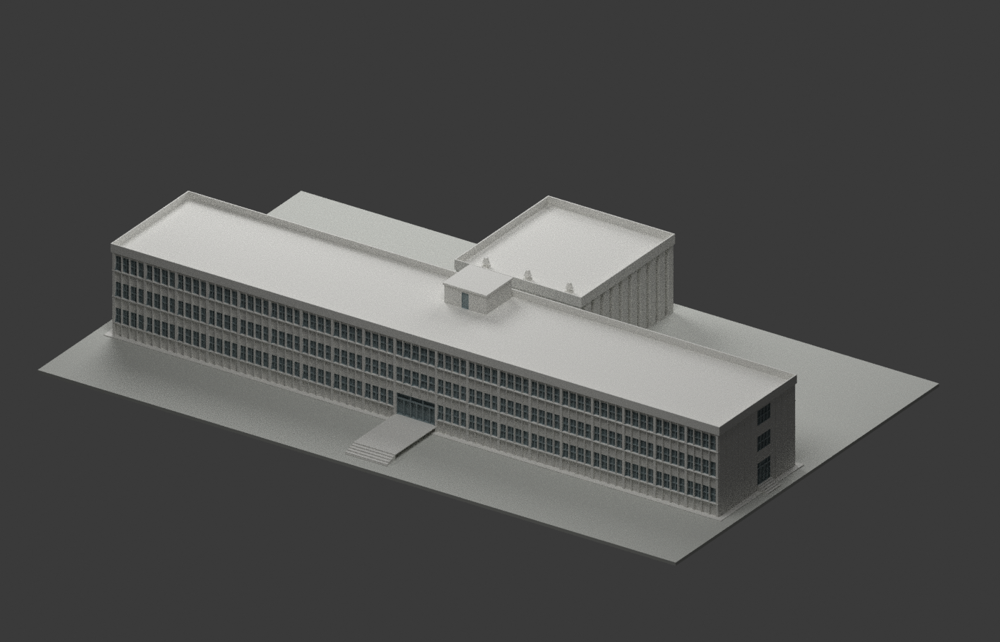

# 模型檔與驗證

本包為國立中央大學科學館 1968 年原設計外觀重建（現稱科學一館），不是現況或竣工測繪。完整來源、設計者、圖面日期差異、明標與估讀值、權利區分及十張實渲見 [README](README.md)。

- [STL](model.stl)：1:300，毫米，單體相連水密網格。
- [3MF](model.3mf)：同一網格，毫米與材質資訊。
- [Blender](scene.blend)：原生壓縮場景，已實際重開比對網格。
- [生成程式](build_model.py)：可重建同一網格；需要 numpy、trimesh、manifold3d。
- [格式檢查](FORMAT-QA.json)、[重建檢查](REBUILD-QA.json)、[來源視覺審核](SOURCE-VISUAL-QA.json)。

展示底座與可列印細框為明示製作處理；不附原圖或私人參考資料。細肋、懸挑板與連橋可能需要列印支撐，未實體試印。原圖 CC BY-NC 與生成模型權利分開說明，不能據此宣稱整包必然僅非商業，也不能宣稱任意利用都不受限制。
