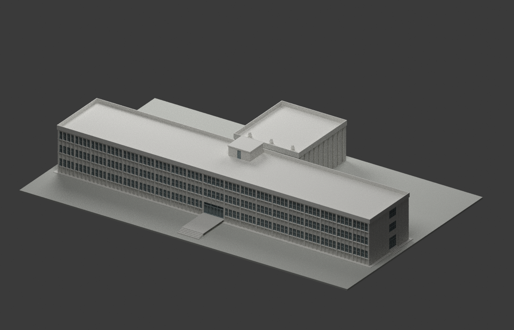
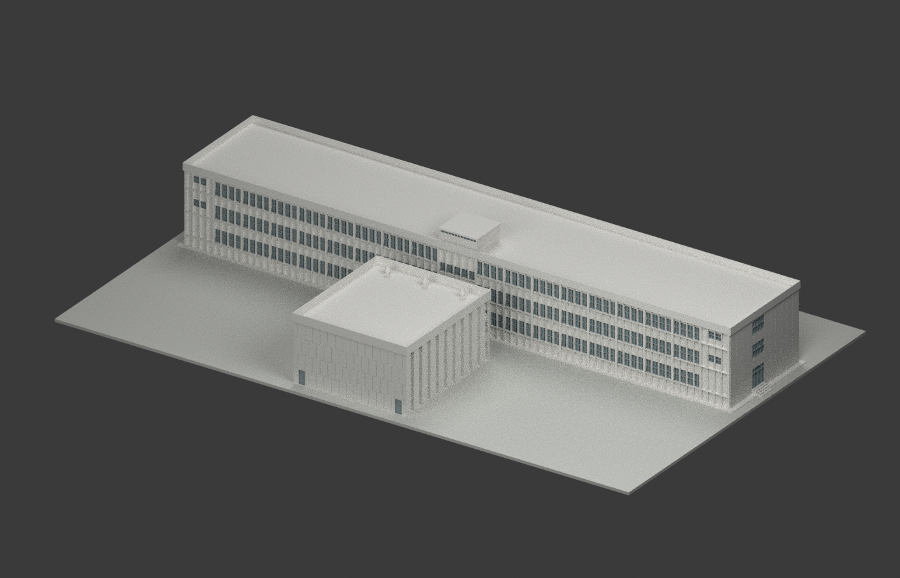
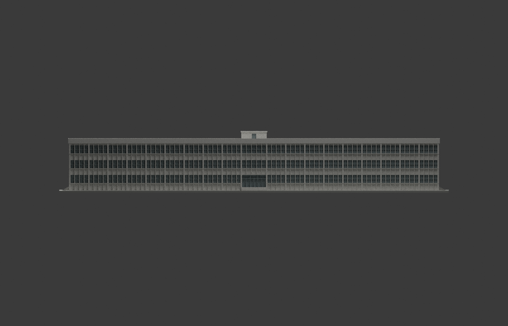
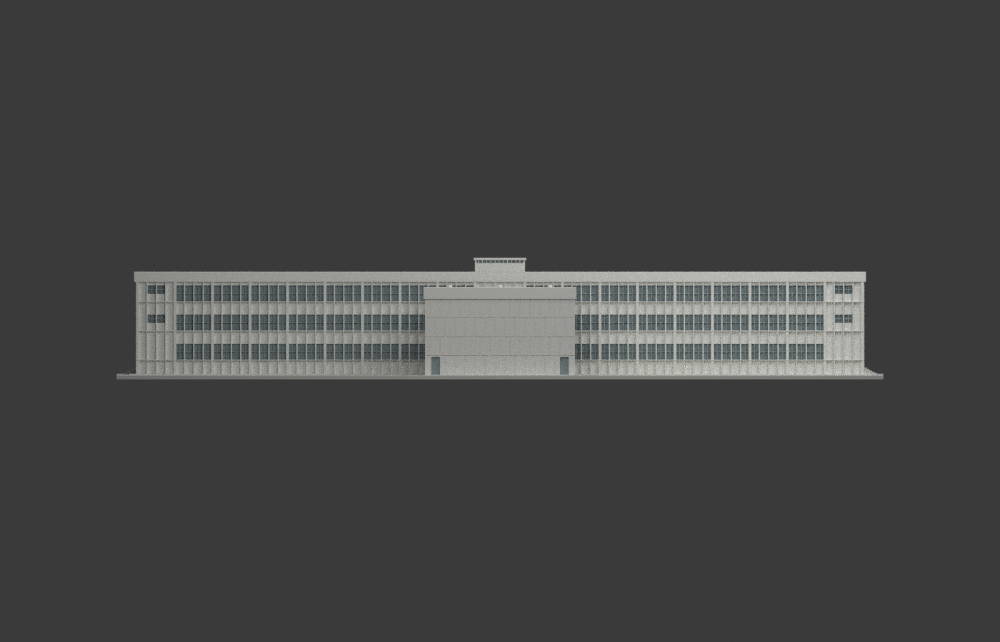
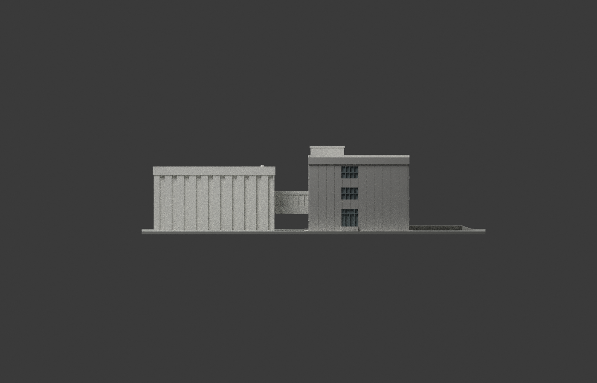
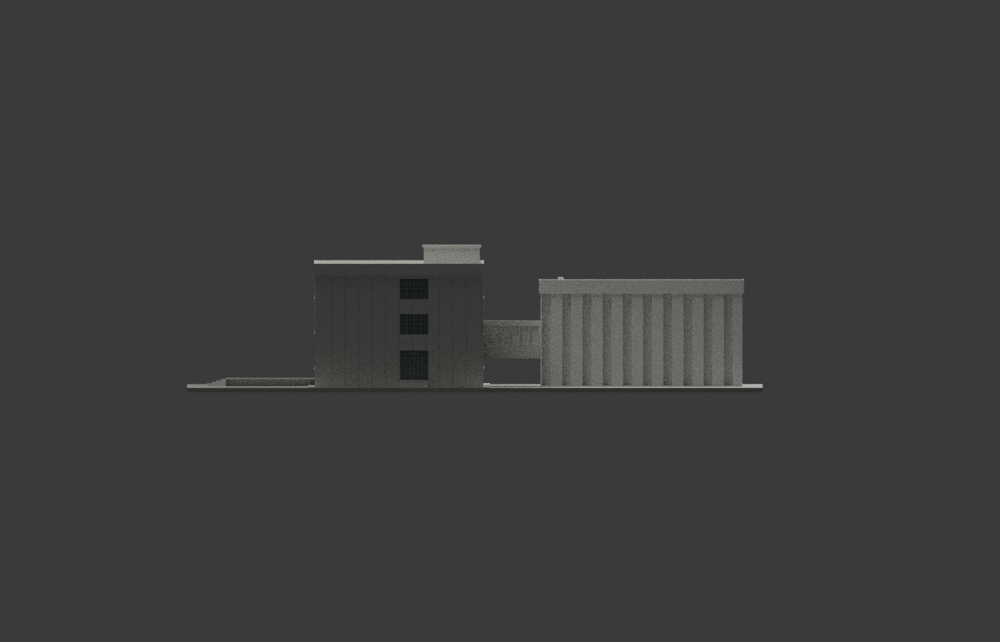
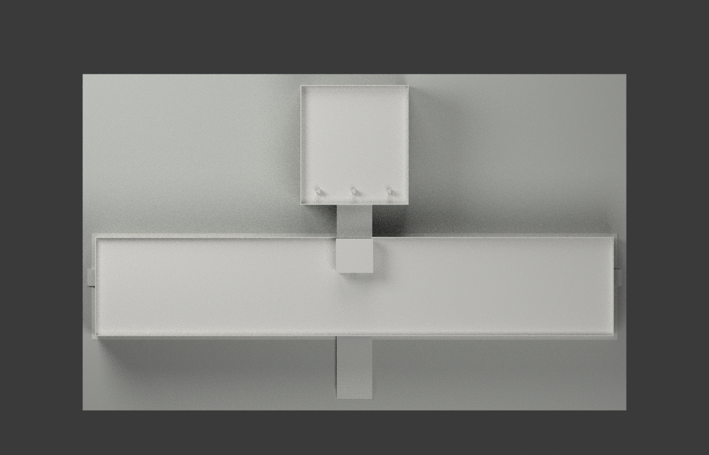
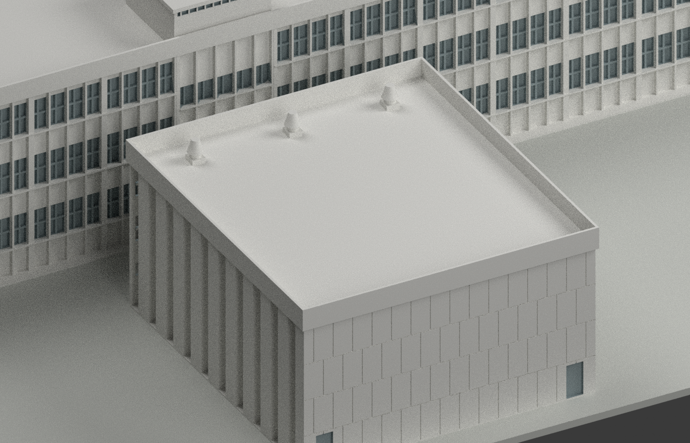
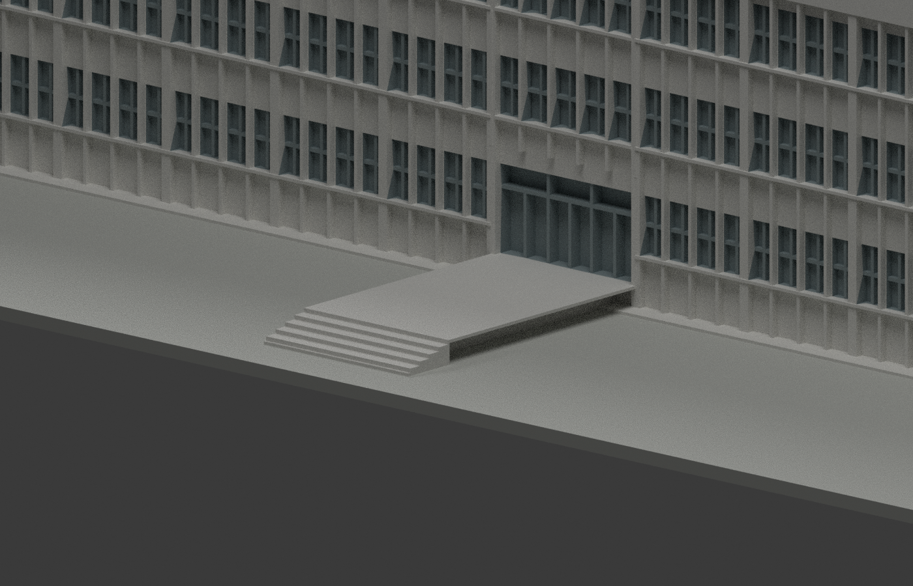
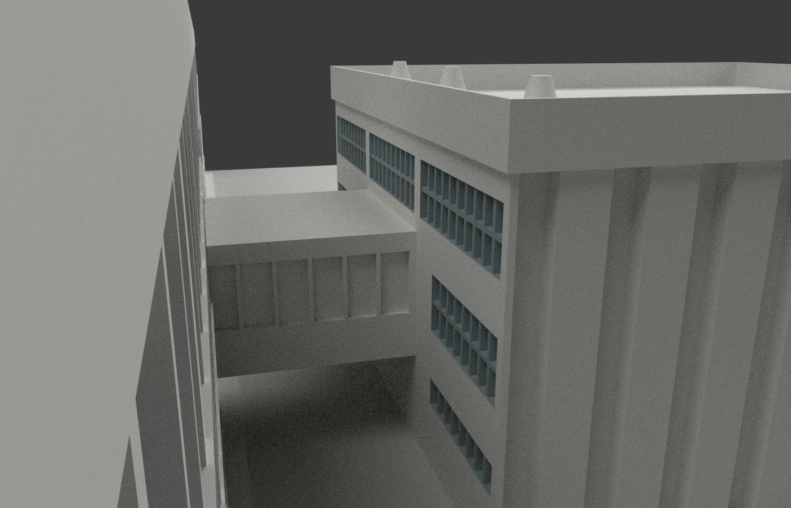

# 國立中央大學科學館｜1968 年原設計圖重建

## 模型實際渲染

| 視角一 | 視角二 | 視角三 |
|---|---|---|
|  原設計斜視 |  背向斜視 |  正面 |
|  背面 |  西側 |  東側 |
|  屋頂 |  附堂細節 |  入口細節 |
|  連橋細節 |  |  |

> **歷史原設計模型，不是竣工測繪或現況模型。** 原設計科學館現稱科學一館；本模型不包含 1981 年後加的天文台圓頂，也不描述 2026 年現況。來源設計者：**陳其寛、劉應昌、黃寶瑜**。以圖章日期民國 57 年 8 月 8 日（1968-08-08）的核心圖組為主，配合同案詳圖；**A10 可讀同日，A12、A13 日期欄未見填值，不推定全組同日**。

## 下載與範圍

- `model.stl`：毫米，**1:300**，單一相連水密外觀展示模型。
- `model.3mf`：同一網格、毫米單位與中性材質分區。
- `scene.blend`：實際 Blender 場景，以原生壓縮儲存；內附同網格與攝影機。
- `build_model.py`、`render_model.py`：可重現建模與實渲程式；`mesh.npz` 是格式一致性基準。
- 模型涵蓋三層主棟、中央屋頂樓梯塔、六米連橋、十八乘二十米階梯教室、折牆、三個屋頂抽風機、入口平台與梯步。展示底座是製作添加物，**不是基地地形或校地界線**。

## 尺寸與版本控制

| 項目 | 採用值及依據 |
|---|---|
| 主棟軸長 | 87 m = 18 × 4.50 m + 中央 6 m（A2）；端部 100 cm 是散水距離，不加作室內長度 |
| 主棟軸寬 | 16 m = 8 + 3 + 5 m（A5） |
| 主棟樓板／女兒牆 | GL + 0.80 / 4.30 / 7.80 / 11.30 / 12.30 m（A5、A6） |
| 典型外窗 | 高 190 cm、窗臺高 100 cm；典型窗寬 99.25 cm（A6、A9） |
| 屋頂樓梯間 | 平面標註控制 6 × 5.54 m（A4）；A7 明標 210 + 35 + 25 = 270 cm，自主屋面 +11.30 到頂 **+14.00 m**；高位玻璃磚帶簡化為聚合凹帶與分格 |
| 附堂平面 | 軸線 18 × 20 m（A2–A4），非內部淨尺寸 |
| 附堂外高度 | A3 同一 GL：10 + 910 + 25 + 110 = **1055 cm**；牆身起 +0.10，至 +9.20，帶至 +9.45，女兒牆至 +10.55 m |
| 附堂折牆 | A8 每 2 m 一週期，85 + 115 cm，凹凸 50 cm；不是任意直條肋 |
| 連橋 | A8：GL + 0.10 + 3.00 = 橋面 +3.10 m；外鏈再 3.10 + 0.30 = 頂 +6.50 m；內部「313」與外鏈「310」的 3 cm 差異保留，不硬改成同值 |
| 橋下緣 | 約 GL + 2.75 m，依圖比例估讀 ±5 cm；兩側 90 cm 矮牆 + 10 cm 蓋板，上段中性薄框封背，不斷言原材質為玻璃 |
| 入口 | 採 A13 詳圖：寬 6 m，總投影 11 m，梯跑 1.80 m、五級各 14 cm，平台 +0.80 m；中央 4 m 填體、兩側各 1 m 懸挑板，非六米全寬填實 |

A13 入口詳圖與 A2 示意投影不同，採 A13；未反推不明修訂日期。附堂正立面上排三組寬採 5.45 m，A12 另型 5.425 m 差異保留；中排兩組明標 4.34 × 1.60 m，低排 4.34 × 0.80 m 的寬依 A4 對齊推導，三排窗臺 GL +1.90 / 4.10 / 6.95 m 為立面比例讀值。中、上窗有中橫框，低窗單行。附堂背立面兩側低門依 A3 比例重建約 1.05 × 2.10 m，非另有明標尺寸。A12 主棟端窗採 2.80 × 2.00 m、四欄兩列；A10 端門 AD3 採 2.77 × 2.90 m、中扇 1.60 × 2.15 m 加 0.75 m 上亮。主入口 AD1 採 5.65 × 2.90 m。兩端短梯依 A2/A5 圖形補五級升至 +0.80 m，1.50 m 梯跑為比例估讀，非另有精確標註。主棟端面及附堂背面的飾面分縫保留圖示節奏，但不是石材施工放樣。

## 明示簡化與列印限制

1. 這是**封閉外觀展示模型**：窗內使用不透明實心背襯，隱藏房間、座椅、室內樓梯與地下基礎不重建；不是可使用的建築 BIM。
2. 窗細框為可辨識與列印增至原尺寸等效 120 mm（1:300 下 0.4 mm）；飾面分縫採約 0.2 mm 列印刻槽。此為製造簡化，非原施工尺度。
3. 色彩是依圖面材料文字選的中性視覺解讀，不是校色照片；不補造校徽、字牌、設備品牌、未知管線、路網或植栽。
4. 橋下緣、背門尺寸屬明列比例估讀；圖面間細小矛盾保留，不宣稱毫米級實測準確。
5. 約 307 mm 長的展示底座可能超出部分桌上型印表機。懸挑平台、橋、細肋與窗框可能需支撐或調整切片設定。**未實體試印**；水密與格式檢查通過不等於所有機型都能直接成功列印。

## 來源與權利分開說明

主要來源是國立臺灣博物館／文化部建築典藏的原設計圖。典藏頁標示 **CC BY-NC**，版本未確認；原圖自身授權不因本模型而變更。本包**不附原圖、掃描、網站 HTML 或私人參考資料**。

本包的自行建模程式、生成網格與渲染，與來源原圖授權分開說明：**不把整包概括列為僅限非商業，也不宣稱所有利用均可無限制商用**。請保留設計者及來源；具體再利用仍須自行確認適用權利與法規。來源及設計圖日期不等於實際竣工狀態。

- [A2 平面與入口](https://collections.culture.tw/docomomo_collectionsweb/Collection?GID=MNMSM6MXMD)
- [A3 附堂側／背立面](https://collections.culture.tw/docomomo_collectionsweb/Collection?GID=MCMSM6MXMD)
- [A4 屋頂樓梯間與附堂正立面](https://collections.culture.tw/docomomo_collectionsweb/Collection?GID=M7MSM6MXMD)
- [A5 全向立面、剖面與屋頂](https://collections.culture.tw/docomomo_collectionsweb/Collection?GID=MHMSM6MXMD)
- [A6 主棟窗牆剖面](https://collections.culture.tw/docomomo_collectionsweb/Collection?GID=MQMSM6MXMD)
- [A8 附堂與連橋詳圖](https://collections.culture.tw/docomomo_collectionsweb/Collection?GID=MKMSM6MXMD)
- [A9 窗型與立面分格](https://collections.culture.tw/docomomo_collectionsweb/Collection?GID=M8MAMRMNMD)
- [A10 鋁門表與細部](https://collections.culture.tw/docomomo_collectionsweb/Collection?GID=MLMAMRMNMD)
- [A13 入口詳圖](https://collections.culture.tw/docomomo_collectionsweb/Collection?GID=MCMAMRMNMD)
- [中央大學人文電子報：科學館現名、1968–1969 興建與 1981 後加天文台](https://hcepaper.ncu.edu.tw/web/paper/paper.jsp?cp_id=CP1680085555614&paper_no=CP1679982697783)

## 重建

使用 Python（numpy、trimesh、manifold3d）執行 `build_model.py`、`export_3mf.py`、`validate_model.py`。以 Blender 4.3 執行 `render_model.py`，再執行 `render_bridge_detail.py` 補來源核對視角，最後執行 `verify_scene.py` 重新開檔核對。詳見各 `*-QA.json`；`SHA256SUMS` 與凍結清單限定交付版本。

### 中央樓梯立面分開解讀
A5 正面中央 6 m 柱間保留上兩層窗帶（GL 5.30–7.20、8.80–10.70 m），直條下至約 GL 4.30 m；背面只有約 GL 7.70–8.90 m 的單道窗帶，直條下至約 6.40 m。五個約 1.20 m 直條間隔、窗格與背面帶高為立面比例解讀，不套用一般 4.50 m 柱間的 A9 窗寬，也不冒稱找到對應明標窗型；一樓中央門不被連續窗臺條穿越。
