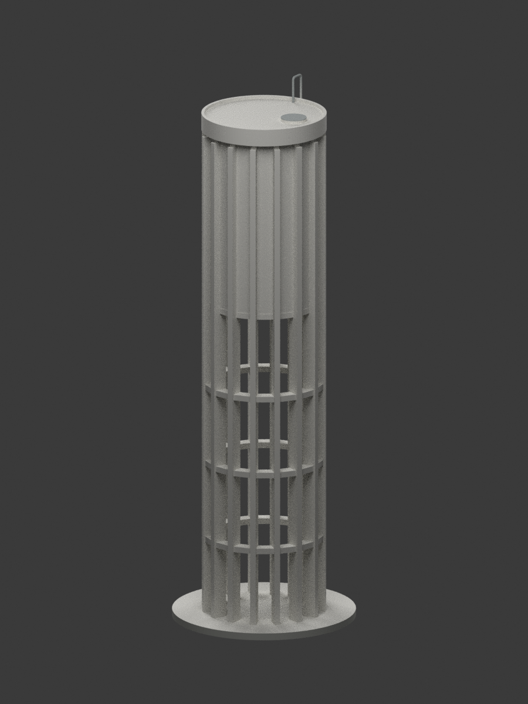
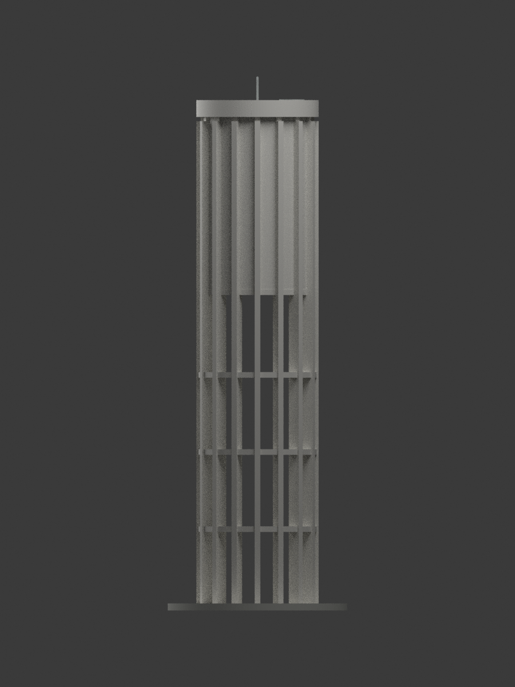
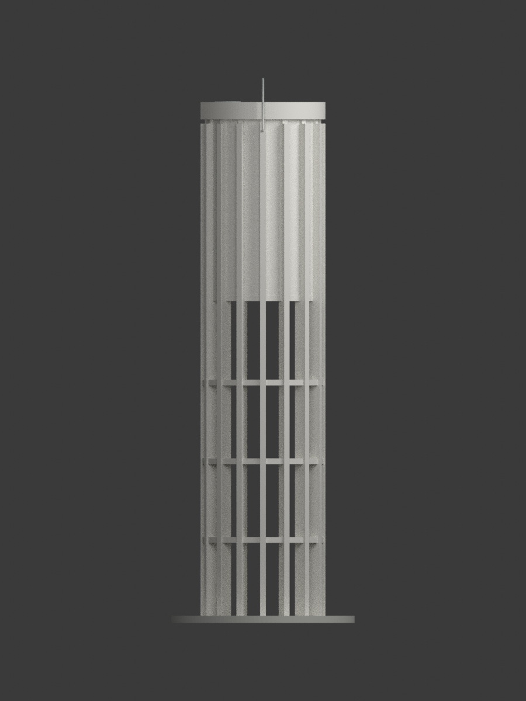
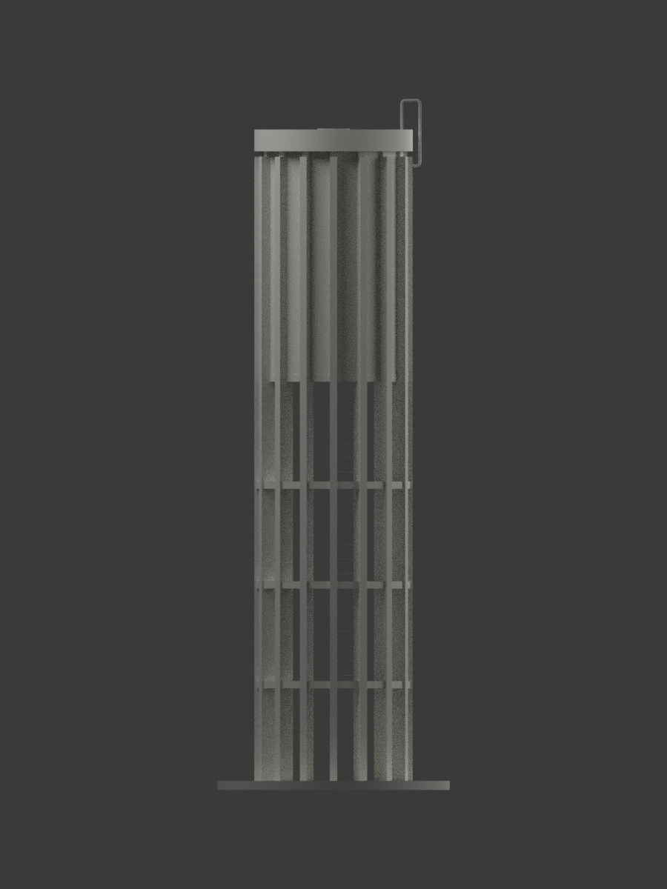
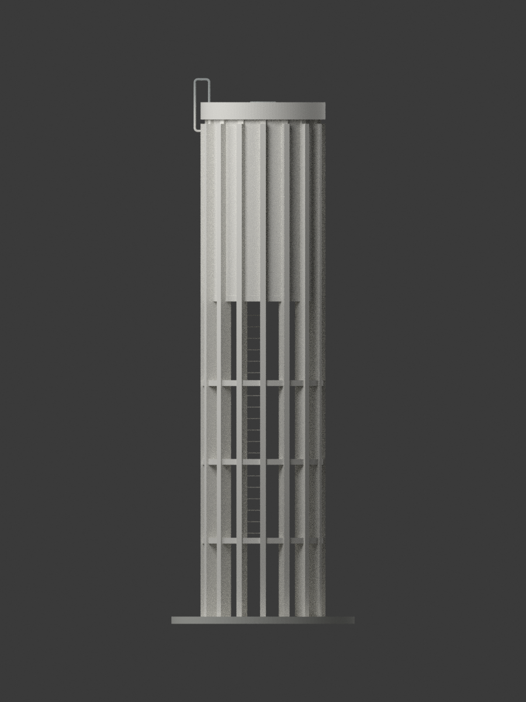
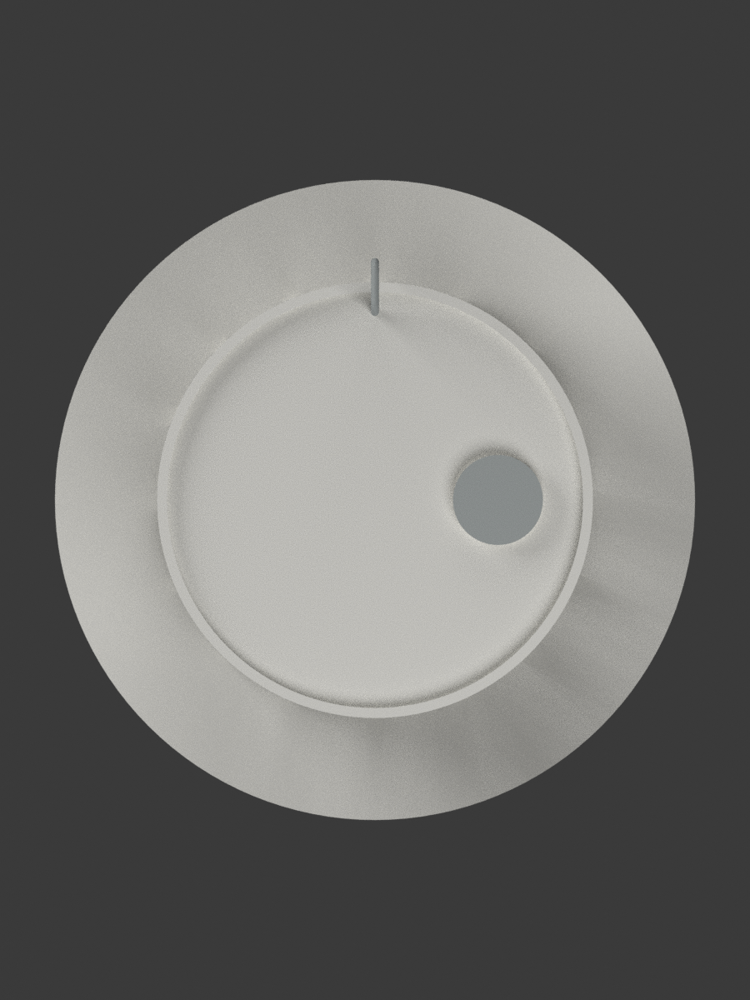
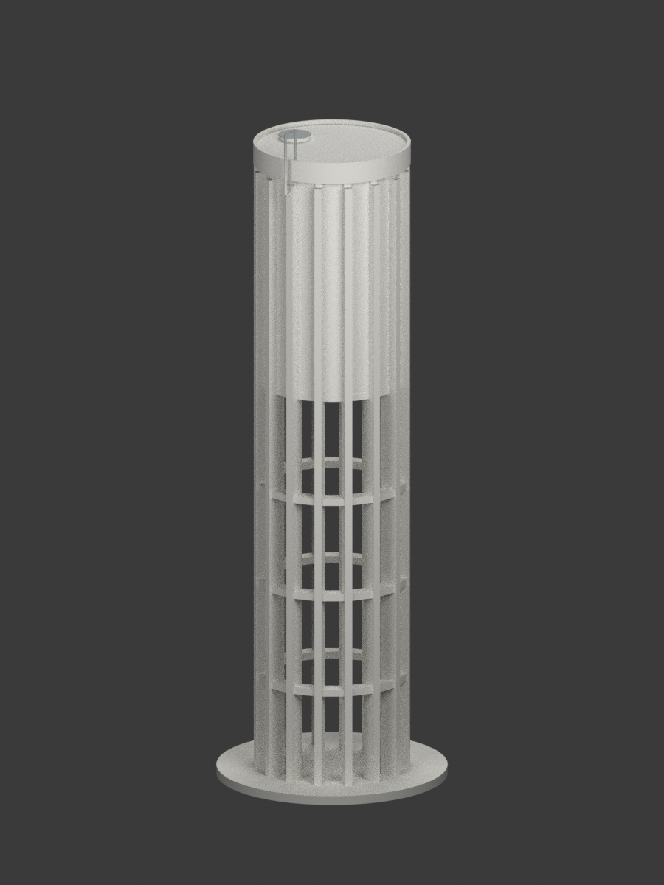

# 國立中央大學水塔 — 1969 設計圖重建

**歷史原設計模型，不是竣工測繪，也不代表 2026 年現況。精確現址與保存狀況未核。**



## 來源與範圍
以國立臺灣博物館臺灣現代建築圖說 CCCK19104006（T1）與 CCCK19104007（T2）重建。校核欄 58.6.20 換算 1969-06-20，不由案號推年份。原圖題名「國立中央大學水塔新建工程」；T2 註記 60T。
設計者：陳其寛、劉應昌；T2 另列黃寶瑜。精確連結見 sources.json。

## 幾何控制與差異
- 比例 1:100，毫米模型。16 根徑向肋、22.5° 間隔。
- T1 槽淨內徑 3.66 m；T2 同基準標 3.60 m。本模型採 T1，不平均、不冒稱一致。
- 槽壁厚 0.10 m；上肋徑向 0.35 m、下柱 0.50 m，切向寬 0.20 m。
- GL 至槽底板下 11 m，底板 0.20 m；再 6 m、0.15 m、B1 0.50 m、屋緣凸起 0.10 m，至凸緣 17.95 m。
- 下部三道 B4 弦梁；頂部人孔 0.70 m。

## 明示簡化
原槽內空間改為不外露列印實心核，並非建築實際填實；封閉人孔蓋用 25 mm 設計尺度顯示厚度。下部爬梯桿採簡化矩形截面，未作五金細節。槽內梯與配筋不呈現；T1 頂部回彎管按屋蓋上下各 90 cm、水平 20/30 cm 重建；名義 1 英吋管徑在 1:100 過細，明示增粗為列印直徑 0.8 mm，非原尺寸。底盤為作者展示底座，不是地形或原設計基礎。地下基礎及未知管線不造。中性色非現地採色。未實體試印。

## 權利
原圖頁標示 **CC BY-NC**，版本未確認；此為來源條件，不把整包自動概括為非商業授權，也不宣稱模型可無限制商用。保留設計者與典藏出處；本包不含原圖、PDF 或網頁。

## 檢視








## 重現與驗證
```sh
python build_model.py
python export_3mf.py
python validate_model.py
blender -b --python render_model.py
blender -b --python verify_scene.py
```
模型檔為毫米、1:100；STL 不攜帶色彩，3MF 包含中性展示色。八張 PNG 為同一 mesh 的實際 Blender 渲染；屋頂細節刻意裁去底盤，其餘七向完整取景。

## 下載與重建檔案

[單色 STL](model.stl) · [彩色 3MF](model.3mf) · [可編輯 Blender 場景](scene.blend) · [建模程式](build_model.py) · [渲染程式](render_model.py) · [3MF 匯出程式](export_3mf.py) · [重建依賴](requirements.txt)
