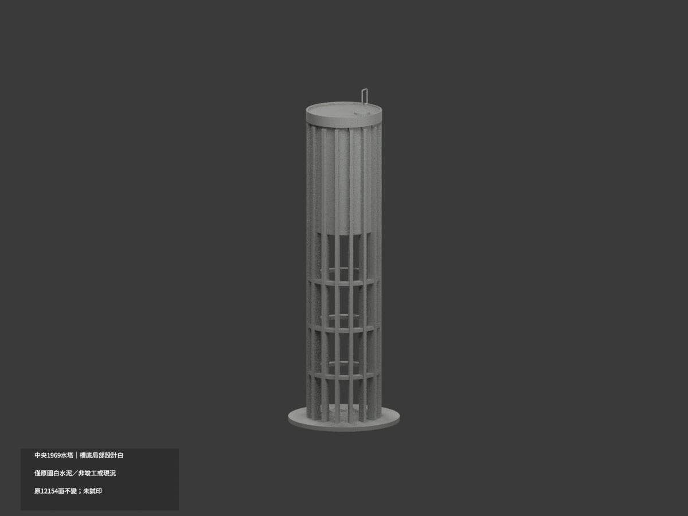
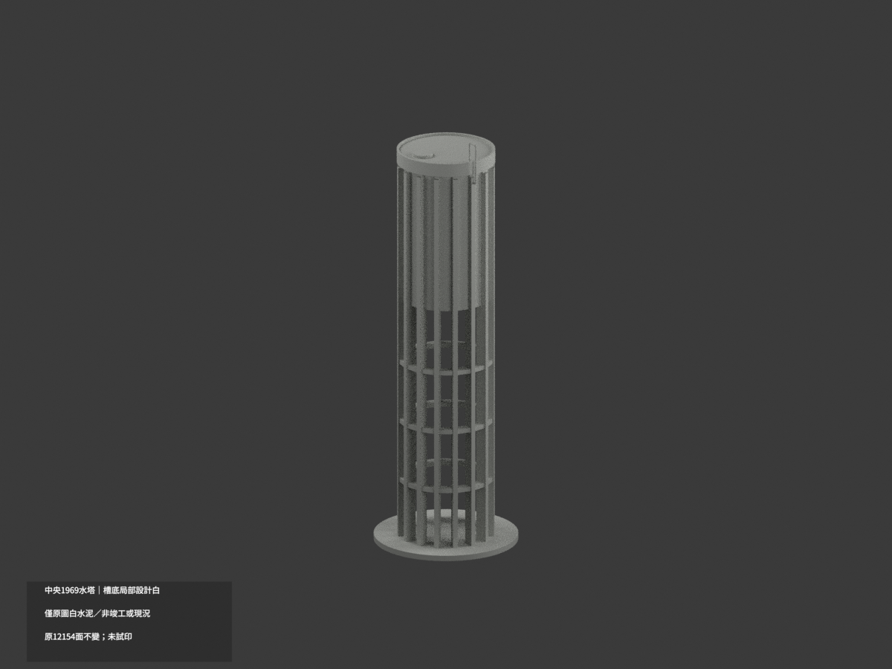
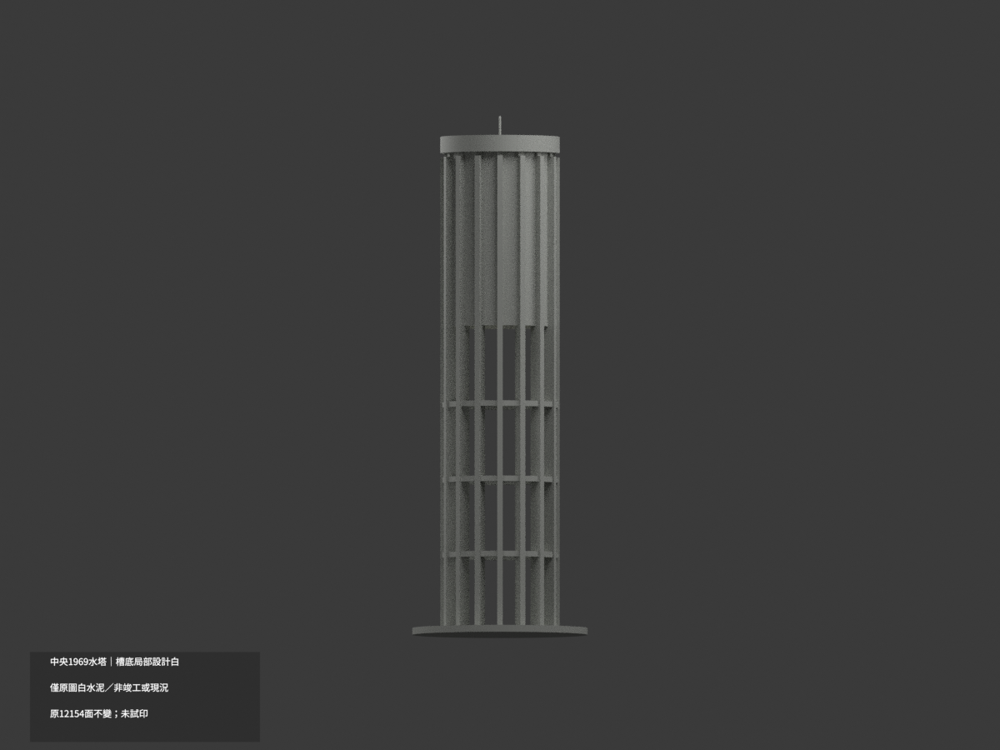
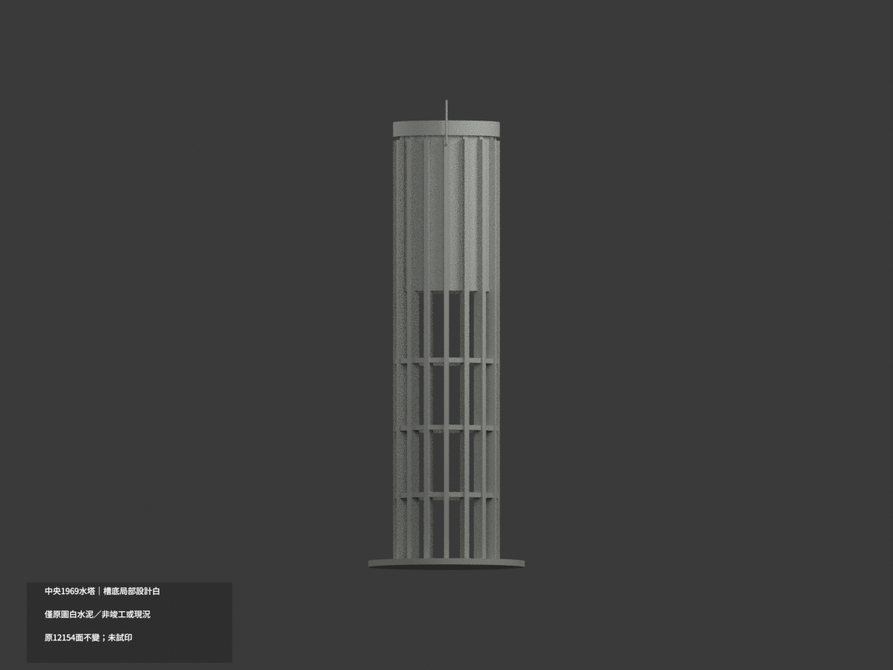
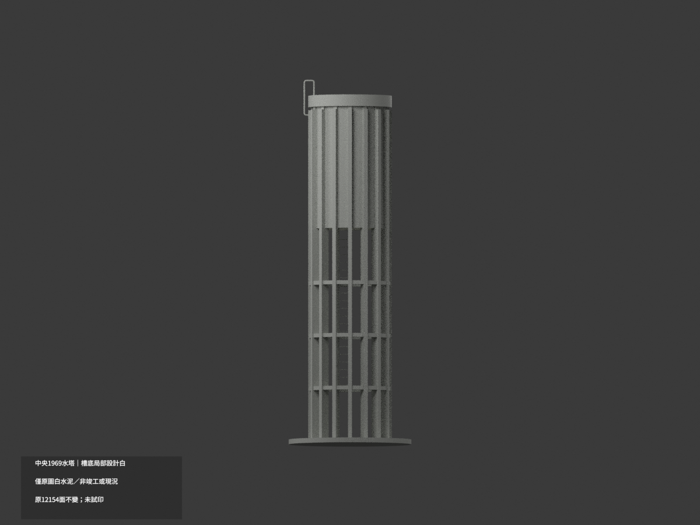
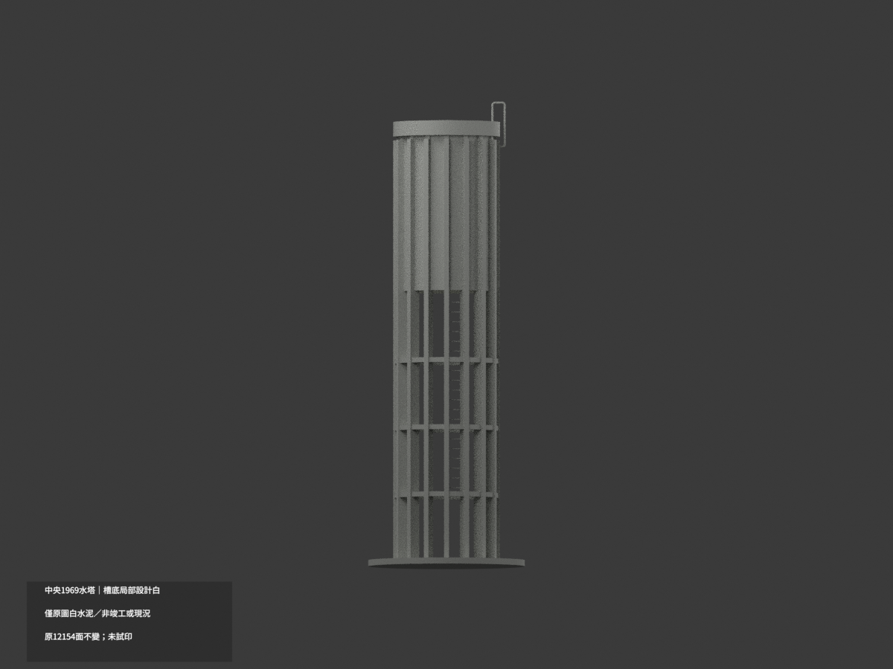
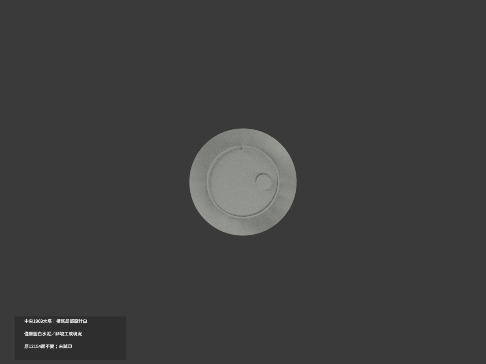
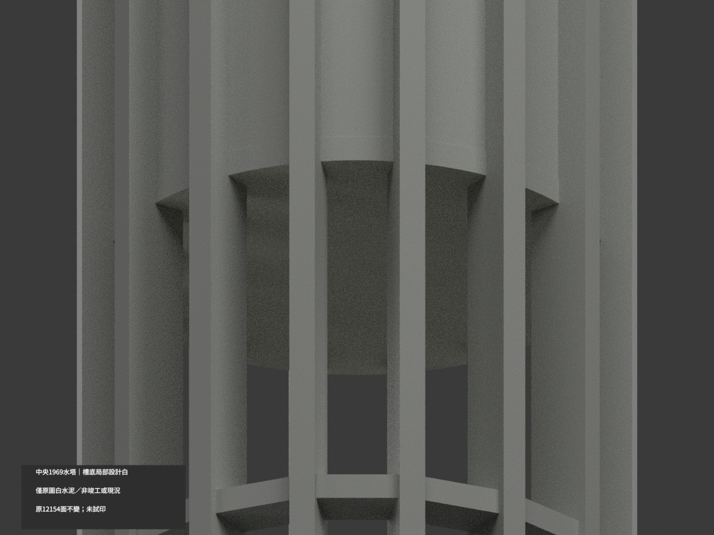
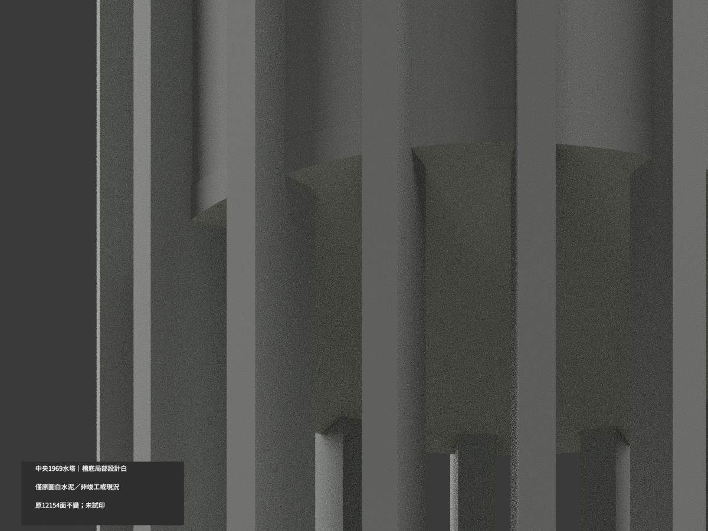
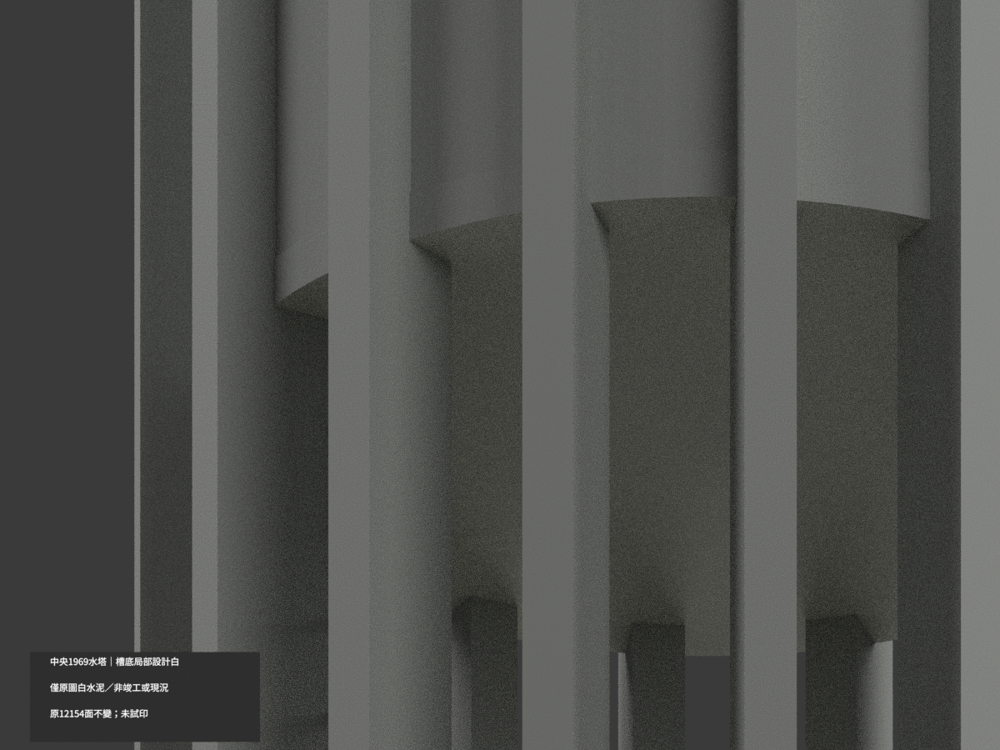

# 中央水塔1969設計｜槽底板局部白水泥設計色

**局部補色未完成：只1969原設計標註「刷白水泥三道」的槽底板外露下表面142原三角呈名義白，其餘面尚未分色。不是竣工實色、現地採色或2026現況；色審不追認全幾何/列印QA。** partial_color_incomplete=true、fully_colored_exterior=false。同項 ncu-water-tower-1969-design/count_delta=0。身份 NCU Water Tower 1969 Design partial color。

| 前斜視 | 後斜視 | 正面 |
|---|---|---|
|  |  |  |
|  |  |  |
|  |  |  |
|  | | |

## 材色範圍

T1槽底板引線明示水泥粉刷／刷白水泥三道；本件只採其歷史設計色族，不以照片猜現況。先取原z112.5無限plane全部142面、exact共享邊一完整component，再按原128gon半空間r19.4、normals(k+.5)×2π/128核全部三頂點。原面等於有限域；C1/C2柱腳交疊已由原Boolean扣除，不補圓盤。142名義設計白#DFE0D4，12012未知中性#B8BAB5，3224共面域uniform。

112.5mm=(11m+.25m展示平移)×10，原transform已含在STL，不重施。只外露槽底板+同高B2環底融合表面；立槽皮、肋柱、B4弦梁、屋蓋、上緣、封閉人孔、爬梯、回彎管、底座與實心列印核不染白。名義色不是精確RGB/漆樣，資料範圍邊界不是實材接縫；中性不當已證灰。

## 原件作用域與歷史限制

完整36原檔含原3MF、3材palette、scene、mesh、8張圖及全部QA，逐byte保於original-version/；另私存original-remote。原QA只驗原子包內檔案，不誤綁新10圖/scene/palette。本根目錄為新色版，原model.stl/build_model.py字節保留，原inventory無OBJ，不捏造。舊中性混凝土/底座/蓋3展示分類不是已測實色；PREVIEW-TRANSITION.md記source-gap同項更新。

來源校核58.6.20=1969-06-20設計圖日期，非建成/拍攝/今日狀態。精確現址與保存未核。T1槽淨內徑3.66m優先、T2同基準3.60m差保留，不平均。原16徑向肋22.5°及全標高環幾何不變。槽內填實為不可見列印代理，封人孔蓋25mm設計厚度、爬梯矩形簡化、回彎管列印直徑0.8mm增粗均保。展示底座不代表地形/地下基礎，未知管線不造。

新QA僅原bytes/12154全triangle identity、精確隔離原build+color重建、2材3MF/reopen/身份/十圖；不改寫或另認證原geometryQA。未切片/實體試印，不稱免支撐或強度保證。來源設計者陳其寛、劉應昌，T2另黃寶瑜；典藏臺博館。原圖CC BY-NC版本未核，不擴稱整包無限制商用。原圖與crop私存不公開。

NCU Water Tower 1969 Design partial color. Only the complete exposed tank-bottom underside142originaltriangles receive nominal whitecement from the1969design instruction,not measured/asbuilt/currentcolor. Wholez112.5plane equals one connected142triangle domain within original128gon radius19.4mm; support footprints stay Boolean-cut.12012neutral,3224coplanar domains uniform,12154triangles unchanged,count0.

All36originalfiles including originalmodel.3mf,three-materialscene/palette,originaleightviews andQA remain byte-identical under original-version/. Those oldQA records apply only to that self-contained originalpackage,not newimages. OriginalSTL/build unchanged,no originalOBJ. Exactrebuild/identity does not independently reapprove originalprintability.

T1clear3.66m versus T2 3.60m discrepancy retained.1969design date not construction/capture,current site unverified. Solidinteriorproxy,25mmcover,rectangularladder,.8mmprintpipe and authored base remain disclosed. No actual print,globalstrength/currentclaim. Private sourceimages excluded. Verticalskin/supports/rings/roof/pipe/core remain neutral. Closeups deliberately low-angle to show underside; preview neednot make hiddenfaces appear colored.
