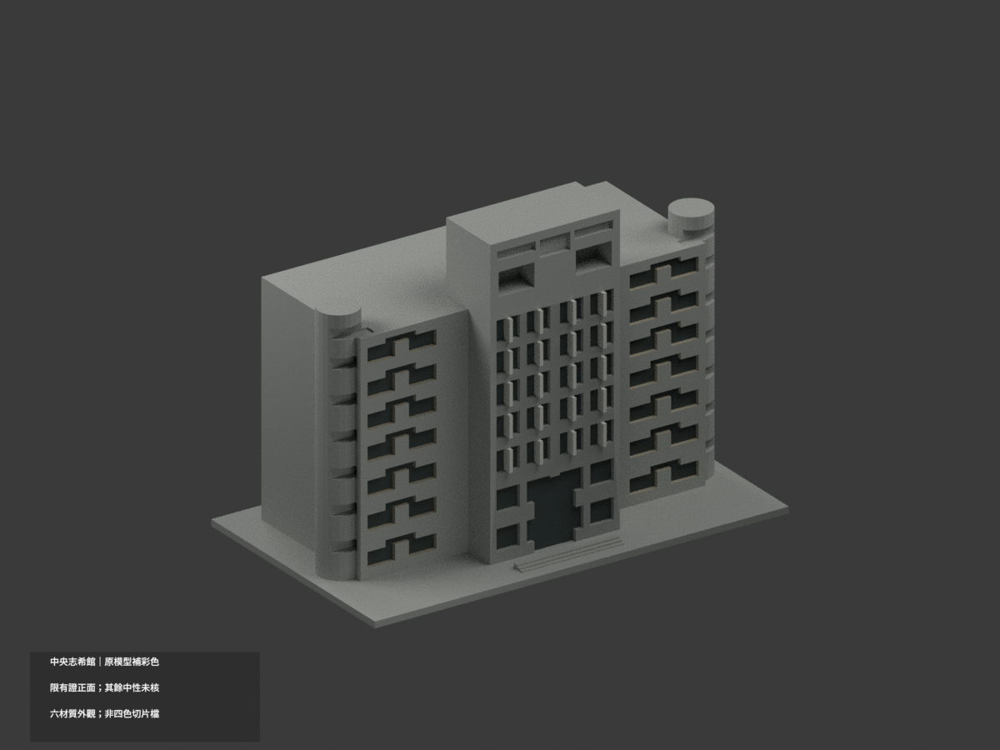
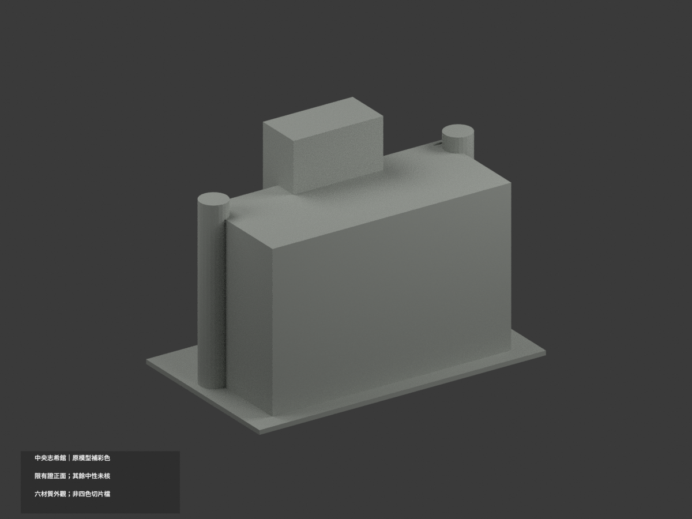
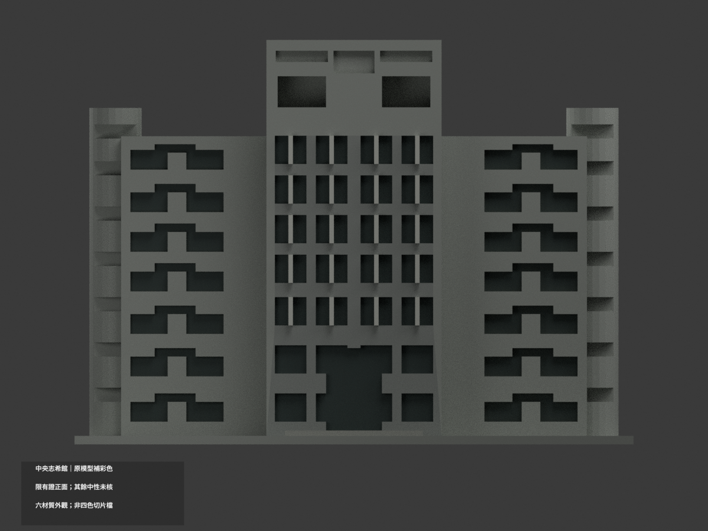
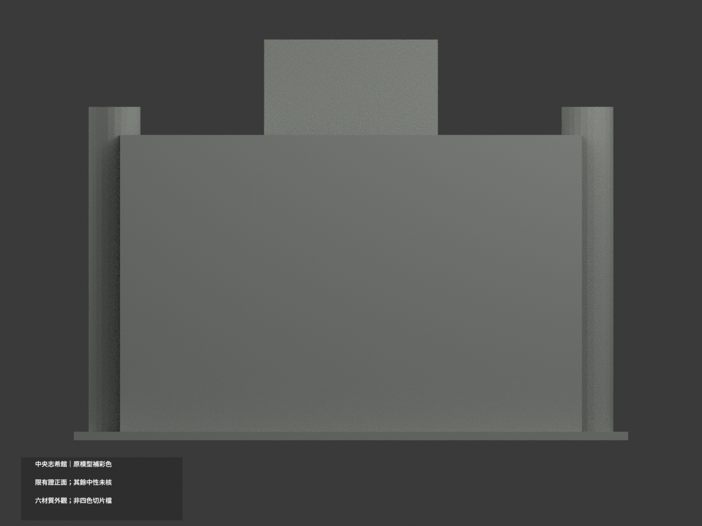
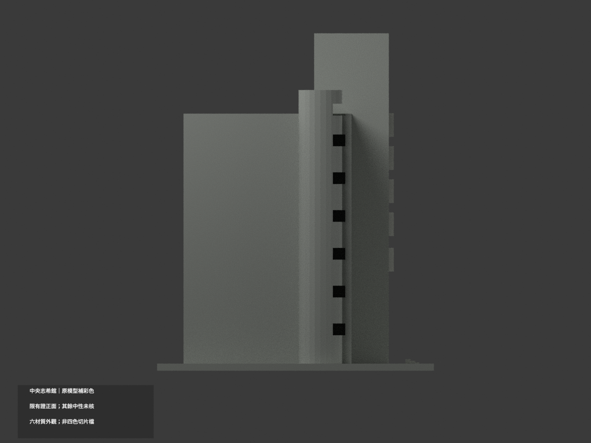
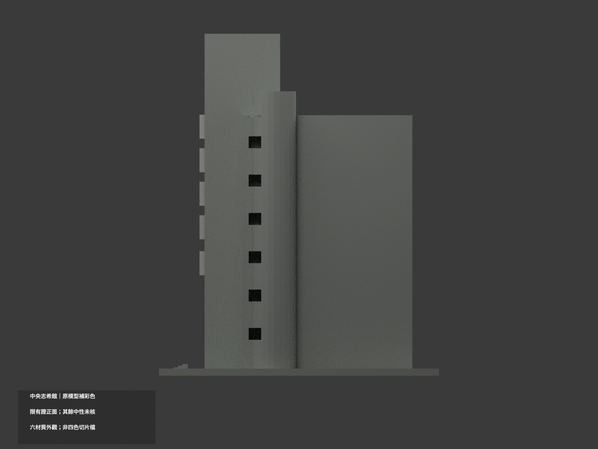
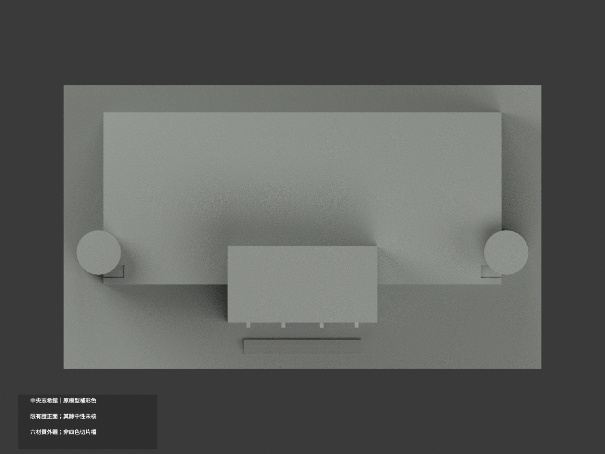
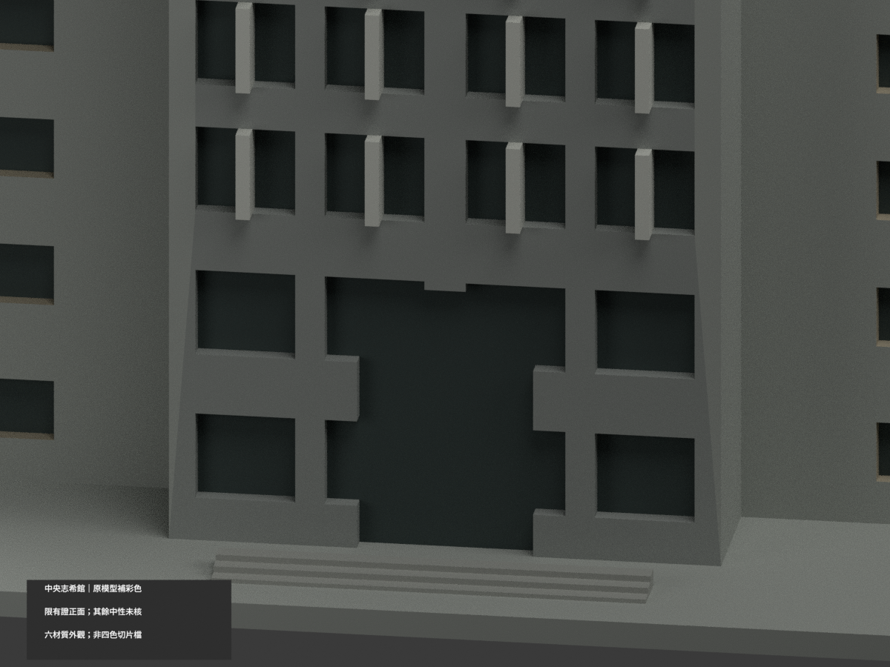
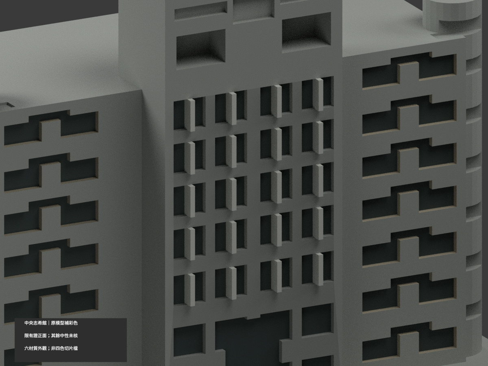
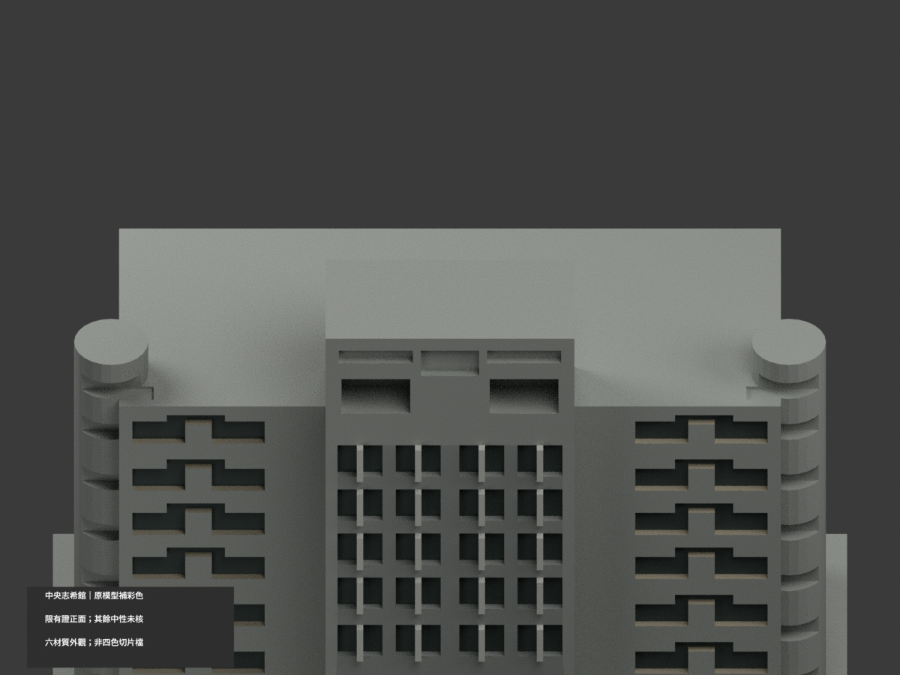

# 國立中央大學志希館｜有證正面限定材色更新

## 彩色模型預覽

**原 2524 三角面、STL／OBJ 與原建模程式均不變，同項目更新、不增加套數。** 本次採「原 2013 入口近似幾何＋後取得、拍攝日期未載之官方照片色族」；不是某一年精確全館復原。只有照片可對應的正面框架／翼牆／窗底分材，最高塔段、圓核心、側後與屋面保持中性未核。

| 整體 | 反向 | 正面 |
|---|---|---|
|  |  |  |
|  |  |  |
|  |  |  |
|  | | |

## 材色範圍與重要不確定性

- 官方照片中央為灰框、淡灰梃與深灰窗，側翼前面偏低飽和暖灰米色。官方校史文字另稱「磚紅色」；照片曝光／色偏／拍攝時期和文字泛稱的差異尚未釐清，**此處是有界照片色族展示，不能宣稱已證真實歷年塗色**，也沒有任意改鮮紅。
- 原碼中央五排細梃窗至原 z=109（輸出 z=82.84 mm），翼面保守至原 z=106（輸出 80.56 mm）；這只是照片與原簡化樓帶對位的分色界線，不是實測建築標高。全模型原碼 z×0.76 的形狀比例原樣保留。
- 只有**完整既有三角面**位於有證區才分色，跨越有證／未知範圍的整片三角面保持中性，不新增切面或移動頂點。因而某些連續框面仍中性，不能把此留白誤認實景塗裝界線。
- 兩翼主前牆平面存在跨越照片上界的長三角面，若只把跨界面留灰會出現假的斜分色。故整個翼部主前牆平面一致保中性；暖灰米色僅保留在有證範圍內且可獨立對應的既有小窗洞側面。**不是宣稱實景翼牆為整面灰色，也沒有精確復原翼部塗色。**
- 最高雙凹口／頂層窗、兩側圓核心、塔側／後面與水平屋面均未證，維持中性；不補設備、文字、窗格或來源照片貼圖。

## 檔案與列印差別

`appearance.3mf` 為毫米單位六種基本材質逐面配置；`scene.blend` 為彩色場景。`model.stl`、`model.obj`、`build_model.py` 保持原檔字節。**STL 本身沒有顏色。** HEX 是人工展示近似，非實地校色。

六材質外觀不是已驗證四色切片檔；尚未驗證切片器材質匯入、耗材映射、支撐、換色或實際列印。既有粗化窗洞／比例／後部限制不因補彩而改善。

## 重現與查核

`python build_model.py` 重建原幾何，`python colorize_model.py` 分材，`python export_appearance.py` 輸出彩色 3MF；`blender -b -P render_color.py` 產生十視圖。`python validate_color.py` 驗原 STL、三角座標、3MF 材質與保留式隔離重建；`blender -b -P verify_color_scene.py` 重開核場景。

原 `previews/` 單色圖及舊檢查檔保留歷程，不是本次材色 QA；舊 `render_preview.py` 會重建單色場景，請勿誤覆新彩色場景。不自動刪檔。

## 來源與權利

採[中央大學官方 114 年公開文件](https://military.ncu.edu.tw/download/114.07.21防災計畫-公告用.pdf) PDF 第 27 頁上半「志希館」外觀照片，僅作公開外觀色族參考，不使用內部或安全配置。文件 2025-07-21／調查欄 2025-02 **不是照片拍攝日**；同頁下半另一棟不混用。[校友通訊第 78 期](https://in.ncu.edu.tw/alumni/enews/no78/page2.pdf) 的磚紅文字僅作未解差異記錄，不代替色票。

新照片／PDF 未確認 CC 授權，全部私人保留、不隨模型公開，也不用作貼圖。原包所列舊照片的授權不自動涵蓋本次官照；不保證商用或重新授權第三方建築／影像。

## 原幾何範圍與限制（繼續有效）

# 國立中央大學志希館｜150 mm 外觀模型

## 模型預覽

| 正向 | 背向 | 立面視角 |
|---|---|---|
|  |  |  |

此為公開外觀資料研究模型，非測繪、施工或正式切片檔。每棟獨立縮尺，含底座最長150 mm，不能直接當作同一比例校園拼圖。本檔尺寸約 150 × 89 × 108.528 mm。

## 保留的識別特徵
- 中央較高前突塔身及頂部雙凹口
- 兩側較低長翼與一對圓形端部核心
- 中央細分格窗及低層入口

## 證據與簡化
- 兩張實照主要都是正面，無可靠後側照片；全深、圓形核心後側及低翼後部均目測简化，不是全外觀復原。
- 入口採2013可見配置；未以入口改善採購或效果圖推定後續完工現況。
- 格窗、圓核心水平窗帶、柱距及開孔數量已加厚粗化；未複製空調、細柵與文字。
- 樓層表載11樓作身份核對，模型垂直比例從照片近似，不作實際樓高或2026測繪。

全部來源及照片/設計圖區分見 sources.json。來源原照片、PDF、內部對照圖不隨模型發布。照片年代不同，不聲稱完整2026現況。

## 檔案與重建
- model.stl：單一連通列印實體，單位毫米
- scene.blend：由交付STL匯入的可編輯網格（不是參數化BIM）；預覽材質只供展示
- build_model.py：可攜參數化量體來源，無需來源照片即可重建
- previews/front.png、rear.png、elevation.png：從實際STL渲染，不是設計效果圖；名稱為相機視角，非精確方位

使用 Python 3.12，依 requirements.txt 準備相依套件，Blender 4.3.2。

    python build_model.py
    blender -b -t 2 -P render_preview.py
    python validate_model.py
    python check_layers.py
    python check_thin_features.py

## 幾何檢查及列印限制
原始STL法線與繞序一致、水密、每邊兩面、頂點鏈單環、單連通表面、無分離內腔殼、正體積、乾淨重建同SHA-256、已存Blender/STL三角幾何一致，詳 validation.json（passed=True）。

0.2 mm幾何截面共 543 層，全部閉合=True。另以1 mm間距檢查0.8 mm XY形態開運算薄特徵，0 層損失面積超過1%；尖角也會被計入，見 thin-feature-check.json。這不是全域壁厚保證，也不是正式切片或試印。

底座平放。頂層雙凹口、窗框及圓柱狹窗上緣需局部支撐/橋接評估。建議先以0.4 mm噴嘴、0.2 mm層高在實際切片軟體檢查外壁、橋接、支撐可移除性與底板附著，再決定列印設定。小窗框、曲面尖端與薄簷口可能不完整重現；不得將幾何通過寫成「免支撐、保證可印」。

SHA256SUMS含可發布檔案雜湊。尚未實體試印。此為全校持續研究中的一件，不代表全校完成。

## 檔案下載與實際模型預覽

[STL](model.stl) · [可編輯 Blender](scene.blend) · [Python 來源](build_model.py) · [完整驗證](validation.json) · [來源](sources.json)

以上皆由交付STL渲染；rear所示未知背側簡化，不代表有同視角實景佐證。相機視角不是精確地理方位。

## 截面數值方法修訂與補查

本發布包已直接採用canonical-edge-v2薄篩工具與結果，固定共邊插值方向，要求節點度數2、閉環及各Polygon有效，再做1 mm間距的0.8 mm XY開運算。舊版可能因共邊端點分開計算後取整而漏環，不能沿用舊面積值。這項修正不改STL、Blender或重建來源；真實薄特徵警示照常保留。

另以0.2 mm間距逐層補查閉環及Polygon有效性，共 543 層通過，見[有效性報告](contour-validity-check.json)與[可攜檢查程式](check_contour_validity.py)。這項較密補查沒有做薄篩開運算；薄篩採樣間距仍是1 mm。兩者都不是正式切片、試印或全域壁厚保證。
